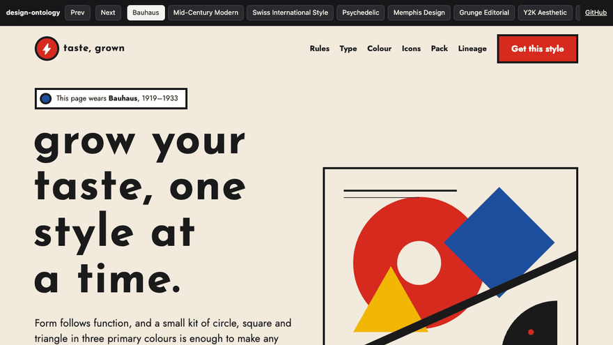

<div align="center">

# design-ontology

### Your agent has no taste. Give it a style it can execute.

**138 styles in six domains, as data. Each one compiles into a skill that any coding agent can load.**<br>
Bauhaus to visionOS. JSON in, `SKILL.md` + `tokens.css` out. No runtime, no API key, no lock-in.

[](https://github.com/musicalbee/design-ontology/actions/workflows/validate.yml)


<a href="https://musicalbee.github.io/design-ontology/demo/"></a>

[**Live demo**](https://musicalbee.github.io/design-ontology/demo/) · [Skill index](skills/SKILL_INDEX.md) · [Add a style](#add-a-style) · [The schema](schema/domains/design.schema.json)

</div>

---

Ask an agent for "a neo-brutalist landing page" and you get rounded cards, a soft grey shadow and a purple gradient. The model knows the word. It does not know the rules.

This repository holds the rules. A style here is not a mood board and not a paragraph of adjectives. It is a record with a thesis, numbered directives, a list of things that break it, five scores, a palette, a type system and a set of CSS tokens. A compiler turns each record into a file your agent reads before it writes a line of code.

```text
- **NEVER:** Blurred drop shadows with a blur radius above 0px.
- **NEVER:** Subtle grey gradients or glossy highlights on surfaces.
- **NEVER:** Pastel, low-saturation fills with grey text.
```

That is three lines of [`skills/neo-brutalism-ui/SKILL.md`](skills/neo-brutalism-ui/SKILL.md). The agent gets them, plus `--shadow-elevation: 4px 4px 0 0 #000000`, plus the Tailwind classes for a button that presses into the page.

## Try it in 30 seconds

No install. Take one file.

**Claude Code**

```bash
mkdir -p .claude/skills/neo-brutalism-ui && curl -fsSL https://raw.githubusercontent.com/musicalbee/design-ontology/main/skills/neo-brutalism-ui/SKILL.md -o .claude/skills/neo-brutalism-ui/SKILL.md
```

**Cursor**

```bash
mkdir -p .cursor/rules && curl -fsSL https://raw.githubusercontent.com/musicalbee/design-ontology/main/skills/neo-brutalism-ui/SKILL.md -o .cursor/rules/neo-brutalism-ui.mdc
```

**Any other agent** (Windsurf, Cline, Codex, a LangGraph node, a system prompt): paste the contents of a `SKILL.md` into the context. Each file stands alone and needs no other file.

Then say: *"Build a pricing page in neo-brutalism."*

**Let the agent choose.** Give it [`skills/SKILL_INDEX.md`](skills/SKILL_INDEX.md). That one small table routes a request to a style by trigger words, use case, mood and vector score. The agent loads the full skill only after it has picked.

## What is in a style

| Section | What the agent gets |
|---|---|
| **Philosophy** | One thesis, 4 to 10 directives it can execute, 4 to 10 anti-patterns it must not ship |
| **Vectors** | Five integer scores, 1 to 5: ornamentation, dimensionality, grid rigidity, skeuomorphic realism, typographic expressiveness |
| **Layout** | Grid mechanics, whitespace ratio, alignment, container geometry, with numbers |
| **Typography** | Type classes, open-source font pairings, tracking, leading, hierarchy rules |
| **Colour** | Palette with hex and role, contrast rules, surface treatment, light and shadow |
| **Materiality** | What the surface imitates, border rules, blur and elevation in px |
| **Ornament** | Icon stroke, illustration rules, decorative elements |
| **Motion** | Physics, a CSS easing function, a duration, hover and active states |
| **Lineage** | Where it came from, what it rejects, what it mixes with |
| **Emotion** | Target response, keywords, brand archetypes |
| **Agent routing** | Trigger words, use cases, when not to use it, and where to go for "softer" or "bolder" |
| **Visual** | Type treatment, icon treatment, a hero picture recipe, a pattern and a page layout |
| **Tokens** | 16 required CSS custom properties and Tailwind patterns for common elements |

Every style fills the same 16 tokens. So a style is a drop-in replacement for another style: change `data-style="flat-design"` to `data-style="glassmorphism"` and the page changes its skin. The [live demo](https://musicalbee.github.io/design-ontology/demo/) is that one trick, 17 times: one landing page, "Grow your taste", that wears each style in turn.

The compiler adds two things to each style:

- **A text colour for each field.** An author writes `--color-text` for the main field only. The compiler derives `--color-on-bg`, `--color-on-surface`, `--color-on-primary`, `--color-on-accent`, two muted colours and two link colours. Each one reaches 4.5 to 1 on its field, or the compiler replaces it.
- **A visual pack.** `skills/<id>/pack/hero.svg` is a hero picture in the style. `pattern.svg` is a tile that repeats. `icons.svg` is a sprite of 14 icons, cut from an open-source icon family that fits the style.

## Weights: each style has a budget

Weight is an accent, and a style decides how much of it to spend. `visual.type` gives a weight to five roles: display, subhead, body, bold in text, and labels. It also names where the accent lives: in weight, size, case or colour.

- **Few weights, far apart.** Bauhaus and Swiss use 400 and 700 and no other. The hierarchy comes from size.
- **A light display.** Flat design and Frutiger Aero set the headline at 300, lighter than the body. Size and colour carry it, and bold goes to the buttons.
- **A heavy floor.** Text on glass starts at 500, because a thin stem breaks up on a blurred field.
- **One weight in the display face.** A poster face such as Shrikhand has one weight. The contrast comes from the face and the size, and the bold lives in the text face.

The compiler writes the roles as tokens: `--display-weight`, `--subhead-weight`, `--body-weight`, `--strong-weight`, `--label-weight`. A weight must exist in its face: the display face for display and subhead, the text face for the other three.

## Icons: a rule, and a stand-in

A style does not own an icon set. It owns a rule for the choice of one. `icons/principles.json` holds the eight rules, and each `SKILL.md` carries them: the stroke matches the stem of the text face, the terminals follow the radius token, the fill mode follows the technology of the era, one family on one grid, and the licence permits the use.

Each style names the open-source family that the rules select for it, in `visual.icon.pack`, with the reason. Bauhaus takes Material Symbols Sharp. Neo-brutalism takes Phosphor Bold. Y2K takes Pixelarticons. `npm run icons` vendors 14 icons of each family into `icons/packs/`, with the licence, and the build cuts the sprite from that file. [icons/README.md](icons/README.md) lists each family, its author and its licence.

The open-source families are a stand-in for the demo. A product with a brand uses its licensed icon library and applies the same rules to choose the family and the weight.

## The lineage graph

Styles do not appear from nowhere. Flat design rejects skeuomorphism. Neumorphism rejects flat design. Neo-brutalism rejects the friendly corporate look that flat design became. The graph records these edges, so that an agent asked for "the same, but softer" moves to a named neighbour and does not improvise.

**[Open the interactive lineage graph](https://musicalbee.github.io/design-ontology/demo/graph.html)**: all styles on one time line, a lane for each domain. Select a style to see its edges and open it in its domain demo.

<details>
<summary>The same graph as Mermaid (wide)</summary>

Solid arrows show descent. Red dotted arrows show rejection. Grey dotted arrows show kinship across domains.

<!-- lineage:start -->
```mermaid
flowchart LR
  subgraph design_fin_de_siecle["Fin de Siècle · 1880–1918"]
    victorian_web["Victorian Web"]
    art_nouveau_web["Art Nouveau (web)"]
  end
  subgraph design_modernist["Modernist · 1919–1975"]
    de_stijl_web["De Stijl (web)"]
    bauhaus["Bauhaus"]
    constructivism_web["Constructivism (web)"]
    art_deco_web["Art Deco (web)"]
    mid_century_modern["Mid-Century Modern"]
    swiss_international["Swiss International Style"]
    japanese_graphic_modernism["Japanese Graphic Modernism"]
    rams_functionalism_ui["Rams Functionalism (UI)"]
    pop_art_web["Pop Art (web)"]
    space_age["Space Age Design"]
    psychedelic["Psychedelic"]
  end
  subgraph design_postmodern_early_digital["Postmodern & Early Digital · 1976–2006"]
    cassette_futurism["Cassette Futurism"]
    punk_zine["Punk Zine"]
    memphis_design["Memphis Design"]
    cyberdelia["Cyberdelia"]
    grunge_editorial["Grunge Editorial"]
    y2k_aesthetic["Y2K Aesthetic"]
    japanese_dense_web["Japanese Dense Web"]
    apple_aqua["Apple Aqua"]
    frutiger_aero["Frutiger Aero"]
  end
  subgraph design_touchscreen["Touchscreen · 2007–2018"]
    skeuomorphism["Skeuomorphism"]
    metro_ui["Metro UI"]
    pixel_art_web["Pixel Art Web"]
    bohemian_web["Bohemian Web"]
    flat_design["Flat Design"]
    minimalism_web["Minimalism Web"]
    vaporwave["Vaporwave"]
    cyberpunk_web["Cyberpunk Web"]
    synthwave_web["Synthwave Web"]
    brutalist_web["Brutalist Web (2014)"]
    luxury_typography_web["Luxury Typography Web"]
    material_design["Material Design"]
    blob_world["Blob World"]
    conceptual_sketch_ui["Conceptual Sketch UI"]
    wabi_sabi_web["Wabi-Sabi Web"]
    anti_design["Anti-Design"]
    dark_devtool_ui["Dark-Mode Developer Tool"]
    surrealism_web["Surrealism Web"]
    corporate_memphis["Corporate Memphis"]
    terminal_tui_web["Terminal / TUI Web"]
    aurora_gradient_ui["Aurora Gradient UI"]
    scrapbook_ui["Scrapbook UI"]
  end
  subgraph design_contemporary_spatial["Contemporary & Spatial · 2019–now"]
    neumorphism["Neumorphism"]
    cybercore_web["Cybercore Web"]
    glassmorphism["Glassmorphism"]
    neo_brutalism_ui["Neo-Brutalism UI"]
    claymorphism["Claymorphism"]
    editorial_serif_revival["Editorial Serif Revival"]
    ethereal_web["Ethereal Web"]
    ai_chat_ui["AI Chat Interface"]
    bento_grid_ui["Bento Grid UI"]
    spatial_visionos["Spatial UI (visionOS)"]
    liquid_glass_ui["Liquid Glass"]
  end
  subgraph architecture_medieval["Architecture · Medieval · 1200–1520"]
    gothic_architecture["Gothic"]
  end
  subgraph architecture_early_modern["Architecture · Early Modern · 1420–1750"]
    renaissance_architecture["Renaissance"]
    baroque_architecture["Baroque"]
  end
  subgraph architecture_revival_and_academy["Architecture · Revival and Academy · 1750–1914"]
    neoclassical_architecture["Neoclassicism"]
    arts_and_crafts_architecture["Arts and Crafts"]
    beaux_arts_architecture["Beaux-Arts"]
  end
  subgraph architecture_fin_de_siecle["Architecture · Fin de Siècle · 1885–1914"]
    art_nouveau_architecture["Art Nouveau"]
    prairie_school_architecture["Prairie School"]
    organic_architecture["Organic Architecture"]
    expressionist_architecture["Expressionist Architecture"]
  end
  subgraph architecture_modern_movement["Architecture · Modern Movement · 1919–1975"]
    bauhaus_architecture["Bauhaus Architecture"]
    art_deco_architecture["Art Deco"]
    international_style_architecture["International Style"]
    nordic_modernism_architecture["Nordic Modernism"]
    mid_century_modern_architecture["Mid-century Modern"]
    brutalist_architecture["Brutalism"]
    adaptive_reuse_architecture["Adaptive Reuse"]
  end
  subgraph architecture_postmodern_and_after["Architecture · Postmodern and After · 1966–present"]
    postmodern_architecture["Postmodernism"]
    high_tech_architecture["High-tech"]
    critical_regionalism_architecture["Critical Regionalism"]
    deconstructivist_architecture["Deconstructivism"]
    mass_timber_architecture["Mass Timber"]
    parametricism_architecture["Parametricism"]
  end
  subgraph interior_classical_house["Interior · Classical house · 1700–1830"]
    georgian_interior["Georgian"]
  end
  subgraph interior_industrial_century["Interior · Industrial century · 1800–1890"]
    shaker_interior["Shaker"]
    victorian_interior["Victorian"]
    arts_and_crafts_interior["Arts and Crafts"]
  end
  subgraph interior_modern_reform["Interior · Modern reform · 1890–1940"]
    art_nouveau_interior["Art Nouveau"]
    bauhaus_interior["Bauhaus interior"]
    art_deco_interior["Art Deco"]
  end
  subgraph interior_post_war_modern["Interior · Post-war modern · 1940–1990"]
    hollywood_regency_interior["Hollywood Regency"]
    mid_century_modern_interior["Mid-century modern interior"]
    scandinavian_interior["Scandinavian interior"]
    industrial_loft_interior["Industrial loft"]
    memphis_interior["Memphis interior"]
  end
  subgraph interior_global_minimal["Interior · Global minimal · 1990–2010"]
    coastal_interior["Coastal interior"]
    minimalist_interior["Minimalist"]
  end
  subgraph interior_networked_home["Interior · Networked home · 2010–present"]
    japandi_interior["Japandi"]
    grandmillennial_interior["Grandmillennial"]
    neo_deco_interior["Neo-deco"]
    dopamine_decor["Dopamine decor"]
    quiet_luxury_interior["Quiet luxury"]
  end
  subgraph photography_art_photography["Photography · Photography as art · 1885–1950"]
    pictorialism["Pictorialism"]
    straight_photography["Straight photography"]
    group_f64["Group f/64"]
  end
  subgraph photography_documentary_century["Photography · The small camera · 1930–today"]
    new_objectivity["New Objectivity photography"]
    street_photography["Street photography"]
    documentary_photography["Documentary photography"]
  end
  subgraph photography_colour_and_topography["Photography · Colour and the topographic turn · 1970–1990"]
    new_colour["New Colour"]
    new_topographics["New Topographics"]
    duesseldorf_school["Düsseldorf School"]
  end
  subgraph photography_digital_and_grade["Photography · Digital and the grade · 1999–today"]
    y2k_digicam["Y2K digicam"]
    cinematic_teal_orange["Cinematic teal and orange"]
    party_flash["Party flash"]
    film_grain_revival["Film grain revival"]
    ai_hyperreal["AI hyperreal image"]
  end
  subgraph photography_commercial_and_staged["Photography · Constructed images · 1930–today"]
    architectural_photography["Architectural photography"]
    fashion_editorial["Fashion editorial photography"]
    film_noir_still["Film noir still photography"]
    food_photography["Food photography"]
    scandinavian_interior_photography["Scandinavian interior photography"]
  end
  subgraph film_silent_era["Film & Video · The silent era · 1895–1929"]
    german_expressionist_cinema["German Expressionist cinema"]
    soviet_montage["Soviet montage"]
  end
  subgraph film_studio_system["Film & Video · The sound studio system · 1930–1957"]
    classical_hollywood["Classical Hollywood"]
    film_noir["Film noir"]
    italian_neorealism["Italian Neorealism"]
    one_take_oner["The oner"]
  end
  subgraph film_new_waves["Film & Video · Portable cameras and the new waves · 1958–1975"]
    french_new_wave["French New Wave"]
    documentary_verite["Direct cinema and vérité"]
    giallo["Giallo"]
    spaghetti_western["Spaghetti western"]
    new_hollywood["New Hollywood"]
  end
  subgraph film_tape_and_cable["Film & Video · Tape, cable and the blockbuster · 1976–1994"]
    music_video["Music video"]
    neon_noir["Neon noir"]
    hong_kong_action["Hong Kong action"]
  end
  subgraph film_digital_cinema["Film & Video · Lightweight digital and the manifesto · 1995–2009"]
    slow_cinema["Slow cinema"]
    dogme_95["Dogme 95"]
    planimetric_symmetry["Planimetric symmetry"]
    found_footage["Found footage"]
    mumblecore["Mumblecore"]
  end
  subgraph film_platform_video["Film & Video · Platform and creator video · 2005–today"]
    creator_vlog["Creator vlog"]
    phone_cinema["Phone cinema"]
    vertical_short_form["Vertical short-form"]
    cinematic_fpv["Cinematic FPV"]
    camcorder_revival["Camcorder revival"]
  end
  subgraph painting_early_modern["Painting · Early modern · 1400–1860"]
    renaissance_painting["Renaissance painting"]
    mannerism_painting["Mannerism"]
    baroque_painting["Baroque painting"]
    ukiyo_e["Ukiyo-e"]
    rococo_painting["Rococo"]
  end
  subgraph painting_nineteenth_century["Painting · Nineteenth century · 1840–1910"]
    romanticism_painting["Romanticism"]
    realism_painting["Realism"]
    impressionism["Impressionism"]
    nordic_national_romanticism_painting["Nordic national romanticism"]
    pointillism["Pointillism"]
    post_impressionism["Post-Impressionism"]
    symbolism_painting["Symbolism"]
  end
  subgraph painting_avant_garde["Painting · Avant-garde · 1905–1970"]
    expressionism_painting["Expressionism"]
    fauvism["Fauvism"]
    cubism_painting["Cubism"]
    futurism_painting["Futurism"]
    suprematism["Suprematism"]
    de_stijl_painting["De Stijl painting"]
    surrealism_painting["Surrealism"]
    abstract_expressionism["Abstract Expressionism"]
    colour_field_painting["Colour Field Painting"]
    pop_art_painting["Pop Art"]
    minimalism_painting["Minimalism"]
    photorealism["Photorealism"]
    airbrush_surrealism["Airbrush Surrealism"]
  end
  subgraph logo_trademark_age["Logo · Trademark age · 1860–1918"]
    victorian_trademark["Victorian trademark"]
    art_nouveau_monogram["Art Nouveau monogram"]
    emblem_badge["Emblem and badge"]
  end
  subgraph logo_modernist_identity["Logo · Modernist identity · 1919–1995"]
    swiss_modernist_mark["Swiss modernist corporate mark"]
    geometric_symbol["Geometric abstract symbol"]
    minimal_wordmark["Wordmark-led minimal"]
  end
  subgraph logo_screen_identity["Logo · Screen identity · 1995–now"]
    glossy_3d_logo["Gradient 3D and glass"]
    flat_logo["Flat 2010s mark"]
  end
  subgraph icon_bitmap["Icons · Bitmap · 1981–1995"]
    pixel_icon["Pixel icon"]
  end
  subgraph icon_rendered["Icons · Rendered · 1995–2013"]
    isometric_icon["Isometric icon"]
    skeuomorphic_icon["Skeuomorphic icon"]
  end
  subgraph icon_vector_system["Icons · Vector system · 2010–present"]
    flat_icon["Flat icon"]
    solid_glyph_icon["Solid glyph icon"]
    outline_icon["Outline icon"]
    material_symbols_icon["Material Symbols"]
    duotone_icon["Duotone icon"]
  end
  subgraph icon_post_flat["Icons · Post-flat · 2019–present"]
    clay_3d_icon["3D clay icon"]
  end
  subgraph typeface_hand_press["Typeface · Hand press · 1450–1820"]
    blackletter["Blackletter"]
    garalde_old_style["Garalde old-style serif"]
    formal_script["Formal script"]
    transitional_serif["Transitional serif"]
    didone_serif["Didone"]
  end
  subgraph typeface_industrial["Typeface · Industrial · 1810–1914"]
    fat_face_display["Fat face display"]
    slab_serif["Slab serif"]
    grotesque_sans["Grotesque sans"]
    monospace["Monospace"]
  end
  subgraph typeface_modernist["Typeface · Modernist · 1914–1975"]
    humanist_sans["Humanist sans"]
    geometric_sans["Geometric sans"]
    neo_grotesque_sans["Neo-grotesque sans"]
  end
  subgraph game_arcade_age["Video game · Arcade age · 1971–1983"]
    vector_display_arcade["Vector display arcade"]
  end
  subgraph game_tile_and_sprite["Video game · Tile and sprite · 1983–1996"]
    eight_bit_tile["8-bit tile graphics"]
    isometric_pixel_world["Isometric pixel world"]
    sixteen_bit_sprite["16-bit sprite and parallax"]
    four_shade_handheld["Four-shade handheld"]
  end
  subgraph game_early_polygon["Video game · Early polygon · 1993–2001"]
    pre_rendered_backgrounds["Pre-rendered backgrounds"]
    fifth_gen_low_poly["Fifth-generation low poly"]
  end
  subgraph game_programmable_shader["Video game · Programmable shader · 2000–2013"]
    cel_shaded_3d["Cel-shaded 3D"]
    hand_painted_texture["Hand-painted texture"]
    seventh_gen_desaturated["Seventh-generation desaturated bloom"]
    voxel_block_world["Voxel block world"]
  end
  subgraph game_physically_based_and_indie["Video game · Physically based and indie · 2013–now"]
    pbr_photoreal["PBR photoreal"]
    impossible_isometric_mobile["Flat geometric isometric"]
    hd_2d_diorama["HD-2D diorama"]
    low_poly_ps1_revival["Low-poly PS1 revival"]
  end
  subgraph print_hand_press["Print · Hand press · 1400–1800"]
    woodcut_relief_print["Woodcut relief print"]
    engraving_print["Copper engraving"]
    etching_print["Etching"]
    mezzotint_print["Mezzotint"]
  end
  subgraph print_industrial_press["Print · Industrial press · 1800–1945"]
    wood_type_poster["Wood-type poster"]
    chromolithograph_poster["Chromolithograph poster"]
    private_press_book["Private-press book"]
    ben_day_comic_print["Ben-Day comic print"]
    pochoir_plate["Pochoir plate"]
  end
  subgraph print_studio_press["Print · Studio press · 1945–1995"]
    pop_screen_print["Pop screen print"]
    psychedelic_concert_poster["Psychedelic concert poster"]
    xerox_zine["Xerox zine"]
  end
  subgraph print_digital_press["Print · Digital press · 1995–"]
    risograph_print["Risograph print"]
  end
  subgraph industrial_proto_industrial["Industrial design · Proto-industrial · 1760–1840"]
    georgian_neoclassical_manufacture["Georgian neoclassical manufacture"]
    shaker_object["Shaker object"]
  end
  subgraph industrial_victorian_mass_production["Industrial design · Victorian mass production · 1840–1900"]
    victorian_manufacture["Victorian manufacture"]
  end
  subgraph industrial_reform_and_craft["Industrial design · Reform and craft · 1880–1918"]
    arts_and_crafts_object["Arts and Crafts object"]
    art_nouveau_object["Art Nouveau object"]
    industrial_utility_product["Industrial utility product"]
  end
  subgraph industrial_machine_modern["Industrial design · Machine modern · 1919–1945"]
    bauhaus_product["Bauhaus product"]
    art_deco_product["Art Deco product"]
    scandinavian_modern_product["Scandinavian modern product"]
    streamline_moderne_product["Streamline Moderne product"]
  end
  subgraph industrial_post_war_modern["Industrial design · Post-war modern · 1945–1975"]
    mid_century_modern_product["Mid-century modern product"]
    japanese_modern_craft_product["Japanese modern craft product"]
    ulm_braun_functionalism["Ulm and Braun functionalism"]
    space_age_pop_product["Space Age pop product"]
  end
  subgraph industrial_postmodern_plural["Industrial design · Postmodern plural · 1976–2000"]
    memphis_product["Memphis product"]
  end
  subgraph industrial_contemporary["Industrial design · Contemporary · 2000–now"]
    contemporary_craft_product["Contemporary craft product"]
    super_normal_product["Super Normal product"]
  end
  subgraph fashion_court_and_guild["Fashion · Court and guild · 1550–1788"]
    whalebone_stays["Whalebone Stays"]
    georgian_jewellery["Georgian Jewellery"]
    rococo_court_dress["Rococo court dress"]
    breguet_classical_watch["Breguet classical watch"]
  end
  subgraph fashion_revolution_and_regency["Fashion · Revolution and Regency · 1789–1836"]
    empire_line_dress["Empire line dress"]
    english_bespoke_tailoring["English bespoke tailoring"]
  end
  subgraph fashion_victorian_dress["Fashion · Victorian dress · 1837–1899"]
    victorian_sentimental_jewellery["Victorian Sentimental Jewellery"]
    victorian_corsetry["Victorian Corsetry"]
    victorian_millinery["Victorian millinery"]
    american_pocket_watch["American pocket watch"]
    victorian_boot["Victorian boot"]
    malletier_luggage["Malletier luggage"]
    crinoline_and_bustle_dress["Crinoline and bustle dress"]
    country_sporting_tweed["Country sporting tweed"]
    english_welted_dress_shoe["English welted dress shoe"]
    americana_workwear["Americana workwear"]
    brass_era_car["Brass-Era Car"]
    arts_and_crafts_jewellery["Arts and Crafts Jewellery"]
    art_nouveau_jewellery["Art Nouveau Jewellery"]
  end
  subgraph fashion_belle_epoque_and_war["Fashion · Belle Époque and the Great War · 1900–1918"]
    straight_front_corset["Straight-Front Corset"]
    garland_style_jewellery["Garland Style Jewellery"]
    early_wristwatch["Early wristwatch"]
    bandeau_brassiere["Bandeau Brassiere"]
    trench_and_field_military["Trench and field military"]
    art_deco_watch["Art Deco watch"]
    canvas_court_sneaker["Canvas court sneaker"]
  end
  subgraph fashion_interwar_modern["Fashion · Interwar modern · 1919–1938"]
    vintage_coachbuilt_car["Vintage Coachbuilt Car"]
    art_deco_dance_shoe["Art Deco dance shoe"]
    early_mountaineering["Early mountaineering"]
    garconne_flapper_dress["Garçonne and flapper dress"]
    costume_jewellery["Costume Jewellery"]
    art_deco_evening_accessory["Art Deco evening accessory"]
    art_deco_jewellery["Art Deco Jewellery"]
    bias_cut_glamour["Bias-cut glamour"]
    pilot_and_field_watch["Pilot and field watch"]
    streamline_car["Streamline Car"]
    modern_mens_briefs["Modern Men's Briefs"]
    retro_cocktail_jewellery["Retro Cocktail Jewellery"]
    quilted_down_outerwear["Quilted down outerwear"]
    mid_century_eyewear["Mid-century eyewear"]
  end
  subgraph fashion_war_and_new_look["Fashion · War and the New Look · 1939–1959"]
    modernist_studio_jewellery["Modernist Studio Jewellery"]
    italian_gran_turismo["Italian Gran Turismo"]
    new_look["New Look"]
    nylon_foundation_garments["Nylon Foundation Garments"]
    tailfin_era_car["Tailfin-Era Car"]
    ivy_style["Ivy style"]
    dive_watch["Dive watch"]
    stiletto_heel["Stiletto heel"]
    ladylike_handbag["Ladylike handbag"]
    racing_chronograph["Racing chronograph"]
  end
  subgraph fashion_youthquake["Fashion · Youthquake · 1960–1979"]
    brutalist_jewellery["Brutalist Jewellery"]
    mod_and_mini["Mod and mini"]
    nordic_functional_outdoor["Nordic functional outdoor"]
    subculture_workboot["Subculture workboot"]
    muscle_and_pony_car["Muscle and Pony Car"]
    soft_natural_lingerie["Soft Natural Lingerie"]
    space_age_couture["Space Age couture"]
    hippie_bohemian_dress["Hippie bohemian dress"]
    wedge_design_car["Wedge Design Car"]
    electronic_and_digital_watch["Electronic and digital watch"]
    glam_platform_shoe["Glam platform shoe"]
    luxury_steel_sports_watch["Luxury steel sports watch"]
    performance_running_shoe["Performance running shoe"]
    punk_fashion["Punk fashion"]
    technical_shell_alpinism["Technical shell alpinism"]
  end
  subgraph fashion_power_and_subculture["Fashion · Power and subculture · 1980–1999"]
    power_dressing["Power dressing"]
    streetwear["Streetwear"]
    japanese_avant_garde_fashion["Japanese avant-garde fashion"]
    designer_logo_underwear["Designer Logo Underwear"]
    swiss_plastic_pop_watch["Swiss plastic pop watch"]
    underwear_as_outerwear["Underwear as Outerwear"]
    logomania["Logomania"]
    sneaker_culture["Sneaker culture"]
    biodesign_car["Biodesign Car"]
    minimalist_fashion["Minimalist fashion"]
    it_bag["It bag"]
    retro_revival_car["Retro Revival Car"]
  end
  subgraph fashion_contemporary_fashion["Fashion · Contemporary · 2000–now"]
    shapewear_and_seamless["Shapewear and Seamless"]
    techwear["Techwear"]
    quiet_luxury_fashion["Quiet luxury fashion"]
    stealth_luxury_accessory["Stealth luxury accessory"]
    electric_minimal_car["Electric Minimal Car"]
    smartwatch["Smartwatch"]
    gorpcore["Gorpcore"]
  end
  subgraph ceramics_ancient_clay["Ceramics · Ancient clay · before 600"]
    jomon_pottery["Jōmon pottery"]
    greek_black_figure["Greek black-figure pottery"]
    babylonian_glazed_brick["Babylonian glazed brick"]
    greek_red_figure["Greek red-figure pottery"]
    qin_terracotta_warriors["Qin terracotta warriors"]
    roman_terra_sigillata["Roman terra sigillata"]
  end
  subgraph ceramics_medieval_glaze["Ceramics · Medieval glaze · 600–1368"]
    tang_sancai_figures["Tang sancai figures"]
    abbasid_lustreware["Abbasid lustreware"]
    ding_white_ware["Ding white ware"]
    jian_tenmoku_ware["Jian tenmoku ware"]
    goryeo_celadon["Goryeo celadon"]
    longquan_celadon["Longquan celadon"]
    islamic_tile_mosaic["Islamic tile mosaic"]
    hispano_moresque_lustreware["Hispano-Moresque lustreware"]
    zellige["Zellige"]
    yuan_ming_blue_and_white["Yuan and Ming blue-and-white porcelain"]
  end
  subgraph ceramics_blue_and_white["Ceramics · Blue and white · 1368–1600"]
    joseon_buncheong["Joseon buncheong"]
    rhenish_salt_glaze_stoneware["Rhenish salt-glaze stoneware"]
    liuli_glazed_roof["Liuli glazed roof tile"]
    della_robbia_relief["Della Robbia relief"]
    albarello_apothecary_ware["Albarello apothecary ware"]
    iznik_pottery["Iznik pottery"]
    istoriato_maiolica["Istoriato maiolica"]
    yixing_zisha_teapot["Yixing zisha teapot"]
    iznik_tiles["Iznik tiles"]
    azulejo["Azulejo"]
    kraak_porcelain["Kraak porcelain"]
    mino_tea_ceramics["Mino tea ceramics"]
    raku_tea_bowl["Raku tea bowl"]
  end
  subgraph ceramics_porcelain_race["Ceramics · The porcelain race · 1600–1750"]
    delft_tiles["Delft tiles"]
    delftware["Delftware"]
    joseon_moon_jar["Joseon moon jar"]
    kyo_yaki_overglaze["Kyo-yaki overglaze"]
    kakiemon_imari_export["Kakiemon and Imari export porcelain"]
    english_slipware["English slipware"]
    famille_rose_qing["Famille rose (Qing)"]
    meissen_baroque_porcelain["Meissen baroque porcelain"]
    rococo_porcelain_figures["Rococo porcelain figures"]
    georgian_porcelain_tea_service["Georgian porcelain tea service"]
    staffordshire_figures["Staffordshire figures"]
  end
  subgraph ceramics_industrial_pottery["Ceramics · Industrial pottery · 1750–1880"]
    scandinavian_tiled_stove["Scandinavian tiled stove"]
    biscuit_porcelain_figures["Biscuit porcelain figures"]
    sevres_rococo_porcelain["Sèvres rococo porcelain"]
    creamware_neoclassical["Creamware, neoclassical"]
    mocha_banded_ware["Mocha and banded ware"]
    jasperware_neoclassical["Jasperware (Neoclassical)"]
    blue_willow_transferware["Blue willow transferware"]
    american_stoneware_crock["American stoneware crock"]
    regency_gilded_bone_china["Regency gilded bone china"]
    spongeware["Spongeware"]
    victorian_encaustic_tiles["Victorian encaustic tiles"]
    parian_statuary["Parian statuary"]
    porcelain_insulator["Porcelain insulator"]
    victorian_architectural_terracotta["Victorian architectural terracotta"]
    victorian_sanitary_ware["Victorian sanitary ware"]
    arts_and_crafts_art_pottery["Arts and Crafts art pottery"]
  end
  subgraph ceramics_art_pottery["Ceramics · Art pottery and reform · 1880–1918"]
    american_art_pottery["American art pottery"]
    fireclay_butler_sink["Fireclay butler sink"]
    chicago_school_terracotta["Chicago School terracotta"]
    art_nouveau_ceramics["Art Nouveau ceramics"]
    hungarian_secession_ceramics["Hungarian Secession ceramics"]
    art_nouveau_tiles["Art Nouveau tiles"]
    trencadis["Trencadís"]
    subway_tile["Subway tile"]
  end
  subgraph ceramics_modern_ceramics["Ceramics · Modern ceramics · 1919–1975"]
    anglo_oriental_studio_pottery["Anglo-Oriental studio pottery"]
    suprematist_porcelain["Suprematist porcelain"]
    cornishware["Cornishware"]
    art_deco_ceramic_figures["Art Deco ceramic figures"]
    art_deco_faience_facade["Art Deco faience facade"]
    mingei_folk_craft["Mingei folk craft"]
    art_deco_tableware["Art Deco tableware"]
    coloured_bathroom_suite["Coloured bathroom suite"]
    bauhaus_modern_tableware["Bauhaus modern tableware"]
    fiesta_colourware["Fiesta colourware"]
    organic_modern_tableware["Organic modern tableware"]
    british_modernist_studio["British modernist studio ceramics"]
    artist_ceramics_vallauris["Artist ceramics of Vallauris"]
    scandinavian_modern_tableware["Scandinavian modern tableware"]
    abstract_expressionist_ceramics["Abstract Expressionist ceramics"]
    glass_ceramic_cookware["Glass-ceramic cookware"]
    west_german_fat_lava["West German fat lava"]
    funk_ceramics["Funk ceramics"]
  end
  subgraph ceramics_plural_contemporary["Ceramics · Plural and contemporary · 1976–now"]
    large_format_porcelain_tiles["Large-format porcelain tiles"]
    washlet_toilet["Washlet toilet"]
    memphis_postmodern_ceramics["Memphis postmodern ceramics"]
    terracotta_rainscreen["Terracotta rainscreen"]
    designer_wall_hung_sanitary["Designer wall-hung sanitary ware"]
    chef_studio_tableware["Chef studio tableware"]
    digital_3d_printed_ceramics["Digital 3D-printed ceramics"]
  end
  subgraph cuisine_court_and_banquet["Cuisine · Court and banquet · 1300–1650"]
    medieval_court_cuisine["Medieval court cuisine"]
    renaissance_banquet["Renaissance banquet"]
  end
  subgraph cuisine_classical_codification["Cuisine · Classical codification · 1650–1800"]
    cuisine_francoise["Cuisine françoise"]
  end
  subgraph cuisine_grande_and_classique["Cuisine · Grande and classique · 1800–1914"]
    grande_cuisine["Grande cuisine"]
    cuisine_classique["Cuisine classique"]
  end
  subgraph cuisine_regional_and_bourgeois["Cuisine · Regional and bourgeois · 1914–1965"]
    haute_regionale["Haute cuisine régionale"]
  end
  subgraph cuisine_nouvelle_and_new_world["Cuisine · Nouvelle and new world · 1965–1990"]
    nouvelle_cuisine["Nouvelle cuisine"]
    california_cuisine["California cuisine"]
    cuisine_minceur["Cuisine minceur"]
    naturalist_cuisine["Naturalist cuisine"]
    pacific_rim_fusion["Pacific Rim fusion"]
    novoandina_and_nikkei["Novoandina and Nikkei cuisine"]
  end
  subgraph cuisine_modernist_and_global["Cuisine · Modernist and global · 1988–2011"]
    molecular_gastronomy["Molecular gastronomy"]
    bistronomie["Bistronomie"]
    modernist_cuisine["Modernist cuisine"]
  end
  subgraph cuisine_terroir_and_plant["Cuisine · Terroir and plant · 2004–now"]
    new_nordic["New Nordic cuisine"]
    plant_based_fine_dining["Plant-based fine dining"]
  end
  abstract_expressionism <-. echoes .-> abstract_expressionist_ceramics
  abstract_expressionism <-. echoes .-> brutalist_architecture
  adaptive_reuse_architecture <-. echoes .-> industrial_loft_interior
  ai_hyperreal <-. echoes .-> pbr_photoreal
  airbrush_surrealism <-. echoes .-> pop_art_web
  airbrush_surrealism <-. echoes .-> psychedelic
  airbrush_surrealism <-. echoes .-> space_age
  airbrush_surrealism <-. echoes .-> surrealism_web
  american_art_pottery <-. echoes .-> arts_and_crafts_interior
  american_pocket_watch <-. echoes .-> industrial_utility_product
  american_pocket_watch <-. echoes .-> victorian_manufacture
  americana_workwear <-. echoes .-> industrial_utility_product
  americana_workwear <-. echoes .-> shaker_object
  anglo_oriental_studio_pottery <-. echoes .-> contemporary_craft_product
  anglo_oriental_studio_pottery <-. echoes .-> japanese_modern_craft_product
  anti_design <-. echoes .-> deconstructivist_architecture
  anti_design <-. echoes .-> xerox_zine
  apple_aqua <-. echoes .-> glossy_3d_logo
  apple_aqua <-. echoes .-> skeuomorphic_icon
  architectural_photography <-. echoes .-> bauhaus_architecture
  architectural_photography <-. echoes .-> brutalist_architecture
  architectural_photography <-. echoes .-> international_style_architecture
  architectural_photography <-. echoes .-> isometric_pixel_world
  architectural_photography <-. echoes .-> mid_century_modern_architecture
  architectural_photography <-. echoes .-> pbr_photoreal
  architectural_photography <-. echoes .-> pre_rendered_backgrounds
  art_deco_architecture <-. echoes .-> art_deco_ceramic_figures
  art_deco_architecture <-. echoes .-> art_deco_faience_facade
  art_deco_architecture <-. echoes .-> art_deco_interior
  art_deco_architecture <-. echoes .-> art_deco_jewellery
  art_deco_architecture <-. echoes .-> art_deco_product
  art_deco_architecture <-. echoes .-> art_deco_watch
  art_deco_architecture <-. echoes .-> art_deco_web
  art_deco_architecture <-. echoes .-> classical_hollywood
  art_deco_architecture <-. echoes .-> neo_deco_interior
  art_deco_architecture <-. echoes .-> streamline_moderne_product
  art_deco_ceramic_figures <-. echoes .-> art_deco_jewellery
  art_deco_ceramic_figures <-. echoes .-> art_deco_product
  art_deco_dance_shoe <-. echoes .-> art_deco_interior
  art_deco_dance_shoe <-. echoes .-> art_deco_product
  art_deco_evening_accessory <-. echoes .-> art_deco_interior
  art_deco_evening_accessory <-. echoes .-> art_deco_product
  art_deco_faience_facade <-. echoes .-> art_deco_interior
  art_deco_faience_facade <-. echoes .-> art_deco_product
  art_deco_interior <-. echoes .-> art_deco_jewellery
  art_deco_interior <-. echoes .-> art_deco_product
  art_deco_interior <-. echoes .-> art_deco_tableware
  art_deco_interior <-. echoes .-> art_deco_web
  art_deco_interior <-. echoes .-> bias_cut_glamour
  art_deco_interior <-. echoes .-> garconne_flapper_dress
  art_deco_interior <-. echoes .-> pochoir_plate
  art_deco_interior <-. echoes .-> streamline_moderne_product
  art_deco_jewellery <-. echoes .-> art_deco_product
  art_deco_product <-. echoes .-> art_deco_tableware
  art_deco_product <-. echoes .-> art_deco_watch
  art_deco_product <-. echoes .-> art_deco_web
  art_deco_product <-. echoes .-> coloured_bathroom_suite
  art_deco_product <-. echoes .-> costume_jewellery
  art_deco_product <-. echoes .-> fiesta_colourware
  art_deco_product <-. echoes .-> garconne_flapper_dress
  art_deco_product <-. echoes .-> neo_deco_interior
  art_deco_product <-. echoes .-> vintage_coachbuilt_car
  art_deco_tableware <-. echoes .-> streamline_moderne_product
  art_deco_web <-. echoes .-> hollywood_regency_interior
  art_deco_web <-. echoes .-> neo_deco_interior
  art_deco_web <-. echoes .-> pochoir_plate
  art_nouveau_architecture <-. echoes .-> art_nouveau_ceramics
  art_nouveau_architecture <-. echoes .-> art_nouveau_interior
  art_nouveau_architecture <-. echoes .-> art_nouveau_monogram
  art_nouveau_architecture <-. echoes .-> art_nouveau_object
  art_nouveau_architecture <-. echoes .-> art_nouveau_tiles
  art_nouveau_architecture <-. echoes .-> art_nouveau_web
  art_nouveau_architecture <-. echoes .-> chicago_school_terracotta
  art_nouveau_architecture <-. echoes .-> hungarian_secession_ceramics
  art_nouveau_architecture <-. echoes .-> rococo_painting
  art_nouveau_architecture <-. echoes .-> symbolism_painting
  art_nouveau_architecture <-. echoes .-> trencadis
  art_nouveau_ceramics <-. echoes .-> art_nouveau_interior
  art_nouveau_ceramics <-. echoes .-> art_nouveau_object
  art_nouveau_interior <-. echoes .-> art_nouveau_jewellery
  art_nouveau_interior <-. echoes .-> art_nouveau_monogram
  art_nouveau_interior <-. echoes .-> art_nouveau_object
  art_nouveau_interior <-. echoes .-> art_nouveau_tiles
  art_nouveau_interior <-. echoes .-> art_nouveau_web
  art_nouveau_interior <-. echoes .-> chromolithograph_poster
  art_nouveau_jewellery <-. echoes .-> art_nouveau_object
  art_nouveau_monogram <-. echoes .-> art_nouveau_web
  art_nouveau_object <-. echoes .-> art_nouveau_tiles
  art_nouveau_object <-. echoes .-> art_nouveau_web
  art_nouveau_web <-. echoes .-> chromolithograph_poster
  art_nouveau_web <-. echoes .-> psychedelic_concert_poster
  art_nouveau_web <-. echoes .-> symbolism_painting
  artist_ceramics_vallauris <-. echoes .-> cubism_painting
  arts_and_crafts_architecture <-. echoes .-> arts_and_crafts_interior
  arts_and_crafts_architecture <-. echoes .-> arts_and_crafts_object
  arts_and_crafts_architecture <-. echoes .-> private_press_book
  arts_and_crafts_art_pottery <-. echoes .-> arts_and_crafts_interior
  arts_and_crafts_art_pottery <-. echoes .-> arts_and_crafts_object
  arts_and_crafts_interior <-. echoes .-> arts_and_crafts_jewellery
  arts_and_crafts_interior <-. echoes .-> arts_and_crafts_object
  arts_and_crafts_interior <-. echoes .-> hand_painted_texture
  arts_and_crafts_interior <-. echoes .-> humanist_sans
  arts_and_crafts_interior <-. echoes .-> nordic_national_romanticism_painting
  arts_and_crafts_interior <-. echoes .-> private_press_book
  arts_and_crafts_jewellery <-. echoes .-> arts_and_crafts_object
  arts_and_crafts_object <-. echoes .-> country_sporting_tweed
  azulejo <-. echoes .-> baroque_architecture
  baroque_architecture <-. echoes .-> baroque_painting
  baroque_architecture <-. echoes .-> cuisine_francoise
  baroque_painting <-. echoes .-> etching_print
  baroque_painting <-. echoes .-> film_noir_still
  baroque_painting <-. echoes .-> food_photography
  baroque_painting <-. echoes .-> german_expressionist_cinema
  baroque_painting <-. echoes .-> meissen_baroque_porcelain
  baroque_painting <-. echoes .-> mezzotint_print
  bauhaus <-. echoes .-> bauhaus_architecture
  bauhaus <-. echoes .-> bauhaus_interior
  bauhaus <-. echoes .-> bauhaus_modern_tableware
  bauhaus <-. echoes .-> bauhaus_product
  bauhaus <-. echoes .-> de_stijl_painting
  bauhaus <-. echoes .-> geometric_sans
  bauhaus <-. echoes .-> geometric_symbol
  bauhaus <-. echoes .-> international_style_architecture
  bauhaus_architecture <-. echoes .-> bauhaus_interior
  bauhaus_architecture <-. echoes .-> bauhaus_product
  bauhaus_architecture <-. echoes .-> geometric_sans
  bauhaus_architecture <-. echoes .-> new_objectivity
  bauhaus_interior <-. echoes .-> bauhaus_modern_tableware
  bauhaus_interior <-. echoes .-> bauhaus_product
  bauhaus_interior <-. echoes .-> de_stijl_painting
  bauhaus_interior <-. echoes .-> international_style_architecture
  bauhaus_modern_tableware <-. echoes .-> bauhaus_product
  bauhaus_product <-. echoes .-> modernist_studio_jewellery
  beaux_arts_architecture <-. echoes .-> cuisine_classique
  beaux_arts_architecture <-. echoes .-> garland_style_jewellery
  ben_day_comic_print <-. echoes .-> pop_art_painting
  ben_day_comic_print <-. echoes .-> pop_art_web
  bias_cut_glamour <-. echoes .-> classical_hollywood
  biscuit_porcelain_figures <-. echoes .-> georgian_neoclassical_manufacture
  biscuit_porcelain_figures <-. echoes .-> rococo_painting
  blackletter <-. echoes .-> gothic_architecture
  blackletter <-. echoes .-> private_press_book
  blackletter <-. echoes .-> punk_zine
  blackletter <-. echoes .-> woodcut_relief_print
  blue_willow_transferware <-. echoes .-> victorian_manufacture
  bohemian_web <-. echoes .-> hippie_bohemian_dress
  breguet_classical_watch <-. echoes .-> georgian_neoclassical_manufacture
  british_modernist_studio <-. echoes .-> contemporary_craft_product
  brutalist_architecture <-. echoes .-> brutalist_jewellery
  brutalist_architecture <-. echoes .-> brutalist_web
  brutalist_architecture <-. echoes .-> constructivism_web
  brutalist_architecture <-. echoes .-> dogme_95
  brutalist_architecture <-. echoes .-> duesseldorf_school
  brutalist_architecture <-. echoes .-> industrial_loft_interior
  brutalist_architecture <-. echoes .-> neo_brutalism_ui
  brutalist_architecture <-. echoes .-> new_topographics
  brutalist_architecture <-. echoes .-> seventh_gen_desaturated
  brutalist_web <-. echoes .-> monospace
  camcorder_revival <-. echoes .-> fifth_gen_low_poly
  camcorder_revival <-. echoes .-> film_grain_revival
  camcorder_revival <-. echoes .-> grunge_editorial
  camcorder_revival <-. echoes .-> low_poly_ps1_revival
  camcorder_revival <-. echoes .-> party_flash
  camcorder_revival <-. echoes .-> vaporwave
  camcorder_revival <-. echoes .-> y2k_aesthetic
  camcorder_revival <-. echoes .-> y2k_digicam
  cassette_futurism <-. echoes .-> electronic_and_digital_watch
  cassette_futurism <-. echoes .-> high_tech_architecture
  cassette_futurism <-. echoes .-> vector_display_arcade
  cel_shaded_3d <-. echoes .-> flat_design
  cel_shaded_3d <-. echoes .-> pop_art_painting
  cel_shaded_3d <-. echoes .-> ukiyo_e
  chicago_school_terracotta <-. echoes .-> prairie_school_architecture
  chromolithograph_poster <-. echoes .-> post_impressionism
  cinematic_teal_orange <-. echoes .-> neon_noir
  cinematic_teal_orange <-. echoes .-> seventh_gen_desaturated
  classical_hollywood <-. echoes .-> ladylike_handbag
  classical_hollywood <-. echoes .-> pre_rendered_backgrounds
  clay_3d_icon <-. echoes .-> claymorphism
  coloured_bathroom_suite <-. echoes .-> streamline_moderne_product
  constructivism_web <-. echoes .-> cubism_painting
  constructivism_web <-. echoes .-> futurism_painting
  constructivism_web <-. echoes .-> grotesque_sans
  constructivism_web <-. echoes .-> soviet_montage
  constructivism_web <-. echoes .-> suprematism
  constructivism_web <-. echoes .-> suprematist_porcelain
  contemporary_craft_product <-. echoes .-> digital_3d_printed_ceramics
  contemporary_craft_product <-. echoes .-> japandi_interior
  contemporary_craft_product <-. echoes .-> large_format_porcelain_tiles
  contemporary_craft_product <-. echoes .-> modernist_studio_jewellery
  contemporary_craft_product <-. echoes .-> new_nordic
  contemporary_craft_product <-. echoes .-> quiet_luxury_interior
  contemporary_craft_product <-. echoes .-> wabi_sabi_web
  corporate_memphis <-. echoes .-> risograph_print
  creamware_neoclassical <-. echoes .-> georgian_interior
  creamware_neoclassical <-. echoes .-> georgian_neoclassical_manufacture
  creamware_neoclassical <-. echoes .-> neoclassical_architecture
  crinoline_and_bustle_dress <-. echoes .-> victorian_interior
  crinoline_and_bustle_dress <-. echoes .-> victorian_manufacture
  cubism_painting <-. echoes .-> deconstructivist_architecture
  cuisine_classique <-. echoes .-> victorian_interior
  cyberdelia <-. echoes .-> party_flash
  cyberpunk_web <-. echoes .-> film_noir_still
  cyberpunk_web <-. echoes .-> techwear
  dark_devtool_ui <-. echoes .-> monospace
  de_stijl_painting <-. echoes .-> de_stijl_web
  de_stijl_painting <-. echoes .-> geometric_symbol
  de_stijl_painting <-. echoes .-> international_style_architecture
  de_stijl_painting <-. echoes .-> prairie_school_architecture
  de_stijl_painting <-. echoes .-> swiss_international
  de_stijl_painting <-. echoes .-> voxel_block_world
  de_stijl_web <-. echoes .-> international_style_architecture
  de_stijl_web <-. echoes .-> prairie_school_architecture
  deconstructivist_architecture <-. echoes .-> grunge_editorial
  della_robbia_relief <-. echoes .-> renaissance_architecture
  designer_wall_hung_sanitary <-. echoes .-> minimalist_interior
  designer_wall_hung_sanitary <-. echoes .-> super_normal_product
  didone_serif <-. echoes .-> engraving_print
  didone_serif <-. echoes .-> fashion_editorial
  didone_serif <-. echoes .-> neoclassical_architecture
  digital_3d_printed_ceramics <-. echoes .-> parametricism_architecture
  dive_watch <-. echoes .-> industrial_utility_product
  dive_watch <-. echoes .-> mid_century_modern_product
  documentary_photography <-. echoes .-> dogme_95
  documentary_verite <-. echoes .-> street_photography
  dogme_95 <-. echoes .-> straight_photography
  dopamine_decor <-. echoes .-> food_photography
  dopamine_decor <-. echoes .-> memphis_design
  dopamine_decor <-. echoes .-> memphis_product
  duesseldorf_school <-. echoes .-> international_style_architecture
  duotone_icon <-. echoes .-> risograph_print
  early_wristwatch <-. echoes .-> industrial_utility_product
  editorial_serif_revival <-. echoes .-> risograph_print
  eight_bit_tile <-. echoes .-> pixel_art_web
  eight_bit_tile <-. echoes .-> pixel_icon
  electric_minimal_car <-. echoes .-> minimalist_interior
  electric_minimal_car <-. echoes .-> super_normal_product
  electronic_and_digital_watch <-. echoes .-> space_age_pop_product
  electronic_and_digital_watch <-. echoes .-> vector_display_arcade
  emblem_badge <-. echoes .-> mid_century_modern
  emblem_badge <-. echoes .-> space_age
  empire_line_dress <-. echoes .-> georgian_neoclassical_manufacture
  empire_line_dress <-. echoes .-> neoclassical_architecture
  english_bespoke_tailoring <-. echoes .-> georgian_neoclassical_manufacture
  engraving_print <-. echoes .-> victorian_trademark
  etching_print <-. echoes .-> realism_painting
  expressionism_painting <-. echoes .-> german_expressionist_cinema
  expressionist_architecture <-. echoes .-> german_expressionist_cinema
  fashion_editorial <-. echoes .-> grunge_editorial
  fashion_editorial <-. echoes .-> new_look
  fashion_editorial <-. echoes .-> quiet_luxury_interior
  fat_face_display <-. echoes .-> victorian_trademark
  fat_face_display <-. echoes .-> victorian_web
  fat_face_display <-. echoes .-> wood_type_poster
  fauvism <-. echoes .-> new_colour
  fauvism <-. echoes .-> pochoir_plate
  fiesta_colourware <-. echoes .-> streamline_moderne_product
  fifth_gen_low_poly <-. echoes .-> y2k_aesthetic
  film_grain_revival <-. echoes .-> impressionism
  film_grain_revival <-. echoes .-> low_poly_ps1_revival
  film_noir <-. echoes .-> film_noir_still
  film_noir <-. echoes .-> pre_rendered_backgrounds
  film_noir_still <-. echoes .-> german_expressionist_cinema
  film_noir_still <-. echoes .-> mezzotint_print
  fireclay_butler_sink <-. echoes .-> industrial_utility_product
  fireclay_butler_sink <-. echoes .-> victorian_manufacture
  flat_design <-. echoes .-> flat_icon
  flat_design <-. echoes .-> flat_logo
  flat_design <-. echoes .-> impossible_isometric_mobile
  flat_design <-. echoes .-> minimalist_interior
  flat_design <-. echoes .-> smartwatch
  flat_design <-. echoes .-> ukiyo_e
  flat_icon <-. echoes .-> metro_ui
  flat_logo <-. echoes .-> material_design
  flat_logo <-. echoes .-> metro_ui
  formal_script <-. echoes .-> hollywood_regency_interior
  formal_script <-. echoes .-> rococo_painting
  found_footage <-. echoes .-> low_poly_ps1_revival
  found_footage <-. echoes .-> y2k_digicam
  four_shade_handheld <-. echoes .-> pixel_icon
  four_shade_handheld <-. echoes .-> terminal_tui_web
  french_new_wave <-. echoes .-> street_photography
  frutiger_aero <-. echoes .-> glossy_3d_logo
  frutiger_aero <-. echoes .-> skeuomorphic_icon
  funk_ceramics <-. echoes .-> pop_art_painting
  futurism_painting <-. echoes .-> soviet_montage
  garalde_old_style <-. echoes .-> private_press_book
  garalde_old_style <-. echoes .-> renaissance_architecture
  garalde_old_style <-. echoes .-> renaissance_painting
  geometric_symbol <-. echoes .-> mid_century_modern
  georgian_interior <-. echoes .-> georgian_jewellery
  georgian_interior <-. echoes .-> georgian_neoclassical_manufacture
  georgian_interior <-. echoes .-> georgian_porcelain_tea_service
  georgian_interior <-. echoes .-> regency_gilded_bone_china
  georgian_interior <-. echoes .-> renaissance_painting
  georgian_interior <-. echoes .-> rococo_court_dress
  georgian_interior <-. echoes .-> transitional_serif
  georgian_jewellery <-. echoes .-> georgian_neoclassical_manufacture
  georgian_neoclassical_manufacture <-. echoes .-> georgian_porcelain_tea_service
  georgian_neoclassical_manufacture <-. echoes .-> jasperware_neoclassical
  georgian_neoclassical_manufacture <-. echoes .-> neoclassical_architecture
  georgian_neoclassical_manufacture <-. echoes .-> regency_gilded_bone_china
  german_expressionist_cinema <-. echoes .-> new_objectivity
  giallo <-. echoes .-> psychedelic
  glam_platform_shoe <-. echoes .-> pop_art_painting
  glam_platform_shoe <-. echoes .-> space_age_pop_product
  glossy_3d_logo <-. echoes .-> skeuomorphism
  glossy_3d_logo <-. echoes .-> y2k_aesthetic
  gorpcore <-. echoes .-> street_photography
  gothic_architecture <-. echoes .-> medieval_court_cuisine
  gothic_architecture <-. echoes .-> victorian_architectural_terracotta
  gothic_architecture <-. echoes .-> victorian_encaustic_tiles
  grande_cuisine <-. echoes .-> neoclassical_architecture
  grandmillennial_interior <-. echoes .-> impressionism
  group_f64 <-. echoes .-> international_style_architecture
  grunge_editorial <-. echoes .-> party_flash
  grunge_editorial <-. echoes .-> street_photography
  grunge_editorial <-. echoes .-> xerox_zine
  hand_painted_texture <-. echoes .-> impressionism
  hd_2d_diorama <-. echoes .-> new_topographics
  hd_2d_diorama <-. echoes .-> planimetric_symmetry
  high_tech_architecture <-. echoes .-> industrial_loft_interior
  high_tech_architecture <-. echoes .-> industrial_utility_product
  high_tech_architecture <-. echoes .-> luxury_steel_sports_watch
  high_tech_architecture <-. echoes .-> space_age
  high_tech_architecture <-. echoes .-> technical_shell_alpinism
  high_tech_architecture <-. echoes .-> terracotta_rainscreen
  hippie_bohemian_dress <-. echoes .-> psychedelic
  hippie_bohemian_dress <-. echoes .-> psychedelic_concert_poster
  humanist_sans <-. echoes .-> scandinavian_interior
  impossible_isometric_mobile <-. echoes .-> isometric_icon
  impossible_isometric_mobile <-. echoes .-> postmodern_architecture
  impossible_isometric_mobile <-. echoes .-> surrealism_painting
  impressionism <-. echoes .-> pictorialism
  industrial_loft_interior <-. echoes .-> industrial_utility_product
  industrial_loft_interior <-. echoes .-> new_topographics
  industrial_loft_interior <-. echoes .-> seventh_gen_desaturated
  industrial_utility_product <-. echoes .-> pilot_and_field_watch
  industrial_utility_product <-. echoes .-> porcelain_insulator
  industrial_utility_product <-. echoes .-> subculture_workboot
  industrial_utility_product <-. echoes .-> subway_tile
  industrial_utility_product <-. echoes .-> trench_and_field_military
  international_style_architecture <-. echoes .-> large_format_porcelain_tiles
  international_style_architecture <-. echoes .-> mid_century_modern_interior
  international_style_architecture <-. echoes .-> minimalist_interior
  international_style_architecture <-. echoes .-> neo_grotesque_sans
  international_style_architecture <-. echoes .-> new_topographics
  international_style_architecture <-. echoes .-> rams_functionalism_ui
  international_style_architecture <-. echoes .-> straight_photography
  international_style_architecture <-. echoes .-> subway_tile
  international_style_architecture <-. echoes .-> swiss_international
  international_style_architecture <-. echoes .-> swiss_modernist_mark
  isometric_icon <-. echoes .-> isometric_pixel_world
  it_bag <-. echoes .-> y2k_aesthetic
  italian_neorealism <-. echoes .-> street_photography
  japandi_interior <-. echoes .-> japanese_modern_craft_product
  japandi_interior <-. echoes .-> minimalism_painting
  japandi_interior <-. echoes .-> scandinavian_interior_photography
  japandi_interior <-. echoes .-> ukiyo_e
  japandi_interior <-. echoes .-> wabi_sabi_web
  japanese_avant_garde_fashion <-. echoes .-> japanese_graphic_modernism
  japanese_avant_garde_fashion <-. echoes .-> wabi_sabi_web
  japanese_graphic_modernism <-. echoes .-> swiss_modernist_mark
  japanese_graphic_modernism <-. echoes .-> ukiyo_e
  japanese_modern_craft_product <-. echoes .-> mingei_folk_craft
  japanese_modern_craft_product <-. echoes .-> mino_tea_ceramics
  japanese_modern_craft_product <-. echoes .-> raku_tea_bowl
  japanese_modern_craft_product <-. echoes .-> washlet_toilet
  jasperware_neoclassical <-. echoes .-> neoclassical_architecture
  large_format_porcelain_tiles <-. echoes .-> minimalist_interior
  logomania <-. echoes .-> pop_art_painting
  logomania <-. echoes .-> pop_screen_print
  luxury_typography_web <-. echoes .-> quiet_luxury_interior
  malletier_luggage <-. echoes .-> victorian_manufacture
  malletier_luggage <-. echoes .-> victorian_trademark
  mass_timber_architecture <-. echoes .-> scandinavian_interior
  material_design <-. echoes .-> material_symbols_icon
  material_design <-. echoes .-> smartwatch
  memphis_design <-. echoes .-> memphis_interior
  memphis_design <-. echoes .-> memphis_postmodern_ceramics
  memphis_design <-. echoes .-> memphis_product
  memphis_design <-. echoes .-> music_video
  memphis_design <-. echoes .-> pop_art_painting
  memphis_design <-. echoes .-> postmodern_architecture
  memphis_design <-. echoes .-> swiss_plastic_pop_watch
  memphis_interior <-. echoes .-> memphis_postmodern_ceramics
  memphis_interior <-. echoes .-> memphis_product
  memphis_interior <-. echoes .-> postmodern_architecture
  memphis_postmodern_ceramics <-. echoes .-> memphis_product
  memphis_product <-. echoes .-> swiss_plastic_pop_watch
  mid_century_eyewear <-. echoes .-> mid_century_modern_product
  mid_century_modern <-. echoes .-> mid_century_modern_architecture
  mid_century_modern <-. echoes .-> mid_century_modern_interior
  mid_century_modern <-. echoes .-> mid_century_modern_product
  mid_century_modern_architecture <-. echoes .-> mid_century_modern_interior
  mid_century_modern_architecture <-. echoes .-> mid_century_modern_product
  mid_century_modern_architecture <-. echoes .-> space_age
  mid_century_modern_interior <-. echoes .-> mid_century_modern_product
  mid_century_modern_interior <-. echoes .-> space_age
  mid_century_modern_product <-. echoes .-> modernist_studio_jewellery
  mid_century_modern_product <-. echoes .-> organic_modern_tableware
  mid_century_modern_product <-. echoes .-> racing_chronograph
  mid_century_modern_product <-. echoes .-> scandinavian_modern_tableware
  minimal_wordmark <-. echoes .-> minimalist_interior
  minimal_wordmark <-. echoes .-> rams_functionalism_ui
  minimalism_painting <-. echoes .-> minimalist_fashion
  minimalism_painting <-. echoes .-> rams_functionalism_ui
  minimalism_painting <-. echoes .-> swiss_international
  minimalism_web <-. echoes .-> minimalist_fashion
  minimalism_web <-. echoes .-> minimalist_interior
  minimalism_web <-. echoes .-> super_normal_product
  minimalist_fashion <-. echoes .-> minimalist_interior
  minimalist_interior <-. echoes .-> nouvelle_cuisine
  minimalist_interior <-. echoes .-> rams_functionalism_ui
  minimalist_interior <-. echoes .-> super_normal_product
  mod_and_mini <-. echoes .-> pop_art_painting
  mod_and_mini <-. echoes .-> pop_art_web
  monospace <-. echoes .-> terminal_tui_web
  muscle_and_pony_car <-. echoes .-> space_age_pop_product
  music_video <-. echoes .-> y2k_aesthetic
  neo_grotesque_sans <-. echoes .-> swiss_international
  neoclassical_architecture <-. echoes .-> parian_statuary
  neoclassical_architecture <-. echoes .-> transitional_serif
  neon_noir <-. echoes .-> synthwave_web
  new_hollywood <-. echoes .-> street_photography
  new_nordic <-. echoes .-> scandinavian_interior
  new_nordic <-. echoes .-> scandinavian_modern_product
  new_topographics <-. echoes .-> photorealism
  new_topographics <-. echoes .-> planimetric_symmetry
  new_topographics <-. echoes .-> slow_cinema
  nordic_functional_outdoor <-. echoes .-> scandinavian_modern_product
  nordic_modernism_architecture <-. echoes .-> scandinavian_interior
  nordic_modernism_architecture <-. echoes .-> scandinavian_modern_product
  nordic_modernism_architecture <-. echoes .-> scandinavian_modern_tableware
  nordic_national_romanticism_painting <-. echoes .-> scandinavian_interior
  organic_architecture <-. echoes .-> organic_modern_tableware
  organic_architecture <-. echoes .-> scandinavian_interior
  organic_architecture <-. echoes .-> trencadis
  organic_modern_tableware <-. echoes .-> streamline_moderne_product
  outline_icon <-. echoes .-> rams_functionalism_ui
  outline_icon <-. echoes .-> swiss_international
  parian_statuary <-. echoes .-> victorian_manufacture
  party_flash <-. echoes .-> y2k_aesthetic
  pbr_photoreal <-. echoes .-> photorealism
  pictorialism <-. echoes .-> victorian_interior
  pixel_art_web <-. echoes .-> pixel_icon
  pixel_art_web <-. echoes .-> sixteen_bit_sprite
  pixel_art_web <-. echoes .-> voxel_block_world
  planimetric_symmetry <-. echoes .-> renaissance_painting
  pop_art_painting <-. echoes .-> pop_art_web
  pop_art_painting <-. echoes .-> pop_screen_print
  pop_art_painting <-. echoes .-> space_age_pop_product
  pop_art_painting <-. echoes .-> swiss_plastic_pop_watch
  pop_art_web <-. echoes .-> pop_screen_print
  porcelain_insulator <-. echoes .-> victorian_manufacture
  psychedelic <-. echoes .-> psychedelic_concert_poster
  psychedelic_concert_poster <-. echoes .-> surrealism_painting
  punk_fashion <-. echoes .-> punk_zine
  punk_fashion <-. echoes .-> xerox_zine
  punk_zine <-. echoes .-> subculture_workboot
  punk_zine <-. echoes .-> xerox_zine
  quiet_luxury_fashion <-. echoes .-> quiet_luxury_interior
  quiet_luxury_interior <-. echoes .-> stealth_luxury_accessory
  racing_chronograph <-. echoes .-> swiss_international
  raku_tea_bowl <-. echoes .-> wabi_sabi_web
  rams_functionalism_ui <-. echoes .-> ulm_braun_functionalism
  realism_painting <-. echoes .-> straight_photography
  renaissance_architecture <-. echoes .-> renaissance_banquet
  renaissance_architecture <-. echoes .-> renaissance_painting
  renaissance_painting <-. echoes .-> woodcut_relief_print
  retro_cocktail_jewellery <-. echoes .-> streamline_moderne_product
  rococo_court_dress <-. echoes .-> rococo_painting
  rococo_court_dress <-. echoes .-> rococo_porcelain_figures
  rococo_court_dress <-. echoes .-> sevres_rococo_porcelain
  rococo_painting <-. echoes .-> rococo_porcelain_figures
  rococo_painting <-. echoes .-> sevres_rococo_porcelain
  scandinavian_interior <-. echoes .-> scandinavian_interior_photography
  scandinavian_interior <-. echoes .-> scandinavian_modern_product
  scandinavian_interior <-. echoes .-> scandinavian_modern_tableware
  scandinavian_interior <-. echoes .-> scandinavian_tiled_stove
  scandinavian_modern_product <-. echoes .-> scandinavian_modern_tableware
  shaker_interior <-. echoes .-> shaker_object
  sixteen_bit_sprite <-. echoes .-> ukiyo_e
  skeuomorphic_icon <-. echoes .-> skeuomorphism
  slab_serif <-. echoes .-> victorian_interior
  slab_serif <-. echoes .-> victorian_web
  slab_serif <-. echoes .-> wood_type_poster
  smartwatch <-. echoes .-> super_normal_product
  solid_glyph_icon <-. echoes .-> swiss_international
  space_age <-. echoes .-> space_age_couture
  space_age <-. echoes .-> space_age_pop_product
  space_age_couture <-. echoes .-> space_age_pop_product
  space_age_pop_product <-. echoes .-> tailfin_era_car
  space_age_pop_product <-. echoes .-> wedge_design_car
  space_age_pop_product <-. echoes .-> west_german_fat_lava
  space_age_pop_product <-. echoes .-> y2k_aesthetic
  staffordshire_figures <-. echoes .-> victorian_manufacture
  straight_photography <-. echoes .-> swiss_international
  streamline_car <-. echoes .-> streamline_moderne_product
  super_normal_product <-. echoes .-> washlet_toilet
  suprematism <-. echoes .-> suprematist_porcelain
  surrealism_painting <-. echoes .-> surrealism_web
  surrealism_painting <-. echoes .-> vaporwave
  swiss_international <-. echoes .-> swiss_modernist_mark
  swiss_international <-. echoes .-> ulm_braun_functionalism
  synthwave_web <-. echoes .-> vector_display_arcade
  victorian_architectural_terracotta <-. echoes .-> victorian_interior
  victorian_architectural_terracotta <-. echoes .-> victorian_manufacture
  victorian_encaustic_tiles <-. echoes .-> victorian_interior
  victorian_encaustic_tiles <-. echoes .-> victorian_manufacture
  victorian_interior <-. echoes .-> victorian_manufacture
  victorian_interior <-. echoes .-> victorian_millinery
  victorian_interior <-. echoes .-> victorian_sanitary_ware
  victorian_interior <-. echoes .-> victorian_sentimental_jewellery
  victorian_interior <-. echoes .-> victorian_trademark
  victorian_manufacture <-. echoes .-> victorian_millinery
  victorian_manufacture <-. echoes .-> victorian_sanitary_ware
  victorian_manufacture <-. echoes .-> victorian_sentimental_jewellery
  victorian_trademark <-. echoes .-> victorian_web
  victorian_trademark <-. echoes .-> wood_type_poster
  victorian_web <-. echoes .-> wood_type_poster
  y2k_aesthetic <-. echoes .-> y2k_digicam
  cubism_painting --> abstract_expressionism
  surrealism_painting --> abstract_expressionism
  mingei_folk_craft --> abstract_expressionist_ceramics
  flat_design --> ai_chat_ui
  cinematic_teal_orange --> ai_hyperreal
  fashion_editorial --> ai_hyperreal
  hispano_moresque_lustreware --> albarello_apothecary_ware
  arts_and_crafts_art_pottery --> american_art_pottery
  breguet_classical_watch --> american_pocket_watch
  rhenish_salt_glaze_stoneware --> american_stoneware_crock
  arts_and_crafts_art_pottery --> anglo_oriental_studio_pottery
  joseon_buncheong --> anglo_oriental_studio_pottery
  longquan_celadon --> anglo_oriental_studio_pottery
  y2k_aesthetic --> apple_aqua
  new_objectivity --> architectural_photography
  straight_photography --> architectural_photography
  art_nouveau_architecture --> art_deco_architecture
  rococo_porcelain_figures --> art_deco_ceramic_figures
  victorian_boot --> art_deco_dance_shoe
  garconne_flapper_dress --> art_deco_evening_accessory
  chicago_school_terracotta --> art_deco_faience_facade
  garland_style_jewellery --> art_deco_jewellery
  art_nouveau_object --> art_deco_product
  art_nouveau_ceramics --> art_deco_tableware
  early_wristwatch --> art_deco_watch
  american_art_pottery --> art_nouveau_ceramics
  arts_and_crafts_art_pottery --> art_nouveau_ceramics
  arts_and_crafts_interior --> art_nouveau_interior
  arts_and_crafts_jewellery --> art_nouveau_jewellery
  victorian_trademark --> art_nouveau_monogram
  arts_and_crafts_object --> art_nouveau_object
  art_nouveau_ceramics --> art_nouveau_tiles
  delft_tiles --> art_nouveau_tiles
  victorian_encaustic_tiles --> art_nouveau_tiles
  greek_black_figure --> artist_ceramics_vallauris
  hispano_moresque_lustreware --> artist_ceramics_vallauris
  gothic_architecture --> arts_and_crafts_architecture
  hispano_moresque_lustreware --> arts_and_crafts_art_pottery
  rhenish_salt_glaze_stoneware --> arts_and_crafts_art_pottery
  shaker_interior --> arts_and_crafts_interior
  shaker_object --> arts_and_crafts_object
  flat_design --> aurora_gradient_ui
  hispano_moresque_lustreware --> azulejo
  islamic_tile_mosaic --> azulejo
  istoriato_maiolica --> azulejo
  renaissance_architecture --> baroque_architecture
  renaissance_painting --> baroque_painting
  creamware_neoclassical --> bauhaus_modern_tableware
  arts_and_crafts_object --> bauhaus_product
  industrial_utility_product --> bauhaus_product
  baroque_architecture --> beaux_arts_architecture
  neoclassical_architecture --> beaux_arts_architecture
  chromolithograph_poster --> ben_day_comic_print
  flat_design --> bento_grid_ui
  swiss_international --> bento_grid_ui
  garconne_flapper_dress --> bias_cut_glamour
  streamline_car --> biodesign_car
  rococo_porcelain_figures --> biscuit_porcelain_figures
  haute_regionale --> bistronomie
  nouvelle_cuisine --> bistronomie
  creamware_neoclassical --> blue_willow_transferware
  kraak_porcelain --> blue_willow_transferware
  art_nouveau_web --> bohemian_web
  psychedelic --> bohemian_web
  art_nouveau_ceramics --> british_modernist_studio
  international_style_architecture --> brutalist_architecture
  modernist_studio_jewellery --> brutalist_jewellery
  nouvelle_cuisine --> california_cuisine
  rams_functionalism_ui --> cassette_futurism
  fifth_gen_low_poly --> cel_shaded_3d
  scandinavian_modern_tableware --> chef_studio_tableware
  victorian_architectural_terracotta --> chicago_school_terracotta
  new_colour --> cinematic_teal_orange
  german_expressionist_cinema --> classical_hollywood
  skeuomorphic_icon --> clay_3d_icon
  neumorphism --> claymorphism
  scandinavian_interior --> coastal_interior
  abstract_expressionism --> colour_field_painting
  victorian_sanitary_ware --> coloured_bathroom_suite
  arts_and_crafts_object --> contemporary_craft_product
  japanese_modern_craft_product --> contemporary_craft_product
  mocha_banded_ware --> cornishware
  flat_design --> corporate_memphis
  memphis_design --> corporate_memphis
  georgian_jewellery --> costume_jewellery
  english_bespoke_tailoring --> country_sporting_tweed
  english_slipware --> creamware_neoclassical
  empire_line_dress --> crinoline_and_bustle_dress
  nordic_modernism_architecture --> critical_regionalism_architecture
  grande_cuisine --> cuisine_classique
  renaissance_banquet --> cuisine_francoise
  nouvelle_cuisine --> cuisine_minceur
  dark_devtool_ui --> cybercore_web
  y2k_aesthetic --> cybercore_web
  psychedelic --> cyberdelia
  flat_design --> dark_devtool_ui
  cubism_painting --> de_stijl_painting
  azulejo --> delft_tiles
  istoriato_maiolica --> delft_tiles
  kraak_porcelain --> delft_tiles
  istoriato_maiolica --> delftware
  kraak_porcelain --> delftware
  hispano_moresque_lustreware --> della_robbia_relief
  modern_mens_briefs --> designer_logo_underwear
  coloured_bathroom_suite --> designer_wall_hung_sanitary
  transitional_serif --> didone_serif
  british_modernist_studio --> digital_3d_printed_ceramics
  pilot_and_field_watch --> dive_watch
  straight_photography --> documentary_photography
  soviet_montage --> documentary_verite
  memphis_interior --> dopamine_decor
  new_objectivity --> duesseldorf_school
  new_topographics --> duesseldorf_school
  outline_icon --> duotone_icon
  solid_glyph_icon --> duotone_icon
  country_sporting_tweed --> early_mountaineering
  swiss_international --> editorial_serif_revival
  vector_display_arcade --> eight_bit_tile
  biodesign_car --> electric_minimal_car
  victorian_trademark --> emblem_badge
  victorian_boot --> english_welted_dress_shoe
  engraving_print --> etching_print
  aurora_gradient_ui --> ethereal_web
  glassmorphism --> ethereal_web
  post_impressionism --> expressionism_painting
  art_nouveau_architecture --> expressionist_architecture
  kakiemon_imari_export --> famille_rose_qing
  yuan_ming_blue_and_white --> famille_rose_qing
  pictorialism --> fashion_editorial
  straight_photography --> fashion_editorial
  didone_serif --> fat_face_display
  pointillism --> fauvism
  art_deco_tableware --> fiesta_colourware
  vector_display_arcade --> fifth_gen_low_poly
  new_colour --> film_grain_revival
  street_photography --> film_grain_revival
  german_expressionist_cinema --> film_noir
  straight_photography --> film_noir_still
  victorian_sanitary_ware --> fireclay_butler_sink
  swiss_international --> flat_design
  geometric_symbol --> flat_logo
  straight_photography --> food_photography
  documentary_verite --> found_footage
  eight_bit_tile --> four_shade_handheld
  italian_neorealism --> french_new_wave
  soviet_montage --> french_new_wave
  y2k_aesthetic --> frutiger_aero
  abstract_expressionist_ceramics --> funk_ceramics
  artist_ceramics_vallauris --> funk_ceramics
  cubism_painting --> futurism_painting
  georgian_jewellery --> garland_style_jewellery
  swiss_modernist_mark --> geometric_symbol
  kraak_porcelain --> georgian_porcelain_tea_service
  meissen_baroque_porcelain --> georgian_porcelain_tea_service
  german_expressionist_cinema --> giallo
  stiletto_heel --> glam_platform_shoe
  frutiger_aero --> glassmorphism
  geometric_symbol --> glossy_3d_logo
  technical_shell_alpinism --> gorpcore
  longquan_celadon --> goryeo_celadon
  cuisine_francoise --> grande_cuisine
  georgian_interior --> grandmillennial_interior
  victorian_interior --> grandmillennial_interior
  greek_black_figure --> greek_red_figure
  straight_photography --> group_f64
  fifth_gen_low_poly --> hand_painted_texture
  cuisine_classique --> haute_regionale
  sixteen_bit_sprite --> hd_2d_diorama
  international_style_architecture --> high_tech_architecture
  abbasid_lustreware --> hispano_moresque_lustreware
  art_deco_interior --> hollywood_regency_interior
  georgian_interior --> hollywood_regency_interior
  new_hollywood --> hong_kong_action
  garalde_old_style --> humanist_sans
  islamic_tile_mosaic --> hungarian_secession_ceramics
  victorian_architectural_terracotta --> hungarian_secession_ceramics
  isometric_pixel_world --> impossible_isometric_mobile
  realism_painting --> impressionism
  bauhaus_interior --> industrial_loft_interior
  victorian_manufacture --> industrial_utility_product
  abbasid_lustreware --> islamic_tile_mosaic
  pixel_icon --> isometric_icon
  eight_bit_tile --> isometric_pixel_world
  hispano_moresque_lustreware --> istoriato_maiolica
  ladylike_handbag --> it_bag
  logomania --> it_bag
  streamline_car --> italian_gran_turismo
  vintage_coachbuilt_car --> italian_gran_turismo
  english_bespoke_tailoring --> ivy_style
  islamic_tile_mosaic --> iznik_pottery
  yuan_ming_blue_and_white --> iznik_pottery
  islamic_tile_mosaic --> iznik_tiles
  iznik_pottery --> iznik_tiles
  yuan_ming_blue_and_white --> iznik_tiles
  scandinavian_interior --> japandi_interior
  bauhaus --> japanese_graphic_modernism
  swiss_international --> japanese_graphic_modernism
  arts_and_crafts_object --> japanese_modern_craft_product
  creamware_neoclassical --> jasperware_neoclassical
  greek_red_figure --> jasperware_neoclassical
  goryeo_celadon --> joseon_buncheong
  joseon_buncheong --> joseon_moon_jar
  yuan_ming_blue_and_white --> joseon_moon_jar
  kraak_porcelain --> kakiemon_imari_export
  yuan_ming_blue_and_white --> kakiemon_imari_export
  yuan_ming_blue_and_white --> kraak_porcelain
  mino_tea_ceramics --> kyo_yaki_overglaze
  raku_tea_bowl --> kyo_yaki_overglaze
  art_deco_evening_accessory --> ladylike_handbag
  new_look --> ladylike_handbag
  subway_tile --> large_format_porcelain_tiles
  victorian_encaustic_tiles --> large_format_porcelain_tiles
  glassmorphism --> liquid_glass_ui
  spatial_visionos --> liquid_glass_ui
  tang_sancai_figures --> liuli_glazed_roof
  malletier_luggage --> logomania
  fifth_gen_low_poly --> low_poly_ps1_revival
  dive_watch --> luxury_steel_sports_watch
  art_deco_web --> luxury_typography_web
  swiss_international --> luxury_typography_web
  renaissance_painting --> mannerism_painting
  flat_design --> material_design
  flat_icon --> material_symbols_icon
  solid_glyph_icon --> material_symbols_icon
  kraak_porcelain --> meissen_baroque_porcelain
  art_deco_tableware --> memphis_postmodern_ceramics
  space_age_pop_product --> memphis_product
  swiss_international --> metro_ui
  engraving_print --> mezzotint_print
  bauhaus --> mid_century_modern
  international_style_architecture --> mid_century_modern_architecture
  prairie_school_architecture --> mid_century_modern_architecture
  bauhaus_interior --> mid_century_modern_interior
  bauhaus_product --> mid_century_modern_product
  scandinavian_modern_product --> mid_century_modern_product
  joseon_buncheong --> mingei_folk_craft
  mino_tea_ceramics --> mingei_folk_craft
  swiss_modernist_mark --> minimal_wordmark
  de_stijl_painting --> minimalism_painting
  suprematism --> minimalism_painting
  flat_design --> minimalism_web
  swiss_international --> minimalism_web
  bias_cut_glamour --> minimalist_fashion
  bauhaus_interior --> minimalist_interior
  jian_tenmoku_ware --> mino_tea_ceramics
  english_slipware --> mocha_banded_ware
  english_bespoke_tailoring --> mod_and_mini
  ivy_style --> mod_and_mini
  molecular_gastronomy --> modernist_cuisine
  arts_and_crafts_jewellery --> modernist_studio_jewellery
  nouvelle_cuisine --> molecular_gastronomy
  slab_serif --> monospace
  dogme_95 --> mumblecore
  italian_gran_turismo --> muscle_and_pony_car
  nouvelle_cuisine --> naturalist_cuisine
  flat_design --> neo_brutalism_ui
  art_deco_interior --> neo_deco_interior
  grotesque_sans --> neo_grotesque_sans
  film_noir --> neon_noir
  skeuomorphism --> neumorphism
  street_photography --> new_colour
  french_new_wave --> new_hollywood
  crinoline_and_bustle_dress --> new_look
  naturalist_cuisine --> new_nordic
  straight_photography --> new_objectivity
  straight_photography --> new_topographics
  early_mountaineering --> nordic_functional_outdoor
  international_style_architecture --> nordic_modernism_architecture
  cuisine_classique --> nouvelle_cuisine
  nouvelle_cuisine --> novoandina_and_nikkei
  straight_front_corset --> nylon_foundation_garments
  classical_hollywood --> one_take_oner
  art_nouveau_architecture --> organic_architecture
  prairie_school_architecture --> organic_architecture
  art_deco_tableware --> organic_modern_tableware
  bauhaus_modern_tableware --> organic_modern_tableware
  flat_icon --> outline_icon
  california_cuisine --> pacific_rim_fusion
  nouvelle_cuisine --> pacific_rim_fusion
  deconstructivist_architecture --> parametricism_architecture
  biscuit_porcelain_figures --> parian_statuary
  y2k_digicam --> party_flash
  seventh_gen_desaturated --> pbr_photoreal
  canvas_court_sneaker --> performance_running_shoe
  dogme_95 --> phone_cinema
  mumblecore --> phone_cinema
  pop_art_painting --> photorealism
  early_wristwatch --> pilot_and_field_watch
  y2k_aesthetic --> pixel_art_web
  new_nordic --> plant_based_fine_dining
  impressionism --> pointillism
  mid_century_modern --> pop_art_web
  ben_day_comic_print --> pop_screen_print
  meissen_baroque_porcelain --> porcelain_insulator
  impressionism --> post_impressionism
  english_bespoke_tailoring --> power_dressing
  sixteen_bit_sprite --> pre_rendered_backgrounds
  woodcut_relief_print --> private_press_book
  chromolithograph_poster --> psychedelic_concert_poster
  minimalist_fashion --> quiet_luxury_fashion
  japandi_interior --> quiet_luxury_interior
  early_mountaineering --> quilted_down_outerwear
  dive_watch --> racing_chronograph
  pilot_and_field_watch --> racing_chronograph
  bauhaus --> rams_functionalism_ui
  swiss_international --> rams_functionalism_ui
  creamware_neoclassical --> regency_gilded_bone_china
  sevres_rococo_porcelain --> regency_gilded_bone_china
  medieval_court_cuisine --> renaissance_banquet
  art_deco_jewellery --> retro_cocktail_jewellery
  muscle_and_pony_car --> retro_revival_car
  xerox_zine --> risograph_print
  baroque_painting --> rococo_painting
  meissen_baroque_porcelain --> rococo_porcelain_figures
  greek_red_figure --> roman_terra_sigillata
  shaker_interior --> scandinavian_interior
  new_objectivity --> scandinavian_interior_photography
  arts_and_crafts_object --> scandinavian_modern_product
  bauhaus_product --> scandinavian_modern_product
  bauhaus_modern_tableware --> scandinavian_modern_tableware
  organic_modern_tableware --> scandinavian_modern_tableware
  delft_tiles --> scandinavian_tiled_stove
  corporate_memphis --> scrapbook_ui
  punk_zine --> scrapbook_ui
  fifth_gen_low_poly --> seventh_gen_desaturated
  meissen_baroque_porcelain --> sevres_rococo_porcelain
  nylon_foundation_garments --> shapewear_and_seamless
  soft_natural_lingerie --> shapewear_and_seamless
  eight_bit_tile --> sixteen_bit_sprite
  pixel_icon --> skeuomorphic_icon
  didone_serif --> slab_serif
  italian_neorealism --> slow_cinema
  electronic_and_digital_watch --> smartwatch
  canvas_court_sneaker --> sneaker_culture
  performance_running_shoe --> sneaker_culture
  flat_icon --> solid_glyph_icon
  pixel_icon --> solid_glyph_icon
  mid_century_modern --> space_age
  mod_and_mini --> space_age_couture
  mid_century_modern_product --> space_age_pop_product
  glassmorphism --> spatial_visionos
  mocha_banded_ware --> spongeware
  english_slipware --> staffordshire_figures
  english_bespoke_tailoring --> stealth_luxury_accessory
  minimalist_fashion --> stealth_luxury_accessory
  art_deco_dance_shoe --> stiletto_heel
  victorian_corsetry --> straight_front_corset
  art_deco_product --> streamline_moderne_product
  straight_photography --> street_photography
  ivy_style --> streetwear
  delft_tiles --> subway_tile
  victorian_encaustic_tiles --> subway_tile
  ulm_braun_functionalism --> super_normal_product
  cubism_painting --> suprematism
  futurism_painting --> suprematism
  vaporwave --> surrealism_web
  bauhaus --> swiss_international
  electronic_and_digital_watch --> swiss_plastic_pop_watch
  vaporwave --> synthwave_web
  y2k_aesthetic --> synthwave_web
  streamline_car --> tailfin_era_car
  qin_terracotta_warriors --> tang_sancai_figures
  nordic_functional_outdoor --> technical_shell_alpinism
  technical_shell_alpinism --> techwear
  art_deco_faience_facade --> terracotta_rainscreen
  victorian_architectural_terracotta --> terracotta_rainscreen
  garalde_old_style --> transitional_serif
  azulejo --> trencadis
  zellige --> trencadis
  country_sporting_tweed --> trench_and_field_military
  bauhaus_product --> ulm_braun_functionalism
  nylon_foundation_garments --> underwear_as_outerwear
  victorian_corsetry --> underwear_as_outerwear
  y2k_aesthetic --> vaporwave
  creator_vlog --> vertical_short_form
  della_robbia_relief --> victorian_architectural_terracotta
  victorian_encaustic_tiles --> victorian_architectural_terracotta
  whalebone_stays --> victorian_corsetry
  delft_tiles --> victorian_encaustic_tiles
  islamic_tile_mosaic --> victorian_encaustic_tiles
  georgian_interior --> victorian_interior
  georgian_neoclassical_manufacture --> victorian_manufacture
  empire_line_dress --> victorian_millinery
  blue_willow_transferware --> victorian_sanitary_ware
  georgian_jewellery --> victorian_sentimental_jewellery
  brass_era_car --> vintage_coachbuilt_car
  eight_bit_tile --> voxel_block_world
  swiss_international --> wabi_sabi_web
  coloured_bathroom_suite --> washlet_toilet
  italian_gran_turismo --> wedge_design_car
  organic_modern_tableware --> west_german_fat_lava
  woodcut_relief_print --> wood_type_poster
  new_colour --> y2k_digicam
  ding_white_ware --> yuan_ming_blue_and_white
  islamic_tile_mosaic --> zellige
  abstract_expressionism -. rejects .-> de_stijl_painting
  abstract_expressionist_ceramics -. rejects .-> anglo_oriental_studio_pottery
  adaptive_reuse_architecture -. rejects .-> international_style_architecture
  americana_workwear -. rejects .-> english_bespoke_tailoring
  anti_design -. rejects .-> flat_design
  anti_design -. rejects .-> material_design
  anti_design -. rejects .-> swiss_international
  art_deco_ceramic_figures -. rejects .-> parian_statuary
  art_deco_interior -. rejects .-> art_nouveau_interior
  art_deco_jewellery -. rejects .-> art_nouveau_jewellery
  art_deco_product -. rejects .-> arts_and_crafts_object
  art_deco_tableware -. rejects .-> blue_willow_transferware
  art_deco_watch -. rejects .-> garland_style_jewellery
  art_deco_web -. rejects .-> art_nouveau_web
  art_nouveau_interior -. rejects .-> victorian_interior
  art_nouveau_jewellery -. rejects .-> victorian_sentimental_jewellery
  art_nouveau_object -. rejects .-> victorian_manufacture
  arts_and_crafts_architecture -. rejects .-> neoclassical_architecture
  arts_and_crafts_art_pottery -. rejects .-> blue_willow_transferware
  arts_and_crafts_interior -. rejects .-> victorian_interior
  arts_and_crafts_jewellery -. rejects .-> georgian_jewellery
  arts_and_crafts_jewellery -. rejects .-> victorian_sentimental_jewellery
  arts_and_crafts_object -. rejects .-> victorian_manufacture
  bandeau_brassiere -. rejects .-> straight_front_corset
  bauhaus_modern_tableware -. rejects .-> meissen_baroque_porcelain
  bauhaus_modern_tableware -. rejects .-> regency_gilded_bone_china
  biodesign_car -. rejects .-> wedge_design_car
  bistronomie -. rejects .-> cuisine_classique
  blob_world -. rejects .-> flat_design
  british_modernist_studio -. rejects .-> anglo_oriental_studio_pottery
  brutalist_jewellery -. rejects .-> retro_cocktail_jewellery
  brutalist_web -. rejects .-> flat_design
  brutalist_web -. rejects .-> material_design
  canvas_court_sneaker -. rejects .-> english_welted_dress_shoe
  chef_studio_tableware -. rejects .-> regency_gilded_bone_china
  clay_3d_icon -. rejects .-> flat_icon
  claymorphism -. rejects .-> flat_design
  conceptual_sketch_ui -. rejects .-> flat_design
  constructivism_web -. rejects .-> art_nouveau_web
  costume_jewellery -. rejects .-> garland_style_jewellery
  creamware_neoclassical -. rejects .-> delftware
  critical_regionalism_architecture -. rejects .-> international_style_architecture
  critical_regionalism_architecture -. rejects .-> postmodern_architecture
  cubism_painting -. rejects .-> impressionism
  cubism_painting -. rejects .-> renaissance_painting
  cuisine_francoise -. rejects .-> medieval_court_cuisine
  cuisine_minceur -. rejects .-> cuisine_classique
  cybercore_web -. rejects .-> flat_design
  cyberpunk_web -. rejects .-> flat_design
  cyberpunk_web -. rejects .-> minimalism_web
  de_stijl_web -. rejects .-> art_nouveau_web
  deconstructivist_architecture -. rejects .-> international_style_architecture
  deconstructivist_architecture -. rejects .-> postmodern_architecture
  designer_wall_hung_sanitary -. rejects .-> victorian_sanitary_ware
  didone_serif -. rejects .-> garalde_old_style
  documentary_photography -. rejects .-> pictorialism
  dogme_95 -. rejects .-> french_new_wave
  dopamine_decor -. rejects .-> japandi_interior
  dopamine_decor -. rejects .-> scandinavian_interior
  early_wristwatch -. rejects .-> american_pocket_watch
  editorial_serif_revival -. rejects .-> corporate_memphis
  editorial_serif_revival -. rejects .-> flat_design
  electric_minimal_car -. rejects .-> retro_revival_car
  electronic_and_digital_watch -. rejects .-> breguet_classical_watch
  empire_line_dress -. rejects .-> rococo_court_dress
  english_bespoke_tailoring -. rejects .-> rococo_court_dress
  english_slipware -. rejects .-> delftware
  ethereal_web -. rejects .-> brutalist_web
  expressionist_architecture -. rejects .-> beaux_arts_architecture
  fashion_editorial -. rejects .-> new_objectivity
  fiesta_colourware -. rejects .-> blue_willow_transferware
  fifth_gen_low_poly -. rejects .-> sixteen_bit_sprite
  film_grain_revival -. rejects .-> y2k_digicam
  film_noir -. rejects .-> classical_hollywood
  flat_design -. rejects .-> skeuomorphism
  flat_icon -. rejects .-> skeuomorphic_icon
  flat_logo -. rejects .-> glossy_3d_logo
  funk_ceramics -. rejects .-> anglo_oriental_studio_pottery
  garalde_old_style -. rejects .-> blackletter
  garconne_flapper_dress -. rejects .-> crinoline_and_bustle_dress
  garland_style_jewellery -. rejects .-> art_nouveau_jewellery
  geometric_sans -. rejects .-> garalde_old_style
  geometric_sans -. rejects .-> grotesque_sans
  glass_ceramic_cookware -. rejects .-> american_stoneware_crock
  glossy_3d_logo -. rejects .-> swiss_modernist_mark
  gorpcore -. rejects .-> minimalist_fashion
  grandmillennial_interior -. rejects .-> minimalist_interior
  grandmillennial_interior -. rejects .-> scandinavian_interior
  grotesque_sans -. rejects .-> didone_serif
  group_f64 -. rejects .-> pictorialism
  grunge_editorial -. rejects .-> swiss_international
  hippie_bohemian_dress -. rejects .-> ivy_style
  hippie_bohemian_dress -. rejects .-> mod_and_mini
  humanist_sans -. rejects .-> grotesque_sans
  impossible_isometric_mobile -. rejects .-> seventh_gen_desaturated
  industrial_utility_product -. rejects .-> arts_and_crafts_object
  italian_neorealism -. rejects .-> classical_hollywood
  japanese_avant_garde_fashion -. rejects .-> new_look
  japanese_dense_web -. rejects .-> swiss_international
  large_format_porcelain_tiles -. rejects .-> delft_tiles
  liquid_glass_ui -. rejects .-> flat_design
  low_poly_ps1_revival -. rejects .-> pbr_photoreal
  luxury_steel_sports_watch -. rejects .-> electronic_and_digital_watch
  luxury_typography_web -. rejects .-> flat_design
  mass_timber_architecture -. rejects .-> brutalist_architecture
  memphis_design -. rejects .-> swiss_international
  memphis_interior -. rejects .-> bauhaus_interior
  memphis_interior -. rejects .-> mid_century_modern_interior
  memphis_postmodern_ceramics -. rejects .-> bauhaus_modern_tableware
  memphis_postmodern_ceramics -. rejects .-> scandinavian_modern_tableware
  memphis_product -. rejects .-> ulm_braun_functionalism
  metro_ui -. rejects .-> frutiger_aero
  metro_ui -. rejects .-> skeuomorphism
  mid_century_modern_product -. rejects .-> art_deco_product
  mingei_folk_craft -. rejects .-> kyo_yaki_overglaze
  minimal_wordmark -. rejects .-> emblem_badge
  minimalism_painting -. rejects .-> abstract_expressionism
  minimalism_web -. rejects .-> skeuomorphism
  minimalist_fashion -. rejects .-> power_dressing
  minimalist_interior -. rejects .-> memphis_interior
  mod_and_mini -. rejects .-> new_look
  modernist_studio_jewellery -. rejects .-> retro_cocktail_jewellery
  molecular_gastronomy -. rejects .-> cuisine_classique
  mumblecore -. rejects .-> classical_hollywood
  muscle_and_pony_car -. rejects .-> tailfin_era_car
  music_video -. rejects .-> classical_hollywood
  naturalist_cuisine -. rejects .-> cuisine_classique
  neo_brutalism_ui -. rejects .-> corporate_memphis
  neo_brutalism_ui -. rejects .-> material_design
  neo_deco_interior -. rejects .-> minimalist_interior
  neo_grotesque_sans -. rejects .-> humanist_sans
  neoclassical_architecture -. rejects .-> baroque_architecture
  neumorphism -. rejects .-> flat_design
  new_hollywood -. rejects .-> classical_hollywood
  new_nordic -. rejects .-> molecular_gastronomy
  new_objectivity -. rejects .-> pictorialism
  nylon_foundation_garments -. rejects .-> bandeau_brassiere
  one_take_oner -. rejects .-> soviet_montage
  organic_modern_tableware -. rejects .-> regency_gilded_bone_china
  outline_icon -. rejects .-> skeuomorphic_icon
  parametricism_architecture -. rejects .-> international_style_architecture
  parian_statuary -. rejects .-> staffordshire_figures
  photorealism -. rejects .-> abstract_expressionism
  planimetric_symmetry -. rejects .-> dogme_95
  plant_based_fine_dining -. rejects .-> cuisine_classique
  pochoir_plate -. rejects .-> chromolithograph_poster
  pop_art_painting -. rejects .-> abstract_expressionism
  postmodern_architecture -. rejects .-> brutalist_architecture
  postmodern_architecture -. rejects .-> international_style_architecture
  power_dressing -. rejects .-> hippie_bohemian_dress
  private_press_book -. rejects .-> chromolithograph_poster
  psychedelic -. rejects .-> swiss_international
  punk_fashion -. rejects .-> hippie_bohemian_dress
  punk_fashion -. rejects .-> mod_and_mini
  punk_zine -. rejects .-> mid_century_modern
  punk_zine -. rejects .-> swiss_international
  quiet_luxury_fashion -. rejects .-> logomania
  quiet_luxury_interior -. rejects .-> dopamine_decor
  raku_tea_bowl -. rejects .-> jian_tenmoku_ware
  realism_painting -. rejects .-> rococo_painting
  realism_painting -. rejects .-> romanticism_painting
  renaissance_architecture -. rejects .-> gothic_architecture
  retro_cocktail_jewellery -. rejects .-> garland_style_jewellery
  retro_revival_car -. rejects .-> biodesign_car
  romanticism_painting -. rejects .-> rococo_painting
  scandinavian_modern_tableware -. rejects .-> art_deco_tableware
  scrapbook_ui -. rejects .-> flat_design
  seventh_gen_desaturated -. rejects .-> cel_shaded_3d
  shaker_object -. rejects .-> georgian_neoclassical_manufacture
  shapewear_and_seamless -. rejects .-> victorian_corsetry
  slow_cinema -. rejects .-> classical_hollywood
  sneaker_culture -. rejects .-> english_welted_dress_shoe
  soft_natural_lingerie -. rejects .-> nylon_foundation_garments
  space_age_couture -. rejects .-> new_look
  space_age_pop_product -. rejects .-> scandinavian_modern_product
  spaghetti_western -. rejects .-> classical_hollywood
  spongeware -. rejects .-> blue_willow_transferware
  staffordshire_figures -. rejects .-> rococo_porcelain_figures
  stealth_luxury_accessory -. rejects .-> it_bag
  stealth_luxury_accessory -. rejects .-> logomania
  straight_photography -. rejects .-> pictorialism
  streamline_car -. rejects .-> vintage_coachbuilt_car
  streamline_moderne_product -. rejects .-> victorian_manufacture
  subculture_workboot -. rejects .-> english_welted_dress_shoe
  super_normal_product -. rejects .-> memphis_product
  suprematist_porcelain -. rejects .-> georgian_porcelain_tea_service
  suprematist_porcelain -. rejects .-> meissen_baroque_porcelain
  surrealism_web -. rejects .-> flat_design
  swiss_modernist_mark -. rejects .-> emblem_badge
  swiss_modernist_mark -. rejects .-> victorian_trademark
  swiss_plastic_pop_watch -. rejects .-> luxury_steel_sports_watch
  symbolism_painting -. rejects .-> realism_painting
  synthwave_web -. rejects .-> flat_design
  technical_shell_alpinism -. rejects .-> country_sporting_tweed
  terminal_tui_web -. rejects .-> material_design
  ulm_braun_functionalism -. rejects .-> streamline_moderne_product
  underwear_as_outerwear -. rejects .-> soft_natural_lingerie
  voxel_block_world -. rejects .-> seventh_gen_desaturated
  wabi_sabi_web -. rejects .-> flat_design
  wedge_design_car -. rejects .-> muscle_and_pony_car
  xerox_zine -. rejects .-> psychedelic_concert_poster
  y2k_aesthetic -. rejects .-> grunge_editorial
  yixing_zisha_teapot -. rejects .-> jian_tenmoku_ware
  linkStyle 0 stroke:#8E8E93,stroke-width:1.5px
  linkStyle 1 stroke:#8E8E93,stroke-width:1.5px
  linkStyle 2 stroke:#8E8E93,stroke-width:1.5px
  linkStyle 3 stroke:#8E8E93,stroke-width:1.5px
  linkStyle 4 stroke:#8E8E93,stroke-width:1.5px
  linkStyle 5 stroke:#8E8E93,stroke-width:1.5px
  linkStyle 6 stroke:#8E8E93,stroke-width:1.5px
  linkStyle 7 stroke:#8E8E93,stroke-width:1.5px
  linkStyle 8 stroke:#8E8E93,stroke-width:1.5px
  linkStyle 9 stroke:#8E8E93,stroke-width:1.5px
  linkStyle 10 stroke:#8E8E93,stroke-width:1.5px
  linkStyle 11 stroke:#8E8E93,stroke-width:1.5px
  linkStyle 12 stroke:#8E8E93,stroke-width:1.5px
  linkStyle 13 stroke:#8E8E93,stroke-width:1.5px
  linkStyle 14 stroke:#8E8E93,stroke-width:1.5px
  linkStyle 15 stroke:#8E8E93,stroke-width:1.5px
  linkStyle 16 stroke:#8E8E93,stroke-width:1.5px
  linkStyle 17 stroke:#8E8E93,stroke-width:1.5px
  linkStyle 18 stroke:#8E8E93,stroke-width:1.5px
  linkStyle 19 stroke:#8E8E93,stroke-width:1.5px
  linkStyle 20 stroke:#8E8E93,stroke-width:1.5px
  linkStyle 21 stroke:#8E8E93,stroke-width:1.5px
  linkStyle 22 stroke:#8E8E93,stroke-width:1.5px
  linkStyle 23 stroke:#8E8E93,stroke-width:1.5px
  linkStyle 24 stroke:#8E8E93,stroke-width:1.5px
  linkStyle 25 stroke:#8E8E93,stroke-width:1.5px
  linkStyle 26 stroke:#8E8E93,stroke-width:1.5px
  linkStyle 27 stroke:#8E8E93,stroke-width:1.5px
  linkStyle 28 stroke:#8E8E93,stroke-width:1.5px
  linkStyle 29 stroke:#8E8E93,stroke-width:1.5px
  linkStyle 30 stroke:#8E8E93,stroke-width:1.5px
  linkStyle 31 stroke:#8E8E93,stroke-width:1.5px
  linkStyle 32 stroke:#8E8E93,stroke-width:1.5px
  linkStyle 33 stroke:#8E8E93,stroke-width:1.5px
  linkStyle 34 stroke:#8E8E93,stroke-width:1.5px
  linkStyle 35 stroke:#8E8E93,stroke-width:1.5px
  linkStyle 36 stroke:#8E8E93,stroke-width:1.5px
  linkStyle 37 stroke:#8E8E93,stroke-width:1.5px
  linkStyle 38 stroke:#8E8E93,stroke-width:1.5px
  linkStyle 39 stroke:#8E8E93,stroke-width:1.5px
  linkStyle 40 stroke:#8E8E93,stroke-width:1.5px
  linkStyle 41 stroke:#8E8E93,stroke-width:1.5px
  linkStyle 42 stroke:#8E8E93,stroke-width:1.5px
  linkStyle 43 stroke:#8E8E93,stroke-width:1.5px
  linkStyle 44 stroke:#8E8E93,stroke-width:1.5px
  linkStyle 45 stroke:#8E8E93,stroke-width:1.5px
  linkStyle 46 stroke:#8E8E93,stroke-width:1.5px
  linkStyle 47 stroke:#8E8E93,stroke-width:1.5px
  linkStyle 48 stroke:#8E8E93,stroke-width:1.5px
  linkStyle 49 stroke:#8E8E93,stroke-width:1.5px
  linkStyle 50 stroke:#8E8E93,stroke-width:1.5px
  linkStyle 51 stroke:#8E8E93,stroke-width:1.5px
  linkStyle 52 stroke:#8E8E93,stroke-width:1.5px
  linkStyle 53 stroke:#8E8E93,stroke-width:1.5px
  linkStyle 54 stroke:#8E8E93,stroke-width:1.5px
  linkStyle 55 stroke:#8E8E93,stroke-width:1.5px
  linkStyle 56 stroke:#8E8E93,stroke-width:1.5px
  linkStyle 57 stroke:#8E8E93,stroke-width:1.5px
  linkStyle 58 stroke:#8E8E93,stroke-width:1.5px
  linkStyle 59 stroke:#8E8E93,stroke-width:1.5px
  linkStyle 60 stroke:#8E8E93,stroke-width:1.5px
  linkStyle 61 stroke:#8E8E93,stroke-width:1.5px
  linkStyle 62 stroke:#8E8E93,stroke-width:1.5px
  linkStyle 63 stroke:#8E8E93,stroke-width:1.5px
  linkStyle 64 stroke:#8E8E93,stroke-width:1.5px
  linkStyle 65 stroke:#8E8E93,stroke-width:1.5px
  linkStyle 66 stroke:#8E8E93,stroke-width:1.5px
  linkStyle 67 stroke:#8E8E93,stroke-width:1.5px
  linkStyle 68 stroke:#8E8E93,stroke-width:1.5px
  linkStyle 69 stroke:#8E8E93,stroke-width:1.5px
  linkStyle 70 stroke:#8E8E93,stroke-width:1.5px
  linkStyle 71 stroke:#8E8E93,stroke-width:1.5px
  linkStyle 72 stroke:#8E8E93,stroke-width:1.5px
  linkStyle 73 stroke:#8E8E93,stroke-width:1.5px
  linkStyle 74 stroke:#8E8E93,stroke-width:1.5px
  linkStyle 75 stroke:#8E8E93,stroke-width:1.5px
  linkStyle 76 stroke:#8E8E93,stroke-width:1.5px
  linkStyle 77 stroke:#8E8E93,stroke-width:1.5px
  linkStyle 78 stroke:#8E8E93,stroke-width:1.5px
  linkStyle 79 stroke:#8E8E93,stroke-width:1.5px
  linkStyle 80 stroke:#8E8E93,stroke-width:1.5px
  linkStyle 81 stroke:#8E8E93,stroke-width:1.5px
  linkStyle 82 stroke:#8E8E93,stroke-width:1.5px
  linkStyle 83 stroke:#8E8E93,stroke-width:1.5px
  linkStyle 84 stroke:#8E8E93,stroke-width:1.5px
  linkStyle 85 stroke:#8E8E93,stroke-width:1.5px
  linkStyle 86 stroke:#8E8E93,stroke-width:1.5px
  linkStyle 87 stroke:#8E8E93,stroke-width:1.5px
  linkStyle 88 stroke:#8E8E93,stroke-width:1.5px
  linkStyle 89 stroke:#8E8E93,stroke-width:1.5px
  linkStyle 90 stroke:#8E8E93,stroke-width:1.5px
  linkStyle 91 stroke:#8E8E93,stroke-width:1.5px
  linkStyle 92 stroke:#8E8E93,stroke-width:1.5px
  linkStyle 93 stroke:#8E8E93,stroke-width:1.5px
  linkStyle 94 stroke:#8E8E93,stroke-width:1.5px
  linkStyle 95 stroke:#8E8E93,stroke-width:1.5px
  linkStyle 96 stroke:#8E8E93,stroke-width:1.5px
  linkStyle 97 stroke:#8E8E93,stroke-width:1.5px
  linkStyle 98 stroke:#8E8E93,stroke-width:1.5px
  linkStyle 99 stroke:#8E8E93,stroke-width:1.5px
  linkStyle 100 stroke:#8E8E93,stroke-width:1.5px
  linkStyle 101 stroke:#8E8E93,stroke-width:1.5px
  linkStyle 102 stroke:#8E8E93,stroke-width:1.5px
  linkStyle 103 stroke:#8E8E93,stroke-width:1.5px
  linkStyle 104 stroke:#8E8E93,stroke-width:1.5px
  linkStyle 105 stroke:#8E8E93,stroke-width:1.5px
  linkStyle 106 stroke:#8E8E93,stroke-width:1.5px
  linkStyle 107 stroke:#8E8E93,stroke-width:1.5px
  linkStyle 108 stroke:#8E8E93,stroke-width:1.5px
  linkStyle 109 stroke:#8E8E93,stroke-width:1.5px
  linkStyle 110 stroke:#8E8E93,stroke-width:1.5px
  linkStyle 111 stroke:#8E8E93,stroke-width:1.5px
  linkStyle 112 stroke:#8E8E93,stroke-width:1.5px
  linkStyle 113 stroke:#8E8E93,stroke-width:1.5px
  linkStyle 114 stroke:#8E8E93,stroke-width:1.5px
  linkStyle 115 stroke:#8E8E93,stroke-width:1.5px
  linkStyle 116 stroke:#8E8E93,stroke-width:1.5px
  linkStyle 117 stroke:#8E8E93,stroke-width:1.5px
  linkStyle 118 stroke:#8E8E93,stroke-width:1.5px
  linkStyle 119 stroke:#8E8E93,stroke-width:1.5px
  linkStyle 120 stroke:#8E8E93,stroke-width:1.5px
  linkStyle 121 stroke:#8E8E93,stroke-width:1.5px
  linkStyle 122 stroke:#8E8E93,stroke-width:1.5px
  linkStyle 123 stroke:#8E8E93,stroke-width:1.5px
  linkStyle 124 stroke:#8E8E93,stroke-width:1.5px
  linkStyle 125 stroke:#8E8E93,stroke-width:1.5px
  linkStyle 126 stroke:#8E8E93,stroke-width:1.5px
  linkStyle 127 stroke:#8E8E93,stroke-width:1.5px
  linkStyle 128 stroke:#8E8E93,stroke-width:1.5px
  linkStyle 129 stroke:#8E8E93,stroke-width:1.5px
  linkStyle 130 stroke:#8E8E93,stroke-width:1.5px
  linkStyle 131 stroke:#8E8E93,stroke-width:1.5px
  linkStyle 132 stroke:#8E8E93,stroke-width:1.5px
  linkStyle 133 stroke:#8E8E93,stroke-width:1.5px
  linkStyle 134 stroke:#8E8E93,stroke-width:1.5px
  linkStyle 135 stroke:#8E8E93,stroke-width:1.5px
  linkStyle 136 stroke:#8E8E93,stroke-width:1.5px
  linkStyle 137 stroke:#8E8E93,stroke-width:1.5px
  linkStyle 138 stroke:#8E8E93,stroke-width:1.5px
  linkStyle 139 stroke:#8E8E93,stroke-width:1.5px
  linkStyle 140 stroke:#8E8E93,stroke-width:1.5px
  linkStyle 141 stroke:#8E8E93,stroke-width:1.5px
  linkStyle 142 stroke:#8E8E93,stroke-width:1.5px
  linkStyle 143 stroke:#8E8E93,stroke-width:1.5px
  linkStyle 144 stroke:#8E8E93,stroke-width:1.5px
  linkStyle 145 stroke:#8E8E93,stroke-width:1.5px
  linkStyle 146 stroke:#8E8E93,stroke-width:1.5px
  linkStyle 147 stroke:#8E8E93,stroke-width:1.5px
  linkStyle 148 stroke:#8E8E93,stroke-width:1.5px
  linkStyle 149 stroke:#8E8E93,stroke-width:1.5px
  linkStyle 150 stroke:#8E8E93,stroke-width:1.5px
  linkStyle 151 stroke:#8E8E93,stroke-width:1.5px
  linkStyle 152 stroke:#8E8E93,stroke-width:1.5px
  linkStyle 153 stroke:#8E8E93,stroke-width:1.5px
  linkStyle 154 stroke:#8E8E93,stroke-width:1.5px
  linkStyle 155 stroke:#8E8E93,stroke-width:1.5px
  linkStyle 156 stroke:#8E8E93,stroke-width:1.5px
  linkStyle 157 stroke:#8E8E93,stroke-width:1.5px
  linkStyle 158 stroke:#8E8E93,stroke-width:1.5px
  linkStyle 159 stroke:#8E8E93,stroke-width:1.5px
  linkStyle 160 stroke:#8E8E93,stroke-width:1.5px
  linkStyle 161 stroke:#8E8E93,stroke-width:1.5px
  linkStyle 162 stroke:#8E8E93,stroke-width:1.5px
  linkStyle 163 stroke:#8E8E93,stroke-width:1.5px
  linkStyle 164 stroke:#8E8E93,stroke-width:1.5px
  linkStyle 165 stroke:#8E8E93,stroke-width:1.5px
  linkStyle 166 stroke:#8E8E93,stroke-width:1.5px
  linkStyle 167 stroke:#8E8E93,stroke-width:1.5px
  linkStyle 168 stroke:#8E8E93,stroke-width:1.5px
  linkStyle 169 stroke:#8E8E93,stroke-width:1.5px
  linkStyle 170 stroke:#8E8E93,stroke-width:1.5px
  linkStyle 171 stroke:#8E8E93,stroke-width:1.5px
  linkStyle 172 stroke:#8E8E93,stroke-width:1.5px
  linkStyle 173 stroke:#8E8E93,stroke-width:1.5px
  linkStyle 174 stroke:#8E8E93,stroke-width:1.5px
  linkStyle 175 stroke:#8E8E93,stroke-width:1.5px
  linkStyle 176 stroke:#8E8E93,stroke-width:1.5px
  linkStyle 177 stroke:#8E8E93,stroke-width:1.5px
  linkStyle 178 stroke:#8E8E93,stroke-width:1.5px
  linkStyle 179 stroke:#8E8E93,stroke-width:1.5px
  linkStyle 180 stroke:#8E8E93,stroke-width:1.5px
  linkStyle 181 stroke:#8E8E93,stroke-width:1.5px
  linkStyle 182 stroke:#8E8E93,stroke-width:1.5px
  linkStyle 183 stroke:#8E8E93,stroke-width:1.5px
  linkStyle 184 stroke:#8E8E93,stroke-width:1.5px
  linkStyle 185 stroke:#8E8E93,stroke-width:1.5px
  linkStyle 186 stroke:#8E8E93,stroke-width:1.5px
  linkStyle 187 stroke:#8E8E93,stroke-width:1.5px
  linkStyle 188 stroke:#8E8E93,stroke-width:1.5px
  linkStyle 189 stroke:#8E8E93,stroke-width:1.5px
  linkStyle 190 stroke:#8E8E93,stroke-width:1.5px
  linkStyle 191 stroke:#8E8E93,stroke-width:1.5px
  linkStyle 192 stroke:#8E8E93,stroke-width:1.5px
  linkStyle 193 stroke:#8E8E93,stroke-width:1.5px
  linkStyle 194 stroke:#8E8E93,stroke-width:1.5px
  linkStyle 195 stroke:#8E8E93,stroke-width:1.5px
  linkStyle 196 stroke:#8E8E93,stroke-width:1.5px
  linkStyle 197 stroke:#8E8E93,stroke-width:1.5px
  linkStyle 198 stroke:#8E8E93,stroke-width:1.5px
  linkStyle 199 stroke:#8E8E93,stroke-width:1.5px
  linkStyle 200 stroke:#8E8E93,stroke-width:1.5px
  linkStyle 201 stroke:#8E8E93,stroke-width:1.5px
  linkStyle 202 stroke:#8E8E93,stroke-width:1.5px
  linkStyle 203 stroke:#8E8E93,stroke-width:1.5px
  linkStyle 204 stroke:#8E8E93,stroke-width:1.5px
  linkStyle 205 stroke:#8E8E93,stroke-width:1.5px
  linkStyle 206 stroke:#8E8E93,stroke-width:1.5px
  linkStyle 207 stroke:#8E8E93,stroke-width:1.5px
  linkStyle 208 stroke:#8E8E93,stroke-width:1.5px
  linkStyle 209 stroke:#8E8E93,stroke-width:1.5px
  linkStyle 210 stroke:#8E8E93,stroke-width:1.5px
  linkStyle 211 stroke:#8E8E93,stroke-width:1.5px
  linkStyle 212 stroke:#8E8E93,stroke-width:1.5px
  linkStyle 213 stroke:#8E8E93,stroke-width:1.5px
  linkStyle 214 stroke:#8E8E93,stroke-width:1.5px
  linkStyle 215 stroke:#8E8E93,stroke-width:1.5px
  linkStyle 216 stroke:#8E8E93,stroke-width:1.5px
  linkStyle 217 stroke:#8E8E93,stroke-width:1.5px
  linkStyle 218 stroke:#8E8E93,stroke-width:1.5px
  linkStyle 219 stroke:#8E8E93,stroke-width:1.5px
  linkStyle 220 stroke:#8E8E93,stroke-width:1.5px
  linkStyle 221 stroke:#8E8E93,stroke-width:1.5px
  linkStyle 222 stroke:#8E8E93,stroke-width:1.5px
  linkStyle 223 stroke:#8E8E93,stroke-width:1.5px
  linkStyle 224 stroke:#8E8E93,stroke-width:1.5px
  linkStyle 225 stroke:#8E8E93,stroke-width:1.5px
  linkStyle 226 stroke:#8E8E93,stroke-width:1.5px
  linkStyle 227 stroke:#8E8E93,stroke-width:1.5px
  linkStyle 228 stroke:#8E8E93,stroke-width:1.5px
  linkStyle 229 stroke:#8E8E93,stroke-width:1.5px
  linkStyle 230 stroke:#8E8E93,stroke-width:1.5px
  linkStyle 231 stroke:#8E8E93,stroke-width:1.5px
  linkStyle 232 stroke:#8E8E93,stroke-width:1.5px
  linkStyle 233 stroke:#8E8E93,stroke-width:1.5px
  linkStyle 234 stroke:#8E8E93,stroke-width:1.5px
  linkStyle 235 stroke:#8E8E93,stroke-width:1.5px
  linkStyle 236 stroke:#8E8E93,stroke-width:1.5px
  linkStyle 237 stroke:#8E8E93,stroke-width:1.5px
  linkStyle 238 stroke:#8E8E93,stroke-width:1.5px
  linkStyle 239 stroke:#8E8E93,stroke-width:1.5px
  linkStyle 240 stroke:#8E8E93,stroke-width:1.5px
  linkStyle 241 stroke:#8E8E93,stroke-width:1.5px
  linkStyle 242 stroke:#8E8E93,stroke-width:1.5px
  linkStyle 243 stroke:#8E8E93,stroke-width:1.5px
  linkStyle 244 stroke:#8E8E93,stroke-width:1.5px
  linkStyle 245 stroke:#8E8E93,stroke-width:1.5px
  linkStyle 246 stroke:#8E8E93,stroke-width:1.5px
  linkStyle 247 stroke:#8E8E93,stroke-width:1.5px
  linkStyle 248 stroke:#8E8E93,stroke-width:1.5px
  linkStyle 249 stroke:#8E8E93,stroke-width:1.5px
  linkStyle 250 stroke:#8E8E93,stroke-width:1.5px
  linkStyle 251 stroke:#8E8E93,stroke-width:1.5px
  linkStyle 252 stroke:#8E8E93,stroke-width:1.5px
  linkStyle 253 stroke:#8E8E93,stroke-width:1.5px
  linkStyle 254 stroke:#8E8E93,stroke-width:1.5px
  linkStyle 255 stroke:#8E8E93,stroke-width:1.5px
  linkStyle 256 stroke:#8E8E93,stroke-width:1.5px
  linkStyle 257 stroke:#8E8E93,stroke-width:1.5px
  linkStyle 258 stroke:#8E8E93,stroke-width:1.5px
  linkStyle 259 stroke:#8E8E93,stroke-width:1.5px
  linkStyle 260 stroke:#8E8E93,stroke-width:1.5px
  linkStyle 261 stroke:#8E8E93,stroke-width:1.5px
  linkStyle 262 stroke:#8E8E93,stroke-width:1.5px
  linkStyle 263 stroke:#8E8E93,stroke-width:1.5px
  linkStyle 264 stroke:#8E8E93,stroke-width:1.5px
  linkStyle 265 stroke:#8E8E93,stroke-width:1.5px
  linkStyle 266 stroke:#8E8E93,stroke-width:1.5px
  linkStyle 267 stroke:#8E8E93,stroke-width:1.5px
  linkStyle 268 stroke:#8E8E93,stroke-width:1.5px
  linkStyle 269 stroke:#8E8E93,stroke-width:1.5px
  linkStyle 270 stroke:#8E8E93,stroke-width:1.5px
  linkStyle 271 stroke:#8E8E93,stroke-width:1.5px
  linkStyle 272 stroke:#8E8E93,stroke-width:1.5px
  linkStyle 273 stroke:#8E8E93,stroke-width:1.5px
  linkStyle 274 stroke:#8E8E93,stroke-width:1.5px
  linkStyle 275 stroke:#8E8E93,stroke-width:1.5px
  linkStyle 276 stroke:#8E8E93,stroke-width:1.5px
  linkStyle 277 stroke:#8E8E93,stroke-width:1.5px
  linkStyle 278 stroke:#8E8E93,stroke-width:1.5px
  linkStyle 279 stroke:#8E8E93,stroke-width:1.5px
  linkStyle 280 stroke:#8E8E93,stroke-width:1.5px
  linkStyle 281 stroke:#8E8E93,stroke-width:1.5px
  linkStyle 282 stroke:#8E8E93,stroke-width:1.5px
  linkStyle 283 stroke:#8E8E93,stroke-width:1.5px
  linkStyle 284 stroke:#8E8E93,stroke-width:1.5px
  linkStyle 285 stroke:#8E8E93,stroke-width:1.5px
  linkStyle 286 stroke:#8E8E93,stroke-width:1.5px
  linkStyle 287 stroke:#8E8E93,stroke-width:1.5px
  linkStyle 288 stroke:#8E8E93,stroke-width:1.5px
  linkStyle 289 stroke:#8E8E93,stroke-width:1.5px
  linkStyle 290 stroke:#8E8E93,stroke-width:1.5px
  linkStyle 291 stroke:#8E8E93,stroke-width:1.5px
  linkStyle 292 stroke:#8E8E93,stroke-width:1.5px
  linkStyle 293 stroke:#8E8E93,stroke-width:1.5px
  linkStyle 294 stroke:#8E8E93,stroke-width:1.5px
  linkStyle 295 stroke:#8E8E93,stroke-width:1.5px
  linkStyle 296 stroke:#8E8E93,stroke-width:1.5px
  linkStyle 297 stroke:#8E8E93,stroke-width:1.5px
  linkStyle 298 stroke:#8E8E93,stroke-width:1.5px
  linkStyle 299 stroke:#8E8E93,stroke-width:1.5px
  linkStyle 300 stroke:#8E8E93,stroke-width:1.5px
  linkStyle 301 stroke:#8E8E93,stroke-width:1.5px
  linkStyle 302 stroke:#8E8E93,stroke-width:1.5px
  linkStyle 303 stroke:#8E8E93,stroke-width:1.5px
  linkStyle 304 stroke:#8E8E93,stroke-width:1.5px
  linkStyle 305 stroke:#8E8E93,stroke-width:1.5px
  linkStyle 306 stroke:#8E8E93,stroke-width:1.5px
  linkStyle 307 stroke:#8E8E93,stroke-width:1.5px
  linkStyle 308 stroke:#8E8E93,stroke-width:1.5px
  linkStyle 309 stroke:#8E8E93,stroke-width:1.5px
  linkStyle 310 stroke:#8E8E93,stroke-width:1.5px
  linkStyle 311 stroke:#8E8E93,stroke-width:1.5px
  linkStyle 312 stroke:#8E8E93,stroke-width:1.5px
  linkStyle 313 stroke:#8E8E93,stroke-width:1.5px
  linkStyle 314 stroke:#8E8E93,stroke-width:1.5px
  linkStyle 315 stroke:#8E8E93,stroke-width:1.5px
  linkStyle 316 stroke:#8E8E93,stroke-width:1.5px
  linkStyle 317 stroke:#8E8E93,stroke-width:1.5px
  linkStyle 318 stroke:#8E8E93,stroke-width:1.5px
  linkStyle 319 stroke:#8E8E93,stroke-width:1.5px
  linkStyle 320 stroke:#8E8E93,stroke-width:1.5px
  linkStyle 321 stroke:#8E8E93,stroke-width:1.5px
  linkStyle 322 stroke:#8E8E93,stroke-width:1.5px
  linkStyle 323 stroke:#8E8E93,stroke-width:1.5px
  linkStyle 324 stroke:#8E8E93,stroke-width:1.5px
  linkStyle 325 stroke:#8E8E93,stroke-width:1.5px
  linkStyle 326 stroke:#8E8E93,stroke-width:1.5px
  linkStyle 327 stroke:#8E8E93,stroke-width:1.5px
  linkStyle 328 stroke:#8E8E93,stroke-width:1.5px
  linkStyle 329 stroke:#8E8E93,stroke-width:1.5px
  linkStyle 330 stroke:#8E8E93,stroke-width:1.5px
  linkStyle 331 stroke:#8E8E93,stroke-width:1.5px
  linkStyle 332 stroke:#8E8E93,stroke-width:1.5px
  linkStyle 333 stroke:#8E8E93,stroke-width:1.5px
  linkStyle 334 stroke:#8E8E93,stroke-width:1.5px
  linkStyle 335 stroke:#8E8E93,stroke-width:1.5px
  linkStyle 336 stroke:#8E8E93,stroke-width:1.5px
  linkStyle 337 stroke:#8E8E93,stroke-width:1.5px
  linkStyle 338 stroke:#8E8E93,stroke-width:1.5px
  linkStyle 339 stroke:#8E8E93,stroke-width:1.5px
  linkStyle 340 stroke:#8E8E93,stroke-width:1.5px
  linkStyle 341 stroke:#8E8E93,stroke-width:1.5px
  linkStyle 342 stroke:#8E8E93,stroke-width:1.5px
  linkStyle 343 stroke:#8E8E93,stroke-width:1.5px
  linkStyle 344 stroke:#8E8E93,stroke-width:1.5px
  linkStyle 345 stroke:#8E8E93,stroke-width:1.5px
  linkStyle 346 stroke:#8E8E93,stroke-width:1.5px
  linkStyle 347 stroke:#8E8E93,stroke-width:1.5px
  linkStyle 348 stroke:#8E8E93,stroke-width:1.5px
  linkStyle 349 stroke:#8E8E93,stroke-width:1.5px
  linkStyle 350 stroke:#8E8E93,stroke-width:1.5px
  linkStyle 351 stroke:#8E8E93,stroke-width:1.5px
  linkStyle 352 stroke:#8E8E93,stroke-width:1.5px
  linkStyle 353 stroke:#8E8E93,stroke-width:1.5px
  linkStyle 354 stroke:#8E8E93,stroke-width:1.5px
  linkStyle 355 stroke:#8E8E93,stroke-width:1.5px
  linkStyle 356 stroke:#8E8E93,stroke-width:1.5px
  linkStyle 357 stroke:#8E8E93,stroke-width:1.5px
  linkStyle 358 stroke:#8E8E93,stroke-width:1.5px
  linkStyle 359 stroke:#8E8E93,stroke-width:1.5px
  linkStyle 360 stroke:#8E8E93,stroke-width:1.5px
  linkStyle 361 stroke:#8E8E93,stroke-width:1.5px
  linkStyle 362 stroke:#8E8E93,stroke-width:1.5px
  linkStyle 363 stroke:#8E8E93,stroke-width:1.5px
  linkStyle 364 stroke:#8E8E93,stroke-width:1.5px
  linkStyle 365 stroke:#8E8E93,stroke-width:1.5px
  linkStyle 366 stroke:#8E8E93,stroke-width:1.5px
  linkStyle 367 stroke:#8E8E93,stroke-width:1.5px
  linkStyle 368 stroke:#8E8E93,stroke-width:1.5px
  linkStyle 369 stroke:#8E8E93,stroke-width:1.5px
  linkStyle 370 stroke:#8E8E93,stroke-width:1.5px
  linkStyle 371 stroke:#8E8E93,stroke-width:1.5px
  linkStyle 372 stroke:#8E8E93,stroke-width:1.5px
  linkStyle 373 stroke:#8E8E93,stroke-width:1.5px
  linkStyle 374 stroke:#8E8E93,stroke-width:1.5px
  linkStyle 375 stroke:#8E8E93,stroke-width:1.5px
  linkStyle 376 stroke:#8E8E93,stroke-width:1.5px
  linkStyle 377 stroke:#8E8E93,stroke-width:1.5px
  linkStyle 378 stroke:#8E8E93,stroke-width:1.5px
  linkStyle 379 stroke:#8E8E93,stroke-width:1.5px
  linkStyle 380 stroke:#8E8E93,stroke-width:1.5px
  linkStyle 381 stroke:#8E8E93,stroke-width:1.5px
  linkStyle 382 stroke:#8E8E93,stroke-width:1.5px
  linkStyle 383 stroke:#8E8E93,stroke-width:1.5px
  linkStyle 384 stroke:#8E8E93,stroke-width:1.5px
  linkStyle 385 stroke:#8E8E93,stroke-width:1.5px
  linkStyle 386 stroke:#8E8E93,stroke-width:1.5px
  linkStyle 387 stroke:#8E8E93,stroke-width:1.5px
  linkStyle 388 stroke:#8E8E93,stroke-width:1.5px
  linkStyle 389 stroke:#8E8E93,stroke-width:1.5px
  linkStyle 390 stroke:#8E8E93,stroke-width:1.5px
  linkStyle 391 stroke:#8E8E93,stroke-width:1.5px
  linkStyle 392 stroke:#8E8E93,stroke-width:1.5px
  linkStyle 393 stroke:#8E8E93,stroke-width:1.5px
  linkStyle 394 stroke:#8E8E93,stroke-width:1.5px
  linkStyle 395 stroke:#8E8E93,stroke-width:1.5px
  linkStyle 396 stroke:#8E8E93,stroke-width:1.5px
  linkStyle 397 stroke:#8E8E93,stroke-width:1.5px
  linkStyle 398 stroke:#8E8E93,stroke-width:1.5px
  linkStyle 399 stroke:#8E8E93,stroke-width:1.5px
  linkStyle 400 stroke:#8E8E93,stroke-width:1.5px
  linkStyle 401 stroke:#8E8E93,stroke-width:1.5px
  linkStyle 402 stroke:#8E8E93,stroke-width:1.5px
  linkStyle 403 stroke:#8E8E93,stroke-width:1.5px
  linkStyle 404 stroke:#8E8E93,stroke-width:1.5px
  linkStyle 405 stroke:#8E8E93,stroke-width:1.5px
  linkStyle 406 stroke:#8E8E93,stroke-width:1.5px
  linkStyle 407 stroke:#8E8E93,stroke-width:1.5px
  linkStyle 408 stroke:#8E8E93,stroke-width:1.5px
  linkStyle 409 stroke:#8E8E93,stroke-width:1.5px
  linkStyle 410 stroke:#8E8E93,stroke-width:1.5px
  linkStyle 411 stroke:#8E8E93,stroke-width:1.5px
  linkStyle 412 stroke:#8E8E93,stroke-width:1.5px
  linkStyle 413 stroke:#8E8E93,stroke-width:1.5px
  linkStyle 414 stroke:#8E8E93,stroke-width:1.5px
  linkStyle 415 stroke:#8E8E93,stroke-width:1.5px
  linkStyle 416 stroke:#8E8E93,stroke-width:1.5px
  linkStyle 417 stroke:#8E8E93,stroke-width:1.5px
  linkStyle 418 stroke:#8E8E93,stroke-width:1.5px
  linkStyle 419 stroke:#8E8E93,stroke-width:1.5px
  linkStyle 420 stroke:#8E8E93,stroke-width:1.5px
  linkStyle 421 stroke:#8E8E93,stroke-width:1.5px
  linkStyle 422 stroke:#8E8E93,stroke-width:1.5px
  linkStyle 423 stroke:#8E8E93,stroke-width:1.5px
  linkStyle 424 stroke:#8E8E93,stroke-width:1.5px
  linkStyle 425 stroke:#8E8E93,stroke-width:1.5px
  linkStyle 426 stroke:#8E8E93,stroke-width:1.5px
  linkStyle 427 stroke:#8E8E93,stroke-width:1.5px
  linkStyle 428 stroke:#8E8E93,stroke-width:1.5px
  linkStyle 429 stroke:#8E8E93,stroke-width:1.5px
  linkStyle 430 stroke:#8E8E93,stroke-width:1.5px
  linkStyle 431 stroke:#8E8E93,stroke-width:1.5px
  linkStyle 432 stroke:#8E8E93,stroke-width:1.5px
  linkStyle 433 stroke:#8E8E93,stroke-width:1.5px
  linkStyle 434 stroke:#8E8E93,stroke-width:1.5px
  linkStyle 435 stroke:#8E8E93,stroke-width:1.5px
  linkStyle 436 stroke:#8E8E93,stroke-width:1.5px
  linkStyle 437 stroke:#8E8E93,stroke-width:1.5px
  linkStyle 438 stroke:#8E8E93,stroke-width:1.5px
  linkStyle 439 stroke:#8E8E93,stroke-width:1.5px
  linkStyle 440 stroke:#8E8E93,stroke-width:1.5px
  linkStyle 441 stroke:#8E8E93,stroke-width:1.5px
  linkStyle 442 stroke:#8E8E93,stroke-width:1.5px
  linkStyle 443 stroke:#8E8E93,stroke-width:1.5px
  linkStyle 444 stroke:#8E8E93,stroke-width:1.5px
  linkStyle 445 stroke:#8E8E93,stroke-width:1.5px
  linkStyle 446 stroke:#8E8E93,stroke-width:1.5px
  linkStyle 447 stroke:#8E8E93,stroke-width:1.5px
  linkStyle 448 stroke:#8E8E93,stroke-width:1.5px
  linkStyle 449 stroke:#8E8E93,stroke-width:1.5px
  linkStyle 450 stroke:#8E8E93,stroke-width:1.5px
  linkStyle 451 stroke:#8E8E93,stroke-width:1.5px
  linkStyle 452 stroke:#8E8E93,stroke-width:1.5px
  linkStyle 453 stroke:#8E8E93,stroke-width:1.5px
  linkStyle 454 stroke:#8E8E93,stroke-width:1.5px
  linkStyle 455 stroke:#8E8E93,stroke-width:1.5px
  linkStyle 456 stroke:#8E8E93,stroke-width:1.5px
  linkStyle 457 stroke:#8E8E93,stroke-width:1.5px
  linkStyle 458 stroke:#8E8E93,stroke-width:1.5px
  linkStyle 459 stroke:#8E8E93,stroke-width:1.5px
  linkStyle 460 stroke:#8E8E93,stroke-width:1.5px
  linkStyle 461 stroke:#8E8E93,stroke-width:1.5px
  linkStyle 462 stroke:#8E8E93,stroke-width:1.5px
  linkStyle 463 stroke:#8E8E93,stroke-width:1.5px
  linkStyle 464 stroke:#8E8E93,stroke-width:1.5px
  linkStyle 465 stroke:#8E8E93,stroke-width:1.5px
  linkStyle 466 stroke:#8E8E93,stroke-width:1.5px
  linkStyle 467 stroke:#8E8E93,stroke-width:1.5px
  linkStyle 468 stroke:#8E8E93,stroke-width:1.5px
  linkStyle 469 stroke:#8E8E93,stroke-width:1.5px
  linkStyle 470 stroke:#8E8E93,stroke-width:1.5px
  linkStyle 471 stroke:#8E8E93,stroke-width:1.5px
  linkStyle 472 stroke:#8E8E93,stroke-width:1.5px
  linkStyle 473 stroke:#8E8E93,stroke-width:1.5px
  linkStyle 474 stroke:#8E8E93,stroke-width:1.5px
  linkStyle 475 stroke:#8E8E93,stroke-width:1.5px
  linkStyle 476 stroke:#8E8E93,stroke-width:1.5px
  linkStyle 477 stroke:#8E8E93,stroke-width:1.5px
  linkStyle 478 stroke:#8E8E93,stroke-width:1.5px
  linkStyle 479 stroke:#8E8E93,stroke-width:1.5px
  linkStyle 480 stroke:#8E8E93,stroke-width:1.5px
  linkStyle 481 stroke:#8E8E93,stroke-width:1.5px
  linkStyle 482 stroke:#8E8E93,stroke-width:1.5px
  linkStyle 483 stroke:#8E8E93,stroke-width:1.5px
  linkStyle 484 stroke:#8E8E93,stroke-width:1.5px
  linkStyle 485 stroke:#8E8E93,stroke-width:1.5px
  linkStyle 486 stroke:#8E8E93,stroke-width:1.5px
  linkStyle 487 stroke:#8E8E93,stroke-width:1.5px
  linkStyle 488 stroke:#8E8E93,stroke-width:1.5px
  linkStyle 489 stroke:#8E8E93,stroke-width:1.5px
  linkStyle 490 stroke:#8E8E93,stroke-width:1.5px
  linkStyle 491 stroke:#8E8E93,stroke-width:1.5px
  linkStyle 492 stroke:#8E8E93,stroke-width:1.5px
  linkStyle 493 stroke:#8E8E93,stroke-width:1.5px
  linkStyle 494 stroke:#8E8E93,stroke-width:1.5px
  linkStyle 495 stroke:#8E8E93,stroke-width:1.5px
  linkStyle 496 stroke:#8E8E93,stroke-width:1.5px
  linkStyle 497 stroke:#8E8E93,stroke-width:1.5px
  linkStyle 498 stroke:#8E8E93,stroke-width:1.5px
  linkStyle 499 stroke:#8E8E93,stroke-width:1.5px
  linkStyle 500 stroke:#8E8E93,stroke-width:1.5px
  linkStyle 501 stroke:#8E8E93,stroke-width:1.5px
  linkStyle 502 stroke:#8E8E93,stroke-width:1.5px
  linkStyle 503 stroke:#8E8E93,stroke-width:1.5px
  linkStyle 504 stroke:#8E8E93,stroke-width:1.5px
  linkStyle 505 stroke:#8E8E93,stroke-width:1.5px
  linkStyle 506 stroke:#8E8E93,stroke-width:1.5px
  linkStyle 507 stroke:#8E8E93,stroke-width:1.5px
  linkStyle 508 stroke:#8E8E93,stroke-width:1.5px
  linkStyle 509 stroke:#8E8E93,stroke-width:1.5px
  linkStyle 510 stroke:#8E8E93,stroke-width:1.5px
  linkStyle 511 stroke:#8E8E93,stroke-width:1.5px
  linkStyle 512 stroke:#8E8E93,stroke-width:1.5px
  linkStyle 513 stroke:#8E8E93,stroke-width:1.5px
  linkStyle 514 stroke:#8E8E93,stroke-width:1.5px
  linkStyle 515 stroke:#8E8E93,stroke-width:1.5px
  linkStyle 516 stroke:#8E8E93,stroke-width:1.5px
  linkStyle 517 stroke:#8E8E93,stroke-width:1.5px
  linkStyle 518 stroke:#8E8E93,stroke-width:1.5px
  linkStyle 519 stroke:#8E8E93,stroke-width:1.5px
  linkStyle 520 stroke:#8E8E93,stroke-width:1.5px
  linkStyle 521 stroke:#8E8E93,stroke-width:1.5px
  linkStyle 917 stroke:#E5484D,stroke-width:1.5px
  linkStyle 918 stroke:#E5484D,stroke-width:1.5px
  linkStyle 919 stroke:#E5484D,stroke-width:1.5px
  linkStyle 920 stroke:#E5484D,stroke-width:1.5px
  linkStyle 921 stroke:#E5484D,stroke-width:1.5px
  linkStyle 922 stroke:#E5484D,stroke-width:1.5px
  linkStyle 923 stroke:#E5484D,stroke-width:1.5px
  linkStyle 924 stroke:#E5484D,stroke-width:1.5px
  linkStyle 925 stroke:#E5484D,stroke-width:1.5px
  linkStyle 926 stroke:#E5484D,stroke-width:1.5px
  linkStyle 927 stroke:#E5484D,stroke-width:1.5px
  linkStyle 928 stroke:#E5484D,stroke-width:1.5px
  linkStyle 929 stroke:#E5484D,stroke-width:1.5px
  linkStyle 930 stroke:#E5484D,stroke-width:1.5px
  linkStyle 931 stroke:#E5484D,stroke-width:1.5px
  linkStyle 932 stroke:#E5484D,stroke-width:1.5px
  linkStyle 933 stroke:#E5484D,stroke-width:1.5px
  linkStyle 934 stroke:#E5484D,stroke-width:1.5px
  linkStyle 935 stroke:#E5484D,stroke-width:1.5px
  linkStyle 936 stroke:#E5484D,stroke-width:1.5px
  linkStyle 937 stroke:#E5484D,stroke-width:1.5px
  linkStyle 938 stroke:#E5484D,stroke-width:1.5px
  linkStyle 939 stroke:#E5484D,stroke-width:1.5px
  linkStyle 940 stroke:#E5484D,stroke-width:1.5px
  linkStyle 941 stroke:#E5484D,stroke-width:1.5px
  linkStyle 942 stroke:#E5484D,stroke-width:1.5px
  linkStyle 943 stroke:#E5484D,stroke-width:1.5px
  linkStyle 944 stroke:#E5484D,stroke-width:1.5px
  linkStyle 945 stroke:#E5484D,stroke-width:1.5px
  linkStyle 946 stroke:#E5484D,stroke-width:1.5px
  linkStyle 947 stroke:#E5484D,stroke-width:1.5px
  linkStyle 948 stroke:#E5484D,stroke-width:1.5px
  linkStyle 949 stroke:#E5484D,stroke-width:1.5px
  linkStyle 950 stroke:#E5484D,stroke-width:1.5px
  linkStyle 951 stroke:#E5484D,stroke-width:1.5px
  linkStyle 952 stroke:#E5484D,stroke-width:1.5px
  linkStyle 953 stroke:#E5484D,stroke-width:1.5px
  linkStyle 954 stroke:#E5484D,stroke-width:1.5px
  linkStyle 955 stroke:#E5484D,stroke-width:1.5px
  linkStyle 956 stroke:#E5484D,stroke-width:1.5px
  linkStyle 957 stroke:#E5484D,stroke-width:1.5px
  linkStyle 958 stroke:#E5484D,stroke-width:1.5px
  linkStyle 959 stroke:#E5484D,stroke-width:1.5px
  linkStyle 960 stroke:#E5484D,stroke-width:1.5px
  linkStyle 961 stroke:#E5484D,stroke-width:1.5px
  linkStyle 962 stroke:#E5484D,stroke-width:1.5px
  linkStyle 963 stroke:#E5484D,stroke-width:1.5px
  linkStyle 964 stroke:#E5484D,stroke-width:1.5px
  linkStyle 965 stroke:#E5484D,stroke-width:1.5px
  linkStyle 966 stroke:#E5484D,stroke-width:1.5px
  linkStyle 967 stroke:#E5484D,stroke-width:1.5px
  linkStyle 968 stroke:#E5484D,stroke-width:1.5px
  linkStyle 969 stroke:#E5484D,stroke-width:1.5px
  linkStyle 970 stroke:#E5484D,stroke-width:1.5px
  linkStyle 971 stroke:#E5484D,stroke-width:1.5px
  linkStyle 972 stroke:#E5484D,stroke-width:1.5px
  linkStyle 973 stroke:#E5484D,stroke-width:1.5px
  linkStyle 974 stroke:#E5484D,stroke-width:1.5px
  linkStyle 975 stroke:#E5484D,stroke-width:1.5px
  linkStyle 976 stroke:#E5484D,stroke-width:1.5px
  linkStyle 977 stroke:#E5484D,stroke-width:1.5px
  linkStyle 978 stroke:#E5484D,stroke-width:1.5px
  linkStyle 979 stroke:#E5484D,stroke-width:1.5px
  linkStyle 980 stroke:#E5484D,stroke-width:1.5px
  linkStyle 981 stroke:#E5484D,stroke-width:1.5px
  linkStyle 982 stroke:#E5484D,stroke-width:1.5px
  linkStyle 983 stroke:#E5484D,stroke-width:1.5px
  linkStyle 984 stroke:#E5484D,stroke-width:1.5px
  linkStyle 985 stroke:#E5484D,stroke-width:1.5px
  linkStyle 986 stroke:#E5484D,stroke-width:1.5px
  linkStyle 987 stroke:#E5484D,stroke-width:1.5px
  linkStyle 988 stroke:#E5484D,stroke-width:1.5px
  linkStyle 989 stroke:#E5484D,stroke-width:1.5px
  linkStyle 990 stroke:#E5484D,stroke-width:1.5px
  linkStyle 991 stroke:#E5484D,stroke-width:1.5px
  linkStyle 992 stroke:#E5484D,stroke-width:1.5px
  linkStyle 993 stroke:#E5484D,stroke-width:1.5px
  linkStyle 994 stroke:#E5484D,stroke-width:1.5px
  linkStyle 995 stroke:#E5484D,stroke-width:1.5px
  linkStyle 996 stroke:#E5484D,stroke-width:1.5px
  linkStyle 997 stroke:#E5484D,stroke-width:1.5px
  linkStyle 998 stroke:#E5484D,stroke-width:1.5px
  linkStyle 999 stroke:#E5484D,stroke-width:1.5px
  linkStyle 1000 stroke:#E5484D,stroke-width:1.5px
  linkStyle 1001 stroke:#E5484D,stroke-width:1.5px
  linkStyle 1002 stroke:#E5484D,stroke-width:1.5px
  linkStyle 1003 stroke:#E5484D,stroke-width:1.5px
  linkStyle 1004 stroke:#E5484D,stroke-width:1.5px
  linkStyle 1005 stroke:#E5484D,stroke-width:1.5px
  linkStyle 1006 stroke:#E5484D,stroke-width:1.5px
  linkStyle 1007 stroke:#E5484D,stroke-width:1.5px
  linkStyle 1008 stroke:#E5484D,stroke-width:1.5px
  linkStyle 1009 stroke:#E5484D,stroke-width:1.5px
  linkStyle 1010 stroke:#E5484D,stroke-width:1.5px
  linkStyle 1011 stroke:#E5484D,stroke-width:1.5px
  linkStyle 1012 stroke:#E5484D,stroke-width:1.5px
  linkStyle 1013 stroke:#E5484D,stroke-width:1.5px
  linkStyle 1014 stroke:#E5484D,stroke-width:1.5px
  linkStyle 1015 stroke:#E5484D,stroke-width:1.5px
  linkStyle 1016 stroke:#E5484D,stroke-width:1.5px
  linkStyle 1017 stroke:#E5484D,stroke-width:1.5px
  linkStyle 1018 stroke:#E5484D,stroke-width:1.5px
  linkStyle 1019 stroke:#E5484D,stroke-width:1.5px
  linkStyle 1020 stroke:#E5484D,stroke-width:1.5px
  linkStyle 1021 stroke:#E5484D,stroke-width:1.5px
  linkStyle 1022 stroke:#E5484D,stroke-width:1.5px
  linkStyle 1023 stroke:#E5484D,stroke-width:1.5px
  linkStyle 1024 stroke:#E5484D,stroke-width:1.5px
  linkStyle 1025 stroke:#E5484D,stroke-width:1.5px
  linkStyle 1026 stroke:#E5484D,stroke-width:1.5px
  linkStyle 1027 stroke:#E5484D,stroke-width:1.5px
  linkStyle 1028 stroke:#E5484D,stroke-width:1.5px
  linkStyle 1029 stroke:#E5484D,stroke-width:1.5px
  linkStyle 1030 stroke:#E5484D,stroke-width:1.5px
  linkStyle 1031 stroke:#E5484D,stroke-width:1.5px
  linkStyle 1032 stroke:#E5484D,stroke-width:1.5px
  linkStyle 1033 stroke:#E5484D,stroke-width:1.5px
  linkStyle 1034 stroke:#E5484D,stroke-width:1.5px
  linkStyle 1035 stroke:#E5484D,stroke-width:1.5px
  linkStyle 1036 stroke:#E5484D,stroke-width:1.5px
  linkStyle 1037 stroke:#E5484D,stroke-width:1.5px
  linkStyle 1038 stroke:#E5484D,stroke-width:1.5px
  linkStyle 1039 stroke:#E5484D,stroke-width:1.5px
  linkStyle 1040 stroke:#E5484D,stroke-width:1.5px
  linkStyle 1041 stroke:#E5484D,stroke-width:1.5px
  linkStyle 1042 stroke:#E5484D,stroke-width:1.5px
  linkStyle 1043 stroke:#E5484D,stroke-width:1.5px
  linkStyle 1044 stroke:#E5484D,stroke-width:1.5px
  linkStyle 1045 stroke:#E5484D,stroke-width:1.5px
  linkStyle 1046 stroke:#E5484D,stroke-width:1.5px
  linkStyle 1047 stroke:#E5484D,stroke-width:1.5px
  linkStyle 1048 stroke:#E5484D,stroke-width:1.5px
  linkStyle 1049 stroke:#E5484D,stroke-width:1.5px
  linkStyle 1050 stroke:#E5484D,stroke-width:1.5px
  linkStyle 1051 stroke:#E5484D,stroke-width:1.5px
  linkStyle 1052 stroke:#E5484D,stroke-width:1.5px
  linkStyle 1053 stroke:#E5484D,stroke-width:1.5px
  linkStyle 1054 stroke:#E5484D,stroke-width:1.5px
  linkStyle 1055 stroke:#E5484D,stroke-width:1.5px
  linkStyle 1056 stroke:#E5484D,stroke-width:1.5px
  linkStyle 1057 stroke:#E5484D,stroke-width:1.5px
  linkStyle 1058 stroke:#E5484D,stroke-width:1.5px
  linkStyle 1059 stroke:#E5484D,stroke-width:1.5px
  linkStyle 1060 stroke:#E5484D,stroke-width:1.5px
  linkStyle 1061 stroke:#E5484D,stroke-width:1.5px
  linkStyle 1062 stroke:#E5484D,stroke-width:1.5px
  linkStyle 1063 stroke:#E5484D,stroke-width:1.5px
  linkStyle 1064 stroke:#E5484D,stroke-width:1.5px
  linkStyle 1065 stroke:#E5484D,stroke-width:1.5px
  linkStyle 1066 stroke:#E5484D,stroke-width:1.5px
  linkStyle 1067 stroke:#E5484D,stroke-width:1.5px
  linkStyle 1068 stroke:#E5484D,stroke-width:1.5px
  linkStyle 1069 stroke:#E5484D,stroke-width:1.5px
  linkStyle 1070 stroke:#E5484D,stroke-width:1.5px
  linkStyle 1071 stroke:#E5484D,stroke-width:1.5px
  linkStyle 1072 stroke:#E5484D,stroke-width:1.5px
  linkStyle 1073 stroke:#E5484D,stroke-width:1.5px
  linkStyle 1074 stroke:#E5484D,stroke-width:1.5px
  linkStyle 1075 stroke:#E5484D,stroke-width:1.5px
  linkStyle 1076 stroke:#E5484D,stroke-width:1.5px
  linkStyle 1077 stroke:#E5484D,stroke-width:1.5px
  linkStyle 1078 stroke:#E5484D,stroke-width:1.5px
  linkStyle 1079 stroke:#E5484D,stroke-width:1.5px
  linkStyle 1080 stroke:#E5484D,stroke-width:1.5px
  linkStyle 1081 stroke:#E5484D,stroke-width:1.5px
  linkStyle 1082 stroke:#E5484D,stroke-width:1.5px
  linkStyle 1083 stroke:#E5484D,stroke-width:1.5px
  linkStyle 1084 stroke:#E5484D,stroke-width:1.5px
  linkStyle 1085 stroke:#E5484D,stroke-width:1.5px
  linkStyle 1086 stroke:#E5484D,stroke-width:1.5px
  linkStyle 1087 stroke:#E5484D,stroke-width:1.5px
  linkStyle 1088 stroke:#E5484D,stroke-width:1.5px
  linkStyle 1089 stroke:#E5484D,stroke-width:1.5px
  linkStyle 1090 stroke:#E5484D,stroke-width:1.5px
  linkStyle 1091 stroke:#E5484D,stroke-width:1.5px
  linkStyle 1092 stroke:#E5484D,stroke-width:1.5px
  linkStyle 1093 stroke:#E5484D,stroke-width:1.5px
  linkStyle 1094 stroke:#E5484D,stroke-width:1.5px
  linkStyle 1095 stroke:#E5484D,stroke-width:1.5px
  linkStyle 1096 stroke:#E5484D,stroke-width:1.5px
  linkStyle 1097 stroke:#E5484D,stroke-width:1.5px
  linkStyle 1098 stroke:#E5484D,stroke-width:1.5px
  linkStyle 1099 stroke:#E5484D,stroke-width:1.5px
  linkStyle 1100 stroke:#E5484D,stroke-width:1.5px
  linkStyle 1101 stroke:#E5484D,stroke-width:1.5px
  linkStyle 1102 stroke:#E5484D,stroke-width:1.5px
  linkStyle 1103 stroke:#E5484D,stroke-width:1.5px
  linkStyle 1104 stroke:#E5484D,stroke-width:1.5px
  linkStyle 1105 stroke:#E5484D,stroke-width:1.5px
  linkStyle 1106 stroke:#E5484D,stroke-width:1.5px
  linkStyle 1107 stroke:#E5484D,stroke-width:1.5px
  linkStyle 1108 stroke:#E5484D,stroke-width:1.5px
  linkStyle 1109 stroke:#E5484D,stroke-width:1.5px
  linkStyle 1110 stroke:#E5484D,stroke-width:1.5px
  linkStyle 1111 stroke:#E5484D,stroke-width:1.5px
  linkStyle 1112 stroke:#E5484D,stroke-width:1.5px
  linkStyle 1113 stroke:#E5484D,stroke-width:1.5px
  linkStyle 1114 stroke:#E5484D,stroke-width:1.5px
  linkStyle 1115 stroke:#E5484D,stroke-width:1.5px
  linkStyle 1116 stroke:#E5484D,stroke-width:1.5px
  linkStyle 1117 stroke:#E5484D,stroke-width:1.5px
  linkStyle 1118 stroke:#E5484D,stroke-width:1.5px
  linkStyle 1119 stroke:#E5484D,stroke-width:1.5px
```
<!-- lineage:end -->

</details>

The same graph, for machines: [`graph/lineage.json`](graph/lineage.json). It has nodes, typed edges, an adjacency list that you can walk in both directions, and the three nearest neighbours of each style by vector distance.

## Query it

```bash
git clone https://github.com/musicalbee/design-ontology && cd design-ontology && npm install
```

```bash
npm run query -- where "grid_rigidity>=4" "ornamentation<=2"
```

```text
bauhaus                            design        2 2 4 1 3  Bauhaus
swiss-international                design        1 1 5 1 2  Swiss International Style
flat-design                        design        1 1 4 1 2  Flat Design
material-design                    design        2 3 4 2 2  Material Design
bento-grid-ui                      design        2 2 5 2 3  Bento Grid UI
```

```bash
npm run query -- path spatial-visionos bauhaus
```

```text
spatial-visionos —EVOLVED_FROM→ glassmorphism ←HYBRIDIZED_WITH— bento-grid-ui —EVOLVED_FROM→ swiss-international —EVOLVED_FROM→ bauhaus
```

Other commands: `list`, `show <id>`, `near <id>`, `match "<free text>"`.

## Not only screens

The ontology has domains. A domain is one manifest ([`domains/`](domains/)) and one schema ([`schema/domains/`](schema/domains/)). It brings its own vector axes and its own facets, and it shares identity, philosophy, lineage, emotion and agent routing with every other domain. The compiler reads the manifest, so a new domain needs no new code.

| Domain | Styles | Implementation layer | Demo |
|---|--:|---|---|
| Design | 25 | 16 CSS tokens, Tailwind patterns, a visual pack | [landing page](demo/design.html) |
| Architecture | 9 | vocabulary primer for briefs, image prompts and 3D scenes | [massing](demo/architecture.html) |
| Interior | 19 | composition rules in cm, lux and K, and a scene primer | [one room, each style](demo/interior.html) |
| Photography | 19 | camera numbers (mm, f-stop, shutter, ISO, K) and a grade recipe | [gallery](demo/photography.html) |
| Film and video | 24 | shot primer (aspect, fps, shutter angle, shot length) and a video-prompt primer | [gallery](demo/film.html) |
| Painting | 25 | palette in hex, brushwork and medium rules, a composition schema | [gallery](demo/painting.html) |
| Logo | 8 | grid, stroke contrast, colour count, minimum size, clear space and one-colour reversal | [gallery](demo/logo.html) |
| Icons | 9 | grid, stroke, corner and fill numbers, and an icon-set brief | [sheet](demo/icon.html) |
| Typefaces | 8 | type numbers (x-height, contrast, stress, terminals) and font pairings | [specimens](demo/typeface.html) |

**Composition principles** are shared. [`data/principles/`](data/principles/) holds 20 records, such as focal point, symmetry and axis, rhythm, rule of thirds, layering in depth and colour distribution. Each record has a definition and a measure with a typical range. A style in any domain names a principle by id and gives its own number. The validator refuses an id that does not exist.

Domains connect. An `echoes` edge joins kin across domains: Brutalism ↔ Neo-Brutalism UI, International Style ↔ Swiss International Style, Dogme 95 ↔ Brutalism. Ask for a website that feels like the Barbican, and the graph has an answer.

Next domains under discussion: type design, motion, sound.

## Techniques that cross domains

A technique starts in one domain and moves into others, often decades later. The sunburst went from Art Deco facades in 1925 to mid-century wall clocks in 1949. The breeze block went from screen walls in Recife in 1929 into room dividers about 89 years later. [`data/techniques/`](data/techniques/) holds 52 records: cuts and camera methods (photomontage, jump cut, long take, handheld camera, tilt-shift), motion rules (squash and stretch, easing, multiplane parallax), motifs and materials (sunburst, terrazzo, breeze block, limewash, laminated timber), print and pen processes (halftone, woodcut, lithography, line engraving, wood type, broad-nib and pointed pen) and drawing systems (perspective grid, construction grid, pixel grid, modular grid).

Each record gives the origin, each adoption with its lag in years, and 2 to 6 rules with numbers. Each style that uses a technique carries its rules in a "Techniques" section. The catalogue is [`skills/TECHNIQUES.md`](skills/TECHNIQUES.md).

**[Open the techniques demo](https://musicalbee.github.io/design-ontology/demo/techniques.html)**: a table counts the moves from each origin domain to each adoption domain, with the median lag. A time line shows each technique as a route of hops across domains. Select a row to see its rules, its route and the styles that use it.

## Add a style

A contribution is one JSON file. The build does the rest.

1. Copy [`data/design/styles/swiss-international.json`](data/design/styles/swiss-international.json) to `data/design/styles/<your-id>.json`.
2. Fill each field. Give numbers: px, em, ratios, hex. "Clean and modern" is not a rule.
3. Write anti-patterns as the thing to avoid ("Rounded corners on containers"). The compiler adds `NEVER`.
4. Connect the style to the graph with at least one lineage edge.
5. Run `npm run build`. It validates, builds the graph and compiles the skills.
6. Commit the data file. A pre-commit hook builds again and adds the generated files to the commit.
7. Open a pull request.

The validator checks more than the schema. It refuses a lineage edge that points at nothing, a style that descends from a later style, an id that exists in two domains and a font pairing field that is empty. The full rules are in [CONTRIBUTING.md](CONTRIBUTING.md). An agent that contributes reads [AGENTS.md](AGENTS.md).

**Wanted:** brutalist web (the 2014 kind), Apple Aqua, Metro, dark-mode developer tool, claymorphism, editorial serif revival, anti-design. In architecture: almost everything.

## How it is built

```text
data/<domain>/styles/*.json     the source of truth, one file for each style
        │
        ├─ npm run validate      JSON Schema 2020-12 + lineage and chronology checks
        ├─ npm run build:graph   graph/lineage.json + the diagram in this README
        └─ npm run build:skills  skills/<id>/SKILL.md + tokens.css + pack/*.svg + SKILL_INDEX.md + index.json
```

- **Deterministic.** The same data gives the same bytes. A husky pre-commit hook moves the package version one patch step and builds the generated files, so each commit is prebuilt. CI only checks that a generated file does not differ from the commit.
- **Generated files are in the repository** on purpose, so that a raw URL is all an agent needs.
- **No runtime.** The output is Markdown, CSS and JSON. The scripts are about 1,300 lines of TypeScript with two dependencies, `ajv` and `handlebars`.

## Principles

1. **A rule names a property and a number.** If an agent cannot check it, it is not a rule.
2. **The anti-patterns matter most.** A model drifts to the average of the web. A style is mostly a list of refusals.
3. **A style is a position, not a preset.** Each one has a thesis and an opponent. The graph keeps both.
4. **Open-source fonts only.** Every pairing is on Google Fonts under SIL OFL or Apache.
5. **Honest about limits.** Neumorphism and glassmorphism have real accessibility costs, and their records say so.

## People

A style has people behind it. `data/people/` has one file for each person: the years of birth and death, a short bio, the styles with a role (founder, key figure, forerunner, populariser, trend-setter, rebel), dated milestones, and a portrait on Wikimedia Commons. The schema is `schema/person.schema.json`. `npm run build:graph` writes `graph/people.json`, with an index from each style to its people.

`demo/people.html` puts each life on the same time line as the styles, so you can see if a person came before a style, lived through it, or outlived it.

The facts come from open data (Wikidata, Wikimedia Commons). The bios and milestones are our own words. Portraits are linked, not copied, and each one keeps its credit and its licence. When no open source gives a year of birth, the field is null: we do not guess.

## Status

Version 0.1. The schema can still change before 1.0. The seed styles are a first edition: the scores are editorial judgements, and a pull request with a better-argued score is welcome. Open an issue to disagree with a lineage edge. That argument is the purpose of the project.

## Licence

Code (`scripts/`, `schema/`, `demo/`): [MIT](LICENSE). Data and generated skills (`data/`, `domains/`, `graph/`, `skills/`): [CC BY 4.0](LICENSE-DATA.md). Use the skills in commercial work; credit the project when you redistribute the data. The icons in `icons/packs/` and in each `pack/icons.svg` belong to their authors, under the licence that [icons/README.md](icons/README.md) names for each family.
