<div align="center">

# design-ontology

### Your agent has no taste. Give it a style it can execute.

**66 styles in six domains, as data. Each one compiles into a skill that any coding agent can load.**<br>
Bauhaus to visionOS. JSON in, `SKILL.md` + `tokens.css` out. No runtime, no API key, no lock-in.

[](https://github.com/musicalbee/design-ontology/actions/workflows/validate.yml)


<a href="https://musicalbee.github.io/design-ontology/demo/"></a>

[**Live demo**](https://musicalbee.github.io/design-ontology/demo/) · [Skill index](skills/SKILL_INDEX.md) · [Add a style](#add-a-style) · [The schema](schema/domains/design.schema.json)

</div>

---

Ask an agent for "a neo-brutalist landing page" and you get rounded cards, a soft grey shadow and a purple gradient. The model knows the word. It does not know the rules.

This repository holds the rules. A style here is not a mood board and not a paragraph of adjectives. It is a record with a thesis, numbered directives, a list of things that break it, five scores, a palette, a type system and a set of CSS tokens. A compiler turns each record into a file your agent reads before it writes a line of code.

```text
- **NEVER:** Blurred drop shadows with a blur radius above 0px.
- **NEVER:** Subtle grey gradients or glossy highlights on surfaces.
- **NEVER:** Pastel, low-saturation fills with grey text.
```

That is three lines of [`skills/neo-brutalism-ui/SKILL.md`](skills/neo-brutalism-ui/SKILL.md). The agent gets them, plus `--shadow-elevation: 4px 4px 0 0 #000000`, plus the Tailwind classes for a button that presses into the page.

## Try it in 30 seconds

No install. Take one file.

**Claude Code**

```bash
mkdir -p .claude/skills/neo-brutalism-ui && curl -fsSL https://raw.githubusercontent.com/musicalbee/design-ontology/main/skills/neo-brutalism-ui/SKILL.md -o .claude/skills/neo-brutalism-ui/SKILL.md
```

**Cursor**

```bash
mkdir -p .cursor/rules && curl -fsSL https://raw.githubusercontent.com/musicalbee/design-ontology/main/skills/neo-brutalism-ui/SKILL.md -o .cursor/rules/neo-brutalism-ui.mdc
```

**Any other agent** (Windsurf, Cline, Codex, a LangGraph node, a system prompt): paste the contents of a `SKILL.md` into the context. Each file stands alone and needs no other file.

Then say: *"Build a pricing page in neo-brutalism."*

**Let the agent choose.** Give it [`skills/SKILL_INDEX.md`](skills/SKILL_INDEX.md). That one small table routes a request to a style by trigger words, use case, mood and vector score. The agent loads the full skill only after it has picked.

## What is in a style

| Section | What the agent gets |
|---|---|
| **Philosophy** | One thesis, 4 to 10 directives it can execute, 4 to 10 anti-patterns it must not ship |
| **Vectors** | Five integer scores, 1 to 5: ornamentation, dimensionality, grid rigidity, skeuomorphic realism, typographic expressiveness |
| **Layout** | Grid mechanics, whitespace ratio, alignment, container geometry, with numbers |
| **Typography** | Type classes, open-source font pairings, tracking, leading, hierarchy rules |
| **Colour** | Palette with hex and role, contrast rules, surface treatment, light and shadow |
| **Materiality** | What the surface imitates, border rules, blur and elevation in px |
| **Ornament** | Icon stroke, illustration rules, decorative elements |
| **Motion** | Physics, a CSS easing function, a duration, hover and active states |
| **Lineage** | Where it came from, what it rejects, what it mixes with |
| **Emotion** | Target response, keywords, brand archetypes |
| **Agent routing** | Trigger words, use cases, when not to use it, and where to go for "softer" or "bolder" |
| **Visual** | Type treatment, icon treatment, a hero picture recipe, a pattern and a page layout |
| **Tokens** | 16 required CSS custom properties and Tailwind patterns for common elements |

Every style fills the same 16 tokens. So a style is a drop-in replacement for another style: change `data-style="flat-design"` to `data-style="glassmorphism"` and the page changes its skin. The [live demo](https://musicalbee.github.io/design-ontology/demo/) is that one trick, 17 times: one landing page, "Grow your taste", that wears each style in turn.

The compiler adds two things to each style:

- **A text colour for each field.** An author writes `--color-text` for the main field only. The compiler derives `--color-on-bg`, `--color-on-surface`, `--color-on-primary`, `--color-on-accent`, two muted colours and two link colours. Each one reaches 4.5 to 1 on its field, or the compiler replaces it.
- **A visual pack.** `skills/<id>/pack/hero.svg` is a hero picture in the style. `pattern.svg` is a tile that repeats. `icons.svg` is a sprite of 14 icons, cut from an open-source icon family that fits the style.

## Weights: each style has a budget

Weight is an accent, and a style decides how much of it to spend. `visual.type` gives a weight to five roles: display, subhead, body, bold in text, and labels. It also names where the accent lives: in weight, size, case or colour.

- **Few weights, far apart.** Bauhaus and Swiss use 400 and 700 and no other. The hierarchy comes from size.
- **A light display.** Flat design and Frutiger Aero set the headline at 300, lighter than the body. Size and colour carry it, and bold goes to the buttons.
- **A heavy floor.** Text on glass starts at 500, because a thin stem breaks up on a blurred field.
- **One weight in the display face.** A poster face such as Shrikhand has one weight. The contrast comes from the face and the size, and the bold lives in the text face.

The compiler writes the roles as tokens: `--display-weight`, `--subhead-weight`, `--body-weight`, `--strong-weight`, `--label-weight`. A weight must exist in its face: the display face for display and subhead, the text face for the other three.

## Icons: a rule, and a stand-in

A style does not own an icon set. It owns a rule for the choice of one. `icons/principles.json` holds the eight rules, and each `SKILL.md` carries them: the stroke matches the stem of the text face, the terminals follow the radius token, the fill mode follows the technology of the era, one family on one grid, and the licence permits the use.

Each style names the open-source family that the rules select for it, in `visual.icon.pack`, with the reason. Bauhaus takes Material Symbols Sharp. Neo-brutalism takes Phosphor Bold. Y2K takes Pixelarticons. `npm run icons` vendors 14 icons of each family into `icons/packs/`, with the licence, and the build cuts the sprite from that file. [icons/README.md](icons/README.md) lists each family, its author and its licence.

The open-source families are a stand-in for the demo. A product with a brand uses its licensed icon library and applies the same rules to choose the family and the weight.

## The lineage graph

Styles do not appear from nowhere. Flat design rejects skeuomorphism. Neumorphism rejects flat design. Neo-brutalism rejects the friendly corporate look that flat design became. The graph records these edges, so that an agent asked for "the same, but softer" moves to a named neighbour and does not improvise.

**[Open the interactive lineage graph](https://musicalbee.github.io/design-ontology/demo/graph.html)**: all styles on one time line, a lane for each domain. Select a style to see its edges and open it in its domain demo.

<details>
<summary>The same graph as Mermaid (wide)</summary>

Solid arrows show descent. Red dotted arrows show rejection. Grey dotted arrows show kinship across domains.

```mermaid
flowchart LR
  subgraph design_fin_de_siecle["Fin de Siècle · 1880–1918"]
    art_nouveau_web["Art Nouveau (web)"]
  end
  subgraph design_modernist["Modernist · 1919–1975"]
    de_stijl_web["De Stijl (web)"]
    bauhaus["Bauhaus"]
    constructivism_web["Constructivism (web)"]
    art_deco_web["Art Deco (web)"]
    mid_century_modern["Mid-Century Modern"]
    swiss_international["Swiss International Style"]
    rams_functionalism_ui["Rams Functionalism (UI)"]
    pop_art_web["Pop Art (web)"]
    psychedelic["Psychedelic"]
  end
  subgraph design_postmodern_early_digital["Postmodern & Early Digital · 1976–2006"]
    punk_zine["Punk Zine"]
    memphis_design["Memphis Design"]
    grunge_editorial["Grunge Editorial"]
    y2k_aesthetic["Y2K Aesthetic"]
    frutiger_aero["Frutiger Aero"]
  end
  subgraph design_touchscreen["Touchscreen · 2007–2018"]
    skeuomorphism["Skeuomorphism"]
    flat_design["Flat Design"]
    vaporwave["Vaporwave"]
    material_design["Material Design"]
    corporate_memphis["Corporate Memphis"]
  end
  subgraph design_contemporary_spatial["Contemporary & Spatial · 2019–now"]
    neumorphism["Neumorphism"]
    glassmorphism["Glassmorphism"]
    neo_brutalism_ui["Neo-Brutalism UI"]
    bento_grid_ui["Bento Grid UI"]
    spatial_visionos["Spatial UI (visionOS)"]
  end
  subgraph architecture_fin_de_siecle["Architecture · Fin de Siècle · 1885–1914"]
    art_nouveau_architecture["Art Nouveau"]
  end
  subgraph architecture_modern_movement["Architecture · Modern Movement · 1919–1975"]
    bauhaus_architecture["Bauhaus Architecture"]
    art_deco_architecture["Art Deco"]
    international_style_architecture["International Style"]
    mid_century_modern_architecture["Mid-century Modern"]
    brutalist_architecture["Brutalism"]
  end
  subgraph architecture_postmodern_and_after["Architecture · Postmodern and After · 1966–present"]
    postmodern_architecture["Postmodernism"]
    high_tech_architecture["High-tech"]
    deconstructivist_architecture["Deconstructivism"]
  end
  subgraph interior_classical_house["Interior · Classical house · 1700–1830"]
    georgian_interior["Georgian"]
  end
  subgraph interior_industrial_century["Interior · Industrial century · 1800–1890"]
    shaker_interior["Shaker"]
    victorian_interior["Victorian"]
    arts_and_crafts_interior["Arts and Crafts"]
  end
  subgraph interior_modern_reform["Interior · Modern reform · 1890–1940"]
    art_nouveau_interior["Art Nouveau"]
    bauhaus_interior["Bauhaus interior"]
    art_deco_interior["Art Deco"]
  end
  subgraph interior_post_war_modern["Interior · Post-war modern · 1940–1990"]
    hollywood_regency_interior["Hollywood Regency"]
    mid_century_modern_interior["Mid-century modern interior"]
    scandinavian_interior["Scandinavian interior"]
    industrial_loft_interior["Industrial loft"]
    memphis_interior["Memphis interior"]
  end
  subgraph interior_global_minimal["Interior · Global minimal · 1990–2010"]
    coastal_interior["Coastal interior"]
    minimalist_interior["Minimalist"]
  end
  subgraph interior_networked_home["Interior · Networked home · 2010–present"]
    japandi_interior["Japandi"]
    grandmillennial_interior["Grandmillennial"]
    neo_deco_interior["Neo-deco"]
    dopamine_decor["Dopamine decor"]
    quiet_luxury_interior["Quiet luxury"]
  end
  subgraph photography_art_photography["Photography · Photography as art · 1885–1950"]
    pictorialism["Pictorialism"]
    straight_photography["Straight photography"]
  end
  subgraph photography_documentary_century["Photography · The small camera · 1930–today"]
    street_photography["Street photography"]
  end
  subgraph photography_colour_and_topography["Photography · Colour and the topographic turn · 1970–1990"]
    new_colour["New Colour"]
    new_topographics["New Topographics"]
  end
  subgraph photography_digital_and_grade["Photography · Digital and the grade · 1999–today"]
    y2k_digicam["Y2K digicam"]
    cinematic_teal_orange["Cinematic teal and orange"]
    party_flash["Party flash"]
  end
  subgraph film_silent_era["Film & Video · The silent era · 1895–1929"]
    german_expressionist_cinema["German Expressionist cinema"]
    soviet_montage["Soviet montage"]
  end
  subgraph film_new_waves["Film & Video · Portable cameras and the new waves · 1958–1975"]
    french_new_wave["French New Wave"]
  end
  subgraph film_digital_cinema["Film & Video · Lightweight digital and the manifesto · 1995–2009"]
    dogme_95["Dogme 95"]
  end
  subgraph film_platform_video["Film & Video · Platform and creator video · 2005–today"]
    creator_vlog["Creator vlog"]
    vertical_short_form["Vertical short-form"]
    cinematic_fpv["Cinematic FPV"]
    camcorder_revival["Camcorder revival"]
  end
  subgraph painting_early_modern["Painting · Early modern · 1400–1860"]
    renaissance_painting["Renaissance painting"]
    baroque_painting["Baroque painting"]
    ukiyo_e["Ukiyo-e"]
  end
  subgraph painting_nineteenth_century["Painting · Nineteenth century · 1840–1910"]
    impressionism["Impressionism"]
    nordic_national_romanticism_painting["Nordic national romanticism"]
  end
  subgraph painting_avant_garde["Painting · Avant-garde · 1905–1970"]
    cubism_painting["Cubism"]
    de_stijl_painting["De Stijl painting"]
    abstract_expressionism["Abstract Expressionism"]
  end
  abstract_expressionism <-. echoes .-> brutalist_architecture
  art_deco_architecture <-. echoes .-> art_deco_interior
  art_deco_architecture <-. echoes .-> neo_deco_interior
  art_deco_interior <-. echoes .-> art_deco_web
  art_deco_web <-. echoes .-> hollywood_regency_interior
  art_deco_web <-. echoes .-> neo_deco_interior
  art_nouveau_architecture <-. echoes .-> art_nouveau_interior
  art_nouveau_interior <-. echoes .-> art_nouveau_web
  arts_and_crafts_interior <-. echoes .-> nordic_national_romanticism_painting
  bauhaus <-. echoes .-> bauhaus_architecture
  bauhaus <-. echoes .-> bauhaus_interior
  bauhaus <-. echoes .-> de_stijl_painting
  bauhaus <-. echoes .-> international_style_architecture
  bauhaus_interior <-. echoes .-> international_style_architecture
  brutalist_architecture <-. echoes .-> constructivism_web
  brutalist_architecture <-. echoes .-> dogme_95
  brutalist_architecture <-. echoes .-> industrial_loft_interior
  brutalist_architecture <-. echoes .-> neo_brutalism_ui
  brutalist_architecture <-. echoes .-> new_topographics
  camcorder_revival <-. echoes .-> grunge_editorial
  camcorder_revival <-. echoes .-> y2k_aesthetic
  de_stijl_painting <-. echoes .-> international_style_architecture
  de_stijl_painting <-. echoes .-> swiss_international
  de_stijl_web <-. echoes .-> international_style_architecture
  deconstructivist_architecture <-. echoes .-> grunge_editorial
  dopamine_decor <-. echoes .-> memphis_design
  flat_design <-. echoes .-> minimalist_interior
  flat_design <-. echoes .-> ukiyo_e
  georgian_interior <-. echoes .-> renaissance_painting
  grandmillennial_interior <-. echoes .-> impressionism
  grunge_editorial <-. echoes .-> party_flash
  grunge_editorial <-. echoes .-> street_photography
  high_tech_architecture <-. echoes .-> industrial_loft_interior
  industrial_loft_interior <-. echoes .-> new_topographics
  international_style_architecture <-. echoes .-> mid_century_modern_interior
  international_style_architecture <-. echoes .-> minimalist_interior
  international_style_architecture <-. echoes .-> new_topographics
  international_style_architecture <-. echoes .-> rams_functionalism_ui
  international_style_architecture <-. echoes .-> straight_photography
  international_style_architecture <-. echoes .-> swiss_international
  memphis_design <-. echoes .-> memphis_interior
  memphis_design <-. echoes .-> postmodern_architecture
  mid_century_modern <-. echoes .-> mid_century_modern_architecture
  mid_century_modern <-. echoes .-> mid_century_modern_interior
  minimalist_interior <-. echoes .-> rams_functionalism_ui
  party_flash <-. echoes .-> y2k_aesthetic
  pictorialism <-. echoes .-> victorian_interior
  straight_photography <-. echoes .-> swiss_international
  y2k_aesthetic <-. echoes .-> y2k_digicam
  cubism_painting --> abstract_expressionism
  art_nouveau_architecture --> art_deco_architecture
  arts_and_crafts_interior --> art_nouveau_interior
  shaker_interior --> arts_and_crafts_interior
  renaissance_painting --> baroque_painting
  flat_design --> bento_grid_ui
  swiss_international --> bento_grid_ui
  international_style_architecture --> brutalist_architecture
  new_colour --> cinematic_teal_orange
  scandinavian_interior --> coastal_interior
  flat_design --> corporate_memphis
  memphis_design --> corporate_memphis
  cubism_painting --> de_stijl_painting
  memphis_interior --> dopamine_decor
  swiss_international --> flat_design
  soviet_montage --> french_new_wave
  y2k_aesthetic --> frutiger_aero
  frutiger_aero --> glassmorphism
  georgian_interior --> grandmillennial_interior
  victorian_interior --> grandmillennial_interior
  international_style_architecture --> high_tech_architecture
  art_deco_interior --> hollywood_regency_interior
  georgian_interior --> hollywood_regency_interior
  bauhaus_interior --> industrial_loft_interior
  scandinavian_interior --> japandi_interior
  flat_design --> material_design
  bauhaus --> mid_century_modern
  international_style_architecture --> mid_century_modern_architecture
  bauhaus_interior --> mid_century_modern_interior
  bauhaus_interior --> minimalist_interior
  flat_design --> neo_brutalism_ui
  art_deco_interior --> neo_deco_interior
  skeuomorphism --> neumorphism
  street_photography --> new_colour
  straight_photography --> new_topographics
  y2k_digicam --> party_flash
  mid_century_modern --> pop_art_web
  japandi_interior --> quiet_luxury_interior
  bauhaus --> rams_functionalism_ui
  swiss_international --> rams_functionalism_ui
  shaker_interior --> scandinavian_interior
  glassmorphism --> spatial_visionos
  straight_photography --> street_photography
  bauhaus --> swiss_international
  y2k_aesthetic --> vaporwave
  creator_vlog --> vertical_short_form
  georgian_interior --> victorian_interior
  new_colour --> y2k_digicam
  abstract_expressionism -. rejects .-> de_stijl_painting
  art_deco_interior -. rejects .-> art_nouveau_interior
  art_deco_web -. rejects .-> art_nouveau_web
  art_nouveau_interior -. rejects .-> victorian_interior
  arts_and_crafts_interior -. rejects .-> victorian_interior
  constructivism_web -. rejects .-> art_nouveau_web
  cubism_painting -. rejects .-> impressionism
  cubism_painting -. rejects .-> renaissance_painting
  de_stijl_web -. rejects .-> art_nouveau_web
  deconstructivist_architecture -. rejects .-> international_style_architecture
  deconstructivist_architecture -. rejects .-> postmodern_architecture
  dogme_95 -. rejects .-> french_new_wave
  dopamine_decor -. rejects .-> japandi_interior
  dopamine_decor -. rejects .-> scandinavian_interior
  flat_design -. rejects .-> skeuomorphism
  grandmillennial_interior -. rejects .-> minimalist_interior
  grandmillennial_interior -. rejects .-> scandinavian_interior
  grunge_editorial -. rejects .-> swiss_international
  memphis_design -. rejects .-> swiss_international
  memphis_interior -. rejects .-> bauhaus_interior
  memphis_interior -. rejects .-> mid_century_modern_interior
  minimalist_interior -. rejects .-> memphis_interior
  neo_brutalism_ui -. rejects .-> corporate_memphis
  neo_brutalism_ui -. rejects .-> material_design
  neo_deco_interior -. rejects .-> minimalist_interior
  neumorphism -. rejects .-> flat_design
  postmodern_architecture -. rejects .-> brutalist_architecture
  postmodern_architecture -. rejects .-> international_style_architecture
  psychedelic -. rejects .-> swiss_international
  punk_zine -. rejects .-> mid_century_modern
  punk_zine -. rejects .-> swiss_international
  quiet_luxury_interior -. rejects .-> dopamine_decor
  straight_photography -. rejects .-> pictorialism
  y2k_aesthetic -. rejects .-> grunge_editorial
  linkStyle 0 stroke:#8E8E93,stroke-width:1.5px
  linkStyle 1 stroke:#8E8E93,stroke-width:1.5px
  linkStyle 2 stroke:#8E8E93,stroke-width:1.5px
  linkStyle 3 stroke:#8E8E93,stroke-width:1.5px
  linkStyle 4 stroke:#8E8E93,stroke-width:1.5px
  linkStyle 5 stroke:#8E8E93,stroke-width:1.5px
  linkStyle 6 stroke:#8E8E93,stroke-width:1.5px
  linkStyle 7 stroke:#8E8E93,stroke-width:1.5px
  linkStyle 8 stroke:#8E8E93,stroke-width:1.5px
  linkStyle 9 stroke:#8E8E93,stroke-width:1.5px
  linkStyle 10 stroke:#8E8E93,stroke-width:1.5px
  linkStyle 11 stroke:#8E8E93,stroke-width:1.5px
  linkStyle 12 stroke:#8E8E93,stroke-width:1.5px
  linkStyle 13 stroke:#8E8E93,stroke-width:1.5px
  linkStyle 14 stroke:#8E8E93,stroke-width:1.5px
  linkStyle 15 stroke:#8E8E93,stroke-width:1.5px
  linkStyle 16 stroke:#8E8E93,stroke-width:1.5px
  linkStyle 17 stroke:#8E8E93,stroke-width:1.5px
  linkStyle 18 stroke:#8E8E93,stroke-width:1.5px
  linkStyle 19 stroke:#8E8E93,stroke-width:1.5px
  linkStyle 20 stroke:#8E8E93,stroke-width:1.5px
  linkStyle 21 stroke:#8E8E93,stroke-width:1.5px
  linkStyle 22 stroke:#8E8E93,stroke-width:1.5px
  linkStyle 23 stroke:#8E8E93,stroke-width:1.5px
  linkStyle 24 stroke:#8E8E93,stroke-width:1.5px
  linkStyle 25 stroke:#8E8E93,stroke-width:1.5px
  linkStyle 26 stroke:#8E8E93,stroke-width:1.5px
  linkStyle 27 stroke:#8E8E93,stroke-width:1.5px
  linkStyle 28 stroke:#8E8E93,stroke-width:1.5px
  linkStyle 29 stroke:#8E8E93,stroke-width:1.5px
  linkStyle 30 stroke:#8E8E93,stroke-width:1.5px
  linkStyle 31 stroke:#8E8E93,stroke-width:1.5px
  linkStyle 32 stroke:#8E8E93,stroke-width:1.5px
  linkStyle 33 stroke:#8E8E93,stroke-width:1.5px
  linkStyle 34 stroke:#8E8E93,stroke-width:1.5px
  linkStyle 35 stroke:#8E8E93,stroke-width:1.5px
  linkStyle 36 stroke:#8E8E93,stroke-width:1.5px
  linkStyle 37 stroke:#8E8E93,stroke-width:1.5px
  linkStyle 38 stroke:#8E8E93,stroke-width:1.5px
  linkStyle 39 stroke:#8E8E93,stroke-width:1.5px
  linkStyle 40 stroke:#8E8E93,stroke-width:1.5px
  linkStyle 41 stroke:#8E8E93,stroke-width:1.5px
  linkStyle 42 stroke:#8E8E93,stroke-width:1.5px
  linkStyle 43 stroke:#8E8E93,stroke-width:1.5px
  linkStyle 44 stroke:#8E8E93,stroke-width:1.5px
  linkStyle 45 stroke:#8E8E93,stroke-width:1.5px
  linkStyle 46 stroke:#8E8E93,stroke-width:1.5px
  linkStyle 47 stroke:#8E8E93,stroke-width:1.5px
  linkStyle 48 stroke:#8E8E93,stroke-width:1.5px
  linkStyle 97 stroke:#E5484D,stroke-width:1.5px
  linkStyle 98 stroke:#E5484D,stroke-width:1.5px
  linkStyle 99 stroke:#E5484D,stroke-width:1.5px
  linkStyle 100 stroke:#E5484D,stroke-width:1.5px
  linkStyle 101 stroke:#E5484D,stroke-width:1.5px
  linkStyle 102 stroke:#E5484D,stroke-width:1.5px
  linkStyle 103 stroke:#E5484D,stroke-width:1.5px
  linkStyle 104 stroke:#E5484D,stroke-width:1.5px
  linkStyle 105 stroke:#E5484D,stroke-width:1.5px
  linkStyle 106 stroke:#E5484D,stroke-width:1.5px
  linkStyle 107 stroke:#E5484D,stroke-width:1.5px
  linkStyle 108 stroke:#E5484D,stroke-width:1.5px
  linkStyle 109 stroke:#E5484D,stroke-width:1.5px
  linkStyle 110 stroke:#E5484D,stroke-width:1.5px
  linkStyle 111 stroke:#E5484D,stroke-width:1.5px
  linkStyle 112 stroke:#E5484D,stroke-width:1.5px
  linkStyle 113 stroke:#E5484D,stroke-width:1.5px
  linkStyle 114 stroke:#E5484D,stroke-width:1.5px
  linkStyle 115 stroke:#E5484D,stroke-width:1.5px
  linkStyle 116 stroke:#E5484D,stroke-width:1.5px
  linkStyle 117 stroke:#E5484D,stroke-width:1.5px
  linkStyle 118 stroke:#E5484D,stroke-width:1.5px
  linkStyle 119 stroke:#E5484D,stroke-width:1.5px
  linkStyle 120 stroke:#E5484D,stroke-width:1.5px
  linkStyle 121 stroke:#E5484D,stroke-width:1.5px
  linkStyle 122 stroke:#E5484D,stroke-width:1.5px
  linkStyle 123 stroke:#E5484D,stroke-width:1.5px
  linkStyle 124 stroke:#E5484D,stroke-width:1.5px
  linkStyle 125 stroke:#E5484D,stroke-width:1.5px
  linkStyle 126 stroke:#E5484D,stroke-width:1.5px
  linkStyle 127 stroke:#E5484D,stroke-width:1.5px
  linkStyle 128 stroke:#E5484D,stroke-width:1.5px
  linkStyle 129 stroke:#E5484D,stroke-width:1.5px
  linkStyle 130 stroke:#E5484D,stroke-width:1.5px
```

<!-- lineage:start -->

<!-- lineage:end -->

</details>

The same graph, for machines: [`graph/lineage.json`](graph/lineage.json). It has nodes, typed edges, an adjacency list that you can walk in both directions, and the three nearest neighbours of each style by vector distance.

## Query it

```bash
git clone https://github.com/musicalbee/design-ontology && cd design-ontology && npm install
```

```bash
npm run query -- where "grid_rigidity>=4" "ornamentation<=2"
```

```text
bauhaus                            design        2 2 4 1 3  Bauhaus
swiss-international                design        1 1 5 1 2  Swiss International Style
flat-design                        design        1 1 4 1 2  Flat Design
material-design                    design        2 3 4 2 2  Material Design
bento-grid-ui                      design        2 2 5 2 3  Bento Grid UI
```

```bash
npm run query -- path spatial-visionos bauhaus
```

```text
spatial-visionos —EVOLVED_FROM→ glassmorphism ←HYBRIDIZED_WITH— bento-grid-ui —EVOLVED_FROM→ swiss-international —EVOLVED_FROM→ bauhaus
```

Other commands: `list`, `show <id>`, `near <id>`, `match "<free text>"`.

## Not only screens

The ontology has domains. A domain is one manifest ([`domains/`](domains/)) and one schema ([`schema/domains/`](schema/domains/)). It brings its own vector axes and its own facets, and it shares identity, philosophy, lineage, emotion and agent routing with every other domain. The compiler reads the manifest, so a new domain needs no new code.

| Domain | Styles | Implementation layer | Demo |
|---|--:|---|---|
| Design | 25 | 16 CSS tokens, Tailwind patterns, a visual pack | [landing page](demo/index.html) |
| Architecture | 9 | vocabulary primer for briefs, image prompts and 3D scenes | [massing](demo/architecture.html) |
| Interior | 8 | composition rules in cm, lux and K, and a scene primer | [one room, each style](demo/interior.html) |
| Photography | 8 | camera numbers (mm, f-stop, shutter, ISO, K) and a grade recipe | [gallery](demo/photography.html) |
| Film and video | 8 | shot primer (aspect, fps, shutter angle, shot length) and a video-prompt primer | [gallery](demo/film.html) |
| Painting | 8 | palette in hex, brushwork and medium rules, a composition schema | [gallery](demo/painting.html) |

**Composition principles** are shared. [`data/principles/`](data/principles/) holds 20 records, such as focal point, symmetry and axis, rhythm, rule of thirds, layering in depth and colour distribution. Each record has a definition and a measure with a typical range. A style in any domain names a principle by id and gives its own number. The validator refuses an id that does not exist.

Domains connect. An `echoes` edge joins kin across domains: Brutalism ↔ Neo-Brutalism UI, International Style ↔ Swiss International Style, Dogme 95 ↔ Brutalism. Ask for a website that feels like the Barbican, and the graph has an answer.

Next domains under discussion: type design, motion, sound.

## Add a style

A contribution is one JSON file. The build does the rest.

1. Copy [`data/design/styles/swiss-international.json`](data/design/styles/swiss-international.json) to `data/design/styles/<your-id>.json`.
2. Fill each field. Give numbers: px, em, ratios, hex. "Clean and modern" is not a rule.
3. Write anti-patterns as the thing to avoid ("Rounded corners on containers"). The compiler adds `NEVER`.
4. Connect the style to the graph with at least one lineage edge.
5. Run `npm run build`. It validates, builds the graph and compiles the skills.
6. Commit the data file. A pre-commit hook builds again and adds the generated files to the commit.
7. Open a pull request.

The validator checks more than the schema. It refuses a lineage edge that points at nothing, a style that descends from a later style, an id that exists in two domains and a font pairing field that is empty. The full rules are in [CONTRIBUTING.md](CONTRIBUTING.md). An agent that contributes reads [AGENTS.md](AGENTS.md).

**Wanted:** brutalist web (the 2014 kind), Apple Aqua, Metro, dark-mode developer tool, claymorphism, editorial serif revival, anti-design. In architecture: almost everything.

## How it is built

```text
data/<domain>/styles/*.json     the source of truth, one file for each style
        │
        ├─ npm run validate      JSON Schema 2020-12 + lineage and chronology checks
        ├─ npm run build:graph   graph/lineage.json + the diagram in this README
        └─ npm run build:skills  skills/<id>/SKILL.md + tokens.css + pack/*.svg + SKILL_INDEX.md + index.json
```

- **Deterministic.** The same data gives the same bytes. A husky pre-commit hook moves the package version one patch step and builds the generated files, so each commit is prebuilt. CI only checks that a generated file does not differ from the commit.
- **Generated files are in the repository** on purpose, so that a raw URL is all an agent needs.
- **No runtime.** The output is Markdown, CSS and JSON. The scripts are about 1,300 lines of TypeScript with two dependencies, `ajv` and `handlebars`.

## Principles

1. **A rule names a property and a number.** If an agent cannot check it, it is not a rule.
2. **The anti-patterns matter most.** A model drifts to the average of the web. A style is mostly a list of refusals.
3. **A style is a position, not a preset.** Each one has a thesis and an opponent. The graph keeps both.
4. **Open-source fonts only.** Every pairing is on Google Fonts under SIL OFL or Apache.
5. **Honest about limits.** Neumorphism and glassmorphism have real accessibility costs, and their records say so.

## Status

Version 0.1. The schema can still change before 1.0. The seed styles are a first edition: the scores are editorial judgements, and a pull request with a better-argued score is welcome. Open an issue to disagree with a lineage edge. That argument is the purpose of the project.

## Licence

Code (`scripts/`, `schema/`, `demo/`): [MIT](LICENSE). Data and generated skills (`data/`, `domains/`, `graph/`, `skills/`): [CC BY 4.0](LICENSE-DATA.md). Use the skills in commercial work; credit the project when you redistribute the data. The icons in `icons/packs/` and in each `pack/icons.svg` belong to their authors, under the licence that [icons/README.md](icons/README.md) names for each family.
