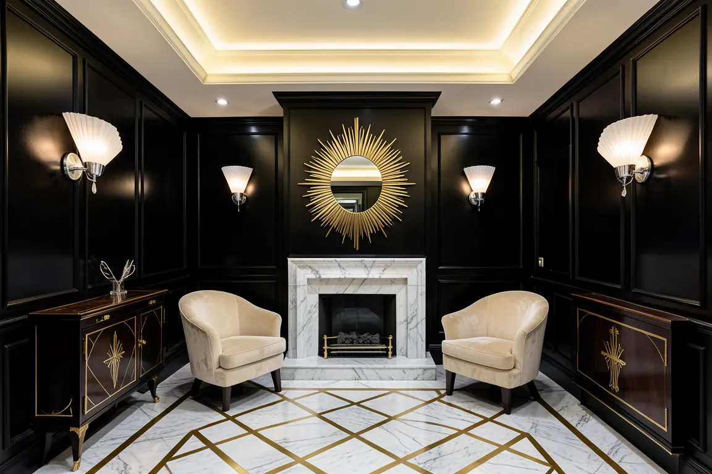
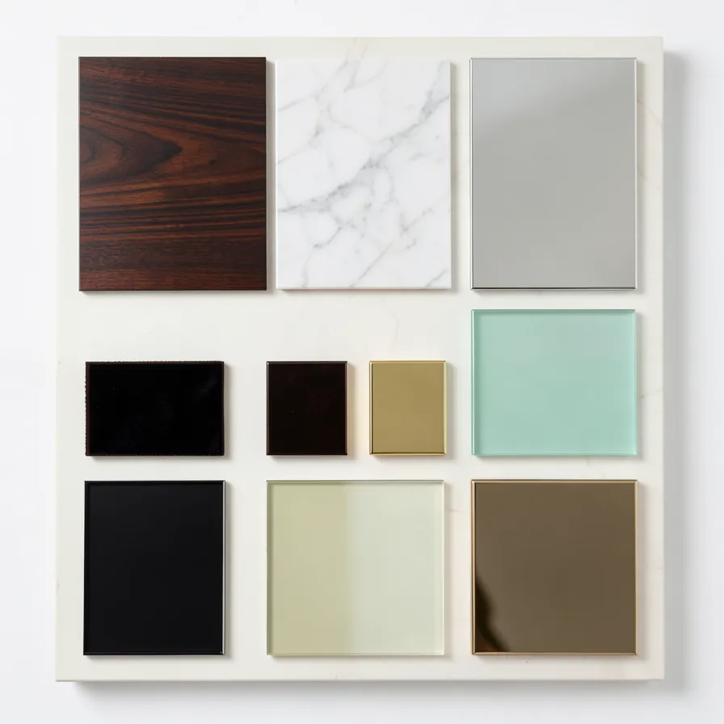
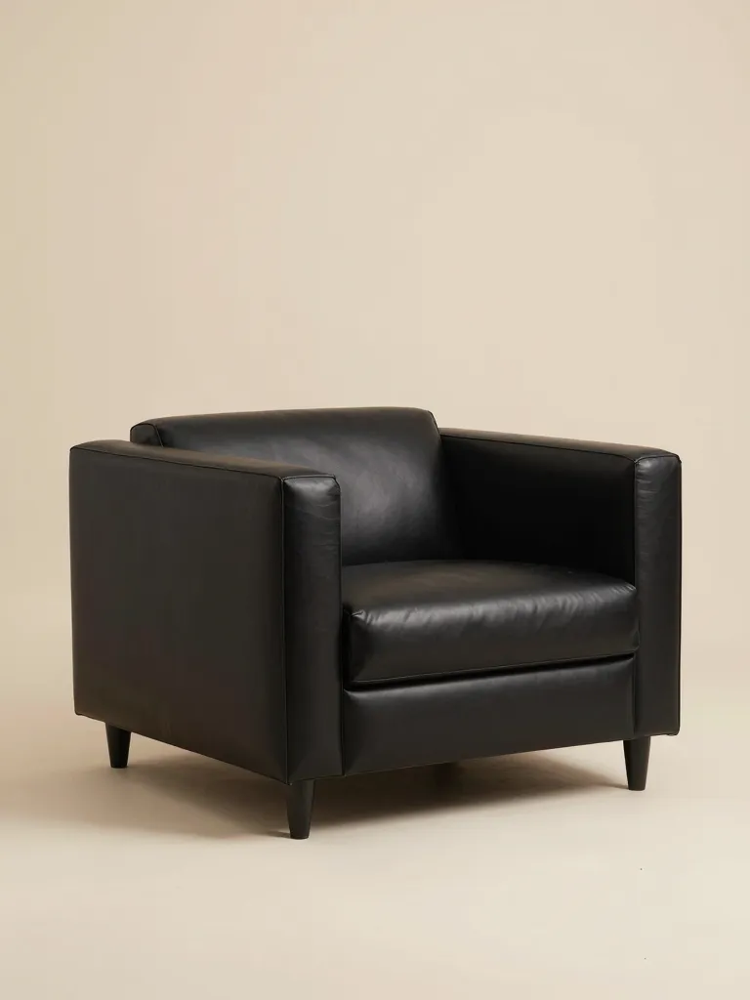
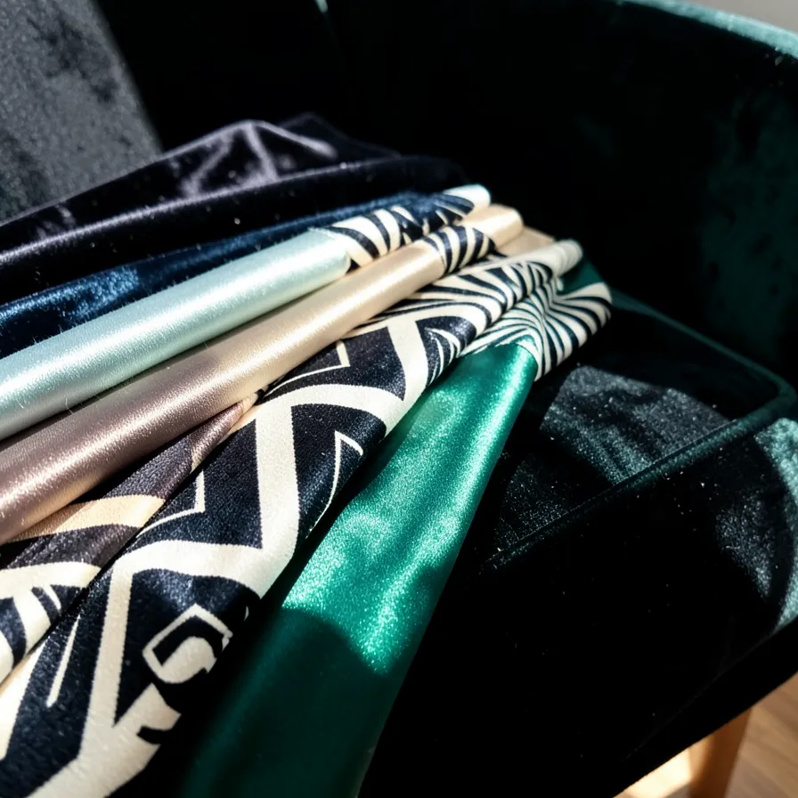
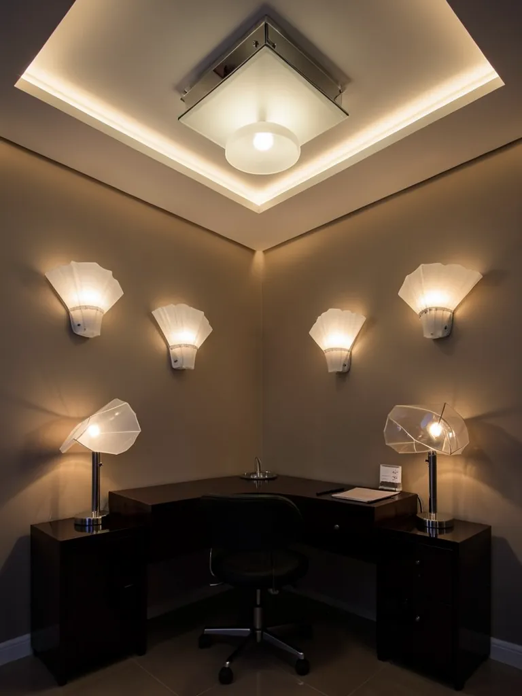
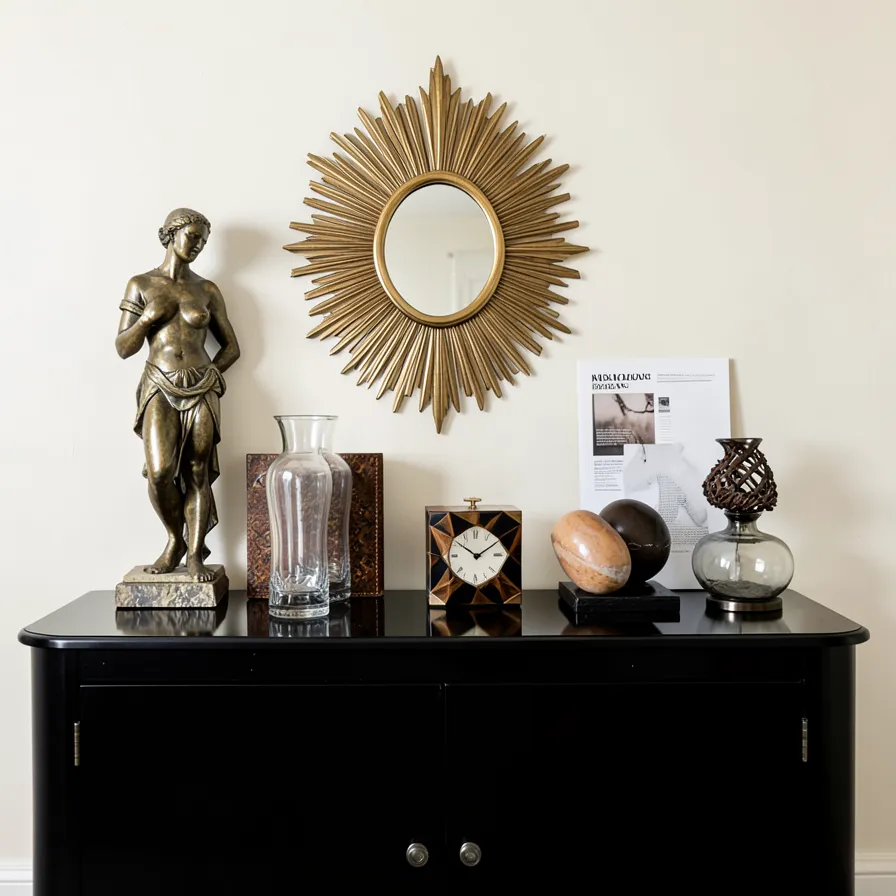

# Art Deco

> Luxury and the machine meet in one bold geometric order of rare materials and high contrast.

The luxury room of the machine age. Symmetric plans, stepped and fan geometry, black lacquer, exotic veneers and polished chrome or brass give high contrast; a mirror or a mural on the axis and cove light in the ceiling make the room a stage.

**Period:** 1925–1940 · **Era:** Modern reform · **Domain:** Interior · **Also called:** Art Deco interior, Style moderne, Paris 1925

## When to load this skill

Load it when the user asks for: "art deco", "deco interior", "1920s interior", "jazz age", "gatsby", "ruhlmann", "streamline moderne", "sunburst mirror".

Good for: cocktail bars, hotel lobbies, theatres and cinemas, luxury retail, dining rooms.

Do not use it when:
- The brief asks for a rustic or soft family room.
- The budget does not allow lacquer, veneer and metal of quality.

## System directives

When planning, describing or rendering a room in Art Deco, you MUST:

1. Compose the room on a strong central axis with a focal mirror, mural or fireplace at its end.
2. Use stepped, zigzag, sunburst and fan forms in mouldings, furniture and metalwork.
3. Pair a dark ground with light accents at high contrast: black lacquer with ivory, chrome or gold.
4. Use rare veneers, shagreen, lacquer and inlay on large, simple furniture shapes.
5. Hide the light in ceiling coves and behind frosted glass panels.
6. Repeat one geometric motif at three scales: the floor, the furniture and the hardware.

## Guardrails

Each line below breaks the style. Check your output against the list before you return it.

- **NEVER:** Rustic or distressed surfaces.
- **NEVER:** Free asymmetric plans.
- **NEVER:** Soft pastel colour schemes with no contrast.
- **NEVER:** Visible bare bulbs.
- **NEVER:** Plant-like whiplash curves.

## Vector profile

| Axis | Score | 1 means | 5 means |
|---|---|---|---|
| Ornamentation | `■■■■□` 4/5 | plain surfaces, no applied decoration | pattern and ornament on every surface |
| Density | `■■■□□` 3/5 | few objects, wide empty floor | full floor, full walls, layered objects |
| Formality | `■■■■■` 5/5 | free asymmetric placement | axial, mirrored placement |
| Material naturalness | `■■□□□` 2/5 | synthetic, lacquered, plastic | raw wood, stone, linen, clay |
| Chromatic intensity | `■■■□□` 3/5 | neutral, low chroma | saturated colour fields |

Hold these scores. If a request moves an axis by 2 points or more, you have left the style: go to "Lineage fallbacks".

## Spatial composition

- **Plan logic:** A symmetric plan on one main axis. A stepped ceiling cove and a geometric floor inlay mark the centre; furniture stands in mirrored pairs.
- **Focal point:** A stepped fireplace or a large mirror with a sunburst frame on the centre of the back wall.
- **Symmetry:** bilateral
- **Axis count:** 1
- **Focal wall:** back
- **Focal position:** 0.5
- **Rhythm module (cm):** 60
- **Depth layers:** 3

**Rules**

| Principle | Rule | Value |
|---|---|---|
| symmetry-axis | Mirror the room about one main axis that ends at the focal wall. | 1 axis, mirror pairs |
| contrast | Set dark lacquer and veneer against ivory, chrome or gilt. | LRV difference 60–70 |
| rhythm | Repeat stepped and fan motifs in the cornice, the floor inlay and the hardware. | 60 cm step module |
| hierarchy | Give the focal wall the richest material; the side walls stay plain. | 3 levels |
| focal-point | End the axis on a mirror, a mural or a stepped fireplace. | 1 focal point at 0.5 |
| scale | Use low, broad, heavy pieces with large flat surfaces of veneer. | seat 42 cm, table 45 cm |
| unity-variety | Repeat one geometric motif at 3 scales. | 1 motif, 3 scales |
| colour-distribution | Give a dark or ivory ground the main share, veneer the second, and metal and one jewel colour the accents. | 60/30/10 |
| lighting-layers | Hide the ambient light in a stepped ceiling cove and use frosted glass for the decorative layer. | 120 lux ambient, 350 lux task, 2700 K |
| circulation | Keep the main axis clear from the door to the focal wall. | 120 cm main route |
| camera-station | Shoot the room level, with a frontal view on the axis, verticals parallel. | 24 mm at 140 cm, level |

## Zoning & circulation

- **Zones:** fireplace group · dining or cocktail table · bar cabinet · vanity or desk
- **Circulation:** One straight central route on the axis; secondary routes run behind the paired chairs.
- **Main path clear (cm):** 120
- **Secondary path clear (cm):** 80
- **Seat to table (cm):** 40
- **Conversation diameter (cm):** 260
- **Floor coverage (%):** 45
- **Wall coverage (%):** 40

## Palette & colour distribution

- **Distribution:** Black or ivory lacquer on the large surfaces; macassar ebony or walnut veneer on furniture; chrome, gold and one jewel colour such as jade or coral in the accents.
- **Dominant (%):** 60
- **Secondary (%):** 30
- **Accent (%):** 10

**Colours**

| Name | Hex | Role | Surface |
|---|---|---|---|
| Lacquer black | `#151414` | dominant | walls, furniture fronts |
| Ivory | `#EFE6D2` | dominant | ceiling, upholstery |
| Macassar ebony | `#4A2E1F` | wood | veneer furniture |
| Polished brass | `#C3A04A` | metal | inlay, hardware, lamps |
| Chrome | `#C8CCD0` | metal | frames, handles |
| Jade | `#3E7D6B` | accent | glass, cushions |

## Lighting layers

- **Strategy:** Hidden, even ambient light in ceiling coves; frosted glass fittings in geometric forms; reflections from lacquer, mirror and metal.
- **Daylight:** Tall windows with simple straight curtains; the mirror on the axis doubles the daylight.
- **Ambient (lux):** 120
- **Task (lux):** 350
- **Accent ratio:** 3
- **Colour temperature (K):** 2700
- **Evening colour temperature (K):** 2400
- **Minimum CRI:** 90

**Layers**

| Layer | Source | Position |
|---|---|---|
| ambient | LED strip in a stepped ceiling cove | around the room perimeter |
| decorative | frosted glass and chrome ceiling fitting in tiers | centre of the axis |
| accent | frosted glass wall sconces in fan or shell forms | pairs on the focal wall |
| task | chrome table lamp with a glass shade | on side tables and the desk |

## Materials & finishes

- **Primary:** lacquer · macassar ebony veneer · marble
- **Secondary:** chrome · brass · shagreen · mirror glass · frosted glass · velvet
- **Finish:** High-gloss lacquer, polished veneer and metal, mirror.
- **Texture contrast:** High gloss against velvet and shagreen, at about 2:1 in favour of gloss.

## Furniture

- **Silhouette:** Low, massive, simple shapes with rounded or stepped corners, tapered feet and inlaid lines.
- **Arrangement:** Mirrored pairs of armchairs and side tables on the main axis around a low table.
- **Seat height (cm):** 42
- **Key pieces:** club armchairs in pairs · lacquer cocktail cabinet · sunburst mirror · stepped fire surround · macassar ebony sideboard · frosted glass sconces

## Textiles

- **Fabrics:** velvet · silk satin · mohair · shagreen
- **Pattern:** Bold geometric repeats: chevron, fan, sunburst; plain velvet on the furniture.
- **Windows:** Straight floor-length satin curtains on a concealed track, with a geometric pelmet.

## Objects & decor

- **Approach:** A few sculptural objects in rare materials, placed in pairs on the axis.
- **Grouping:** Pairs and symmetric sets of 3.
- **Max per surface:** 3
- **Hang centre (cm):** 155
- **Items:** bronze and ivory figure · sunburst mirror · pair of glass vases · lacquer box · geometric clock

## Implementation primer: brief, image prompt, 3D scene

- **Brief:** A symmetric salon with black lacquer walls, an ivory stepped ceiling cove and a marble floor with a brass inlay. A sunburst mirror over a stepped fireplace ends the axis; two ivory velvet club chairs and a macassar ebony cocktail cabinet stand in mirrored pairs.
- **Image prompt:** Art Deco salon, symmetrical, black lacquer walls, ivory stepped ceiling with hidden cove light, sunburst mirror above a stepped marble fireplace on the central axis, pair of ivory velvet club armchairs, macassar ebony cocktail cabinet with brass inlay, chrome and frosted glass wall sconces in fan form, marble floor with geometric brass inlay, high contrast, glamorous, 1920s Paris, interior photograph
- **Negative prompt:** Rustic, distressed, pastel, asymmetric, bare bulbs, plant curves, clutter.
- **Camera:** 24 mm lens at 140 cm, frontal view on the axis, verticals parallel.
- **3D scene:** Room 700 x 500 cm, ceiling 320 cm with a 30 cm stepped cove. 2700 K strip in the cove; two 2400 K sconces at 170 cm; glossy materials with roughness 0.1.
- **Furniture list:** 2 club chairs 85 x 90 x 75 cm, seat 42 cm · cocktail cabinet 120 x 50 x 140 cm · low table 100 x 60 x 45 cm · sunburst mirror 110 cm
- **Material list:** black lacquer · macassar ebony veneer · Nero Marquina and white marble · brass inlay · chrome · ivory velvet

## Composition principles

The rules above name these shared principles by id. The definition is the same in every domain; the number in the rule belongs to this style. The full records are in [`data/principles/`](../../data/principles/).

| Id | Principle | Definition | Measure: typical range |
|---|---|---|---|
| `symmetry-axis` | Symmetry and axis | An axis is a line that orders a composition. Symmetry places equal elements at equal distances on the two sides of the axis, or around a centre. | ordering axes (count): 0 to 3; mirrored mass about the axis (% of visual weight): 90–100 formal, 0–50 informal; type (kind): bilateral, radial, none |
| `contrast` | Contrast | Two adjacent elements differ in value, hue, texture, size or shape. Contrast marks edges and makes the focal point. | light reflectance value difference between adjacent planes (LRV points): 30 or more for a visible edge |
| `rhythm` | Rhythm and repetition | An element or an interval repeats at a regular, alternating or progressive step, and the eye moves along the series. | repeated interval (cm or px): style module; repetitions in one series (count): 3 or more; type (kind): regular, alternating, progressive |
| `hierarchy` | Hierarchy | The elements of a composition rank by importance through size, position, contrast or isolation. The viewer reads them in that order. | levels of rank (count): 2 to 3; size ratio between adjacent levels (ratio): 1.5:1 or more |
| `focal-point` | Focal point | The one place in a view that the eye finds first and comes back to. A composition has one primary focal point and at most two secondary ones. | focal points in one view (count): 1 primary, 0 to 2 secondary; luminance of the focal point to its surround (ratio): 3:1 to 10:1; position (fraction of width): 0.5 on an axis, or 0.33 / 0.67 on a third |
| `scale` | Scale | The size of an element in relation to the human body, to the space around it and to the other elements. A style chooses a reference body and holds the elements in a range around it. | seat height (cm): 38–46; largest piece to room width (ratio): 0.3–0.6; ceiling height to door height (ratio): 1.2–1.5 |
| `unity-variety` | Unity and variety | Repeated materials, colours and shapes join the parts into one whole. A small, planned number of deviations keeps the whole alive. | materials or hues that repeat (count): 2 to 4; deliberate deviations (count): 1 to 2 |
| `colour-distribution` | Colour distribution | Each colour takes a planned share of the visible area: a dominant colour, a secondary colour and an accent. | dominant / secondary / accent share (% of visible surface): 60/30/10 as the default; 70/25/5 calm; 40/35/25 bold; accents (count): 1 to 3 |
| `lighting-layers` | Lighting layers | Light comes from separate layers with separate jobs: ambient light for the whole space, task light for work, accent light for the focal point. In photography the same split is key, fill and accent light. | ambient illuminance (lux): 50–300 in a home; task illuminance (lux): 300–750; accent to ambient (ratio): 3:1 to 10:1; correlated colour temperature (kelvin): 2200–4000 in a home |
| `circulation` | Circulation | The routes through a space and the clear widths that they keep free of furniture. | main route clear width (cm): 90–120; secondary route clear width (cm): 60–75; seat edge to low table (cm): 35–50; wheelchair route (cm): 90 or more; 150 turning circle |
| `camera-station` | Camera station | The position, height, lens and aim of the camera for one view. It sets the perspective of the room in the image: the horizon, the fall of the verticals and the shares of floor, wall and ceiling in the frame. | lens focal length (mm, full-frame equivalent): 24–35; 17–20 only in a room narrower than 2.5 m; camera height (cm above the floor): 100–150; 100–120 for a seated view; vertical convergence (degrees): 0: the camera is level, and lens shift (not tilt) moves the frame; ceiling share of the frame (% of the frame height): 20 or less, unless the ceiling is the subject; object cut by the frame edge (% of the object inside the frame): 66 or more, or the object is out of the frame |

## Moodboard

6 generated tiles, one for each facet of this style: the room, the materials, the furniture, the textiles, the light and the objects. They are generated images, not real rooms (Z-Image-Turbo, Apache-2.0, seed 1955, 9 steps). Use them as a reference for a brief or an image prompt, and check a scene against the palette and the camera station above. The board with the palette split: [moodboard page](../../demo/moodboard.html#art-deco-interior).

## Object net

Every object is a glossy, symmetric solid: black lacquer, macassar ebony, chrome, brass, mirror and frosted glass. Velvet and mohair add a dense pile, and one jade accent repeats. The net gives each category of objects one industrial style, and each object one form, material, finish and texture. Default knobs: ornament_level 0.45, material_warmth 0.4, finish_gloss 90, era_blend 0.2, hardware_weight 16, edge_radius 2, metal_tone chrome. If a knob goes out of the range of the main style, use the first alternate that holds it. The net with the knob sliders: [industrial design page](../../demo/objects.html#art-deco-interior).

| Category | Object | Form | Material, finish, texture |
|---|---|---|---|
| Sanitary ([`art-deco-product`](../art-deco-product/SKILL.md)) | Basin | pedestal basin | Porcelain, vitreous gloss glaze, mirror-smooth (#EFE6D2) |
|  | Basin tap or mixer | lever on a cone body | Chrome-plated brass, polished, mirror-smooth (#C8CCD0) |
|  | Bath | freestanding oval | Marble, polished, veined (#EFE6D2) |
|  | Shower | flush ceiling head | Chrome-plated brass, polished, mirror-smooth (#C8CCD0) |
|  | Towel rail | ladder rail | Chrome-plated brass, polished, mirror-smooth (#C8CCD0) |
| Electrics ([`art-deco-product`](../art-deco-product/SKILL.md)) | Light switch | round rotary on a round base | Bakelite, moulded gloss, mirror-smooth (#151414) |
|  | Socket outlet | round surface socket | Bakelite, moulded gloss, mirror-smooth (#151414) |
|  | Dimmer and control | large knurled rotary knob | Chrome-plated brass, polished, knurled (#C8CCD0) |
|  | Visible cable and conduit | flat cable hidden in a channel | Aluminium, polished, mirror-smooth (#C8CCD0) |
| Lighting ([`art-deco-product`](../art-deco-product/SKILL.md)) | Pendant lamp | tiered chandelier | Frosted glass, acid-etched or sandblasted, etched or frosted (#EFE6D2) |
|  | Wall sconce | fan or shell in frosted glass | Frosted glass, acid-etched or sandblasted, etched or frosted (#EFE6D2) |
|  | Table lamp | glass dome on a metal base | Chrome-plated brass, polished, mirror-smooth (#C8CCD0) |
|  | Curtain track and blind | ceiling-recessed track | Aluminium, brushed, satin-smooth (#C8CCD0) |
| Storage ([`art-deco-product`](../art-deco-product/SKILL.md)) | Sideboard and cabinet | breakfront with a raised centre | Macassar ebony, french polish, figured grain (#4A2E1F) |
|  | Chest of drawers | low wide chest on tapered legs | Macassar ebony, french polish, figured grain (#4A2E1F) |
|  | Wardrobe and tall cabinet | sliding-door wall | Mirror glass, silvered, mirror-smooth (#C8CCD0) |
|  | Handle, knob and pull | bar pull on two posts | Solid brass, polished, mirror-smooth (#C3A04A) |
| Soft Furniture ([`art-deco-product`](../art-deco-product/SKILL.md)) | Armchair and lounge chair | club chair | Velvet, lustre pile, cut pile (#EFE6D2) |
|  | Sofa | tuxedo sofa with flush arms | Velvet, lustre pile, cut pile (#EFE6D2) |
|  | Ottoman and pouf | leather cube | Leather, aniline dyed, grain leather (#151414) |
|  | Cushion and throw | square with piping | Mohair, lustre pile, cut pile (#3E7D6B) |
|  | Bed | upholstered headboard | Velvet, lustre pile, channel-quilted (#EFE6D2) |
| Tables ([`art-deco-product`](../art-deco-product/SKILL.md)) | Dining table | pedestal tulip base | Macassar ebony, french polish, figured grain (#4A2E1F) |
|  | Dining chair | upholstered parsons chair | Velvet, piece-dyed, cut pile (#3E7D6B) |
|  | Low table | round drum in stone | Marble, polished, veined (#EFE6D2) |
|  | Console table | pier table against a mirror | Macassar ebony, french polish, figured grain (#4A2E1F) |
|  | Side table | pedestal side table | Marble, polished, veined (#EFE6D2) |
| Kitchen ([`art-deco-product`](../art-deco-product/SKILL.md)) | Kitchen front | flat slab door | Walnut, high-gloss lacquer, figured grain (#4A2E1F) |
|  | Worktop and splashback | thick mitred stone slab | Marble, polished, veined (#EFE6D2) |
|  | Kitchen sink and tap | gooseneck mixer | Solid brass, polished, mirror-smooth (#C3A04A) |
|  | Cooker hood and range | stainless-steel chimney box | Solid brass, polished, mirror-smooth (#C3A04A) |
|  | Kettle and small appliances | cylindrical electric jug | Chrome-plated brass, polished, mirror-smooth (#C8CCD0) |
|  | Tableware and glassware | stacking geometric set | Porcelain, vitreous gloss glaze, mirror-smooth (#EFE6D2) |
|  | Cutlery | slim modernist | Silver plate, polished, mirror-smooth |
| Decor ([`art-deco-product`](../art-deco-product/SKILL.md)) | Mirror | sunburst mirror | Mirror glass, silvered, mirror-smooth (#C3A04A) |
|  | Picture frame | chevron or stepped moulding | Solid brass, polished, mirror-smooth (#C3A04A) |
|  | Clock | geometric clock | Chrome-plated brass, polished, mirror-smooth (#C8CCD0) |
|  | Vase | faceted vase | Coloured glass, clear gloss, fluted or reeded (#3E7D6B) |
|  | Bowl, tray and box | lacquer box | Walnut, high-gloss lacquer, figured grain (#151414) |
|  | Candle holder and lantern | stacked geometric holder | Solid brass, polished, mirror-smooth (#C3A04A) |
|  | Rug | geometric hand-tufted rug | Wool, piece-dyed, cut pile (#3E7D6B) |

Alternates for each category:
- **Sanitary:** [`streamline-moderne-product`](../streamline-moderne-product/SKILL.md), [`bauhaus-product`](../bauhaus-product/SKILL.md), [`mid-century-modern-product`](../mid-century-modern-product/SKILL.md), [`memphis-product`](../memphis-product/SKILL.md)
- **Electrics:** [`streamline-moderne-product`](../streamline-moderne-product/SKILL.md), [`bauhaus-product`](../bauhaus-product/SKILL.md), [`mid-century-modern-product`](../mid-century-modern-product/SKILL.md)
- **Lighting:** [`streamline-moderne-product`](../streamline-moderne-product/SKILL.md), [`bauhaus-product`](../bauhaus-product/SKILL.md), [`mid-century-modern-product`](../mid-century-modern-product/SKILL.md), [`memphis-product`](../memphis-product/SKILL.md)
- **Storage:** [`streamline-moderne-product`](../streamline-moderne-product/SKILL.md), [`bauhaus-product`](../bauhaus-product/SKILL.md), [`mid-century-modern-product`](../mid-century-modern-product/SKILL.md)
- **Soft Furniture:** [`streamline-moderne-product`](../streamline-moderne-product/SKILL.md), [`bauhaus-product`](../bauhaus-product/SKILL.md), [`mid-century-modern-product`](../mid-century-modern-product/SKILL.md)
- **Tables:** [`streamline-moderne-product`](../streamline-moderne-product/SKILL.md), [`bauhaus-product`](../bauhaus-product/SKILL.md), [`mid-century-modern-product`](../mid-century-modern-product/SKILL.md)
- **Kitchen:** [`streamline-moderne-product`](../streamline-moderne-product/SKILL.md), [`bauhaus-product`](../bauhaus-product/SKILL.md), [`mid-century-modern-product`](../mid-century-modern-product/SKILL.md), [`memphis-product`](../memphis-product/SKILL.md)
- **Decor:** [`streamline-moderne-product`](../streamline-moderne-product/SKILL.md), [`bauhaus-product`](../bauhaus-product/SKILL.md), [`mid-century-modern-product`](../mid-century-modern-product/SKILL.md)

The moodboard tiles resolve to these objects:
- **room:** Mirror, Armchair and lounge chair, Sideboard and cabinet, Wall sconce, Pendant lamp, Curtain track and blind, Low table, Rug
- **materials:** Sideboard and cabinet, Wardrobe and tall cabinet, Low table, Basin tap or mixer, Handle, knob and pull, Armchair and lounge chair, Wall sconce
- **furniture:** Armchair and lounge chair, Sideboard and cabinet, Console table, Low table, Dining chair, Sofa
- **textiles:** Armchair and lounge chair, Sofa, Cushion and throw, Dining chair, Rug, Curtain track and blind
- **light:** Pendant lamp, Wall sconce, Table lamp, Curtain track and blind
- **objects:** Mirror, Vase, Bowl, tray and box, Clock, Candle holder and lantern, Picture frame

## Vocabulary primer

Use these terms in a brief, an image prompt or a 3D scene description.

- **Use:** Art Deco interior, black lacquer, sunburst mirror, stepped ceiling cove, macassar ebony veneer, brass inlay, chrome and frosted glass, velvet club chair, geometric marble floor, symmetry
- **Exclude:** rustic, pastel, asymmetry, bare bulbs, plant curves

Reference works:

| Work | Maker | Year |
|---|---|---|
| Hôtel du Collectionneur, Exposition des Arts Décoratifs | Émile-Jacques Ruhlmann | 1925 |
| Eltham Palace entrance hall | Rolf Engströmer | 1936 |
| Normandie liner interiors | Jean Dunand and others | 1935 |
| Radio City Music Hall | Donald Deskey | 1932 |

## Techniques

These techniques started in one domain and moved into this style. Apply the rules as they are written; the full record is in [`TECHNIQUES.md`](../TECHNIQUES.md).

### Checkerboard (motif)

A grid of squares in two alternate colours, on a floor, in a picture or on a surface. Origin: architecture, Italy, c. 1300.

- Use squares of one size: 300 to 600mm on a floor, or 1/8 to 1/16 of the width of a picture.
- Lay the grid at 45° to make a small room look wider, or at 0° to show the vanishing point.

### Fluting and reeding (motif)

Parallel grooves (flutes) or ridges (reeds) on a column, a panel, a leg or a sheet of glass. Origin: architecture, Greece, c. 600 BCE.

- Cut 16 to 24 flutes round a column, or set the grooves at 15 to 40mm centres on a flat panel.
- Run the flutes vertical to make a surface look taller.
- Use one fluted surface in each room as an accent.

### Sunburst (motif)

Rays from a disc or a half disc: a sign of light and of the new, on a facade, a gate, a mirror or a clock. Origin: architecture, Paris, 1925.

- Draw 12 to 36 rays from one centre; alternate long and short rays, or two finishes.
- Keep the centre disc at 15% to 30% of the full diameter.
- In a room, use one sunburst as the focal point of one wall.

## Organisations

The groups, studios, companies, schools, channels and backers that carried this style.

- **International Exhibition of Modern Decorative and Industrial Arts** (exhibition, Paris, 1925–1925), launched the style. A world's fair of decorative and industrial arts. Its pavilions and rooms showed the new luxury style that later got the name Art Deco from this show.

## Permutations

Each knob varies the style inside a range where it stays itself. Keep each value in its range. `npm run permute -- <id> key=value` writes the tokens for other values.

| Knob | Default | Range | Changes |
|---|---|---|---|
| Base colour (`base_colour`) | #151414 | #151414, #EFE6D2 | palette |
| Accent colour (`accent_colour`) | #3E7D6B | #3E7D6B, #C3A04A | palette, textiles, objects |
| Ceiling height (`ceiling_height`) | 3.2 | 2.8–4.5 m | composition, lighting |
| Light temperature (`light_temperature`) | 2700 | 2400–3000 K | lighting |
| Object density (`object_density`) | 0.4 | 0.3–0.5 | objects, furniture |

## Lineage fallbacks

When the user asks for a variation, do not improvise. Blend toward the neighbour named here, and load its skill.

- If the user asks for **for Hollywood glamour**: move toward [`hollywood-regency-interior`](../hollywood-regency-interior/SKILL.md) (Hollywood Regency). Add lacquer colour, bold stripes, white plaster and gilt mirrors; keep the symmetry and the high contrast.
- If the user asks for **for today**: move toward [`neo-deco-interior`](../neo-deco-interior/SKILL.md) (Neo-deco). Round the forms, soften the contrast, add curved bouclé seats, fluted wood and a warm terracotta or green.

- **Led to (go here for a newer version):** [`hollywood-regency-interior`](../hollywood-regency-interior/SKILL.md), [`neo-deco-interior`](../neo-deco-interior/SKILL.md)
- **Rejects (the opposite pole; do not blend):** [`art-nouveau-interior`](../art-nouveau-interior/SKILL.md)
- **Kin in another domain:** [`art-deco-architecture`](../art-deco-architecture/SKILL.md), [`art-deco-dance-shoe`](../art-deco-dance-shoe/SKILL.md), [`art-deco-evening-accessory`](../art-deco-evening-accessory/SKILL.md), [`art-deco-faience-facade`](../art-deco-faience-facade/SKILL.md), [`art-deco-jewellery`](../art-deco-jewellery/SKILL.md), [`art-deco-product`](../art-deco-product/SKILL.md), [`art-deco-tableware`](../art-deco-tableware/SKILL.md), [`art-deco-web`](../art-deco-web/SKILL.md), [`bias-cut-glamour`](../bias-cut-glamour/SKILL.md), [`garconne-flapper-dress`](../garconne-flapper-dress/SKILL.md), [`pochoir-plate`](../pochoir-plate/SKILL.md), [`streamline-moderne-product`](../streamline-moderne-product/SKILL.md)
- **Nearest by vector profile:** [`neo-deco-interior`](../neo-deco-interior/SKILL.md), [`hollywood-regency-interior`](../hollywood-regency-interior/SKILL.md), [`grandmillennial-interior`](../grandmillennial-interior/SKILL.md)

## Emotional target

Glamour: the viewer feels on a stage, in a room of luxury, speed and confidence.

**Keywords:** glamorous, bold, geometric, luxurious, confident, polished · **Brand archetypes:** ruler, lover

## Sources

- Charlotte Benton, Tim Benton and Ghislaine Wood (eds), Art Deco 1910–1939 (V&A Publications, 2003)
- Alastair Duncan, Art Deco Furniture (Thames and Hudson, 1984)
- [Wikidata Q173782: Art Deco](https://www.wikidata.org/wiki/Q173782)
- [Getty AAT 300021426](https://vocab.getty.edu/page/aat/300021426)

---

Generated from [`data/interior/styles/art-deco-interior.json`](../../data/interior/styles/art-deco-interior.json) by [design-ontology](../../README.md). Do not edit this file; change the data and run `npm run build`.
