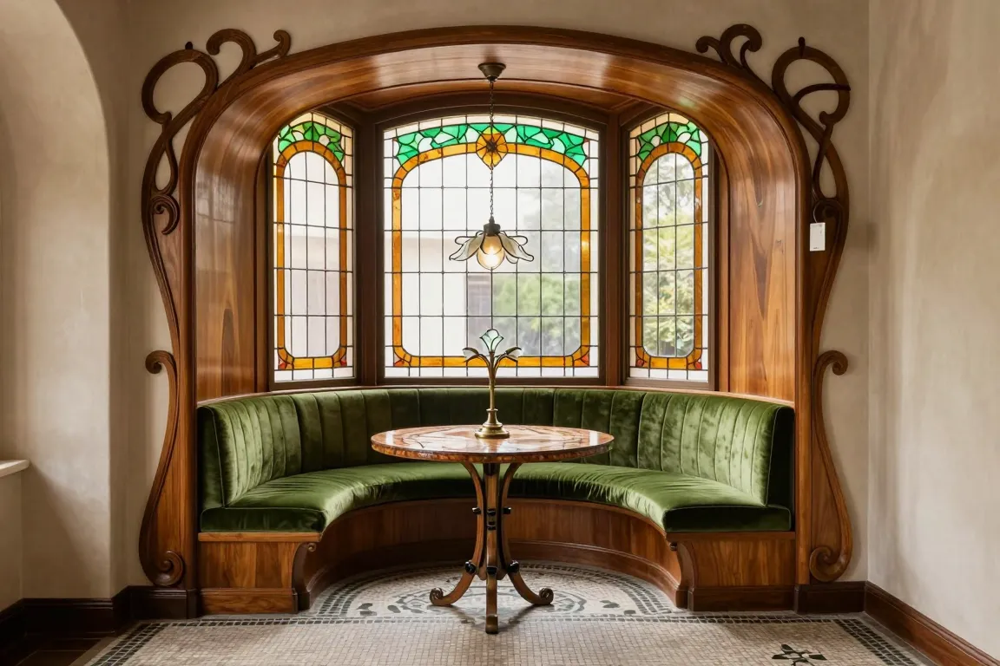
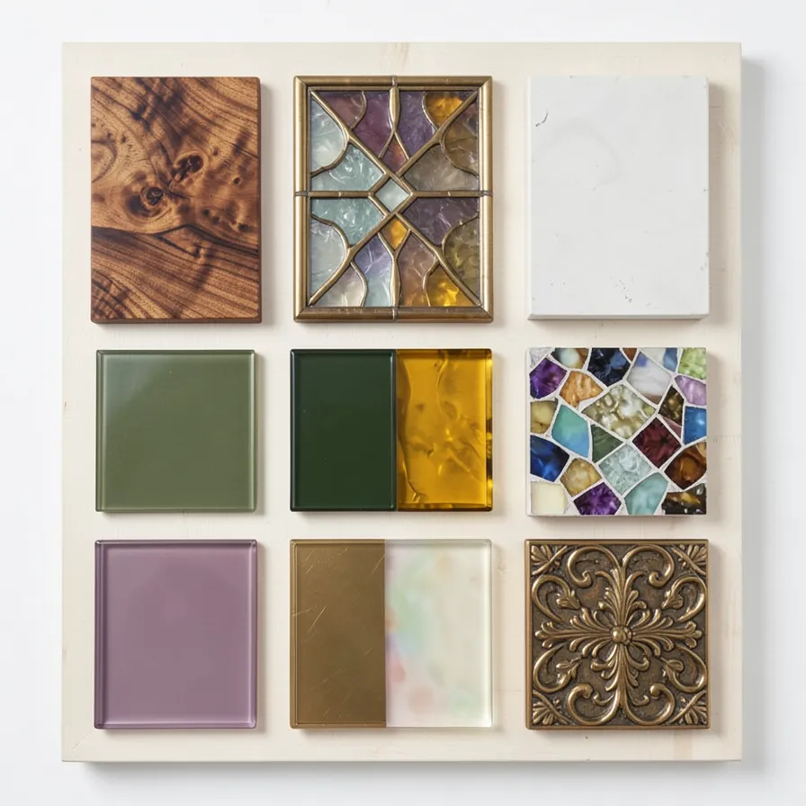
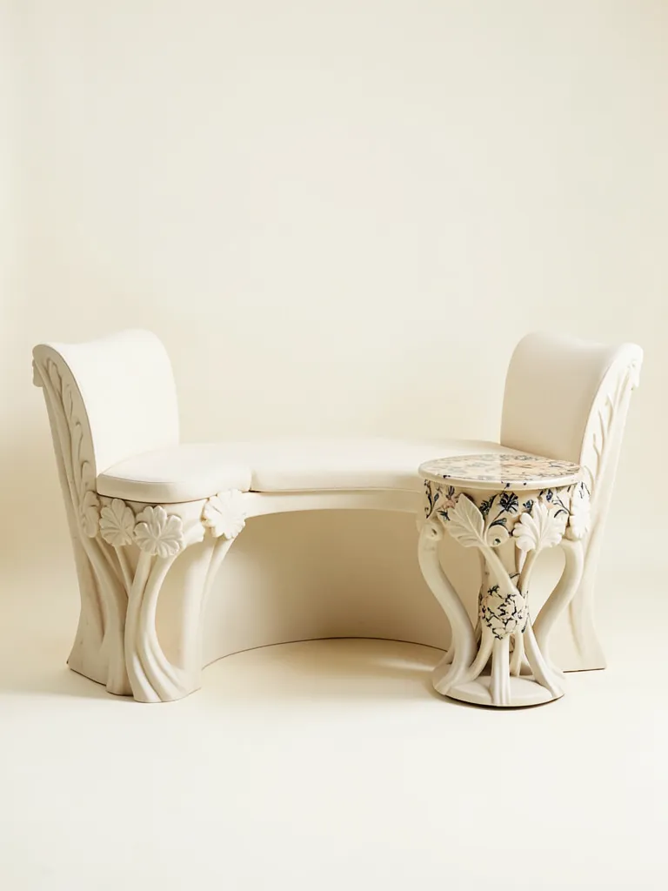
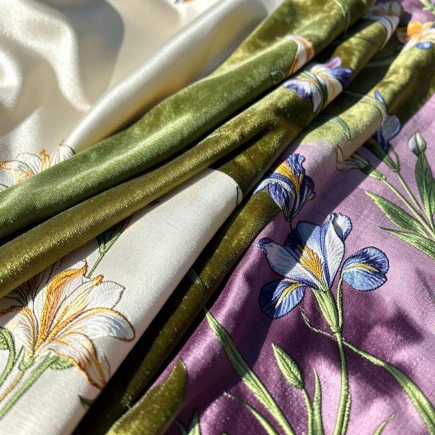
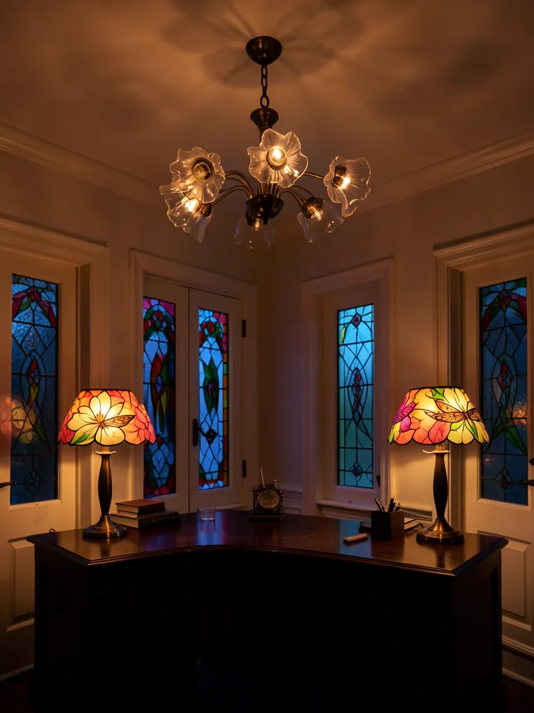
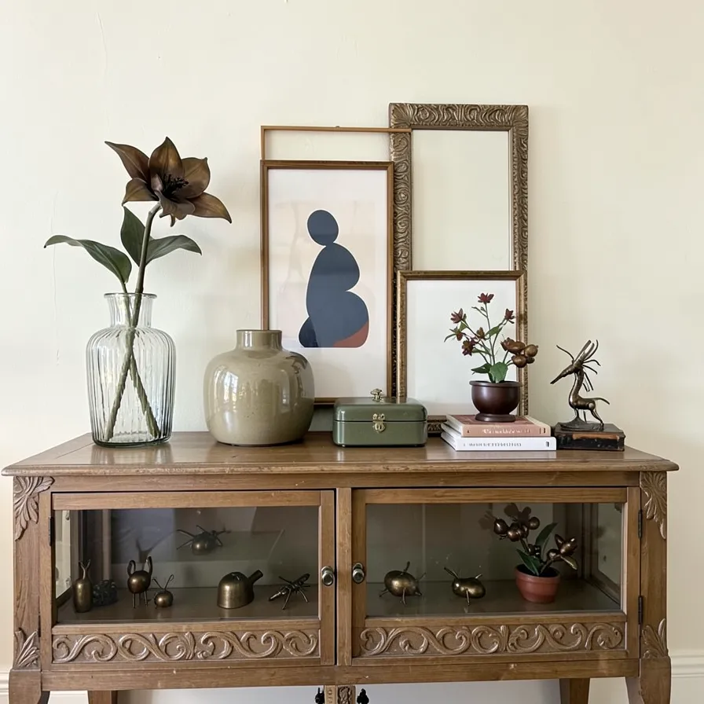

# Art Nouveau

> Nature gives the only true line; one designer must draw every part of a room so that it grows as one plant.

The room as one living organism. Whiplash curves of plant stems run from the furniture into the panelling, the door frames and the light fittings; stained glass, carved fruitwood and bronze make each room a total work of art by one designer.

**Period:** 1890–1914 · **Era:** Modern reform · **Domain:** Interior · **Also called:** Art Nouveau interior, Jugendstil interior, Modern Style, Stile Liberty

## When to load this skill

Load it when the user asks for: "art nouveau", "jugendstil", "liberty style", "whiplash curves", "horta interior", "guimard", "tiffany lamp", "organic ornament".

Good for: cafés and restaurants, boutique hotels, jewellery and perfume retail, theatres and foyers, period restoration.

Do not use it when:
- The budget does not allow custom joinery and glass.
- The brief asks for a rational, rectilinear room.

## System directives

When planning, describing or rendering a room in Art Nouveau, you MUST:

1. Draw every line as a plant stem: a slow curve that ends in a sudden whip.
2. Let the furniture, the panelling and the light fittings share one continuous line; no part stands alone.
3. Make the window the focal point and fill it with stained or opalescent glass.
4. Use soft, natural colours: moss, lily green, mauve, cream and amber.
5. Carve fruitwood and pearwood in soft, curved relief; cast lamps and handles in bronze as stems and buds.
6. Hide the joints between wall, ceiling and furniture under curved mouldings.

## Guardrails

Each line below breaks the style. Check your output against the list before you return it.

- **NEVER:** Straight rectilinear furniture with no curve.
- **NEVER:** Revival ornament from past centuries.
- **NEVER:** Loose furniture of different styles in one room.
- **NEVER:** Pattern that repeats on a mechanical grid.
- **NEVER:** Hard cool light.

## Vector profile

| Axis | Score | 1 means | 5 means |
|---|---|---|---|
| Ornamentation | `■■■■■` 5/5 | plain surfaces, no applied decoration | pattern and ornament on every surface |
| Density | `■■■□□` 3/5 | few objects, wide empty floor | full floor, full walls, layered objects |
| Formality | `■■■□□` 3/5 | free asymmetric placement | axial, mirrored placement |
| Material naturalness | `■■■■□` 4/5 | synthetic, lacquered, plastic | raw wood, stone, linen, clay |
| Chromatic intensity | `■■■□□` 3/5 | neutral, low chroma | saturated colour fields |

Hold these scores. If a request moves an axis by 2 points or more, you have left the style: go to "Lineage fallbacks".

## Spatial composition

- **Plan logic:** A free plan of curved walls, arches and alcoves. Built-in furniture and panelling flow into each other around a stained-glass window.
- **Focal point:** A stained-glass window or bay with a curved frame on the window wall, often framed by a carved arch.
- **Symmetry:** free
- **Axis count:** 1
- **Focal wall:** window
- **Focal position:** 0.5
- **Rhythm module (cm):** 25
- **Depth layers:** 3

**Rules**

| Principle | Rule | Value |
|---|---|---|
| leading-lines | Lead the eye with continuous whiplash curves from the floor through the panelling to the ceiling. | S-curve, 1 continuous line per wall |
| unity-variety | Draw all elements in one family of plant forms by one designer. | 1 motif family |
| focal-point | Make the stained-glass window the focal point under a curved arch. | 1 window at 0.5 |
| framing | Frame doors, windows and alcoves with organic arches in place of straight architraves. | arch radius 0.5–1 x opening width |
| rhythm | Repeat stem-like ribs in panelling and screens at a pitch that changes, as in a plant. | 20–30 cm pitch |
| layering-depth | Set alcoves and screens of carved wood and glass between zones. | 3 planes |
| colour-distribution | Give cream and soft green the walls, fruitwood the furniture, and amber, mauve and gilt bronze the accents. | 55/30/15 |
| lighting-layers | Use bronze fittings with glass shades in the form of flowers; light the stained glass from behind at night. | 90 lux ambient, 350 lux task, 2700 K |
| balance | Balance a large curved mass on one side with a group of slim stems on the other. | moment ratio 0.8–1.25 |
| circulation | Let the route follow the curves of the walls. | 90 cm main, 70 cm secondary |
| camera-station | Shoot the room level, with a frontal view on the window bay. | 28 mm at 150 cm, level |

## Zoning & circulation

- **Zones:** window alcove · built-in seat · dining table · display vitrine
- **Circulation:** Routes follow the curved walls and pass through arches.
- **Main path clear (cm):** 90
- **Secondary path clear (cm):** 70
- **Seat to table (cm):** 40
- **Conversation diameter (cm):** 240
- **Floor coverage (%):** 45
- **Wall coverage (%):** 55

## Palette & colour distribution

- **Distribution:** Cream plaster and soft green panelling; pearwood and walnut furniture; amber glass, mauve textiles and gilt bronze as accents.
- **Dominant (%):** 55
- **Secondary (%):** 30
- **Accent (%):** 15

**Colours**

| Name | Hex | Role | Surface |
|---|---|---|---|
| Lily cream | `#EDE3C8` | dominant | plaster, ceiling |
| Moss green | `#7D8B5A` | secondary | panelling, upholstery |
| Pearwood | `#9A6B45` | wood | furniture, carved frames |
| Amber glass | `#D49A3A` | accent | stained glass, lamp shades |
| Mauve | `#8C6C8E` | accent | textiles, glass |
| Gilt bronze | `#A8843F` | metal | lamps, handles |

## Lighting layers

- **Strategy:** Coloured, filtered light. Stained glass colours the daylight; bronze lamps with flower shades give soft warm pools at night.
- **Daylight:** Stained or opalescent glass in curved frames colours and softens the daylight.
- **Ambient (lux):** 90
- **Task (lux):** 350
- **Accent ratio:** 4
- **Colour temperature (K):** 2700
- **Evening colour temperature (K):** 2300
- **Minimum CRI:** 90

**Layers**

| Layer | Source | Position |
|---|---|---|
| daylight | stained-glass window in a curved frame | window wall |
| decorative | bronze chandelier with glass flower shades | centre of the ceiling |
| task | bronze table lamp with a lily or dragonfly shade | on side tables and the desk |
| accent | backlight behind stained-glass panels | in doors and alcoves |

## Materials & finishes

- **Primary:** carved pearwood and walnut · stained glass · plaster
- **Secondary:** gilt bronze · mosaic · ceramic tile · silk · marquetry
- **Finish:** Satin-polished carved wood, opalescent glass, patinated and gilt bronze.
- **Texture contrast:** Carved relief against smooth glass and silk, at about 2:1.

## Furniture

- **Silhouette:** Fluid, carved pieces whose legs and frames grow like stems; tops and backs end in leaf or flower forms.
- **Arrangement:** Built-in pieces follow the walls; a few loose pieces of the same design stand in alcoves.
- **Seat height (cm):** 44
- **Key pieces:** carved built-in banquette · marquetry side table · display vitrine with curved glass · dragonfly lamp · carved fire surround

## Textiles

- **Fabrics:** silk · velvet · embroidered linen
- **Pattern:** Stylised lilies, irises and stems, in free repeats, not on a grid.
- **Windows:** Light silk or embroidered linen curtains that do not hide the stained glass.

## Objects & decor

- **Approach:** Art glass, bronze and ceramics in plant and insect forms, made for the room.
- **Grouping:** Small groups of 3 in vitrines and on carved shelves.
- **Max per surface:** 4
- **Hang centre (cm):** 155
- **Items:** art glass vase · bronze lily lamp · glazed ceramic vase · enamel box · poster in a carved frame

## Implementation primer: brief, image prompt, 3D scene

- **Brief:** A cream-walled room with moss-green carved panelling. A stained-glass bay under a carved wood arch is the focal point; a curved pearwood banquette, a marquetry table and a bronze lily lamp follow the line of the wall.
- **Image prompt:** Art Nouveau interior, flowing whiplash curves, carved pearwood panelling in organic lines, stained glass window in amber and green under a curved wooden arch, curved built-in banquette with moss green velvet, marquetry table, bronze lily lamp with glass flower shades, mosaic floor, cream plaster walls, soft coloured light, total work of art, interior photograph
- **Negative prompt:** Straight lines, minimal, chrome, revival ornament, cool light, clutter of mixed styles.
- **Camera:** 28 mm lens at 150 cm, frontal view on the window bay.
- **3D scene:** Room 600 x 480 cm, ceiling 320 cm with curved coves. Daylight through stained glass (amber and green filters); 2700 K bronze lamps.
- **Furniture list:** banquette 240 x 70 cm, seat 44 cm · marquetry table 80 cm round · vitrine 90 x 40 x 180 cm · carved arch 260 x 300 cm
- **Material list:** pearwood, carved · stained glass · gilt bronze · glass mosaic · silk velvet, moss green · lime plaster, cream

**References**

| Title | Credit | Licence | Url |
|---|---|---|---|
| Ombellifères (cow parsley) cabinet, Émile Gallé (c. 1900) | The Metropolitan Museum of Art, Anonymous Gift, 1982 | CC0 | https://www.metmuseum.org/art/collection/search/482526 |
| Autumn Crocus vase, Émile Gallé (c. 1900) | The Metropolitan Museum of Art, Gift of Lloyd and Barbara Macklowe, 1984 | CC0 | https://www.metmuseum.org/art/collection/search/483825 |

## Composition principles

The rules above name these shared principles by id. The definition is the same in every domain; the number in the rule belongs to this style. The full records are in [`data/principles/`](../../data/principles/).

| Id | Principle | Definition | Measure: typical range |
|---|---|---|---|
| `leading-lines` | Leading lines | Lines in the view, such as edges, rows, beams or paths, point the eye to the focal point. | lines that converge on the focal point (count): 1 to 4; angle from the frame edge (degrees): 15–60 for a diagonal |
| `unity-variety` | Unity and variety | Repeated materials, colours and shapes join the parts into one whole. A small, planned number of deviations keeps the whole alive. | materials or hues that repeat (count): 2 to 4; deliberate deviations (count): 1 to 2 |
| `focal-point` | Focal point | The one place in a view that the eye finds first and comes back to. A composition has one primary focal point and at most two secondary ones. | focal points in one view (count): 1 primary, 0 to 2 secondary; luminance of the focal point to its surround (ratio): 3:1 to 10:1; position (fraction of width): 0.5 on an axis, or 0.33 / 0.67 on a third |
| `framing` | Framing | A nearer element, such as a doorway, an arch, a window or a branch, surrounds the subject and isolates it. | frame area (% of the view): 10–35; frame planes (count): 1 to 2 |
| `rhythm` | Rhythm and repetition | An element or an interval repeats at a regular, alternating or progressive step, and the eye moves along the series. | repeated interval (cm or px): style module; repetitions in one series (count): 3 or more; type (kind): regular, alternating, progressive |
| `layering-depth` | Layering in depth | A view holds elements on several planes at different distances from the eye. Overlap between the planes shows depth. | planes in depth (count): 2 to 4; overlap between planes (% of the nearer element): 10–40 |
| `colour-distribution` | Colour distribution | Each colour takes a planned share of the visible area: a dominant colour, a secondary colour and an accent. | dominant / secondary / accent share (% of visible surface): 60/30/10 as the default; 70/25/5 calm; 40/35/25 bold; accents (count): 1 to 3 |
| `lighting-layers` | Lighting layers | Light comes from separate layers with separate jobs: ambient light for the whole space, task light for work, accent light for the focal point. In photography the same split is key, fill and accent light. | ambient illuminance (lux): 50–300 in a home; task illuminance (lux): 300–750; accent to ambient (ratio): 3:1 to 10:1; correlated colour temperature (kelvin): 2200–4000 in a home |
| `balance` | Visual balance | The visual weights on the two sides of a centre cancel out. Formal balance uses mirrored equal weights; informal balance sets a large near mass against several small far masses. | moment of visual weight, left to right about the centre (ratio): 1.0 formal; 0.8–1.25 informal; type (kind): formal, informal, radial |
| `circulation` | Circulation | The routes through a space and the clear widths that they keep free of furniture. | main route clear width (cm): 90–120; secondary route clear width (cm): 60–75; seat edge to low table (cm): 35–50; wheelchair route (cm): 90 or more; 150 turning circle |
| `camera-station` | Camera station | The position, height, lens and aim of the camera for one view. It sets the perspective of the room in the image: the horizon, the fall of the verticals and the shares of floor, wall and ceiling in the frame. | lens focal length (mm, full-frame equivalent): 24–35; 17–20 only in a room narrower than 2.5 m; camera height (cm above the floor): 100–150; 100–120 for a seated view; vertical convergence (degrees): 0: the camera is level, and lens shift (not tilt) moves the frame; ceiling share of the frame (% of the frame height): 20 or less, unless the ceiling is the subject; object cut by the frame edge (% of the object inside the frame): 66 or more, or the object is out of the frame |

## Moodboard

6 generated tiles, one for each facet of this style: the room, the materials, the furniture, the textiles, the light and the objects. They are generated images, not real rooms (FLUX.2 [klein] 4B, Apache-2.0, seed 1955, 4 steps). Use them as a reference for a brief or an image prompt, and check a scene against the palette and the camera station above. The board with the palette split: [moodboard page](../../demo/moodboard.html#art-nouveau-interior).

## Object net

Every object grows from a plant or an insect: carved walnut, patinated bronze and amber art glass. Silk and velvet in moss green and mauve follow the same whiplash curve. The net gives each category of objects one industrial style, and each object one form, material, finish and texture. Default knobs: ornament_level 0.65, material_warmth 0.65, finish_gloss 60, era_blend 0.2, hardware_weight 14, edge_radius 8, metal_tone bronze. If a knob goes out of the range of the main style, use the first alternate that holds it. The net with the knob sliders: [industrial design page](../../demo/industrial.html#art-nouveau-interior).

| Category | Object | Form | Material, finish, texture |
|---|---|---|---|
| Sanitary ([`art-nouveau-object`](../art-nouveau-object/SKILL.md)) | Basin | console basin on legs | Porcelain, vitreous gloss glaze, mirror-smooth (#EDE3C8) |
|  | Basin tap or mixer | swan-neck spout | Bronze, patinated, satin-smooth (#A8843F) |
|  | Bath | boat-shaped tub | Copper, patinated, hammered (#A8843F) |
|  | Towel rail | pedestal rail on feet | Bronze, patinated, satin-smooth (#A8843F) |
|  | Bath accessories | shelf-top vessels | Porcelain, vitreous gloss glaze, mirror-smooth (#EDE3C8) |
| Electrics ([`art-nouveau-object`](../art-nouveau-object/SKILL.md)) | Light switch | dolly toggle on a square plate | Bronze, patinated, satin-smooth (#A8843F) |
|  | Socket outlet | round surface socket | Porcelain, vitreous gloss glaze, mirror-smooth (#EDE3C8) |
|  | Visible cable and conduit | fabric-braided cord in a loop | Silk, piece-dyed, plain weave (#8C6C8E) |
| Lighting ([`art-nouveau-object`](../art-nouveau-object/SKILL.md)) | Pendant lamp | tiered chandelier | Coloured glass, clear gloss, pressed pattern (#D49A3A) |
|  | Table lamp | candlestick column with a pleated shade | Bronze, patinated, satin-smooth (#A8843F) |
|  | Wall sconce | fan or shell in frosted glass | Opal glass, acid-etched or sandblasted, etched or frosted (#EDE3C8) |
|  | Curtain pole | slim rod with end caps | Bronze, patinated, satin-smooth (#A8843F) |
|  | Curtain track and blind | Roman blind | Silk, piece-dyed, plain weave (#8C6C8E) |
| Storage ([`art-nouveau-object`](../art-nouveau-object/SKILL.md)) | Sideboard and cabinet | glass-front vitrine | Walnut, french polish, figured grain (#9A6B45) |
|  | Wardrobe and tall cabinet | panelled armoire with a cornice | Walnut, french polish, figured grain (#9A6B45) |
|  | Shelving | open bookcase | Walnut, french polish, figured grain (#9A6B45) |
|  | Handle, knob and pull | drop pull on a backplate | Bronze, patinated, cast relief ornament (#A8843F) |
| Soft Furniture ([`art-nouveau-object`](../art-nouveau-object/SKILL.md)) | Sofa | tight-back sofa on tapered legs | Velvet, lustre pile, cut pile (#7D8B5A) |
|  | Armchair and lounge chair | club chair | Velvet, lustre pile, cut pile (#7D8B5A) |
|  | Bed | upholstered headboard | Walnut, french polish, fine close grain (#9A6B45) |
|  | Cushion and throw | bolster | Silk, piece-dyed, plain weave (#8C6C8E) |
|  | Ottoman and pouf | round pouf | Velvet, lustre pile, cut pile (#8C6C8E) |
| Tables ([`art-nouveau-object`](../art-nouveau-object/SKILL.md)) | Dining table | round table on a central column | Walnut, french polish, figured grain (#9A6B45) |
|  | Dining chair | bentwood bistro chair | Walnut, french polish, figured grain (#9A6B45) |
|  | Side table | pedestal side table | Walnut, french polish, fine close grain (#9A6B45) |
|  | Desk and work table | writing desk with a gallery | Walnut, french polish, figured grain (#9A6B45) |
| Kitchen ([`art-nouveau-object`](../art-nouveau-object/SKILL.md)) | Kitchen front | glass-front wall cabinet | Walnut, waxed, fine close grain (#9A6B45) |
|  | Worktop and splashback | thick butcher-block top | Oak, waxed, open grain (#9A6B45) |
|  | Kitchen sink and tap | copper farmhouse sink | Copper, patinated, hammered (#A8843F) |
|  | Tableware and glassware | lidded tea set | Porcelain, vitreous gloss glaze, mirror-smooth (#EDE3C8) |
|  | Cutlery | fiddle pattern | Silver plate, polished, cast relief ornament |
| Decor ([`art-nouveau-object`](../art-nouveau-object/SKILL.md)) | Vase | trumpet vase | Coloured glass, clear gloss, seeded (#D49A3A) |
|  | Plant pot and planter | glazed jardinière | Stoneware, vitreous gloss glaze, satin-smooth (#7D8B5A) |
|  | Picture frame | gilt swept frame | Walnut, gilded, fine close grain (#A8843F) |
|  | Mirror | arched mirror | Walnut, waxed, fine close grain (#9A6B45) |
|  | Candle holder and lantern | candlestick pair | Bronze, patinated, cast relief ornament (#A8843F) |
|  | Rug | hand-knotted oriental rug | Silk, piece-dyed, knotted pile (#8C6C8E) |

Alternates for each category:
- **Sanitary:** [`victorian-manufacture`](../victorian-manufacture/SKILL.md), [`arts-and-crafts-object`](../arts-and-crafts-object/SKILL.md), [`contemporary-craft-product`](../contemporary-craft-product/SKILL.md), [`art-deco-product`](../art-deco-product/SKILL.md)
- **Electrics:** [`victorian-manufacture`](../victorian-manufacture/SKILL.md), [`arts-and-crafts-object`](../arts-and-crafts-object/SKILL.md), [`contemporary-craft-product`](../contemporary-craft-product/SKILL.md)
- **Lighting:** [`victorian-manufacture`](../victorian-manufacture/SKILL.md), [`arts-and-crafts-object`](../arts-and-crafts-object/SKILL.md), [`contemporary-craft-product`](../contemporary-craft-product/SKILL.md), [`art-deco-product`](../art-deco-product/SKILL.md)
- **Storage:** [`victorian-manufacture`](../victorian-manufacture/SKILL.md), [`arts-and-crafts-object`](../arts-and-crafts-object/SKILL.md), [`contemporary-craft-product`](../contemporary-craft-product/SKILL.md)
- **Soft Furniture:** [`victorian-manufacture`](../victorian-manufacture/SKILL.md), [`arts-and-crafts-object`](../arts-and-crafts-object/SKILL.md), [`contemporary-craft-product`](../contemporary-craft-product/SKILL.md)
- **Tables:** [`victorian-manufacture`](../victorian-manufacture/SKILL.md), [`arts-and-crafts-object`](../arts-and-crafts-object/SKILL.md), [`contemporary-craft-product`](../contemporary-craft-product/SKILL.md)
- **Kitchen:** [`victorian-manufacture`](../victorian-manufacture/SKILL.md), [`arts-and-crafts-object`](../arts-and-crafts-object/SKILL.md), [`contemporary-craft-product`](../contemporary-craft-product/SKILL.md)
- **Decor:** [`victorian-manufacture`](../victorian-manufacture/SKILL.md), [`arts-and-crafts-object`](../arts-and-crafts-object/SKILL.md), [`contemporary-craft-product`](../contemporary-craft-product/SKILL.md)

The moodboard tiles resolve to these objects:
- **room:** Pendant lamp, Sofa, Dining table, Side table, Table lamp, Curtain track and blind, Wardrobe and tall cabinet
- **materials:** Sideboard and cabinet, Pendant lamp, Basin tap or mixer, Curtain track and blind, Sofa, Kitchen front
- **furniture:** Sofa, Side table, Dining chair, Sideboard and cabinet, Desk and work table, Armchair and lounge chair
- **textiles:** Sofa, Cushion and throw, Curtain track and blind, Armchair and lounge chair, Rug
- **light:** Pendant lamp, Table lamp, Wall sconce, Curtain pole
- **objects:** Vase, Plant pot and planter, Picture frame, Mirror, Candle holder and lantern, Tableware and glassware

## Vocabulary primer

Use these terms in a brief, an image prompt or a 3D scene description.

- **Use:** Art Nouveau interior, whiplash curves, stained glass window, carved pearwood, organic plant ornament, bronze lily lamp, mosaic floor, curved arch, moss green and amber, total work of art
- **Exclude:** straight lines, minimal, chrome, revival ornament, cool light

Reference works:

| Work | Maker | Year |
|---|---|---|
| Hôtel Tassel | Victor Horta | 1893 |
| Castel Béranger | Hector Guimard | 1898 |
| Dining room for Eugène Vallin | Eugène Vallin | 1903 |
| Tiffany lamps | Tiffany Studios | 1900 |

## Techniques

These techniques started in one domain and moved into this style. Apply the rules as they are written; the full record is in [`TECHNIQUES.md`](../TECHNIQUES.md).

### Stained glass (material)

Pieces of coloured glass held in lead strips, so that a window becomes a picture of coloured light. Origin: architecture, Saint-Denis, France, 1144.

- Cut each piece to one colour; join the pieces with H-section lead 4 to 8 mm wide.
- Paint the lines of faces and folds in dark grisaille and fire them onto the glass.
- Use deep blue and red for the field; keep the clear or yellow pieces under 20% of the window.

### Whiplash line (motif)

A long S-shaped line whose curve changes along its length, drawn from a plant stem; it joins structure and ornament in one stroke. Origin: architecture, Brussels, c. 1893.

- Draw each line as an S-curve with a radius that changes along its length.
- Swell the stroke from 1 to 4 units along the curve, as a stem thickens at the base.
- Join letters, frame and plant forms with the same line; leave no straight edge to break the flow.
- Use few colours, 2 to 4, in muted tones.

## Media

The salons, schools, magazines, publishers, galleries and platforms that carried this style.

- **Exposition Universelle of 1900** (exhibition, Paris, 1900–1900), exhibited the style. A world's fair in Paris at the turn of the century. Art Nouveau buildings, rooms and metro entrances were on show, and the Finnish pavilion had frescoes of national myths.
- **Maison de l'Art Nouveau** (gallery, Paris, 1895–1904), launched the style. The gallery of the dealer Siegfried Bing. It sold furniture, glass and rooms by new designers, and its name became the name of the style.

## Permutations

Each knob varies the style inside a range where it stays itself. Keep each value in its range. `npm run permute -- <id> key=value` writes the tokens for other values.

| Knob | Default | Range | Changes |
|---|---|---|---|
| Base colour (`base_colour`) | #EDE3C8 | #EDE3C8, #7D8B5A | palette |
| Accent colour (`accent_colour`) | #D49A3A | #D49A3A, #8C6C8E, #A8843F | palette, textiles, objects |
| Ceiling height (`ceiling_height`) | 3.2 | 2.8–4 m | composition, lighting |
| Light temperature (`light_temperature`) | 2700 | 2300–3000 K | lighting |
| Object density (`object_density`) | 0.6 | 0.45–0.75 | objects, furniture |

## Lineage fallbacks

When the user asks for a variation, do not improvise. Blend toward the neighbour named here, and load its skill.

- If the user asks for **more geometric and glamorous**: move toward [`art-deco-interior`](../art-deco-interior/SKILL.md) (Art Deco). Straighten the curves into stepped and fan forms, add lacquer, chrome and high contrast; keep the total design.
- If the user asks for **plainer and more rustic**: move toward [`arts-and-crafts-interior`](../arts-and-crafts-interior/SKILL.md) (Arts and Crafts). Remove the whiplash, show the oak joints and add an inglenook; keep the plant pattern.

- **Came from (go here for a more orthodox version):** [`arts-and-crafts-interior`](../arts-and-crafts-interior/SKILL.md)
- **Rejects (the opposite pole; do not blend):** [`victorian-interior`](../victorian-interior/SKILL.md)
- **Was rejected by:** [`art-deco-interior`](../art-deco-interior/SKILL.md)
- **Kin in another domain:** [`art-nouveau-architecture`](../art-nouveau-architecture/SKILL.md), [`art-nouveau-ceramics`](../art-nouveau-ceramics/SKILL.md), [`art-nouveau-jewellery`](../art-nouveau-jewellery/SKILL.md), [`art-nouveau-monogram`](../art-nouveau-monogram/SKILL.md), [`art-nouveau-object`](../art-nouveau-object/SKILL.md), [`art-nouveau-tiles`](../art-nouveau-tiles/SKILL.md), [`art-nouveau-web`](../art-nouveau-web/SKILL.md), [`chromolithograph-poster`](../chromolithograph-poster/SKILL.md)
- **Nearest by vector profile:** [`grandmillennial-interior`](../grandmillennial-interior/SKILL.md), [`neo-deco-interior`](../neo-deco-interior/SKILL.md), [`arts-and-crafts-interior`](../arts-and-crafts-interior/SKILL.md)

## Emotional target

Enchantment: the viewer feels inside a live garden, as if the room were alive.

**Keywords:** organic, flowing, sensual, crafted, dreamlike, total · **Brand archetypes:** magician, lover

## Sources

- Paul Greenhalgh (ed.), Art Nouveau 1890–1914 (V&A Publications, 2000)
- Siegfried Bing, Artistic America, Tiffany Glass, and Art Nouveau (1895; MIT Press, 1970)
- [Wikidata Q34636: Art Nouveau](https://www.wikidata.org/wiki/Q34636)
- [Getty AAT 300021430](https://vocab.getty.edu/page/aat/300021430)

---

Generated from [`data/interior/styles/art-nouveau-interior.json`](../../data/interior/styles/art-nouveau-interior.json) by [design-ontology](../../README.md). Do not edit this file; change the data and run `npm run build`.
