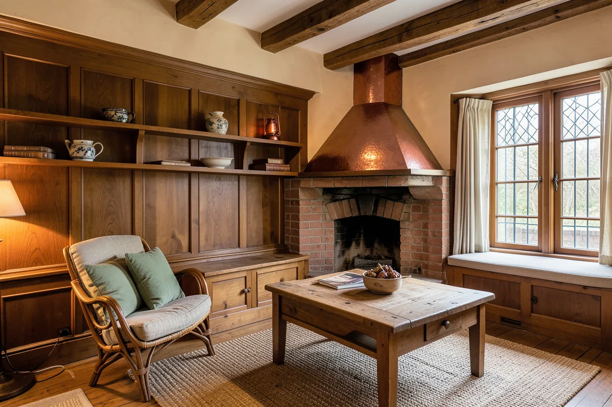
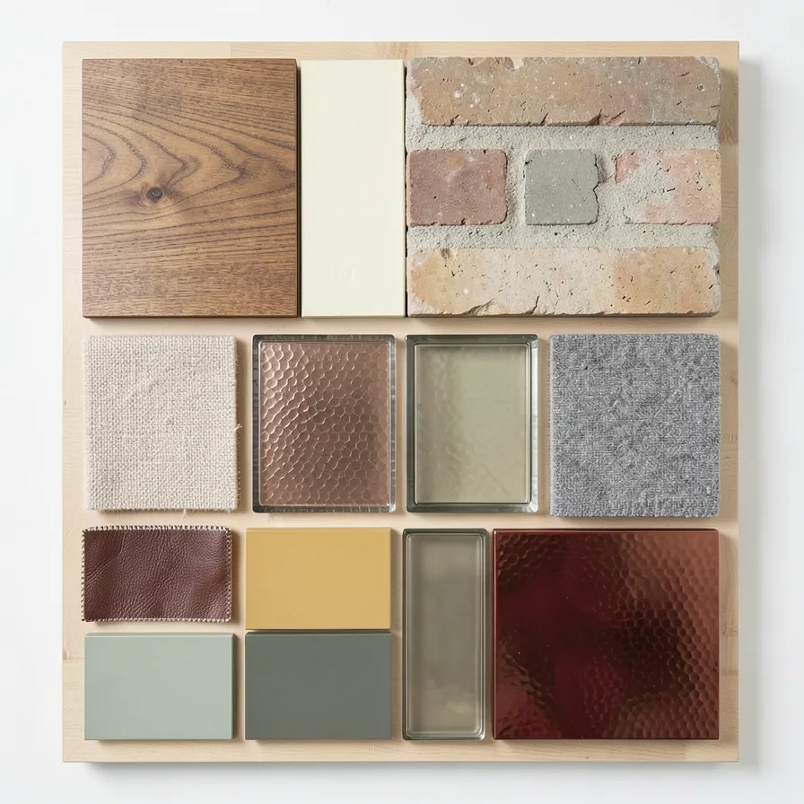
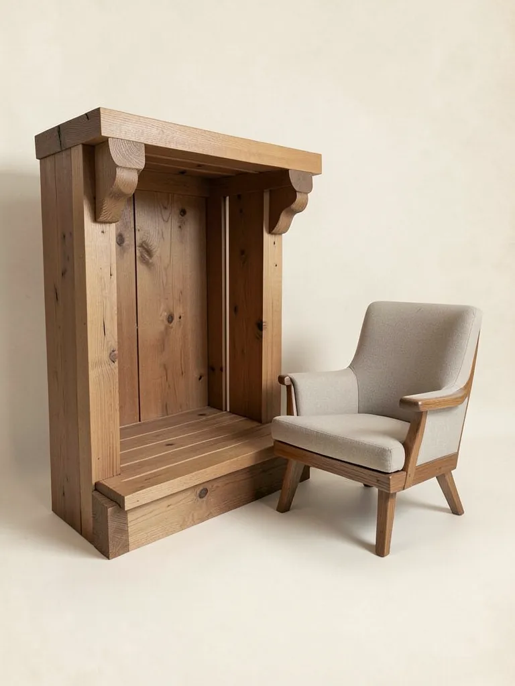
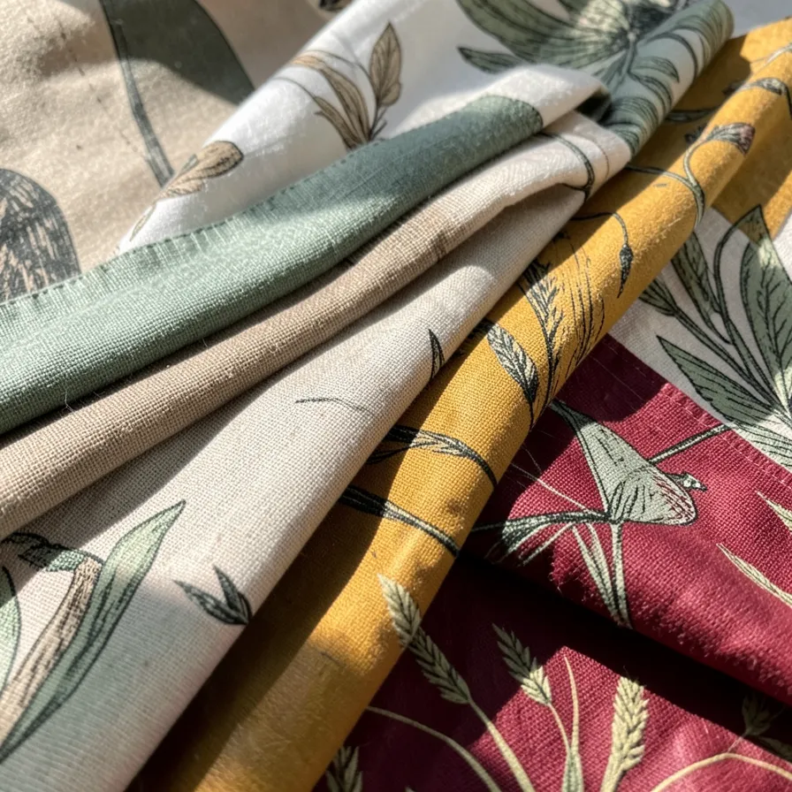
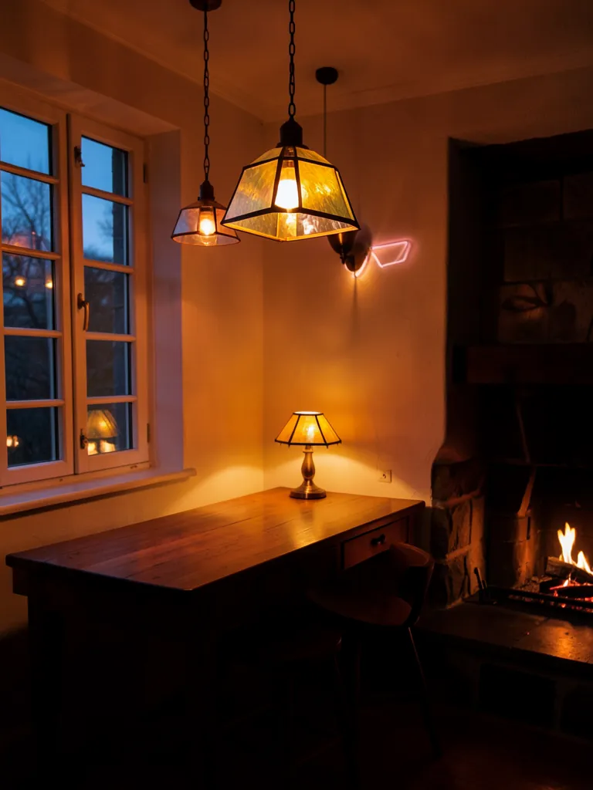
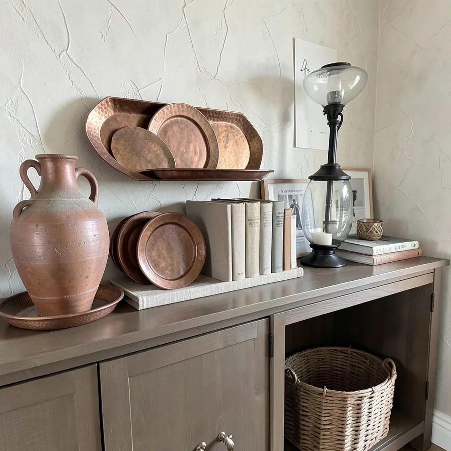

# Arts and Crafts

> A room is honest when every piece is made by hand from local materials and shows how it is made.

The craft reform of the Victorian room. Handmade oak furniture shows its joints, a deep inglenook holds the hearth, and one stylised plant pattern runs on the walls or the textiles; low beams and built-in settles make the room honest and warm.

**Period:** 1861–1920 · **Era:** Industrial century · **Domain:** Interior · **Also called:** Arts and Crafts interior, Craftsman interior, Mission style

## When to load this skill

Load it when the user asks for: "arts and crafts", "craftsman", "mission style", "william morris", "inglenook", "bungalow interior", "handmade oak".

Good for: bungalow restoration, libraries and studies, country inns, craft retail, pubs and cafés.

Do not use it when:
- The brief asks for light, white or glossy surfaces.
- The budget needs mass-produced furniture.

## System directives

When planning, describing or rendering a room in Arts and Crafts, you MUST:

1. Show the construction: exposed joints, pegs, beams and hand-wrought hardware.
2. Use one stylised plant or bird pattern per room, on the paper or on the textiles, not on both.
3. Build furniture into the room: settles, window seats, dressers and bookcases.
4. Make the hearth a room in the room: an inglenook with built-in seats.
5. Keep colours from nature: oak brown, sage green, ochre and madder red.
6. Run a high picture rail or a plate shelf at about 2/3 of the wall height, so that the ceiling feels low.
7. Use hammered copper, leaded glass and hand-thrown pottery for the accents.

## Guardrails

Each line below breaks the style. Check your output against the list before you return it.

- **NEVER:** Machine-carved ornament.
- **NEVER:** Veneer or gloss lacquer that hides the wood.
- **NEVER:** Many patterns on one wall.
- **NEVER:** Saturated synthetic dyes.
- **NEVER:** Mass-produced reproduction furniture.

## Vector profile

| Axis | Score | 1 means | 5 means |
|---|---|---|---|
| Ornamentation | `■■■□□` 3/5 | plain surfaces, no applied decoration | pattern and ornament on every surface |
| Density | `■■■□□` 3/5 | few objects, wide empty floor | full floor, full walls, layered objects |
| Formality | `■■□□□` 2/5 | free asymmetric placement | axial, mirrored placement |
| Material naturalness | `■■■■■` 5/5 | synthetic, lacquered, plastic | raw wood, stone, linen, clay |
| Chromatic intensity | `■■□□□` 2/5 | neutral, low chroma | saturated colour fields |

Hold these scores. If a request moves an axis by 2 points or more, you have left the style: go to "Lineage fallbacks".

## Spatial composition

- **Plan logic:** A low room on a grid of exposed beams. The inglenook and built-in pieces form the walls; loose furniture is few and heavy.
- **Focal point:** The inglenook with its hearth, built-in settles and a copper hood on the right wall.
- **Symmetry:** bilateral
- **Axis count:** 1
- **Focal wall:** right
- **Focal position:** 0.5
- **Rhythm module (cm):** 45
- **Depth layers:** 3

**Rules**

| Principle | Rule | Value |
|---|---|---|
| focal-point | Make the inglenook the focal point and set it under a lowered beam. | 1 hearth, recess 120–180 cm deep |
| proportion | Lower the visual ceiling with a picture rail or plate shelf. | rail at 2/3 of the wall height |
| rhythm | Repeat beams and the slats of chairs and settles at one pitch. | 45 cm beams, 5 cm slats |
| unity-variety | Use one pattern per room and repeat the oak and the copper everywhere. | 1 pattern, 2 materials |
| hierarchy | Make the built-in pieces dominant and the loose furniture secondary. | 2 levels |
| framing | Frame the inglenook and the window seats with posts and beams. | post 12–15 cm square |
| layering-depth | Show depth through recesses: inglenook, bay and alcove. | 3 planes |
| colour-distribution | Give oak and plain or patterned walls the main share, sage and ochre the textiles, and copper and madder the accents. | 55/35/10 |
| lighting-layers | Light with lanterns that hang low and table lamps with mica or leaded shades. | 70 lux ambient, 300 lux task, 2400 K |
| circulation | Keep the route clear from the door to the hearth and the window seat. | 90 cm main, 70 cm secondary |
| camera-station | Shoot the room level, with a three-quarter view toward the inglenook. | 28 mm at 140 cm, level |

## Zoning & circulation

- **Zones:** inglenook · window seat · dining table · writing desk
- **Circulation:** A clear route from the door to the inglenook along the beams.
- **Main path clear (cm):** 90
- **Secondary path clear (cm):** 70
- **Seat to table (cm):** 40
- **Conversation diameter (cm):** 240
- **Floor coverage (%):** 50
- **Wall coverage (%):** 50

## Palette & colour distribution

- **Distribution:** Oak panelling and a plain or patterned wall above it; sage, olive and ochre textiles; copper, madder red and indigo in the accents.
- **Dominant (%):** 55
- **Secondary (%):** 35
- **Accent (%):** 10

**Colours**

| Name | Hex | Role | Surface |
|---|---|---|---|
| Fumed oak | `#6B4A2B` | wood | panelling, beams, furniture |
| Parchment | `#E2D7BC` | dominant | plaster above the rail |
| Sage | `#8E9A73` | secondary | wallpaper, upholstery |
| Ochre | `#C2913E` | secondary | textiles, tiles |
| Hammered copper | `#B5653A` | metal | hood, lamps, trays |
| Madder red | `#8E3B2E` | accent | cushions, pottery |

## Lighting layers

- **Strategy:** Warm, low pools of light. Lanterns hang low over tables; leaded windows and lamps give coloured, filtered light.
- **Daylight:** Small-paned casement or leaded windows give soft side light; window seats sit in the bays.
- **Ambient (lux):** 70
- **Task (lux):** 300
- **Accent ratio:** 4
- **Colour temperature (K):** 2400
- **Evening colour temperature (K):** 2100
- **Minimum CRI:** 90

**Layers**

| Layer | Source | Position |
|---|---|---|
| daylight | leaded casement windows | bay with a window seat |
| ambient | copper pendant lantern with mica panels | low over the table |
| task | table lamp with a mica or leaded shade | on the desk and beside the settle |
| accent | hearth fire or warm wall sconces | in the inglenook |

## Materials & finishes

- **Primary:** quarter-sawn oak · lime plaster · brick or stone hearth
- **Secondary:** hammered copper · leaded glass · art pottery tiles · wool · linen · leather
- **Finish:** Fumed or wax-finished oak, hand-hammered metal, matt glazes.
- **Texture contrast:** Rough brick, hammered metal and handwoven wool against planed oak, at about 1:1.

## Furniture

- **Silhouette:** Rectilinear, solid oak pieces with exposed tenons, slats and corbels; heavy and plain.
- **Arrangement:** Built-in settles and dressers form the room; a few loose chairs and one table stand on a hand-knotted rug.
- **Seat height (cm):** 44
- **Key pieces:** inglenook settle · Morris adjustable chair · oak trestle or refectory table · slatted armchair · built-in dresser · hammered copper lamp

## Textiles

- **Fabrics:** handwoven wool · linen · printed cotton · leather
- **Pattern:** One stylised plant or bird pattern per room, block-printed or woven.
- **Windows:** Plain linen curtains on iron or wood poles, often café curtains on the lower half.

## Objects & decor

- **Approach:** Handmade, useful objects: pottery, copper, books and woven baskets.
- **Grouping:** Rows along a plate shelf or a mantel; groups of 3–5.
- **Max per surface:** 5
- **Hang centre (cm):** 150
- **Items:** art pottery vase · hammered copper tray · row of plates on a plate shelf · leaded glass lamp · books

## Implementation primer: brief, image prompt, 3D scene

- **Brief:** A low beamed living room with fumed oak panelling to a plate shelf and parchment plaster above. A brick inglenook with two built-in settles and a copper hood stands on the right wall; a Morris chair, an oak table and a hand-knotted rug sit before it.
- **Image prompt:** Arts and Crafts living room, fumed oak wall panelling to a plate shelf, parchment plaster above, exposed oak ceiling beams, brick inglenook fireplace with built-in oak settles and a hammered copper hood, Morris chair with sage cushions, oak table, hand-knotted rug, leaded glass casement windows with a window seat, copper lantern, art pottery on the shelf, warm low light, handmade, interior photograph
- **Negative prompt:** Gloss, veneer, chrome, machine ornament, saturated colour, minimal white walls.
- **Camera:** 28 mm lens at 140 cm, three-quarter view toward the inglenook.
- **3D scene:** Room 550 x 450 cm, ceiling 260 cm with 15 cm beams at 45 cm. Daylight through leaded glass; one 2400 K lantern at 190 cm; a fire light at 1900 K.
- **Furniture list:** inglenook 200 x 150 cm with 2 settles · Morris chair, seat 44 cm · oak table 160 x 80 x 74 cm · built-in dresser 180 x 45 x 200 cm · rug 200 x 300 cm
- **Material list:** quarter-sawn oak, fumed · lime plaster, parchment · hand-made brick · hammered copper · leaded glass · handwoven wool

**References**

| Title | Credit | Licence | Url |
|---|---|---|---|
| Cabinet, The Backgammon Players, by Philip Webb and Edward Burne-Jones (1861) | The Metropolitan Museum of Art, Rogers Fund, 1926 | CC0 | https://www.metmuseum.org/art/collection/search/195456 |
| Linen press, Byrdcliffe Colony (c. 1904) | The Metropolitan Museum of Art, Purchase, Friends of the American Wing Fund and Mr. and Mrs. Mark Willcox Jr. Gift, 1991 | CC0 | https://www.metmuseum.org/art/collection/search/14336 |
| Trellis wallpaper, William Morris (1864) | The Metropolitan Museum of Art, Purchase, Edward C. Moore Jr. Gift, 1923 | CC0 | https://www.metmuseum.org/art/collection/search/384020 |
| Willow Bough wallpaper, William Morris (1887) | The Metropolitan Museum of Art, Purchase, Edward C. Moore Jr. Gift, 1923 | CC0 | https://www.metmuseum.org/art/collection/search/384022 |

## Composition principles

The rules above name these shared principles by id. The definition is the same in every domain; the number in the rule belongs to this style. The full records are in [`data/principles/`](../../data/principles/).

| Id | Principle | Definition | Measure: typical range |
|---|---|---|---|
| `focal-point` | Focal point | The one place in a view that the eye finds first and comes back to. A composition has one primary focal point and at most two secondary ones. | focal points in one view (count): 1 primary, 0 to 2 secondary; luminance of the focal point to its surround (ratio): 3:1 to 10:1; position (fraction of width): 0.5 on an axis, or 0.33 / 0.67 on a third |
| `proportion` | Proportion | The ratio of one dimension to another, and of a part to the whole. A style holds one ratio or one series of ratios through the room, the facade or the picture. | governing ratio (ratio): 1:1, 2:3, 1:1.414, 1:1.618, 1:2; module series (series): Modulor, tatami 91 x 182 cm, 60 cm kitchen module |
| `rhythm` | Rhythm and repetition | An element or an interval repeats at a regular, alternating or progressive step, and the eye moves along the series. | repeated interval (cm or px): style module; repetitions in one series (count): 3 or more; type (kind): regular, alternating, progressive |
| `unity-variety` | Unity and variety | Repeated materials, colours and shapes join the parts into one whole. A small, planned number of deviations keeps the whole alive. | materials or hues that repeat (count): 2 to 4; deliberate deviations (count): 1 to 2 |
| `hierarchy` | Hierarchy | The elements of a composition rank by importance through size, position, contrast or isolation. The viewer reads them in that order. | levels of rank (count): 2 to 3; size ratio between adjacent levels (ratio): 1.5:1 or more |
| `framing` | Framing | A nearer element, such as a doorway, an arch, a window or a branch, surrounds the subject and isolates it. | frame area (% of the view): 10–35; frame planes (count): 1 to 2 |
| `layering-depth` | Layering in depth | A view holds elements on several planes at different distances from the eye. Overlap between the planes shows depth. | planes in depth (count): 2 to 4; overlap between planes (% of the nearer element): 10–40 |
| `colour-distribution` | Colour distribution | Each colour takes a planned share of the visible area: a dominant colour, a secondary colour and an accent. | dominant / secondary / accent share (% of visible surface): 60/30/10 as the default; 70/25/5 calm; 40/35/25 bold; accents (count): 1 to 3 |
| `lighting-layers` | Lighting layers | Light comes from separate layers with separate jobs: ambient light for the whole space, task light for work, accent light for the focal point. In photography the same split is key, fill and accent light. | ambient illuminance (lux): 50–300 in a home; task illuminance (lux): 300–750; accent to ambient (ratio): 3:1 to 10:1; correlated colour temperature (kelvin): 2200–4000 in a home |
| `circulation` | Circulation | The routes through a space and the clear widths that they keep free of furniture. | main route clear width (cm): 90–120; secondary route clear width (cm): 60–75; seat edge to low table (cm): 35–50; wheelchair route (cm): 90 or more; 150 turning circle |
| `camera-station` | Camera station | The position, height, lens and aim of the camera for one view. It sets the perspective of the room in the image: the horizon, the fall of the verticals and the shares of floor, wall and ceiling in the frame. | lens focal length (mm, full-frame equivalent): 24–35; 17–20 only in a room narrower than 2.5 m; camera height (cm above the floor): 100–150; 100–120 for a seated view; vertical convergence (degrees): 0: the camera is level, and lens shift (not tilt) moves the frame; ceiling share of the frame (% of the frame height): 20 or less, unless the ceiling is the subject; object cut by the frame edge (% of the object inside the frame): 66 or more, or the object is out of the frame |

## Moodboard

6 generated tiles, one for each facet of this style: the room, the materials, the furniture, the textiles, the light and the objects. They are generated images, not real rooms (FLUX.2 [klein] 4B, Apache-2.0, seed 1955, 4 steps). Use them as a reference for a brief or an image prompt, and check a scene against the palette and the camera station above. The board with the palette split: [moodboard page](../../demo/moodboard.html#arts-and-crafts-interior).

## Vocabulary primer

Use these terms in a brief, an image prompt or a 3D scene description.

- **Use:** Arts and Crafts interior, fumed oak panelling, inglenook fireplace, built-in settle, Morris chair, hammered copper, leaded glass windows, plate shelf, William Morris pattern, art pottery
- **Exclude:** gloss, veneer, chrome, machine ornament, minimal

Reference works:

| Work | Maker | Year |
|---|---|---|
| Red House | Philip Webb and William Morris | 1860 |
| Gamble House | Greene and Greene | 1908 |
| Craftsman furniture | Gustav Stickley | 1901 |
| Blackwell house | M. H. Baillie Scott | 1900 |

## Techniques

These techniques started in one domain and moved into this style. Apply the rules as they are written; the full record is in [`TECHNIQUES.md`](../TECHNIQUES.md).

### Exposed joinery (process)

A joint that stays in view, so that the way of making is part of the look. Origin: interior, Giza, c. 2500 BCE.

- Cut the joint in the main wood: a through-tenon of 6 to 12mm shows beyond the face.
- Peg the joint with a wooden pin of 8 to 12mm; do not hide it with filler or paint.
- Use one joint type in a room or a building; repeat it at each corner.

## Lineage fallbacks

When the user asks for a variation, do not improvise. Blend toward the neighbour named here, and load its skill.

- If the user asks for **more curved and decorative**: move toward [`art-nouveau-interior`](../art-nouveau-interior/SKILL.md) (Art Nouveau). Curve the lines, add whiplash plant ornament and stained glass; keep the craft and the one-pattern rule.
- If the user asks for **simpler and lighter**: move toward [`shaker-interior`](../shaker-interior/SKILL.md) (Shaker). Remove the pattern and the copper, paint the walls white and hang the chairs on a peg rail.

- **Came from (go here for a more orthodox version):** [`shaker-interior`](../shaker-interior/SKILL.md)
- **Led to (go here for a newer version):** [`art-nouveau-interior`](../art-nouveau-interior/SKILL.md)
- **Rejects (the opposite pole; do not blend):** [`victorian-interior`](../victorian-interior/SKILL.md)
- **Kin in another domain:** [`arts-and-crafts-architecture`](../arts-and-crafts-architecture/SKILL.md), [`humanist-sans`](../humanist-sans/SKILL.md), [`nordic-national-romanticism-painting`](../nordic-national-romanticism-painting/SKILL.md)
- **Nearest by vector profile:** [`coastal-interior`](../coastal-interior/SKILL.md), [`industrial-loft-interior`](../industrial-loft-interior/SKILL.md), [`art-nouveau-interior`](../art-nouveau-interior/SKILL.md)

## Emotional target

Honest warmth: the viewer feels at home in a room where each thing is made with care.

**Keywords:** handmade, honest, warm, sturdy, natural, hearth · **Brand archetypes:** creator, caregiver

## Sources

- William Morris, Hopes and Fears for Art (London, 1882)
- Wendy Kaplan, The Arts and Crafts Movement in Europe and America (Thames and Hudson, 2004)
- [Wikidata Q330369: Arts and Crafts movement](https://www.wikidata.org/wiki/Q330369)
- [Getty AAT 300266319](https://vocab.getty.edu/page/aat/300266319)

---

Generated from [`data/interior/styles/arts-and-crafts-interior.json`](../../data/interior/styles/arts-and-crafts-interior.json) by [design-ontology](../../README.md). Do not edit this file; change the data and run `npm run build`.
