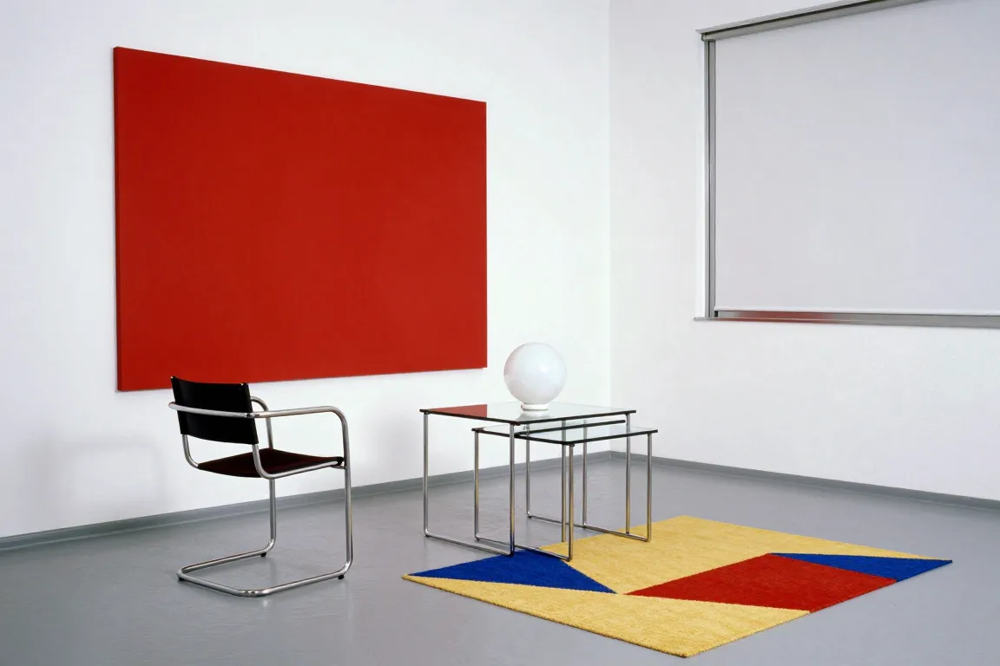
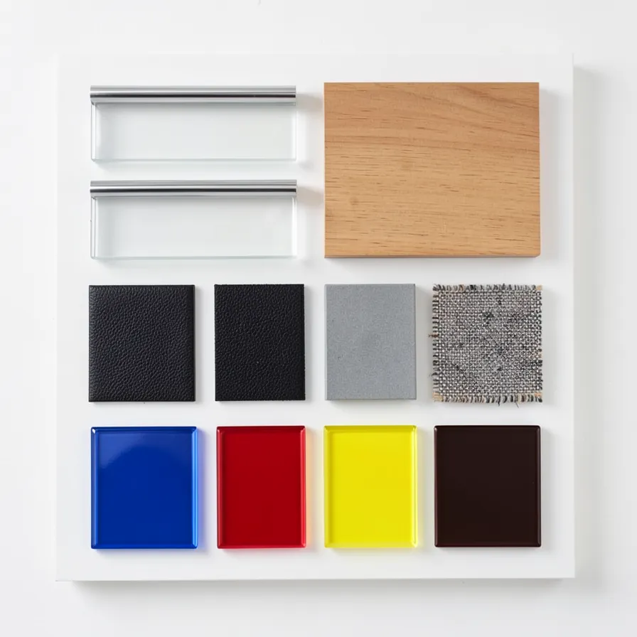
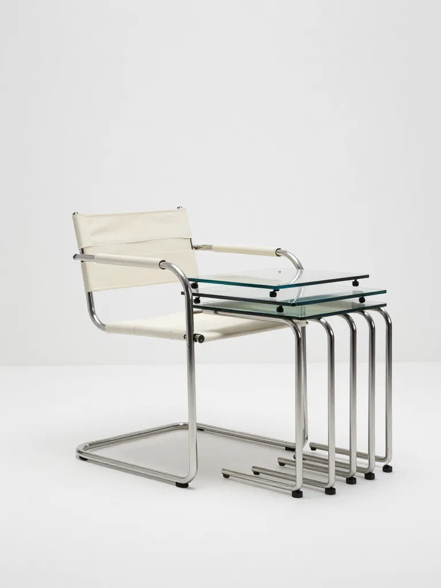
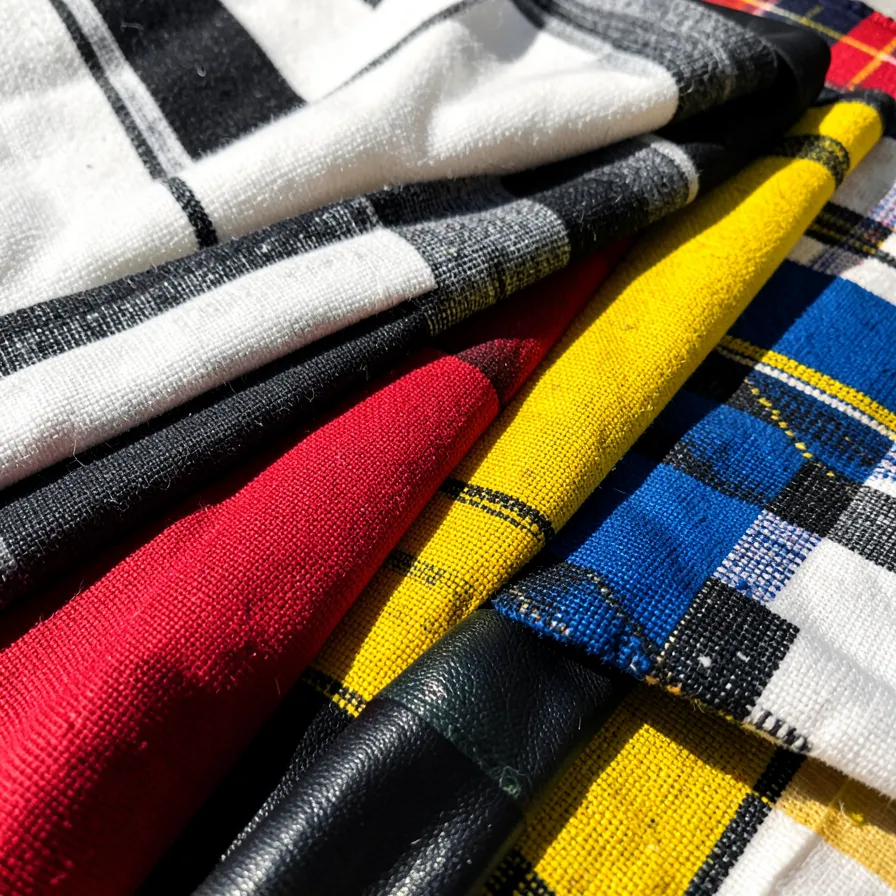
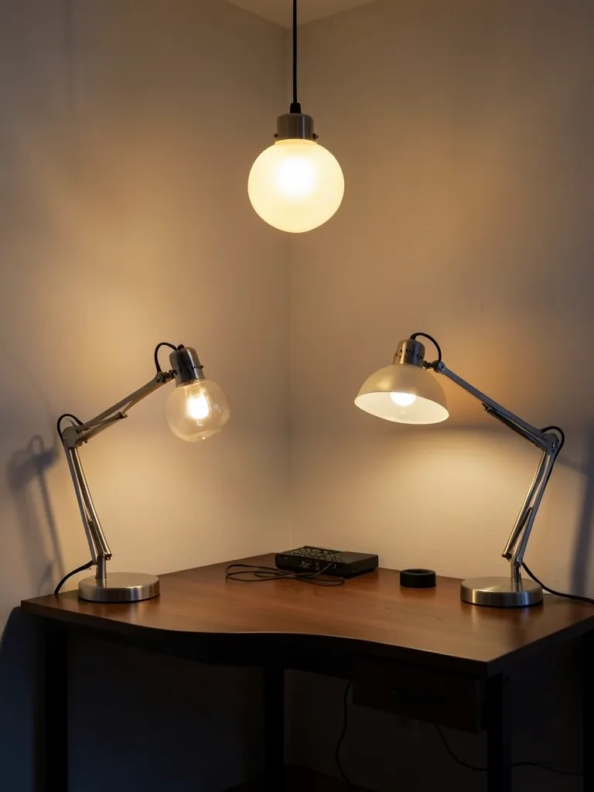
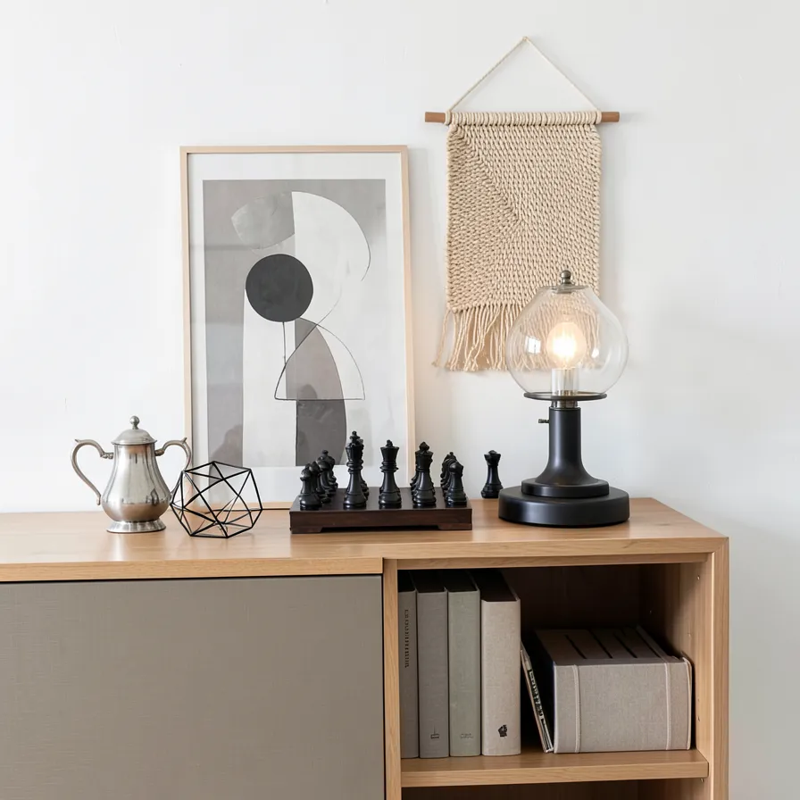

# Bauhaus interior

> A room is a machine for daily life, and industry can make each of its parts well and for everyone.

The rooms that the Bauhaus workshops in Weimar and Dessau designed and furnished. Tubular steel, glass, lacquer and woven wool stand in white rooms with one primary-colour wall; each object is a prototype for industry, and the room is a tool for living.

**Period:** 1919–1933 · **Era:** Modern reform · **Domain:** Interior · **Also called:** Bauhaus room, Neues Wohnen, New Living

## When to load this skill

Load it when the user asks for: "bauhaus interior", "bauhaus room", "tubular steel", "cantilever chair", "dessau", "neues wohnen", "functionalist interior", "primary colour wall".

Good for: studios and workspaces, design museum rooms, small flats, architecture visualisation, set design for the 1920s.

Do not use it when:
- The brief asks for softness, warmth or a traditional home.
- Young children or older users need soft edges and deep seats.

## System directives

When planning, describing or rendering a room in Bauhaus interior, you MUST:

1. Place furniture on two orthogonal axes, parallel to the walls, and never mirror one side of the room in the other.
2. Paint one wall plane in one primary colour, red, yellow or blue, and keep the other planes white, grey or black.
3. Use 3 materials in the furniture: chrome-plated tubular steel, glass and lacquered wood; add woven wool or canvas for the seats.
4. Keep each piece open in frame: a cantilever or a tube outline, so that the floor shows through 50% or more of its footprint.
5. Build storage as modular cabinets on a 60 cm module, flush with the wall and free of handles in relief.
6. Light each zone with one visible functional lamp: an opal globe, a glass-shade table lamp or an adjustable arm lamp.
7. Leave 60% of the floor bare, in linoleum or sealed board of one colour.

## Guardrails

Each line below breaks the style. Check your output against the list before you return it.

- **NEVER:** Historical ornament, mouldings or carved wood.
- **NEVER:** Overstuffed upholstery with skirts, fringes or buttons.
- **NEVER:** A mirrored formal layout about a centre line.
- **NEVER:** Patterned wallpaper or floral fabric.
- **NEVER:** Curved organic forms other than the bent steel tube.
- **NEVER:** Hidden light sources and warm amber glow without a visible lamp.

## Vector profile

| Axis | Score | 1 means | 5 means |
|---|---|---|---|
| Ornamentation | `■□□□□` 1/5 | plain surfaces, no applied decoration | pattern and ornament on every surface |
| Density | `■■□□□` 2/5 | few objects, wide empty floor | full floor, full walls, layered objects |
| Formality | `■■□□□` 2/5 | free asymmetric placement | axial, mirrored placement |
| Material naturalness | `■■□□□` 2/5 | synthetic, lacquered, plastic | raw wood, stone, linen, clay |
| Chromatic intensity | `■■■□□` 3/5 | neutral, low chroma | saturated colour fields |

Hold these scores. If a request moves an axis by 2 points or more, you have left the style: go to "Lineage fallbacks".

## Spatial composition

- **Plan logic:** A free plan on an orthogonal grid. Each zone has one function and one rectangle of furniture, and the rectangles sit off-centre in the room.
- **Focal point:** A primary-colour wall plane or a tubular-steel chair against white, placed on a third of the wall and not on the centre line.
- **Symmetry:** asymmetric
- **Axis count:** 2
- **Focal wall:** left
- **Focal position:** 0.33
- **Rhythm module (cm):** 60
- **Depth layers:** 2

**Rules**

| Principle | Rule | Value |
|---|---|---|
| focal-point | Paint one wall plane in one primary colour. It is the only colour field of more than 1 m² in the room. | 1 colour wall, on a third |
| symmetry-axis | Align every piece to one of two orthogonal axes. No piece stands at an angle, and no side mirrors the other. | 2 axes, 0% mirrored |
| balance | Set a heavy dark block, such as a black cabinet, on one third against a light steel frame on the other third. | moment ratio 0.8–1.25 |
| rhythm | Repeat the cabinet module in built-ins, shelves and door widths. | 60 cm module |
| proportion | Build rectangles of 1:1 and 1:2 in cabinets, rugs and wall panels. | 1:1 and 1:2 |
| contrast | Set black against white on at least one edge in each view. | LRV difference 70 or more |
| negative-space | Keep the floor bare and of one colour. Open frames let the floor show under the chairs and tables. | 60% bare floor |
| zoning | Mark each zone by function and by its lamp: sit, work, eat. Use no screens between zones. | 3 zones, 1 lamp each |
| circulation | Keep one straight route from the door to the window band, clear of furniture. | 100 cm clear |
| sightlines | Keep furniture in the centre of the room below 75 cm, so that the view from the door crosses the floor to the window. | under 75 cm in the centre |
| colour-distribution | Give white and light grey the walls and ceiling, black, chrome and wood the furniture, and one primary colour the focal plane. | 70/20/10 |
| lighting-layers | Show each lamp as an object. Use a neutral white, not a warm glow. | 150 lux ambient, 500 lux task, 3500 K |
| unity-variety | Repeat the same 3 materials in every piece. The only deviation is the woven textile. | 3 materials, 1 textile |
| camera-station | Shoot the room level, with a two-point view at 30 degrees to the colour wall from a corner. | 28 mm at 140 cm, level |

## Zoning & circulation

- **Zones:** sit · work · eat
- **Circulation:** A straight route from the door to the window band, and routes between zones along the grid lines.
- **Main path clear (cm):** 100
- **Secondary path clear (cm):** 70
- **Seat to table (cm):** 40
- **Conversation diameter (cm):** 260
- **Floor coverage (%):** 35
- **Wall coverage (%):** 15

## Palette & colour distribution

- **Distribution:** White walls and ceiling, light grey floor, black and chrome furniture, one primary-colour wall plane; small primary accents on a rug or a lamp.
- **Dominant (%):** 70
- **Secondary (%):** 20
- **Accent (%):** 10

**Colours**

| Name | Hex | Role | Surface |
|---|---|---|---|
| White | `#F4F4F0` | dominant | walls and ceiling |
| Linoleum grey | `#C9C9C4` | secondary | floor |
| Black | `#1A1A1A` | secondary | cabinets, leather seats |
| Chrome | `#B8BCC0` | metal | tubular frames |
| Signal red | `#C8281E` | accent | one wall plane |
| Chrome yellow | `#F2C230` | accent | rug field, small objects |
| Ultramarine | `#1F4E9C` | accent | rug field, cushion |

## Lighting layers

- **Strategy:** Each lamp is a visible industrial object with one job. The light is even and neutral, and each zone has its own lamp.
- **Daylight:** A wide band of steel-framed windows or a full glass wall gives even side light; window glass is 25% of the floor area or more.
- **Ambient (lux):** 150
- **Task (lux):** 500
- **Accent ratio:** 2
- **Colour temperature (K):** 3500
- **Evening colour temperature (K):** 3000
- **Minimum CRI:** 90

**Layers**

| Layer | Source | Position |
|---|---|---|
| daylight | steel-framed window band | one long wall |
| ambient | opal glass globe pendant | centre of each zone |
| task | glass and metal table lamp | desk and side table |
| task | adjustable arm lamp | work table or wall |

## Materials & finishes

- **Primary:** chrome-plated tubular steel · glass · lacquered plywood
- **Secondary:** linoleum · black leather · woven wool · canvas · opal glass
- **Finish:** Gloss chrome and satin lacquer against matt white plaster. Wood shows only as plain veneer or under lacquer.
- **Texture contrast:** Smooth against smooth. Texture comes only from woven seat fabric and one rug, under 10% of the visible surface.

## Furniture

- **Silhouette:** Tubular-steel frames: cantilever chairs, club chairs of steel and canvas straps, nesting tables, glass-top trolleys and cubic cabinets.
- **Arrangement:** Pieces stand free of the walls on the grid lines, in small rectangles parallel to the window wall.
- **Seat height (cm):** 43
- **Key pieces:** tubular-steel club chair · cantilever chair · nesting tables · glass-shade table lamp · modular wall cabinet · steel-frame daybed · woven wool rug

## Textiles

- **Fabrics:** woven wool · canvas · black leather · linen
- **Pattern:** Geometric weaves of stripes and rectangles from the weaving workshop, on one rug or one wall hanging only.
- **Windows:** Bare steel frames, or plain white roller blinds that roll up into the frame.

## Objects & decor

- **Approach:** Industrial prototypes are the only decor: a tea set, a lamp, a chess set, a shelf of books.
- **Grouping:** One object per surface, on a third of the surface, with clear space around it.
- **Max per surface:** 2
- **Hang centre (cm):** 145
- **Items:** metal tea set · geometric chess set · glass-shade lamp · abstract print · woven wall hanging

## Implementation primer: brief, image prompt, 3D scene

- **Brief:** A white room with a band of steel windows, a grey linoleum floor and one red wall plane on the left third. A tubular-steel club chair, a cantilever chair and a nesting table stand on a woven rug; one glass lamp per zone.
- **Image prompt:** Bauhaus interior 1926, white walls, one signal-red wall plane, grey linoleum floor, chrome tubular-steel club chair with black canvas straps, cantilever chair, glass nesting tables, opal glass globe pendant, steel window band, geometric woven wool rug in red yellow blue, asymmetric orthogonal layout, even daylight, black and white contrast, period photograph
- **Negative prompt:** Ornament, mouldings, floral fabric, curved organic furniture, warm amber light, clutter, symmetrical layout, wood grain.
- **Camera:** 28 mm lens, camera at 140 cm, two-point view at 30 degrees to the colour wall from a corner.
- **3D scene:** Room 600 x 450 cm, ceiling 280 cm. Sky light through a 400 cm window band; one 3500 K area light per zone; white walls with reflectance 0.85.
- **Furniture list:** tubular-steel club chair · 2 cantilever chairs · nesting tables, 3 sizes · modular cabinet 180 x 40 x 60 cm · steel desk · rug 200 x 140 cm
- **Material list:** white plaster, matt · grey linoleum · chrome tube 25 mm · black lacquer · clear glass 8 mm · woven wool

## Composition principles

The rules above name these shared principles by id. The definition is the same in every domain; the number in the rule belongs to this style. The full records are in [`data/principles/`](../../data/principles/).

| Id | Principle | Definition | Measure: typical range |
|---|---|---|---|
| `focal-point` | Focal point | The one place in a view that the eye finds first and comes back to. A composition has one primary focal point and at most two secondary ones. | focal points in one view (count): 1 primary, 0 to 2 secondary; luminance of the focal point to its surround (ratio): 3:1 to 10:1; position (fraction of width): 0.5 on an axis, or 0.33 / 0.67 on a third |
| `symmetry-axis` | Symmetry and axis | An axis is a line that orders a composition. Symmetry places equal elements at equal distances on the two sides of the axis, or around a centre. | ordering axes (count): 0 to 3; mirrored mass about the axis (% of visual weight): 90–100 formal, 0–50 informal; type (kind): bilateral, radial, none |
| `balance` | Visual balance | The visual weights on the two sides of a centre cancel out. Formal balance uses mirrored equal weights; informal balance sets a large near mass against several small far masses. | moment of visual weight, left to right about the centre (ratio): 1.0 formal; 0.8–1.25 informal; type (kind): formal, informal, radial |
| `rhythm` | Rhythm and repetition | An element or an interval repeats at a regular, alternating or progressive step, and the eye moves along the series. | repeated interval (cm or px): style module; repetitions in one series (count): 3 or more; type (kind): regular, alternating, progressive |
| `proportion` | Proportion | The ratio of one dimension to another, and of a part to the whole. A style holds one ratio or one series of ratios through the room, the facade or the picture. | governing ratio (ratio): 1:1, 2:3, 1:1.414, 1:1.618, 1:2; module series (series): Modulor, tatami 91 x 182 cm, 60 cm kitchen module |
| `contrast` | Contrast | Two adjacent elements differ in value, hue, texture, size or shape. Contrast marks edges and makes the focal point. | light reflectance value difference between adjacent planes (LRV points): 30 or more for a visible edge |
| `negative-space` | Negative space | The empty area around and between elements. It is a part of the composition, not a remainder. | empty floor area (% of floor): 40–80 in a room; empty wall area (% of wall): 50–95; empty frame area (% of image): 30–70 |
| `zoning` | Zoning | A space divides into areas with one activity each. A rug, a light, a ceiling change or a group of furniture marks a zone without a wall. | zones in one open room (count): 2 to 4; zone marker (kind): rug, pendant, floor level, ceiling level, furniture back |
| `circulation` | Circulation | The routes through a space and the clear widths that they keep free of furniture. | main route clear width (cm): 90–120; secondary route clear width (cm): 60–75; seat edge to low table (cm): 35–50; wheelchair route (cm): 90 or more; 150 turning circle |
| `sightlines` | Sightlines | The line from an eye position, such as an entrance or a seat, to a target. A clear sightline joins the viewer to the focal point. | standing eye height (cm): 150–165; seated eye height (cm): 110–120; obstruction on the main sightline (cm of height): 0, or below 75 for low furniture |
| `colour-distribution` | Colour distribution | Each colour takes a planned share of the visible area: a dominant colour, a secondary colour and an accent. | dominant / secondary / accent share (% of visible surface): 60/30/10 as the default; 70/25/5 calm; 40/35/25 bold; accents (count): 1 to 3 |
| `lighting-layers` | Lighting layers | Light comes from separate layers with separate jobs: ambient light for the whole space, task light for work, accent light for the focal point. In photography the same split is key, fill and accent light. | ambient illuminance (lux): 50–300 in a home; task illuminance (lux): 300–750; accent to ambient (ratio): 3:1 to 10:1; correlated colour temperature (kelvin): 2200–4000 in a home |
| `unity-variety` | Unity and variety | Repeated materials, colours and shapes join the parts into one whole. A small, planned number of deviations keeps the whole alive. | materials or hues that repeat (count): 2 to 4; deliberate deviations (count): 1 to 2 |
| `camera-station` | Camera station | The position, height, lens and aim of the camera for one view. It sets the perspective of the room in the image: the horizon, the fall of the verticals and the shares of floor, wall and ceiling in the frame. | lens focal length (mm, full-frame equivalent): 24–35; 17–20 only in a room narrower than 2.5 m; camera height (cm above the floor): 100–150; 100–120 for a seated view; vertical convergence (degrees): 0: the camera is level, and lens shift (not tilt) moves the frame; ceiling share of the frame (% of the frame height): 20 or less, unless the ceiling is the subject; object cut by the frame edge (% of the object inside the frame): 66 or more, or the object is out of the frame |

## Moodboard

6 generated tiles, one for each facet of this style: the room, the materials, the furniture, the textiles, the light and the objects. They are generated images, not real rooms (FLUX.2 [klein] 4B, Apache-2.0, seed 1955, 4 steps). Use them as a reference for a brief or an image prompt, and check a scene against the palette and the camera station above. The board with the palette split: [moodboard page](../../demo/moodboard.html#bauhaus-interior).

## Object net

Every object is a workshop prototype for the factory: chrome tube, opal glass, black Bakelite and lacquered plywood, with no ornament and one primary colour. The net gives each category of objects one industrial style, and each object one form, material, finish and texture. Default knobs: ornament_level 0, material_warmth 0.3, finish_gloss 80, era_blend 0.2, hardware_weight 22, edge_radius 1, metal_tone chrome. If a knob goes out of the range of the main style, use the first alternate that holds it. The net with the knob sliders: [industrial design page](../../demo/industrial.html#bauhaus-interior).

| Category | Object | Form | Material, finish, texture |
|---|---|---|---|
| Sanitary ([`bauhaus-product`](../bauhaus-product/SKILL.md)) | Basin | wall-hung rectangle | Vitreous china, vitreous gloss glaze, mirror-smooth |
|  | Basin tap or mixer | cross-head pillar taps | Chrome-plated brass, polished, mirror-smooth |
|  | Towel rail | single bar | Chrome-plated steel tube, polished, mirror-smooth |
| Electrics ([`bauhaus-product`](../bauhaus-product/SKILL.md)) | Light switch | round rotary on a round base | Bakelite, moulded gloss, mirror-smooth (#1A1A1A) |
|  | Socket outlet | round surface socket | Bakelite, moulded gloss, mirror-smooth (#1A1A1A) |
| Lighting ([`bauhaus-product`](../bauhaus-product/SKILL.md)) | Pendant lamp | opal globe | Opal glass, acid-etched or sandblasted, etched or frosted |
|  | Table lamp | glass dome on a metal base | Opal glass, acid-etched or sandblasted, etched or frosted |
|  | Task lamp | adjustable bedside lamp with a tilting dome | Mild steel, gloss enamel, satin-smooth (#1A1A1A) |
|  | Curtain track and blind | track behind a pelmet with plain curtains | Canvas, natural, undyed, plain weave |
| Storage ([`bauhaus-product`](../bauhaus-product/SKILL.md)) | Sideboard and cabinet | box on a recessed plinth | Birch plywood, high-gloss lacquer, satin-smooth (#F2F0EA) |
|  | Handle, knob and pull | bar pull on two posts | Chrome-plated brass, polished, mirror-smooth |
| Soft Furniture ([`bauhaus-product`](../bauhaus-product/SKILL.md)) | Armchair and lounge chair | tubular steel club chair with canvas straps | Chrome-plated steel tube, polished, mirror-smooth |
|  | Sofa | daybed on a tubular steel frame | Chrome-plated steel tube, polished, mirror-smooth |
|  | Cushion and throw | box cushion | Wool, piece-dyed, plain weave (#1A1A1A) |
| Tables ([`bauhaus-product`](../bauhaus-product/SKILL.md)) | Dining chair | cantilever chair | Chrome-plated steel tube, polished, mirror-smooth |
|  | Low table | nesting set with glass tops | Clear glass, clear gloss, mirror-smooth |
|  | Desk and work table | tubular steel desk | Chrome-plated steel tube, polished, mirror-smooth |
| Kitchen ([`bauhaus-product`](../bauhaus-product/SKILL.md)) | Kitchen front | flat slab door | Birch plywood, high-gloss lacquer, satin-smooth (#F2F0EA) |
|  | Kettle and small appliances | cylindrical electric jug | Chrome-plated brass, polished, mirror-smooth |
|  | Tableware and glassware | lidded tea set | Silver plate, polished, mirror-smooth |
| Decor ([`bauhaus-product`](../bauhaus-product/SKILL.md)) | Rug | flat-weave kilim in rectangles and stripes | Wool, piece-dyed, plain weave (#C8281E) |
|  | Bowl, tray and box | fruit bowl in wire or steel | Solid brass, polished, mirror-smooth |
|  | Picture frame | thin black box frame | Aluminium, matte paint, satin-smooth (#1A1A1A) |

Alternates for each category:
- **Sanitary:** [`ulm-braun-functionalism`](../ulm-braun-functionalism/SKILL.md), [`super-normal-product`](../super-normal-product/SKILL.md)
- **Electrics:** [`ulm-braun-functionalism`](../ulm-braun-functionalism/SKILL.md)
- **Lighting:** [`industrial-utility-product`](../industrial-utility-product/SKILL.md), [`super-normal-product`](../super-normal-product/SKILL.md)
- **Storage:** [`ulm-braun-functionalism`](../ulm-braun-functionalism/SKILL.md)
- **Soft Furniture:** [`mid-century-modern-product`](../mid-century-modern-product/SKILL.md)
- **Tables:** [`mid-century-modern-product`](../mid-century-modern-product/SKILL.md)
- **Kitchen:** [`ulm-braun-functionalism`](../ulm-braun-functionalism/SKILL.md), [`super-normal-product`](../super-normal-product/SKILL.md)
- **Decor:** [`super-normal-product`](../super-normal-product/SKILL.md)

The moodboard tiles resolve to these objects:
- **room:** Armchair and lounge chair, Dining chair, Low table, Pendant lamp, Rug
- **materials:** Dining chair, Low table, Sideboard and cabinet, Pendant lamp, Curtain track and blind, Rug
- **furniture:** Armchair and lounge chair, Dining chair, Low table, Sideboard and cabinet, Sofa
- **textiles:** Rug, Cushion and throw, Curtain track and blind
- **light:** Pendant lamp, Table lamp, Task lamp
- **objects:** Tableware and glassware, Table lamp, Picture frame, Bowl, tray and box, Sideboard and cabinet

## Vocabulary primer

Use these terms in a brief, an image prompt or a 3D scene description.

- **Use:** Bauhaus interior, tubular steel furniture, cantilever chair, one primary-colour wall, white plaster, grey linoleum floor, steel window band, opal glass pendant, geometric woven rug, asymmetric orthogonal layout
- **Exclude:** ornament, floral fabric, mouldings, overstuffed sofa, warm amber glow, symmetrical layout

Reference works:

| Work | Maker | Year |
|---|---|---|
| Haus am Horn, Weimar | Georg Muche and the Bauhaus workshops | 1923 |
| Club chair B3 | Marcel Breuer | 1925 |
| Masters' Houses, Dessau | Walter Gropius | 1926 |
| Kandem bedside lamp | Marianne Brandt | 1928 |

## Techniques

These techniques started in one domain and moved into this style. Apply the rules as they are written; the full record is in [`TECHNIQUES.md`](../TECHNIQUES.md).

### Cantilever (process)

A beam or slab fixed at one end that carries load beyond its support, so that it seems to hang in the air. Origin: architecture, Northern Europe, c. 1300.

- Fix the beam at one end and anchor it with a back span of at least 1 part to every 2 parts of the overhang.
- Keep the free end thin; a depth of 1/8 to 1/10 of the span suits steel and concrete.
- Repeat the horizontal line in a run of 2 or 3 projecting planes to give a strong shadow.

## Organisations

The groups, studios, companies, schools, channels and backers that carried this style.

- **Bauhaus** (school, Weimar, Dessau, Berlin, 1919–1933), made the style. A school of art, craft and design that joined the workshop to the studio. Its teachers and students set the forms of modern design, interiors and building.

## Permutations

Each knob varies the style inside a range where it stays itself. Keep each value in its range. `npm run permute -- <id> key=value` writes the tokens for other values.

| Knob | Default | Range | Changes |
|---|---|---|---|
| Base colour (`base_colour`) | #F4F4F0 | #F4F4F0, #C9C9C4 | palette |
| Accent colour (`accent_colour`) | #C8281E | #C8281E, #F2C230, #1F4E9C | palette, textiles, objects |
| Ceiling height (`ceiling_height`) | 2.8 | 2.5–3.5 m | composition, lighting |
| Light temperature (`light_temperature`) | 3500 | 3000–4000 K | lighting |
| Object density (`object_density`) | 0.15 | 0.05–0.25 | objects, furniture |

## Lineage fallbacks

When the user asks for a variation, do not improvise. Blend toward the neighbour named here, and load its skill.

- If the user asks for **warmer**: move toward [`mid-century-modern-interior`](../mid-century-modern-interior/SKILL.md) (Mid-century modern interior). Change chrome to teak and moulded plywood, add a low sofa and warm 2700 K light; keep the asymmetric plan and the open frames.
- If the user asks for **more playful**: move toward [`memphis-interior`](../memphis-interior/SKILL.md) (Memphis interior). Add pattern laminate and 4 or more saturated hues, rotate pieces off the grid; keep the primary solids.

- **Led to (go here for a newer version):** [`industrial-loft-interior`](../industrial-loft-interior/SKILL.md), [`mid-century-modern-interior`](../mid-century-modern-interior/SKILL.md), [`minimalist-interior`](../minimalist-interior/SKILL.md)
- **Was rejected by:** [`memphis-interior`](../memphis-interior/SKILL.md)
- **Kin in another domain:** [`bauhaus`](../bauhaus/SKILL.md), [`bauhaus-architecture`](../bauhaus-architecture/SKILL.md), [`bauhaus-modern-tableware`](../bauhaus-modern-tableware/SKILL.md), [`bauhaus-product`](../bauhaus-product/SKILL.md), [`de-stijl-painting`](../de-stijl-painting/SKILL.md), [`international-style-architecture`](../international-style-architecture/SKILL.md)
- **Nearest by vector profile:** [`mid-century-modern-interior`](../mid-century-modern-interior/SKILL.md), [`coastal-interior`](../coastal-interior/SKILL.md), [`industrial-loft-interior`](../industrial-loft-interior/SKILL.md)

## Emotional target

Clear purpose: the viewer sees a rational, light room that is ready for work and for a new kind of life.

**Keywords:** rational, functional, clear, industrial, progressive · **Brand archetypes:** creator, sage

## Sources

- Magdalena Droste, Bauhaus 1919–1933 (Bauhaus-Archiv and Taschen, 1990)
- Walter Gropius, Bauhausbauten Dessau (Bauhausbücher 12, Albert Langen, 1930)
- [Wikidata Q124354: Bauhaus](https://www.wikidata.org/wiki/Q124354)
- [Getty AAT 300021432](https://vocab.getty.edu/page/aat/300021432)

---

Generated from [`data/interior/styles/bauhaus-interior.json`](../../data/interior/styles/bauhaus-interior.json) by [design-ontology](../../README.md). Do not edit this file; change the data and run `npm run build`.
