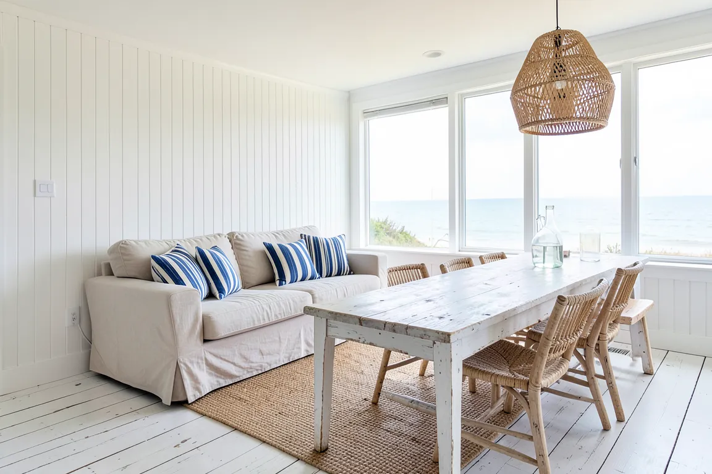
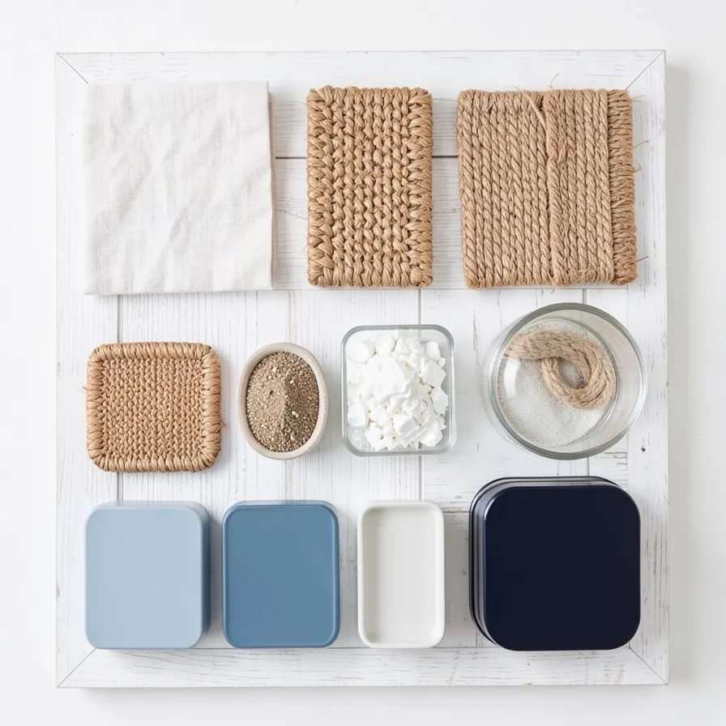
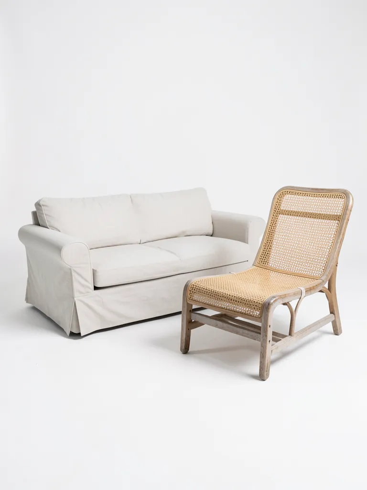
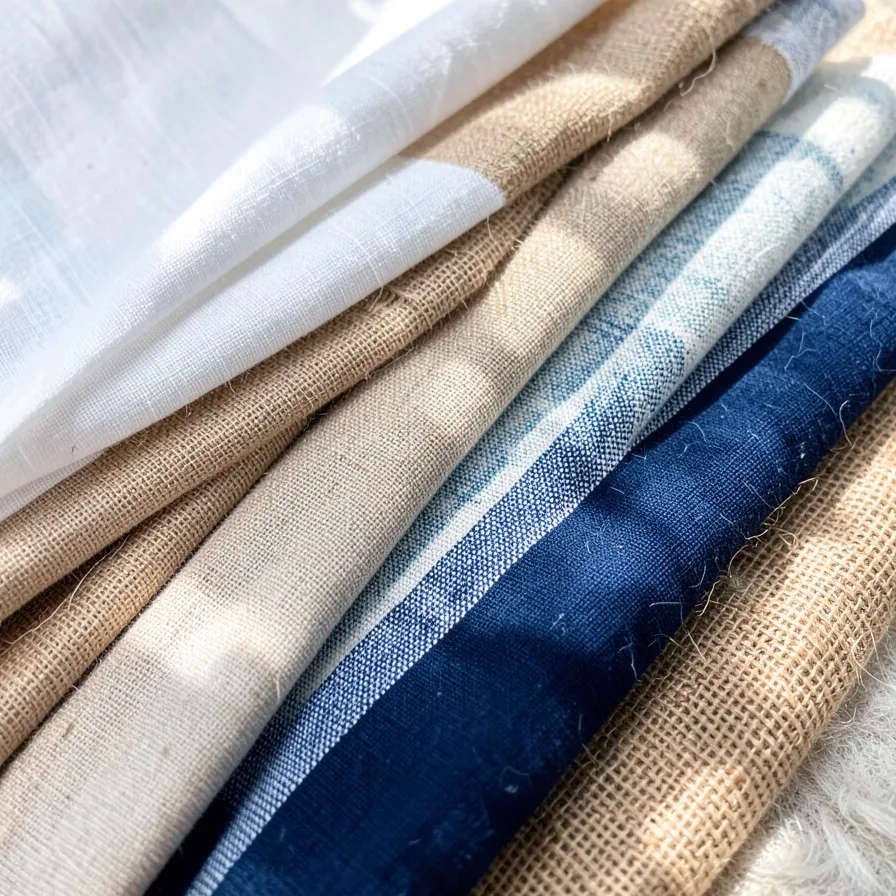
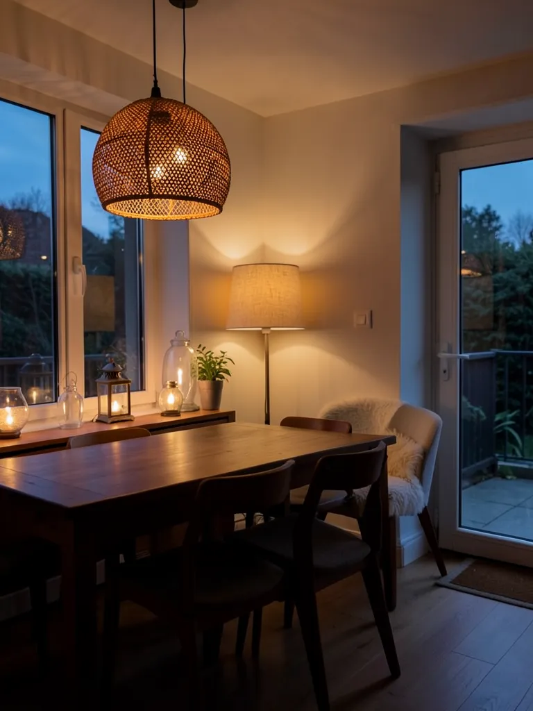
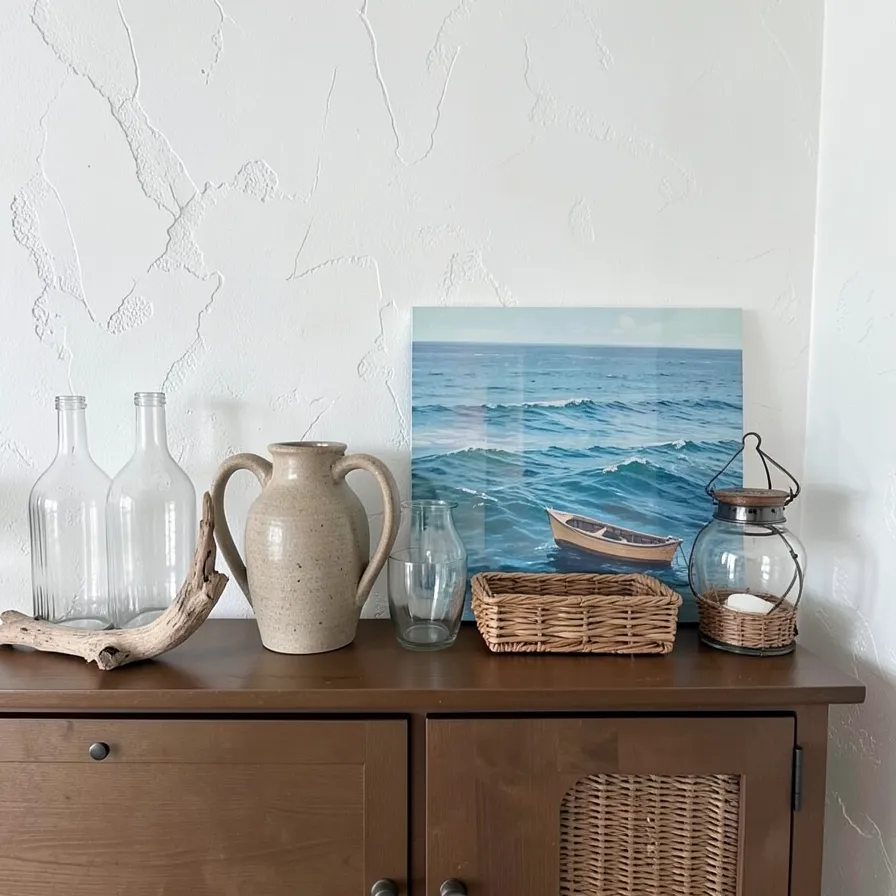

# Coastal interior

> A house by the sea takes its colours from sand, water and weathered wood, and its comfort from loose, washable fabric.

The airy summer-house room by the sea. White and sand-coloured walls, white-washed or grey-oiled wood, linen slipcovers and woven rope or rattan; one sea blue carries the accents, and the room opens to the water and the light.

**Period:** 1990s–present · **Era:** Global minimal · **Domain:** Interior · **Also called:** Coastal style, Nordic coastal, Summer-house style, Hamptons style

## When to load this skill

Load it when the user asks for: "coastal", "coastal style", "beach house", "summer house", "sommerhus", "hytte by the sea", "hamptons", "nautical", "seaside interior".

Good for: holiday homes, flats near the water, hotels and guest houses, show flats in coastal developments.

Do not use it when:
- The brief asks for drama, luxury or a dark, enclosed mood.
- The room has no daylight to lead the scheme.

## System directives

When planning, describing or rendering a room in Coastal interior, you MUST:

1. Paint walls in white or sand at a light reflectance value of 75 or more, and panel one wall or the ceiling in painted tongue-and-groove boards.
2. Use white-washed or grey-oiled oak or pine with a weathered, matt surface.
3. Cover seats in loose linen or cotton slipcovers in white, sand or pale blue.
4. Add woven texture: rattan, wicker, jute, sisal and rope, at most one piece of each in a group.
5. Keep one blue family for the accents, from pale sky to deep navy, at 10% of the surface or less.
6. Open the room to the view: low furniture in front of the window and light curtains that pull fully clear.

## Guardrails

Each line below breaks the style. Check your output against the list before you return it.

- **NEVER:** Theme objects: anchors, life rings, shells on every surface, 'beach' word signs.
- **NEVER:** More than one blue family, or blue together with a second strong hue.
- **NEVER:** Dark heavy wood and velvet.
- **NEVER:** Glossy lacquer and chrome.
- **NEVER:** Tall furniture that blocks the window view.

## Vector profile

| Axis | Score | 1 means | 5 means |
|---|---|---|---|
| Ornamentation | `■□□□□` 1/5 | plain surfaces, no applied decoration | pattern and ornament on every surface |
| Density | `■■□□□` 2/5 | few objects, wide empty floor | full floor, full walls, layered objects |
| Formality | `■■□□□` 2/5 | free asymmetric placement | axial, mirrored placement |
| Material naturalness | `■■■■□` 4/5 | synthetic, lacquered, plastic | raw wood, stone, linen, clay |
| Chromatic intensity | `■■□□□` 2/5 | neutral, low chroma | saturated colour fields |

Hold these scores. If a request moves an axis by 2 points or more, you have left the style: go to "Lineage fallbacks".

## Spatial composition

- **Plan logic:** Seats face the water or the window wall. A large slipcovered sofa and two woven chairs stand on a jute rug; the dining table sits near the glass.
- **Focal point:** The window and the view of the water; inside the room, a white-painted panelled wall or a stone fireplace.
- **Symmetry:** asymmetric
- **Axis count:** 1
- **Focal wall:** window
- **Focal position:** 0.5
- **Rhythm module (cm):** 12
- **Depth layers:** 3

**Rules**

| Principle | Rule | Value |
|---|---|---|
| focal-point | Make the view the focal point. Turn the sofa toward the window or set it at 90 degrees to it. | 1 focal point: the view |
| balance | Balance the sofa with two woven chairs and a floor lamp on the other side of the rug. | moment ratio 0.8–1.25 |
| rhythm | Show the repeat of the panel boards on one wall or the ceiling. | board width 12 cm |
| contrast | Keep walls and floor close in value; give the edge with navy or with a dark rope line. | wall to floor LRV difference 25 or less |
| grouping | Group objects in 3: a glass bottle, a stoneware jug and a piece of driftwood or coral. | groups of 3 |
| layering-depth | Layer from the room to the water: seats, a low table, the window, the view. | 3 planes |
| negative-space | Leave the window wall and the floor in front of it free. | 50% bare floor, 80% bare wall |
| zoning | Mark each zone with a jute or flat-weave rug. | 2–3 zones |
| circulation | Keep the route from the door to the terrace door clear. | 90 cm clear |
| sightlines | Keep every piece in front of the window below the sill. | 0 pieces above the sill on the window wall |
| colour-distribution | Give white and sand the walls and large seats, weathered wood and natural fibre the secondary share, and one blue family the accents. | 65/25/10 |
| lighting-layers | Let daylight lead; in the evening use woven or glass lamps at warm white. | 150 lux ambient, 400 lux task, 2700 K |
| unity-variety | Use one weathered wood and one blue family; vary only the weave of the fibres. | 1 wood, 1 blue, 3 weaves |
| camera-station | Shoot the room level, with a two-point view toward the window and the water. | 24 mm at 120 cm, level |

## Zoning & circulation

- **Zones:** sofa group · dining table by the window · reading chair
- **Circulation:** One route from the door to the terrace door, and a loop around the dining table.
- **Main path clear (cm):** 90
- **Secondary path clear (cm):** 70
- **Seat to table (cm):** 40
- **Conversation diameter (cm):** 280
- **Floor coverage (%):** 45
- **Wall coverage (%):** 20

## Palette & colour distribution

- **Distribution:** White and sand on walls, ceiling and the large seats; weathered wood, jute and rattan as the secondary share; one blue family on cushions, a stripe, glass and ceramics; brushed nickel or rope as the thin line.
- **Dominant (%):** 65
- **Secondary (%):** 25
- **Accent (%):** 10

**Colours**

| Name | Hex | Role | Surface |
|---|---|---|---|
| Salt white | `#F4F2EC` | dominant | walls, ceiling, panelling |
| Sand | `#DCCFB8` | dominant | sofa slipcover, curtains |
| Driftwood | `#B9AD9A` | wood | floor and furniture, white-washed |
| Jute | `#B8995F` | secondary | rug, baskets, rattan chairs |
| Sea blue | `#6F8FA6` | accent | cushions, glass, ceramics |
| Navy | `#2C3E57` | accent | stripe, frame, one chair |
| Brushed nickel | `#A7A9A6` | metal | lamp base, handles, taps |

## Lighting layers

- **Strategy:** Daylight from large windows leads. In the evening, woven and clear-glass lamps give low warm pools.
- **Daylight:** Large windows and a glazed door to a terrace; linen curtains that pull fully clear. Window glass is 25% of the floor area.
- **Ambient (lux):** 150
- **Task (lux):** 400
- **Accent ratio:** 2
- **Colour temperature (K):** 2700
- **Evening colour temperature (K):** 2400
- **Minimum CRI:** 90

**Layers**

| Layer | Source | Position |
|---|---|---|
| daylight | large windows and a glazed terrace door | the water side |
| ambient | woven rattan pendant | over the dining table |
| task | floor lamp with a linen shade | beside the reading chair |
| decorative | clear-glass table lamps and lanterns | sideboard, sill, terrace door |

## Materials & finishes

- **Primary:** white-washed oak · painted pine panelling · linen
- **Secondary:** rattan · jute · sisal · rope · stoneware · clear glass · brushed nickel
- **Finish:** Matt and weathered: white oil or lye on wood, matt paint, washed linen. Nothing is glossy.
- **Texture contrast:** Smooth painted boards against coarse fibre and loose linen, at about 1:1 by area.

## Furniture

- **Silhouette:** Deep, low, slipcovered seats; light woven chairs; simple painted or weathered wood frames.
- **Arrangement:** A large slipcovered sofa and two rattan chairs on a jute rug face the window; a long wood table with mixed chairs sits by the glass.
- **Seat height (cm):** 43
- **Key pieces:** slipcovered linen sofa · rattan lounge chair · white-washed oak dining table · woven rattan pendant · jute rug · painted panelled wall · glass lantern

## Textiles

- **Fabrics:** linen · cotton · jute · sisal · wool
- **Pattern:** Plain linen and one wide stripe or ticking in blue and white; no more than one pattern in a group.
- **Windows:** Unlined white linen curtains on a simple rod, pulled fully clear of the glass by day.

## Objects & decor

- **Approach:** Few objects that come from the place: glass, stoneware, driftwood, one boat or sea print. No theme decor.
- **Grouping:** Groups of 3 on a sill or a sideboard; one large print or painting of the sea, not a gallery wall.
- **Max per surface:** 4
- **Hang centre (cm):** 145
- **Items:** clear-glass bottles · stoneware jug · driftwood piece · woven baskets · one sea print · glass lantern

## Implementation primer: brief, image prompt, 3D scene

- **Brief:** A white summer-house living room with painted panelling and white-washed oak floorboards. A sand linen sofa and two rattan chairs stand on a jute rug in front of large windows to the sea; a rattan pendant hangs over a long oak table.
- **Image prompt:** Coastal summer-house living room, white painted tongue-and-groove panelling, white-washed oak floorboards, large windows to the sea, sand linen slipcovered sofa, two rattan lounge chairs, jute rug, blue and white striped cushions, woven rattan pendant over a long white-washed oak table, clear glass bottles, soft bright daylight, airy, editorial photograph
- **Negative prompt:** Anchors, life rings, shell clutter, beach word signs, dark wood, velvet, gloss, chrome, several strong colours, tall furniture in front of the window.
- **Camera:** 24 mm lens, camera at 120 cm, two-point view toward the window and the water.
- **3D scene:** Room 600 x 450 cm, ceiling 270 cm. Bright sky through two 220 x 200 cm windows and a glazed door; 3 point lights at 2700 K at 60, 140 and 200 cm.
- **Furniture list:** sofa 240 x 100 cm, slipcovered · 2 rattan lounge chairs · low table 120 x 70 cm · dining table 220 x 95 cm · 6 mixed chairs · jute rug 250 x 350 cm
- **Material list:** white matt paint · painted pine panelling · oak boards, white lye · linen, sand · rattan · jute · brushed nickel

## Composition principles

The rules above name these shared principles by id. The definition is the same in every domain; the number in the rule belongs to this style. The full records are in [`data/principles/`](../../data/principles/).

| Id | Principle | Definition | Measure: typical range |
|---|---|---|---|
| `focal-point` | Focal point | The one place in a view that the eye finds first and comes back to. A composition has one primary focal point and at most two secondary ones. | focal points in one view (count): 1 primary, 0 to 2 secondary; luminance of the focal point to its surround (ratio): 3:1 to 10:1; position (fraction of width): 0.5 on an axis, or 0.33 / 0.67 on a third |
| `balance` | Visual balance | The visual weights on the two sides of a centre cancel out. Formal balance uses mirrored equal weights; informal balance sets a large near mass against several small far masses. | moment of visual weight, left to right about the centre (ratio): 1.0 formal; 0.8–1.25 informal; type (kind): formal, informal, radial |
| `rhythm` | Rhythm and repetition | An element or an interval repeats at a regular, alternating or progressive step, and the eye moves along the series. | repeated interval (cm or px): style module; repetitions in one series (count): 3 or more; type (kind): regular, alternating, progressive |
| `contrast` | Contrast | Two adjacent elements differ in value, hue, texture, size or shape. Contrast marks edges and makes the focal point. | light reflectance value difference between adjacent planes (LRV points): 30 or more for a visible edge |
| `grouping` | Grouping | Elements close to each other read as one group. The gap inside a group is smaller than the gap between groups. | gap between groups to gap inside a group (ratio): 2:1 or more; elements in a group (count): 3 or 5 for an informal group, pairs for a formal group |
| `layering-depth` | Layering in depth | A view holds elements on several planes at different distances from the eye. Overlap between the planes shows depth. | planes in depth (count): 2 to 4; overlap between planes (% of the nearer element): 10–40 |
| `negative-space` | Negative space | The empty area around and between elements. It is a part of the composition, not a remainder. | empty floor area (% of floor): 40–80 in a room; empty wall area (% of wall): 50–95; empty frame area (% of image): 30–70 |
| `zoning` | Zoning | A space divides into areas with one activity each. A rug, a light, a ceiling change or a group of furniture marks a zone without a wall. | zones in one open room (count): 2 to 4; zone marker (kind): rug, pendant, floor level, ceiling level, furniture back |
| `circulation` | Circulation | The routes through a space and the clear widths that they keep free of furniture. | main route clear width (cm): 90–120; secondary route clear width (cm): 60–75; seat edge to low table (cm): 35–50; wheelchair route (cm): 90 or more; 150 turning circle |
| `sightlines` | Sightlines | The line from an eye position, such as an entrance or a seat, to a target. A clear sightline joins the viewer to the focal point. | standing eye height (cm): 150–165; seated eye height (cm): 110–120; obstruction on the main sightline (cm of height): 0, or below 75 for low furniture |
| `colour-distribution` | Colour distribution | Each colour takes a planned share of the visible area: a dominant colour, a secondary colour and an accent. | dominant / secondary / accent share (% of visible surface): 60/30/10 as the default; 70/25/5 calm; 40/35/25 bold; accents (count): 1 to 3 |
| `lighting-layers` | Lighting layers | Light comes from separate layers with separate jobs: ambient light for the whole space, task light for work, accent light for the focal point. In photography the same split is key, fill and accent light. | ambient illuminance (lux): 50–300 in a home; task illuminance (lux): 300–750; accent to ambient (ratio): 3:1 to 10:1; correlated colour temperature (kelvin): 2200–4000 in a home |
| `unity-variety` | Unity and variety | Repeated materials, colours and shapes join the parts into one whole. A small, planned number of deviations keeps the whole alive. | materials or hues that repeat (count): 2 to 4; deliberate deviations (count): 1 to 2 |
| `camera-station` | Camera station | The position, height, lens and aim of the camera for one view. It sets the perspective of the room in the image: the horizon, the fall of the verticals and the shares of floor, wall and ceiling in the frame. | lens focal length (mm, full-frame equivalent): 24–35; 17–20 only in a room narrower than 2.5 m; camera height (cm above the floor): 100–150; 100–120 for a seated view; vertical convergence (degrees): 0: the camera is level, and lens shift (not tilt) moves the frame; ceiling share of the frame (% of the frame height): 20 or less, unless the ceiling is the subject; object cut by the frame edge (% of the object inside the frame): 66 or more, or the object is out of the frame |

## Moodboard

6 generated tiles, one for each facet of this style: the room, the materials, the furniture, the textiles, the light and the objects. They are generated images, not real rooms (FLUX.2 [klein] 4B, Apache-2.0, seed 1955, 4 steps). Use them as a reference for a brief or an image prompt, and check a scene against the palette and the camera station above. The board with the palette split: [moodboard page](../../demo/moodboard.html#coastal-interior).

## Vocabulary primer

Use these terms in a brief, an image prompt or a 3D scene description.

- **Use:** coastal living room, white painted panelling, white-washed oak floor, linen slipcovered sofa, rattan chair, jute rug, blue and white stripe, view of the sea, soft bright daylight
- **Exclude:** anchors, life rings, shell clutter, dark wood, velvet, gloss, chrome

Reference works:

| Work | Maker | Year |
|---|---|---|
| Anchers Hus, Skagen | Anna and Michael Ancher | 1884 |
| Le Cabanon, Roquebrune-Cap-Martin | Le Corbusier | 1952 |

## Techniques

These techniques started in one domain and moved into this style. Apply the rules as they are written; the full record is in [`TECHNIQUES.md`](../TECHNIQUES.md).

### Limewash (material)

A thin wash of slaked lime that dries to a soft, matt white with a faint cloud of brush marks. Origin: architecture, Levant, c. 7200 BCE.

- Mix slaked lime with water to a thin milk, and apply 2 to 3 coats with a wide brush.
- Cross the brush strokes between coats, and let each coat dry for 4 to 24 hours.
- Keep the finish matt; the surface must take light with no sheen.
- Use pale tints only: white, sand and chalk blue.

## Permutations

Each knob varies the style inside a range where it stays itself. Keep each value in its range. `npm run permute -- <id> key=value` writes the tokens for other values.

| Knob | Default | Range | Changes |
|---|---|---|---|
| Base colour (`base_colour`) | #F4F2EC | #F4F2EC, #DCCFB8 | palette |
| Accent colour (`accent_colour`) | #6F8FA6 | #6F8FA6, #2C3E57 | palette, textiles, objects |
| Ceiling height (`ceiling_height`) | 2.7 | 2.4–3.2 m | composition, lighting |
| Light temperature (`light_temperature`) | 2700 | 2400–3000 K | lighting |
| Object density (`object_density`) | 0.35 | 0.25–0.5 | objects, furniture |

## Lineage fallbacks

When the user asks for a variation, do not improvise. Blend toward the neighbour named here, and load its skill.

- If the user asks for **more Nordic**: move toward [`scandinavian-interior`](../scandinavian-interior/SKILL.md) (Scandinavian interior). Change the blue accents to grey wool and black lines, drop the rattan to one piece, keep the pale wood and the white walls.
- If the user asks for **more luxury**: move toward [`quiet-luxury-interior`](../quiet-luxury-interior/SKILL.md) (Quiet luxury). Change the jute to a wool-silk rug and the slipcovers to tailored linen, add one stone surface; keep the sand and white palette.
- If the user asks for **more calm**: move toward [`japandi-interior`](../japandi-interior/SKILL.md) (Japandi). Remove the stripe and the blue, add one dark wood and a low bench, reduce objects to 1–3 per surface.

- **Came from (go here for a more orthodox version):** [`scandinavian-interior`](../scandinavian-interior/SKILL.md)
- **Mixes well with:** [`minimalist-interior`](../minimalist-interior/SKILL.md), [`shaker-interior`](../shaker-interior/SKILL.md)
- **Nearest by vector profile:** [`industrial-loft-interior`](../industrial-loft-interior/SKILL.md), [`scandinavian-interior`](../scandinavian-interior/SKILL.md), [`mid-century-modern-interior`](../mid-century-modern-interior/SKILL.md)

## Emotional target

Holiday calm: the viewer feels sea air, bare feet on wood and a house that does not mind sand.

**Keywords:** airy, relaxed, bright, fresh, natural, light · **Brand archetypes:** innocent, explorer, everyman

## Sources

- Ralph Lauren Home, Home Collection catalogues (1983 onward)
- India Hicks, Island Style (Rizzoli, 2005)
- [Skagens Museum: Anchers Hus](https://skagenskunstmuseer.dk/en/)

---

Generated from [`data/interior/styles/coastal-interior.json`](../../data/interior/styles/coastal-interior.json) by [design-ontology](../../README.md). Do not edit this file; change the data and run `npm run build`.
