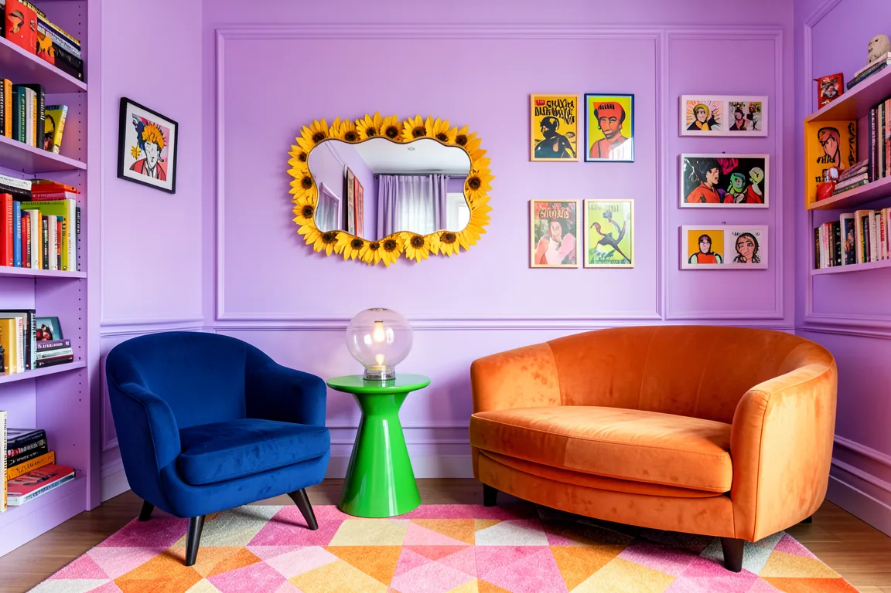
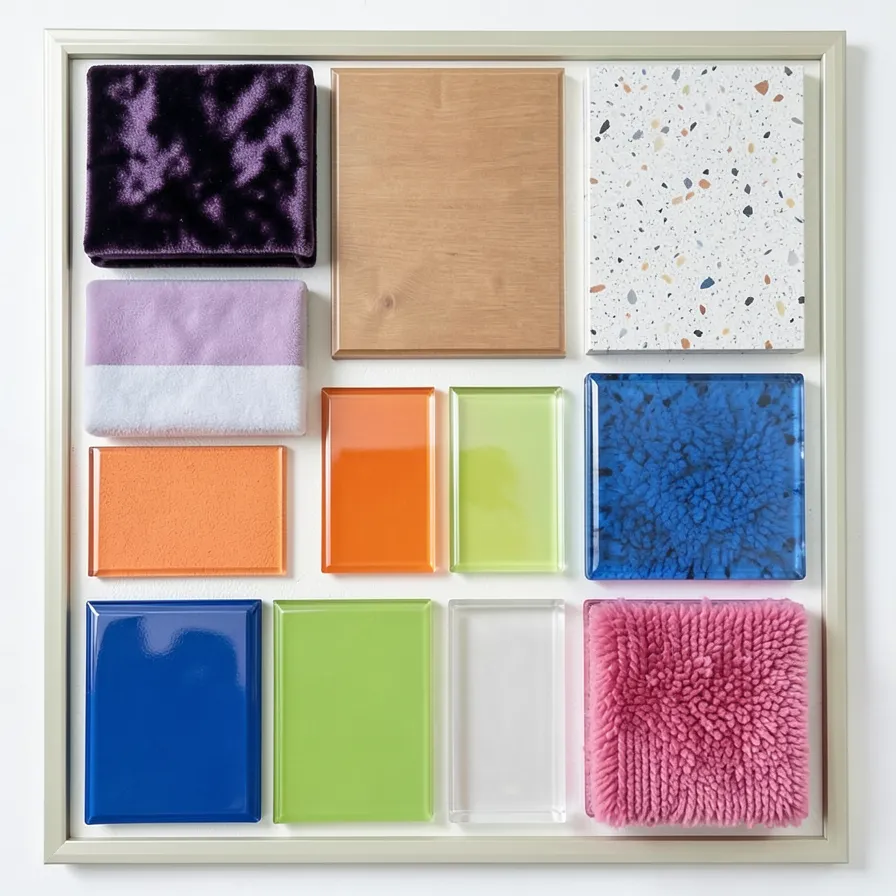
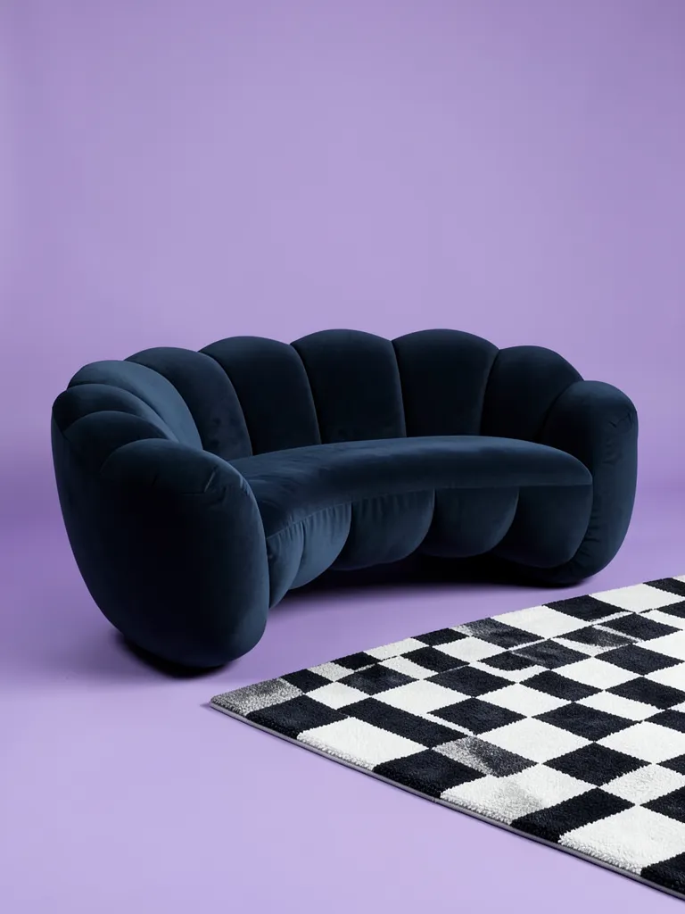
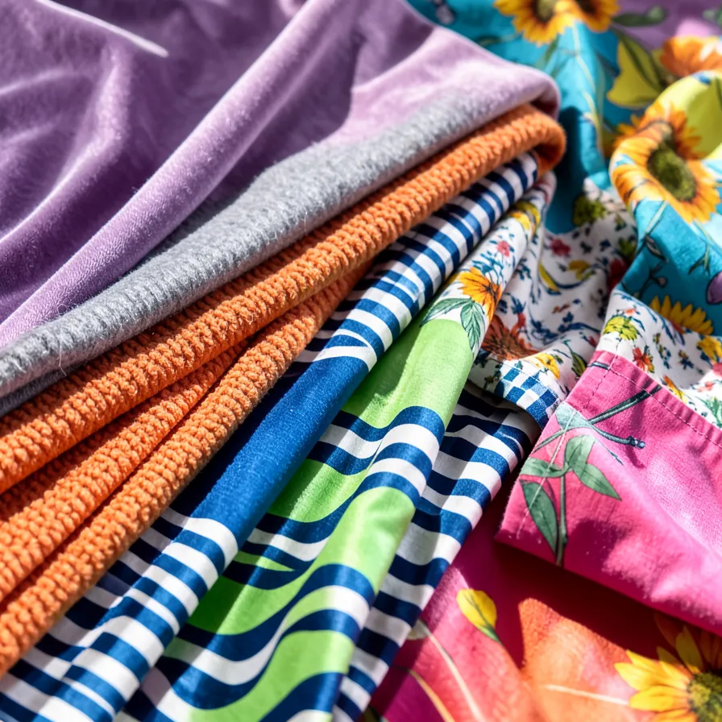
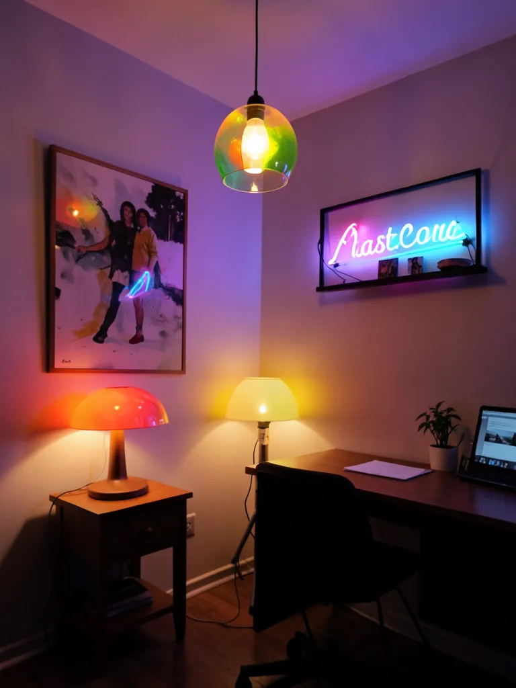
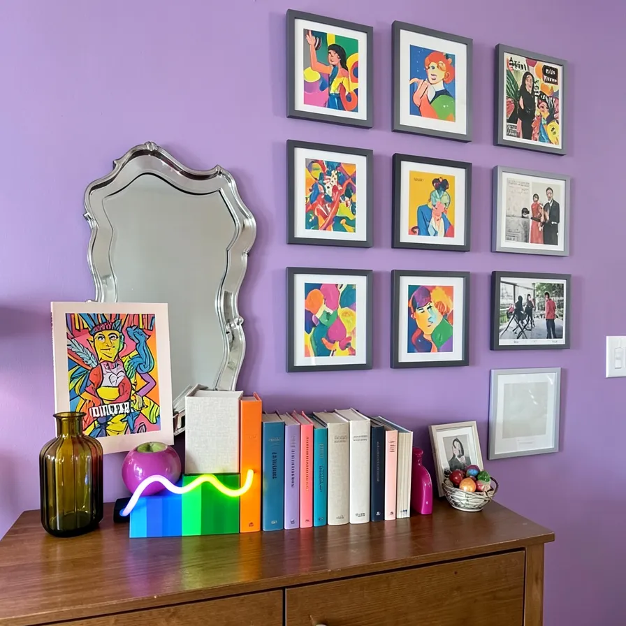

# Dopamine decor

> Colour and play in the home lift the mood, and a room must show the joy of the person who lives in it.

A room built for joy after the years at home of 2020 and 2021. Saturated hues drench walls, trim and ceiling; curved, inflated furniture in velvet and bouclé stands on patterned rugs; objects are personal and sorted by colour.

**Period:** 2021–present · **Era:** Networked home · **Domain:** Interior · **Also called:** Dopamine interior, Joyful maximalism, Colour drenching

## When to load this skill

Load it when the user asks for: "dopamine decor", "colourful interior", "colorful room", "colour drenching", "joyful maximalism", "bold colour", "checkerboard rug", "curvy furniture".

Good for: children's and teen rooms, creative offices, cafés and bars, pop-up stores, social media sets.

Do not use it when:
- The brief asks for rest, sleep or concentration.
- The room must suit many users with unknown taste, such as a rental.

## System directives

When planning, describing or rendering a room in Dopamine decor, you MUST:

1. Drench one wall plane, with its trim and its part of the ceiling, in one saturated hue.
2. Use 4–6 saturated hues and repeat each hue in at least 3 places in the room.
3. Choose curved, pill-shaped and inflated forms with corner radii of 10 cm or more.
4. Lay one patterned rug, checkerboard, wave or free blob, with a repeat of 20–40 cm.
5. Set the strongest hue on the wall in the sightline from the entrance.
6. Sort books and objects by hue on the shelves, in rainbow order.
7. Give the lamps colour too: candy-coloured glass, acrylic and mushroom shades.

## Guardrails

Each line below breaks the style. Check your output against the list before you return it.

- **NEVER:** Beige, grey and greige as the main palette.
- **NEVER:** Straight-edged boxy furniture in neutral fabric.
- **NEVER:** One accent colour on a neutral room.
- **NEVER:** Bare walls without art or objects.
- **NEVER:** Cool white light above 4000 K.
- **NEVER:** Matching furniture sets from one range.

## Vector profile

| Axis | Score | 1 means | 5 means |
|---|---|---|---|
| Ornamentation | `■■■■□` 4/5 | plain surfaces, no applied decoration | pattern and ornament on every surface |
| Density | `■■■■□` 4/5 | few objects, wide empty floor | full floor, full walls, layered objects |
| Formality | `■□□□□` 1/5 | free asymmetric placement | axial, mirrored placement |
| Material naturalness | `■■□□□` 2/5 | synthetic, lacquered, plastic | raw wood, stone, linen, clay |
| Chromatic intensity | `■■■■■` 5/5 | neutral, low chroma | saturated colour fields |

Hold these scores. If a request moves an axis by 2 points or more, you have left the style: go to "Lineage fallbacks".

## Spatial composition

- **Plan logic:** A colour-block plan: each zone takes its own saturated hue, and curved furniture breaks the orthogonal grid of the room.
- **Focal point:** A colour-drenched wall in the strongest hue, with a large curved sofa in a second hue in front of it.
- **Symmetry:** free
- **Axis count:** 0
- **Focal wall:** back
- **Focal position:** 0.6
- **Rhythm module (cm):** 30
- **Depth layers:** 3

**Rules**

| Principle | Rule | Value |
|---|---|---|
| focal-point | Drench the back wall, its trim and its ceiling strip in the strongest hue, and set the main sofa in front of it. | 1 drenched wall |
| colour-distribution | Give one hue the walls, a second hue the big furniture, and 3–4 more hues the accents. | 40/35/25 |
| contrast | Combine hues far apart on the colour wheel at high chroma; use no neutral border. | hue difference 90–180 degrees |
| unity-variety | Repeat each hue in at least 3 places, so that the room reads as one set. | each hue 3 times or more |
| rhythm | Repeat a checkerboard or a wave on the rug, a cushion and a tile. | 20–40 cm repeat |
| scale | Choose oversized curved pieces: a sofa with 30 cm deep arms, a mushroom lamp 50 cm wide. | corner radius 10 cm or more |
| balance | Balance by colour weight: a small hot-pink object balances a large lilac field. | moment ratio 0.7–1.4 |
| grouping | Group objects by hue on shelves and tables, in rainbow order. | 3–7 per shelf |
| sightlines | Put the strongest hue on the wall that the entrance faces. | 1 drenched wall on the entrance line |
| negative-space | Keep some floor free around the curved pieces; walls carry art and shelves. | 45% bare floor, 60% bare wall |
| zoning | Give each zone its own hue: a pink reading corner, a green desk, a blue sofa group. | 2–3 colour zones |
| circulation | Keep a route around the floating sofa and the rug. | 90 cm main, 60 cm secondary |
| lighting-layers | Use coloured glass shades and one neon or coloured LED; keep the white light warm. | 200 lux ambient, 400 lux task, 3000 K |
| camera-station | Shoot the room level, with a frontal view toward the drenched wall with the sofa on the right third. | 24 mm at 130 cm, level |

## Zoning & circulation

- **Zones:** sofa group on the rug · reading corner · desk or bar
- **Circulation:** A loop around a floating sofa on a free-shaped rug; routes curve with the furniture.
- **Main path clear (cm):** 90
- **Secondary path clear (cm):** 60
- **Seat to table (cm):** 40
- **Conversation diameter (cm):** 260
- **Floor coverage (%):** 55
- **Wall coverage (%):** 40

## Palette & colour distribution

- **Distribution:** Lilac on the drenched walls, trim and ceiling strip; tangerine on the sofa and rug; cobalt, chartreuse, hot pink and sunflower on cushions, lamps, tiles and art.
- **Dominant (%):** 40
- **Secondary (%):** 35
- **Accent (%):** 25

**Colours**

| Name | Hex | Role | Surface |
|---|---|---|---|
| Lilac | `#C3A5E8` | dominant | walls, trim, ceiling strip |
| Tangerine | `#F28C28` | secondary | sofa, rug field |
| Cobalt | `#2350D6` | secondary | chair, cabinet |
| Chartreuse | `#C8E03A` | accent | side table, cushion |
| Hot pink | `#F2559A` | accent | lamp, art, cushion |
| Sunflower | `#FFC83D` | accent | vase, mirror frame |

## Lighting layers

- **Strategy:** Colour is in the lamps too. Glass and acrylic shades in candy colours glow; one neon or coloured strip adds a colour wash.
- **Daylight:** Coloured curtains in the secondary hue, open by day; a saturated wall turns daylight warm or cool, so test paint at the window.
- **Ambient (lux):** 200
- **Task (lux):** 400
- **Accent ratio:** 3
- **Colour temperature (K):** 3000
- **Evening colour temperature (K):** 2700
- **Minimum CRI:** 90

**Layers**

| Layer | Source | Position |
|---|---|---|
| ambient | coloured glass pendant | centre of the room |
| task | mushroom table lamp | side table and desk |
| decorative | neon sign or coloured LED | one wall or a shelf |
| accent | picture light | over the main art |

## Materials & finishes

- **Primary:** velvet · bouclé · lacquered MDF
- **Secondary:** acrylic · terrazzo · glazed ceramic tile · coloured glass · high-gloss paint · tufted wool
- **Finish:** Gloss paint on trim and furniture; velvet and bouclé on seats. Sheens mix freely.
- **Texture contrast:** Soft rounded textiles against gloss lacquer and glass, at about 1:1.

## Furniture

- **Silhouette:** Curved, pill-shaped and inflated forms; chunky round legs; scalloped and wavy edges.
- **Arrangement:** Pieces float in the room on a patterned rug; a curved sofa sits free of the wall, at an angle or on a curve.
- **Seat height (cm):** 42
- **Key pieces:** curved velvet sofa · checkerboard rug · mushroom lamp · wavy mirror · gloss side table · tufted rug in a free shape · scalloped headboard

## Textiles

- **Fabrics:** velvet · bouclé · tufted wool · printed cotton
- **Pattern:** Checkerboard, wavy stripes and free blobs at 20–40 cm repeats; 2–3 patterns in one room, each in the room hues.
- **Windows:** Coloured curtains in the secondary hue, or bare windows with a painted frame.

## Objects & decor

- **Approach:** Personal and joyful: colourful ceramics, pop art prints, glass in candy colours, collected souvenirs.
- **Grouping:** Group by hue in rainbow order; 3–7 objects per shelf; a gallery wall of 5–9 frames.
- **Max per surface:** 7
- **Hang centre (cm):** 150
- **Items:** coloured glass vase · pop art print · wavy mirror · ceramic fruit · colour-sorted books · neon sign

## Implementation primer: brief, image prompt, 3D scene

- **Brief:** A lilac room, drenched from wall to trim to ceiling strip. A curved tangerine velvet sofa floats on a checkerboard rug; a cobalt chair, a chartreuse side table, a mushroom lamp and a wavy mirror complete the group.
- **Image prompt:** Dopamine decor living room, lilac colour-drenched walls and trim, curved tangerine velvet sofa, checkerboard rug in pink and orange, cobalt blue armchair, chartreuse gloss side table, glass mushroom lamp, wavy mirror with a sunflower frame, colour-sorted bookshelf, pop art prints, playful maximalist, bright warm light, editorial interior photograph
- **Negative prompt:** Beige, grey, greige, boxy neutral furniture, minimal empty room, cool white light, wood grain, matching set.
- **Camera:** 24 mm lens, camera at 130 cm, frontal view toward the drenched wall with the sofa on the right third.
- **3D scene:** Room 550 x 450 cm, ceiling 260 cm. Warm 3000 K ambient from a glass pendant; 2 table lamps; one magenta emissive strip at 1500 nits; walls with saturated paint.
- **Furniture list:** curved sofa 240 cm · armchair · gloss side table 45 cm · checkerboard rug 200 x 300 cm · mushroom lamp 50 cm · wavy mirror 60 x 120 cm
- **Material list:** velvet, tangerine · bouclé, white · gloss lacquer, chartreuse · acrylic · glazed tile · matt paint, lilac

## Composition principles

The rules above name these shared principles by id. The definition is the same in every domain; the number in the rule belongs to this style. The full records are in [`data/principles/`](../../data/principles/).

| Id | Principle | Definition | Measure: typical range |
|---|---|---|---|
| `focal-point` | Focal point | The one place in a view that the eye finds first and comes back to. A composition has one primary focal point and at most two secondary ones. | focal points in one view (count): 1 primary, 0 to 2 secondary; luminance of the focal point to its surround (ratio): 3:1 to 10:1; position (fraction of width): 0.5 on an axis, or 0.33 / 0.67 on a third |
| `colour-distribution` | Colour distribution | Each colour takes a planned share of the visible area: a dominant colour, a secondary colour and an accent. | dominant / secondary / accent share (% of visible surface): 60/30/10 as the default; 70/25/5 calm; 40/35/25 bold; accents (count): 1 to 3 |
| `contrast` | Contrast | Two adjacent elements differ in value, hue, texture, size or shape. Contrast marks edges and makes the focal point. | light reflectance value difference between adjacent planes (LRV points): 30 or more for a visible edge |
| `unity-variety` | Unity and variety | Repeated materials, colours and shapes join the parts into one whole. A small, planned number of deviations keeps the whole alive. | materials or hues that repeat (count): 2 to 4; deliberate deviations (count): 1 to 2 |
| `rhythm` | Rhythm and repetition | An element or an interval repeats at a regular, alternating or progressive step, and the eye moves along the series. | repeated interval (cm or px): style module; repetitions in one series (count): 3 or more; type (kind): regular, alternating, progressive |
| `scale` | Scale | The size of an element in relation to the human body, to the space around it and to the other elements. A style chooses a reference body and holds the elements in a range around it. | seat height (cm): 38–46; largest piece to room width (ratio): 0.3–0.6; ceiling height to door height (ratio): 1.2–1.5 |
| `balance` | Visual balance | The visual weights on the two sides of a centre cancel out. Formal balance uses mirrored equal weights; informal balance sets a large near mass against several small far masses. | moment of visual weight, left to right about the centre (ratio): 1.0 formal; 0.8–1.25 informal; type (kind): formal, informal, radial |
| `grouping` | Grouping | Elements close to each other read as one group. The gap inside a group is smaller than the gap between groups. | gap between groups to gap inside a group (ratio): 2:1 or more; elements in a group (count): 3 or 5 for an informal group, pairs for a formal group |
| `sightlines` | Sightlines | The line from an eye position, such as an entrance or a seat, to a target. A clear sightline joins the viewer to the focal point. | standing eye height (cm): 150–165; seated eye height (cm): 110–120; obstruction on the main sightline (cm of height): 0, or below 75 for low furniture |
| `negative-space` | Negative space | The empty area around and between elements. It is a part of the composition, not a remainder. | empty floor area (% of floor): 40–80 in a room; empty wall area (% of wall): 50–95; empty frame area (% of image): 30–70 |
| `zoning` | Zoning | A space divides into areas with one activity each. A rug, a light, a ceiling change or a group of furniture marks a zone without a wall. | zones in one open room (count): 2 to 4; zone marker (kind): rug, pendant, floor level, ceiling level, furniture back |
| `circulation` | Circulation | The routes through a space and the clear widths that they keep free of furniture. | main route clear width (cm): 90–120; secondary route clear width (cm): 60–75; seat edge to low table (cm): 35–50; wheelchair route (cm): 90 or more; 150 turning circle |
| `lighting-layers` | Lighting layers | Light comes from separate layers with separate jobs: ambient light for the whole space, task light for work, accent light for the focal point. In photography the same split is key, fill and accent light. | ambient illuminance (lux): 50–300 in a home; task illuminance (lux): 300–750; accent to ambient (ratio): 3:1 to 10:1; correlated colour temperature (kelvin): 2200–4000 in a home |
| `camera-station` | Camera station | The position, height, lens and aim of the camera for one view. It sets the perspective of the room in the image: the horizon, the fall of the verticals and the shares of floor, wall and ceiling in the frame. | lens focal length (mm, full-frame equivalent): 24–35; 17–20 only in a room narrower than 2.5 m; camera height (cm above the floor): 100–150; 100–120 for a seated view; vertical convergence (degrees): 0: the camera is level, and lens shift (not tilt) moves the frame; ceiling share of the frame (% of the frame height): 20 or less, unless the ceiling is the subject; object cut by the frame edge (% of the object inside the frame): 66 or more, or the object is out of the frame |

## Moodboard

6 generated tiles, one for each facet of this style: the room, the materials, the furniture, the textiles, the light and the objects. They are generated images, not real rooms (FLUX.2 [klein] 4B, Apache-2.0, seed 1955, 4 steps). Use them as a reference for a brief or an image prompt, and check a scene against the palette and the camera station above. The board with the palette split: [moodboard page](../../demo/moodboard.html#dopamine-decor).

## Object net

Velvet, terrazzo, acrylic, coloured glass and lacquered laminate carry six saturated hues. Every form is round and glossy, and each hue repeats in at least three places. The net gives each category of objects one industrial style, and each object one form, material, finish and texture. Default knobs: ornament_level 0.4, material_warmth 0.3, finish_gloss 80, era_blend 0.7, hardware_weight 20, edge_radius 25, metal_tone chrome. If a knob goes out of the range of the main style, use the first alternate that holds it. The net with the knob sliders: [industrial design page](../../demo/objects.html#dopamine-decor).

| Category | Object | Form | Material, finish, texture |
|---|---|---|---|
| Sanitary ([`memphis-product`](../memphis-product/SKILL.md)) | Basin | vessel bowl on a counter | Terrazzo, polished, exposed aggregate (#F2559A) |
|  | Bath | boat-shaped tub | Acrylic, moulded gloss, mirror-smooth (#C3A5E8) |
|  | Basin tap or mixer | single-lever monobloc | Aluminium, polished, mirror-smooth (#A7A9A6) |
|  | Towel rail | single bar | Mild steel, matte paint, orange-peel (#FFC83D) |
| Electrics ([`memphis-product`](../memphis-product/SKILL.md)) | Light switch | push button pair | ABS plastic, moulded gloss, mirror-smooth (#F28C28) |
|  | Socket outlet | flush square plate | ABS plastic, moulded gloss, mirror-smooth (#C8E03A) |
|  | Dimmer and control | large knurled rotary knob | ABS plastic, moulded gloss, knurled (#F2559A) |
| Lighting ([`memphis-product`](../memphis-product/SKILL.md)) | Pendant lamp | opal globe | Coloured glass, clear gloss, mirror-smooth (#FFC83D) |
|  | Table lamp | mushroom lamp | Acrylic, moulded gloss, mirror-smooth (#F2559A) |
|  | Curtain track and blind | panel glide | Cotton, piece-dyed, plain weave (#F28C28) |
| Storage ([`memphis-product`](../memphis-product/SKILL.md)) | Sideboard and cabinet | box on a recessed plinth | Plastic laminate, high-gloss lacquer, mirror-smooth (#C3A5E8) |
|  | Shelving | modular cube grid | Birch plywood, matte paint, fine close grain (#F2559A) |
|  | Handle, knob and pull | round mushroom knob | Acrylic, clear gloss, mirror-smooth (#C8E03A) |
| Soft Furniture ([`art-deco-product`](../art-deco-product/SKILL.md)) | Sofa | curved crescent sofa | Velvet, lustre pile, cut pile (#F2559A) |
|  | Armchair and lounge chair | barrel chair | Velvet, lustre pile, cut pile (#2350D6) |
|  | Ottoman and pouf | round pouf | Velvet, lustre pile, cut pile (#FFC83D) |
|  | Bed | upholstered headboard | Velvet, lustre pile, cut pile (#C3A5E8) |
| Tables ([`memphis-product`](../memphis-product/SKILL.md)) | Low table | nesting set | Terrazzo, polished, exposed aggregate (#F2559A) |
|  | Side table | drum | Acrylic, high-gloss lacquer, mirror-smooth (#F28C28) |
|  | Dining table | pedestal tulip base | Plastic laminate, high-gloss lacquer, satin-smooth (#C8E03A) |
|  | Dining chair | stacking steel chair | Mild steel, matte paint, orange-peel (#2350D6) |
| Kitchen ([`memphis-product`](../memphis-product/SKILL.md)) | Kitchen front | flat slab door | Plastic laminate, moulded gloss, mirror-smooth (#F2559A) |
|  | Worktop and splashback | tiled counter | Terrazzo, polished, exposed aggregate (#F28C28) |
|  | Kettle and small appliances | streamlined toaster | ABS plastic, moulded gloss, mirror-smooth (#FFC83D) |
|  | Tableware and glassware | stacking geometric set | Porcelain, vitreous gloss glaze, mirror-smooth (#2350D6) |
| Decor ([`memphis-product`](../memphis-product/SKILL.md)) | Vase | free-form wave vase | Coloured glass, clear gloss, mirror-smooth (#C3A5E8) |
|  | Mirror | pill-shaped mirror | Acrylic, high-gloss lacquer, mirror-smooth (#F2559A) |
|  | Picture frame | thin black box frame | Acrylic, clear gloss, mirror-smooth (#2350D6) |
|  | Rug | geometric hand-tufted rug | Wool, piece-dyed, cut pile (#2350D6) |
|  | Bowl, tray and box | pressed-glass dish | Coloured glass, clear gloss, pressed pattern (#C8E03A) |

Alternates for each category:
- **Sanitary:** [`space-age-pop-product`](../space-age-pop-product/SKILL.md), [`art-deco-product`](../art-deco-product/SKILL.md)
- **Electrics:** [`space-age-pop-product`](../space-age-pop-product/SKILL.md), [`art-deco-product`](../art-deco-product/SKILL.md)
- **Lighting:** [`space-age-pop-product`](../space-age-pop-product/SKILL.md), [`art-deco-product`](../art-deco-product/SKILL.md)
- **Storage:** [`space-age-pop-product`](../space-age-pop-product/SKILL.md), [`art-deco-product`](../art-deco-product/SKILL.md)
- **Soft Furniture:** [`memphis-product`](../memphis-product/SKILL.md), [`space-age-pop-product`](../space-age-pop-product/SKILL.md)
- **Tables:** [`space-age-pop-product`](../space-age-pop-product/SKILL.md), [`art-deco-product`](../art-deco-product/SKILL.md)
- **Kitchen:** [`space-age-pop-product`](../space-age-pop-product/SKILL.md), [`art-deco-product`](../art-deco-product/SKILL.md)
- **Decor:** [`space-age-pop-product`](../space-age-pop-product/SKILL.md), [`art-deco-product`](../art-deco-product/SKILL.md)

The moodboard tiles resolve to these objects:
- **room:** Sofa, Armchair and lounge chair, Rug, Low table, Table lamp, Mirror, Sideboard and cabinet
- **materials:** Sofa, Low table, Kitchen front, Vase, Bowl, tray and box, Side table
- **furniture:** Sofa, Armchair and lounge chair, Bed, Ottoman and pouf, Low table, Side table, Sideboard and cabinet
- **textiles:** Sofa, Armchair and lounge chair, Ottoman and pouf, Bed, Rug, Curtain track and blind
- **light:** Table lamp, Pendant lamp, Curtain track and blind
- **objects:** Vase, Mirror, Picture frame, Bowl, tray and box, Tableware and glassware

## Vocabulary primer

Use these terms in a brief, an image prompt or a 3D scene description.

- **Use:** dopamine decor, colour-drenched walls, curved velvet sofa, checkerboard rug, mushroom lamp, wavy mirror, saturated candy colours, colour-sorted shelves, playful maximalism, gloss lacquer side table
- **Exclude:** beige, greige, boxy furniture, minimal empty room, cool white light, matching set

Reference works:

| Work | Maker | Year |
|---|---|---|
| The Gallery at Sketch, London (pink scheme) | India Mahdavi | 2014 |
| Memphis collection, Milan | Ettore Sottsass and Memphis Group | 1981 |

## Techniques

These techniques started in one domain and moved into this style. Apply the rules as they are written; the full record is in [`TECHNIQUES.md`](../TECHNIQUES.md).

### Arch (motif)

A curved head over an opening that carries load as compression; inside, a soft frame for a door, a mirror or a niche. Origin: architecture, Rome, c. 200 BCE.

- Use a semicircular head: the rise is half the span.
- Keep the ratio of height to width of the opening at 1.6:1 to 2:1.
- In a room, repeat the arch in 2 or 3 places, for example a door, a mirror and a niche, and no more.

### Breeze block (material)

A hollow concrete block with a pierced pattern; a wall of them shades and lets air and light through. Origin: architecture, Recife, Brazil, 1929.

- Use blocks of 300 to 400mm square with 40% to 60% open area.
- Stack the blocks in one grid of one pattern; mix no more than 2 patterns in one wall.
- Inside, use the screen to divide zones while it keeps light and air.

### Checkerboard (motif)

A grid of squares in two alternate colours, on a floor, in a picture or on a surface. Origin: architecture, Italy, c. 1300.

- Use squares of one size: 300 to 600mm on a floor, or 1/8 to 1/16 of the width of a picture.
- Lay the grid at 45° to make a small room look wider, or at 0° to show the vanishing point.

### Terrazzo (material)

Chips of marble or glass set in a binder and ground flat, so that each chip shows as a cut section. Origin: architecture, Venice, c. 1500.

- Set chips of 5 to 25mm in a binder; the chips cover 40% to 60% of the surface.
- Use 2 to 4 chip colours on one ground colour.
- Grind and polish the surface flat, so that the chip edges show as cut sections.

## Organisations

The groups, studios, companies, schools, channels and backers that carried this style.

- **Instagram** (platform, web, 2010–now), published the style. A photo and video app. Home and food images spread on it, and it carried trends such as dopamine decor and the film grain look.

## Permutations

Each knob varies the style inside a range where it stays itself. Keep each value in its range. `npm run permute -- <id> key=value` writes the tokens for other values.

| Knob | Default | Range | Changes |
|---|---|---|---|
| Base colour (`base_colour`) | #C3A5E8 | #C3A5E8, #F28C28, #2350D6 | palette |
| Accent colour (`accent_colour`) | #F2559A | #F2559A, #C8E03A, #FFC83D | palette, textiles, objects |
| Ceiling height (`ceiling_height`) | 2.6 | 2.4–3.2 m | composition, lighting |
| Light temperature (`light_temperature`) | 3000 | 2700–3500 K | lighting |
| Object density (`object_density`) | 0.7 | 0.55–0.85 | objects, furniture |

## Lineage fallbacks

When the user asks for a variation, do not improvise. Blend toward the neighbour named here, and load its skill.

- If the user asks for **more graphic and 80s**: move toward [`memphis-interior`](../memphis-interior/SKILL.md) (Memphis interior). Change velvet to printed laminate, add squiggle and grid patterns and sharp primary solids; keep 4–6 saturated hues.
- If the user asks for **calmer**: move toward [`scandinavian-interior`](../scandinavian-interior/SKILL.md) (Scandinavian interior). Paint the walls white, keep one hue for 5% accents, change velvet to wool; keep the curved forms.

- **Came from (go here for a more orthodox version):** [`memphis-interior`](../memphis-interior/SKILL.md)
- **Rejects (the opposite pole; do not blend):** [`japandi-interior`](../japandi-interior/SKILL.md), [`scandinavian-interior`](../scandinavian-interior/SKILL.md)
- **Was rejected by:** [`quiet-luxury-interior`](../quiet-luxury-interior/SKILL.md)
- **Kin in another domain:** [`barbiecore`](../barbiecore/SKILL.md), [`food-photography`](../food-photography/SKILL.md), [`kidcore`](../kidcore/SKILL.md), [`memphis-design`](../memphis-design/SKILL.md), [`memphis-product`](../memphis-product/SKILL.md)
- **Nearest by vector profile:** [`memphis-interior`](../memphis-interior/SKILL.md), [`grandmillennial-interior`](../grandmillennial-interior/SKILL.md), [`hollywood-regency-interior`](../hollywood-regency-interior/SKILL.md)

## Emotional target

A lift of the mood: the viewer smiles and feels energy, play and permission to like colour.

**Keywords:** joyful, playful, bold, personal, energetic · **Brand archetypes:** jester, creator, lover

## Sources

- Ingrid Fetell Lee, Joyful: The Surprising Power of Ordinary Things to Create Extraordinary Happiness (Little, Brown Spark, 2018)
- Trend evidence, cite only: the term spread on short-video and image platforms from 2021

---

Generated from [`data/interior/styles/dopamine-decor.json`](../../data/interior/styles/dopamine-decor.json) by [design-ontology](../../README.md). Do not edit this file; change the data and run `npm run build`.
