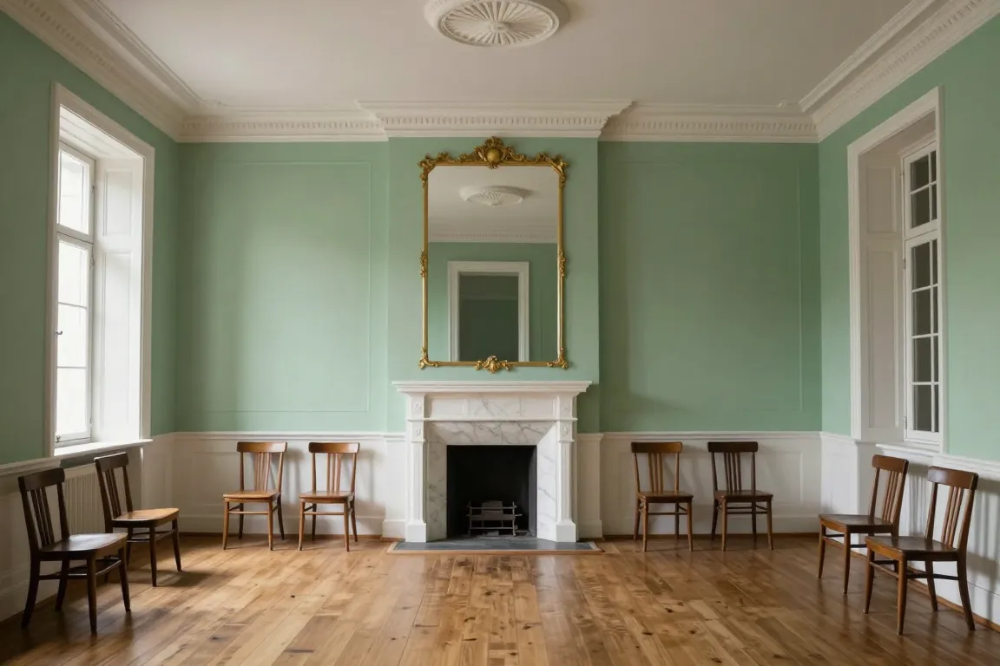
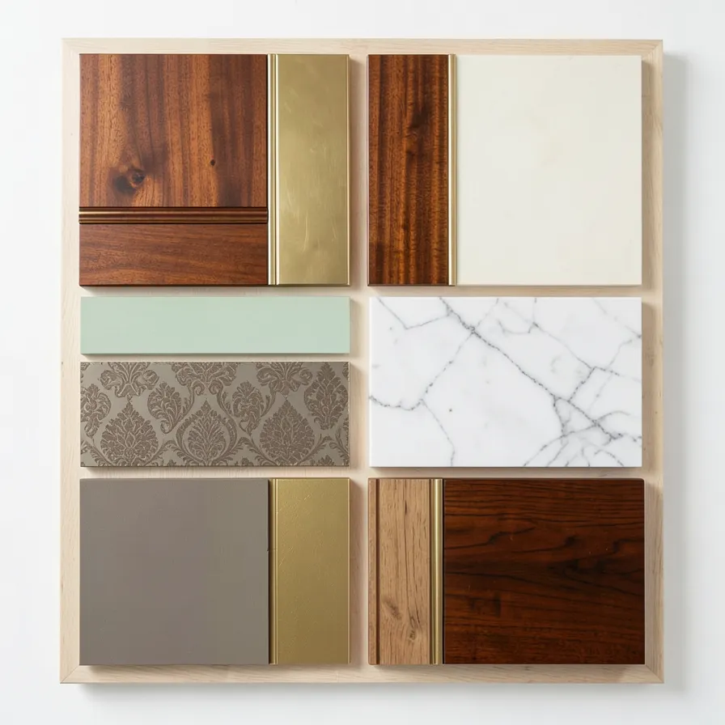
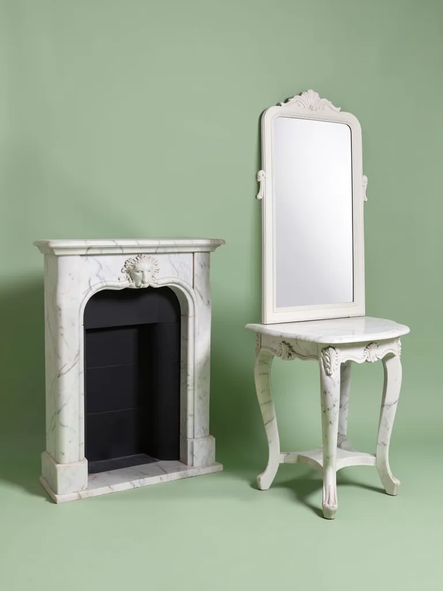
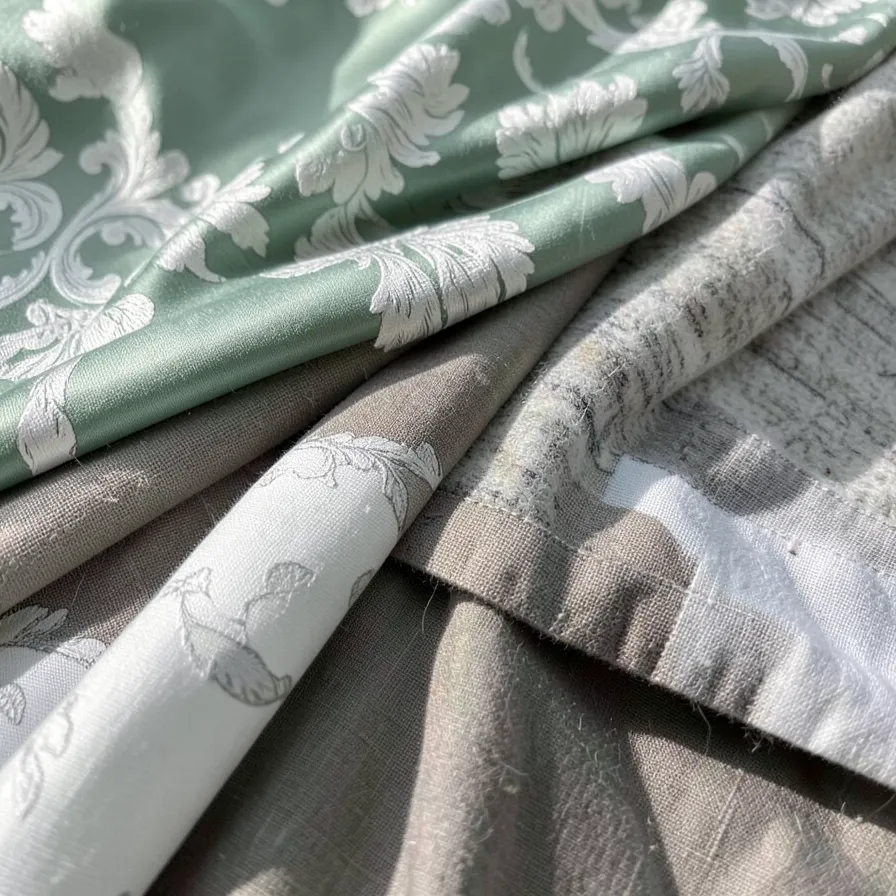
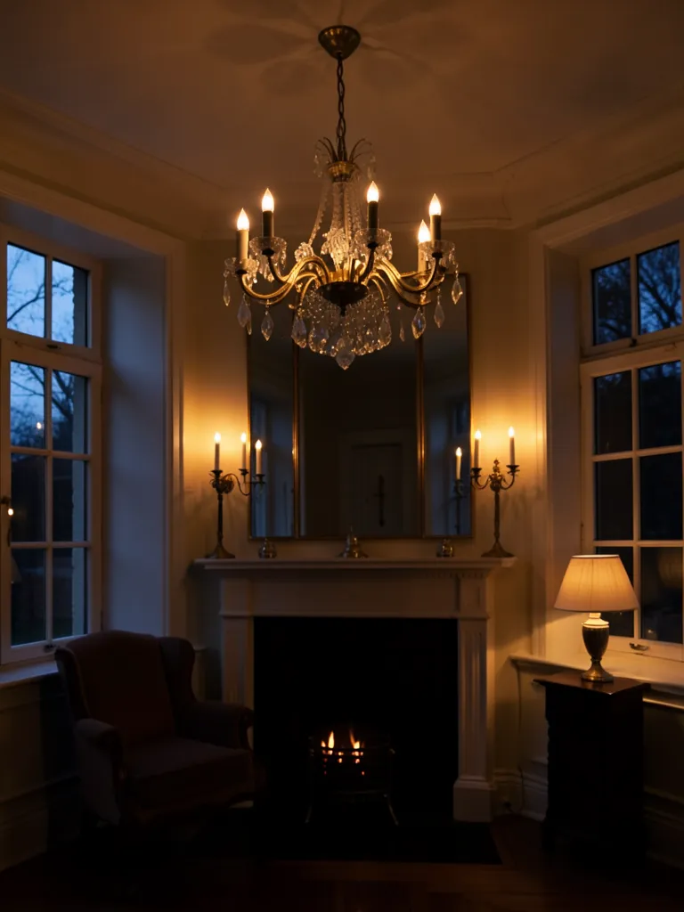
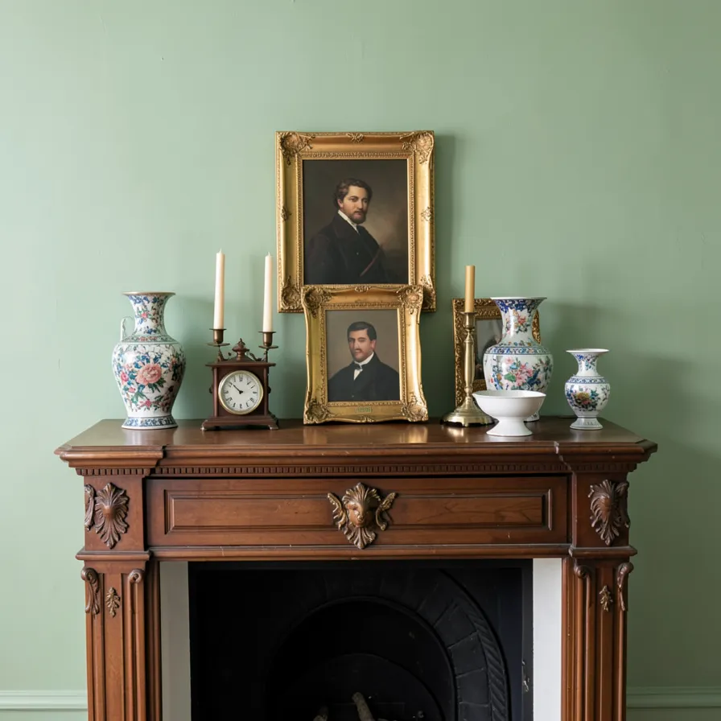

# Georgian

> A room is good when its proportions obey the classical rules and each wall answers the wall opposite it.

The British and colonial room of the four Georges. Walls follow a classical order of dado, field and cornice; a chimneypiece on the centre line, paired doors and sash windows set one axis; mahogany furniture stands against the walls, and the centre of the floor stays clear.

**Period:** 1714–1830 · **Era:** Classical house · **Domain:** Interior · **Also called:** Georgian interior, Palladian interior, Adam style

## When to load this skill

Load it when the user asks for: "georgian", "georgian interior", "palladian", "regency drawing room", "adam style", "period townhouse", "classical interior", "federal style".

Good for: period house restoration, formal dining rooms, boutique hotels in old buildings, embassies and clubs, heritage retail.

Do not use it when:
- The brief asks for an informal, open-plan family room.
- The room has low ceilings below 240 cm and no symmetry.

## System directives

When planning, describing or rendering a room in Georgian, you MUST:

1. Divide each wall into dado, field and frieze in the proportions of a column: dado at about one fifth of the wall height.
2. Put the chimneypiece on the centre of the main wall and match doors, windows and pier glasses about that axis.
3. Give the room simple whole-number ratios: a single cube, a double cube or 2:3.
4. Stand furniture against the walls when the room is not in use; move chairs to the centre only for an event.
5. Use one main wall colour in a soft mineral tone and pick out mouldings in white or a lighter tint.
6. Keep ornament on the architecture: plaster ceiling, cornice, chimneypiece and door cases; keep the walls plain between them.
7. Hang pictures in pairs and in symmetric sets about the chimneypiece.

## Guardrails

Each line below breaks the style. Check your output against the list before you return it.

- **NEVER:** Furniture that floats at an angle in the room.
- **NEVER:** Walls with no dado or cornice.
- **NEVER:** A focal point off the centre line of a wall.
- **NEVER:** Saturated synthetic colour.
- **NEVER:** Open shelves full of small objects.
- **NEVER:** Modern recessed downlights in a decorated ceiling.

## Vector profile

| Axis | Score | 1 means | 5 means |
|---|---|---|---|
| Ornamentation | `■■■□□` 3/5 | plain surfaces, no applied decoration | pattern and ornament on every surface |
| Density | `■■□□□` 2/5 | few objects, wide empty floor | full floor, full walls, layered objects |
| Formality | `■■■■■` 5/5 | free asymmetric placement | axial, mirrored placement |
| Material naturalness | `■■■■□` 4/5 | synthetic, lacquered, plastic | raw wood, stone, linen, clay |
| Chromatic intensity | `■■□□□` 2/5 | neutral, low chroma | saturated colour fields |

Hold these scores. If a request moves an axis by 2 points or more, you have left the style: go to "Lineage fallbacks".

## Spatial composition

- **Plan logic:** A rectangular room on two axes. The long axis runs from the door to the window wall; the cross axis runs through the chimneypiece. Furniture lines the walls and the centre stays open.
- **Focal point:** The chimneypiece on the centre of the back wall, with a pier glass or a large painting above it.
- **Symmetry:** bilateral
- **Axis count:** 2
- **Focal wall:** back
- **Focal position:** 0.5
- **Rhythm module (cm):** 90
- **Depth layers:** 2

**Rules**

| Principle | Rule | Value |
|---|---|---|
| symmetry-axis | Set the chimneypiece on the centre line of the back wall and mirror every door, window, chair and picture about it. | 2 axes, mirror pairs |
| proportion | Give the room and its panels simple classical ratios. | 1:1, 1:2 or 2:3; dado at 1/5 of the wall height |
| hierarchy | Make the chimneypiece the richest element; door cases come second; the field of the wall stays plain. | 3 levels |
| rhythm | Space windows and pier glasses at one bay width along the window wall. | 90 cm bay |
| balance | Balance each object with its twin on the opposite side of the axis. | moment ratio 1.0 |
| focal-point | Show one focal point per room on the main axis. | 1 focal point at 0.5 |
| negative-space | Keep the centre of the floor open; furniture stands against the walls. | 60% bare floor |
| unity-variety | Repeat one moulding profile in the cornice, the dado rail and the door case. | 1 profile family |
| colour-distribution | Give the wall field the main tone, the woodwork white or a lighter tint, and mahogany and gilt the accents. | 65/25/10 |
| lighting-layers | Light the room from the windows by day and from candles on the chimneypiece and the pier tables by night; use warm low light today. | 100 lux ambient, 2400 K |
| circulation | Keep the route from the door to the chimneypiece straight and clear. | 120 cm main route |
| framing | Frame the views with door cases and window architraves of the same width. | architrave 1/6 of the opening width |
| camera-station | Shoot the room level, with a frontal view on the chimneypiece axis, verticals parallel. | 24 mm shift at 150 cm, level |

## Zoning & circulation

- **Zones:** chimneypiece group · window piers with tables · centre table for an event
- **Circulation:** One straight route on the long axis and one on the cross axis; the centre of the room is free.
- **Main path clear (cm):** 120
- **Secondary path clear (cm):** 90
- **Seat to table (cm):** 45
- **Conversation diameter (cm):** 300
- **Floor coverage (%):** 40
- **Wall coverage (%):** 35

## Palette & colour distribution

- **Distribution:** A soft mineral wall tone in the field, white or stone mouldings and ceiling, mahogany furniture and floorboards, and gilt on frames and glasses.
- **Dominant (%):** 65
- **Secondary (%):** 25
- **Accent (%):** 10

**Colours**

| Name | Hex | Role | Surface |
|---|---|---|---|
| Pea green | `#A9B48E` | dominant | wall field |
| Stone white | `#EAE4D6` | secondary | mouldings, ceiling, cornice |
| Drab | `#B7A88A` | secondary | dado and shutters |
| Mahogany | `#5C2E1E` | wood | furniture and doors |
| Oak boards | `#9C7A52` | wood | floor |
| Gilt | `#B8913A` | metal | frames, pier glasses |

## Lighting layers

- **Strategy:** Daylight from tall sash windows on one or two walls; at night, low warm points of light on the chimneypiece, the pier tables and the centre chandelier.
- **Daylight:** Tall sash windows with shutters give even side light; the shutters fold into the window reveals.
- **Ambient (lux):** 100
- **Task (lux):** 300
- **Accent ratio:** 3
- **Colour temperature (K):** 2400
- **Evening colour temperature (K):** 2000
- **Minimum CRI:** 95

**Layers**

| Layer | Source | Position |
|---|---|---|
| daylight | tall sash windows with fold-back shutters | window wall |
| decorative | crystal or brass chandelier | centre of the ceiling on both axes |
| accent | pairs of candlesticks or candle-bulb sconces | either side of the chimneypiece and the pier glasses |
| task | a shaded table lamp | on a side table near a chair |

## Materials & finishes

- **Primary:** painted timber panelling · lime plaster · mahogany
- **Secondary:** marble · gilt wood · brass · oak boards · silk damask
- **Finish:** Flat or eggshell paint on walls and woodwork; French-polished mahogany; honed marble.
- **Texture contrast:** Smooth paint and polish against carved and moulded relief, at about 3:1.

## Furniture

- **Silhouette:** Light, upright pieces with straight or cabriole legs and serpentine fronts; carved but restrained.
- **Arrangement:** Chairs and tables stand in pairs against the walls; a sofa faces the chimneypiece only in the later period.
- **Seat height (cm):** 45
- **Key pieces:** chimneypiece in marble · pier glass and pier table · mahogany side chairs · sofa table · bureau bookcase · drop-leaf dining table

## Textiles

- **Fabrics:** silk damask · wool moreen · printed cotton · linen
- **Pattern:** One damask or a small repeat at most; most surfaces stay plain.
- **Windows:** Festoon or pull-up curtains, or simple paired curtains under a pelmet, with shutters that close.

## Objects & decor

- **Approach:** A few fine objects in symmetric sets: a garniture of vases, a pair of candlesticks, portraits in gilt frames.
- **Grouping:** Odd-numbered garnitures on the chimneypiece, centred on the axis.
- **Max per surface:** 5
- **Hang centre (cm):** 165
- **Items:** garniture of 3 or 5 vases · pair of candlesticks · portrait in a gilt frame · bracket clock · porcelain bowl

## Implementation primer: brief, image prompt, 3D scene

- **Brief:** A double-cube drawing room with a pea-green wall field above a painted dado, a white cornice and a marble chimneypiece on the centre of the back wall. Mahogany chairs stand in pairs against the walls, a gilt pier glass hangs between two tall sash windows, and the centre of the floor is clear.
- **Image prompt:** Georgian drawing room, symmetrical, white marble chimneypiece centred on the back wall, gilt pier glass above it, pea green painted wall panels above a white dado rail, white cornice and plaster ceiling rose, tall sash windows with folding shutters, mahogany chairs in pairs against the walls, polished oak floorboards, soft daylight from the side, calm classical proportion, architectural interior photograph
- **Negative prompt:** Clutter, modern furniture, downlights, saturated colour, asymmetric layout, plastic, chrome.
- **Camera:** 24 mm shift lens at 150 cm, frontal view on the chimneypiece axis, verticals parallel.
- **3D scene:** Room 800 x 400 cm, ceiling 400 cm (double cube). Side daylight from two sash windows 120 x 280 cm; 2400 K candle bulbs at 180 cm.
- **Furniture list:** chimneypiece 180 x 140 cm · pier glass 90 x 200 cm · pier table 110 x 55 x 80 cm · 6 side chairs, seat 45 cm · sofa 200 x 75 x 90 cm
- **Material list:** eggshell paint, pea green · flat paint, stone white · white statuary marble · French-polished mahogany · oiled oak boards · gilt gesso

**References**

| Title | Credit | Licence | Url |
|---|---|---|---|
| Dining room from Kirtlington Park (1748) | The Metropolitan Museum of Art, Fletcher Fund, 1931 | CC0 | https://www.metmuseum.org/art/collection/search/196917 |
| Dining room from Lansdowne House (1766–69) | The Metropolitan Museum of Art, Rogers Fund, 1931 | CC0 | https://www.metmuseum.org/art/collection/search/196910 |
| Tapestry Room from Croome Court (1763–71) | The Metropolitan Museum of Art, Gift of Samuel H. Kress Foundation, 1958 | CC0 | https://www.metmuseum.org/art/collection/search/209329 |
| Room from the Powel House, Philadelphia (1765–66, remodeled 1769–71) | The Metropolitan Museum of Art, Rogers Fund, 1918 | CC0 | https://www.metmuseum.org/art/collection/search/6889 |

## Composition principles

The rules above name these shared principles by id. The definition is the same in every domain; the number in the rule belongs to this style. The full records are in [`data/principles/`](../../data/principles/).

| Id | Principle | Definition | Measure: typical range |
|---|---|---|---|
| `symmetry-axis` | Symmetry and axis | An axis is a line that orders a composition. Symmetry places equal elements at equal distances on the two sides of the axis, or around a centre. | ordering axes (count): 0 to 3; mirrored mass about the axis (% of visual weight): 90–100 formal, 0–50 informal; type (kind): bilateral, radial, none |
| `proportion` | Proportion | The ratio of one dimension to another, and of a part to the whole. A style holds one ratio or one series of ratios through the room, the facade or the picture. | governing ratio (ratio): 1:1, 2:3, 1:1.414, 1:1.618, 1:2; module series (series): Modulor, tatami 91 x 182 cm, 60 cm kitchen module |
| `hierarchy` | Hierarchy | The elements of a composition rank by importance through size, position, contrast or isolation. The viewer reads them in that order. | levels of rank (count): 2 to 3; size ratio between adjacent levels (ratio): 1.5:1 or more |
| `rhythm` | Rhythm and repetition | An element or an interval repeats at a regular, alternating or progressive step, and the eye moves along the series. | repeated interval (cm or px): style module; repetitions in one series (count): 3 or more; type (kind): regular, alternating, progressive |
| `balance` | Visual balance | The visual weights on the two sides of a centre cancel out. Formal balance uses mirrored equal weights; informal balance sets a large near mass against several small far masses. | moment of visual weight, left to right about the centre (ratio): 1.0 formal; 0.8–1.25 informal; type (kind): formal, informal, radial |
| `focal-point` | Focal point | The one place in a view that the eye finds first and comes back to. A composition has one primary focal point and at most two secondary ones. | focal points in one view (count): 1 primary, 0 to 2 secondary; luminance of the focal point to its surround (ratio): 3:1 to 10:1; position (fraction of width): 0.5 on an axis, or 0.33 / 0.67 on a third |
| `negative-space` | Negative space | The empty area around and between elements. It is a part of the composition, not a remainder. | empty floor area (% of floor): 40–80 in a room; empty wall area (% of wall): 50–95; empty frame area (% of image): 30–70 |
| `unity-variety` | Unity and variety | Repeated materials, colours and shapes join the parts into one whole. A small, planned number of deviations keeps the whole alive. | materials or hues that repeat (count): 2 to 4; deliberate deviations (count): 1 to 2 |
| `colour-distribution` | Colour distribution | Each colour takes a planned share of the visible area: a dominant colour, a secondary colour and an accent. | dominant / secondary / accent share (% of visible surface): 60/30/10 as the default; 70/25/5 calm; 40/35/25 bold; accents (count): 1 to 3 |
| `lighting-layers` | Lighting layers | Light comes from separate layers with separate jobs: ambient light for the whole space, task light for work, accent light for the focal point. In photography the same split is key, fill and accent light. | ambient illuminance (lux): 50–300 in a home; task illuminance (lux): 300–750; accent to ambient (ratio): 3:1 to 10:1; correlated colour temperature (kelvin): 2200–4000 in a home |
| `circulation` | Circulation | The routes through a space and the clear widths that they keep free of furniture. | main route clear width (cm): 90–120; secondary route clear width (cm): 60–75; seat edge to low table (cm): 35–50; wheelchair route (cm): 90 or more; 150 turning circle |
| `framing` | Framing | A nearer element, such as a doorway, an arch, a window or a branch, surrounds the subject and isolates it. | frame area (% of the view): 10–35; frame planes (count): 1 to 2 |
| `camera-station` | Camera station | The position, height, lens and aim of the camera for one view. It sets the perspective of the room in the image: the horizon, the fall of the verticals and the shares of floor, wall and ceiling in the frame. | lens focal length (mm, full-frame equivalent): 24–35; 17–20 only in a room narrower than 2.5 m; camera height (cm above the floor): 100–150; 100–120 for a seated view; vertical convergence (degrees): 0: the camera is level, and lens shift (not tilt) moves the frame; ceiling share of the frame (% of the frame height): 20 or less, unless the ceiling is the subject; object cut by the frame edge (% of the object inside the frame): 66 or more, or the object is out of the frame |

## Moodboard

6 generated tiles, one for each facet of this style: the room, the materials, the furniture, the textiles, the light and the objects. They are generated images, not real rooms (FLUX.2 [klein] 4B, Apache-2.0, seed 1955, 4 steps). Use them as a reference for a brief or an image prompt, and check a scene against the palette and the camera station above. The board with the palette split: [moodboard page](../../demo/moodboard.html#georgian-interior).

## Object net

Every object is made in French-polished mahogany, polished brass, white porcelain and honed marble. Silk, gilt and mirror glass give the fine surfaces, and the forms come in symmetric pairs. The net gives each category of objects one industrial style, and each object one form, material, finish and texture. Default knobs: ornament_level 0.45, material_warmth 0.6, finish_gloss 70, era_blend 0.2, hardware_weight 14, edge_radius 3, metal_tone brass. If a knob goes out of the range of the main style, use the first alternate that holds it. The net with the knob sliders: [industrial design page](../../demo/industrial.html#georgian-interior).

| Category | Object | Form | Material, finish, texture |
|---|---|---|---|
| Sanitary ([`georgian-neoclassical-manufacture`](../georgian-neoclassical-manufacture/SKILL.md)) | Basin | pedestal basin | Porcelain, vitreous gloss glaze, mirror-smooth (#EAE4D6) |
|  | Basin tap or mixer | cross-head pillar taps | Solid brass, polished, mirror-smooth (#B8913A) |
|  | Bath | roll-top on claw feet | Cast iron, gloss enamel, mirror-smooth (#EAE4D6) |
|  | Towel rail | pedestal rail on feet | Solid brass, polished, mirror-smooth (#B8913A) |
|  | WC | high-level cistern with pull chain | Mahogany, french polish, figured grain (#5C2E1E) |
| Electrics ([`georgian-neoclassical-manufacture`](../georgian-neoclassical-manufacture/SKILL.md)) | Light switch | dolly toggle on a square plate | Solid brass, polished, mirror-smooth (#B8913A) |
|  | Socket outlet | round surface socket | Porcelain, vitreous gloss glaze, mirror-smooth (#EAE4D6) |
|  | Visible cable and conduit | fabric-braided cord in a loop | Silk, piece-dyed, twill or herringbone (#B8913A) |
| Lighting ([`georgian-neoclassical-manufacture`](../georgian-neoclassical-manufacture/SKILL.md)) | Pendant lamp | tiered chandelier | Clear glass, clear gloss, pressed pattern (#EAE4D6) |
|  | Wall sconce | candle arm with a pleated shade | Solid brass, gilded, cast relief ornament (#B8913A) |
|  | Table lamp | ginger-jar base with a drum shade | Porcelain, vitreous gloss glaze, mirror-smooth (#EAE4D6) |
|  | Curtain pole | pole with spear or acanthus finials | Solid brass, polished, cast relief ornament (#B8913A) |
|  | Curtain track and blind | Roman blind | Silk, piece-dyed, twill or herringbone (#A9B48E) |
| Storage ([`georgian-neoclassical-manufacture`](../georgian-neoclassical-manufacture/SKILL.md)) | Sideboard and cabinet | breakfront with a raised centre | Mahogany, french polish, figured grain (#5C2E1E) |
|  | Chest of drawers | bow-front chest on bracket feet | Mahogany, french polish, figured grain (#5C2E1E) |
|  | Shelving | open bookcase | Mahogany, french polish, fine close grain (#5C2E1E) |
|  | Handle, knob and pull | drop pull on a backplate | Solid brass, polished, cast relief ornament (#B8913A) |
| Soft Furniture ([`georgian-neoclassical-manufacture`](../georgian-neoclassical-manufacture/SKILL.md)) | Sofa | camelback | Silk, piece-dyed, twill or herringbone (#A9B48E) |
|  | Armchair and lounge chair | wing chair | Wool, piece-dyed, twill or herringbone (#B7A88A) |
|  | Bed | four-poster | Mahogany, french polish, fine close grain (#5C2E1E) |
|  | Cushion and throw | knife-edge square | Silk, piece-dyed, plain weave (#EAE4D6) |
| Tables ([`georgian-neoclassical-manufacture`](../georgian-neoclassical-manufacture/SKILL.md)) | Dining table | extending table with leaves | Mahogany, french polish, figured grain (#5C2E1E) |
|  | Dining chair | spindle-back Windsor chair | Mahogany, french polish, figured grain (#5C2E1E) |
|  | Console table | pier table against a mirror | Mahogany, french polish, figured grain (#5C2E1E) |
|  | Side table | pedestal side table | Mahogany, french polish, fine close grain (#5C2E1E) |
|  | Desk and work table | writing desk with a gallery | Mahogany, french polish, figured grain (#5C2E1E) |
| Kitchen ([`georgian-neoclassical-manufacture`](../georgian-neoclassical-manufacture/SKILL.md)) | Kitchen front | Shaker frame-and-panel door | Oak, eggshell paint, satin-smooth (#B7A88A) |
|  | Worktop and splashback | thick mitred stone slab | Marble, honed, veined (#EAE4D6) |
|  | Kitchen sink and tap | bridge tap | Solid brass, polished, mirror-smooth (#B8913A) |
|  | Cooker hood and range | plastered chimney hood | Plaster, matte paint, trowelled (#EAE4D6) |
|  | Tableware and glassware | lidded tea set | Porcelain, vitreous gloss glaze, mirror-smooth (#EAE4D6) |
|  | Cutlery | fiddle pattern | Silver plate, polished, mirror-smooth |
| Decor ([`georgian-neoclassical-manufacture`](../georgian-neoclassical-manufacture/SKILL.md)) | Mirror | gilt overmantel mirror | Mirror glass, silvered, mirror-smooth (#B8913A) |
|  | Picture frame | gilt swept frame | Plaster, gilded, cast relief ornament (#B8913A) |
|  | Vase | amphora | Porcelain, vitreous gloss glaze, mirror-smooth (#EAE4D6) |
|  | Candle holder and lantern | candlestick pair | Solid brass, polished, mirror-smooth (#B8913A) |
|  | Clock | mantel clock | Mahogany, french polish, figured grain (#5C2E1E) |
|  | Bowl, tray and box | porcelain bowl | Porcelain, vitreous gloss glaze, mirror-smooth (#EAE4D6) |
|  | Rug | plain wool rug with a border | Wool, piece-dyed, plain weave (#B7A88A) |

Alternates for each category:
- **Sanitary:** [`victorian-manufacture`](../victorian-manufacture/SKILL.md), [`contemporary-craft-product`](../contemporary-craft-product/SKILL.md), [`scandinavian-modern-product`](../scandinavian-modern-product/SKILL.md), [`super-normal-product`](../super-normal-product/SKILL.md)
- **Electrics:** [`victorian-manufacture`](../victorian-manufacture/SKILL.md), [`contemporary-craft-product`](../contemporary-craft-product/SKILL.md)
- **Lighting:** [`victorian-manufacture`](../victorian-manufacture/SKILL.md), [`contemporary-craft-product`](../contemporary-craft-product/SKILL.md), [`scandinavian-modern-product`](../scandinavian-modern-product/SKILL.md)
- **Storage:** [`victorian-manufacture`](../victorian-manufacture/SKILL.md), [`scandinavian-modern-product`](../scandinavian-modern-product/SKILL.md), [`contemporary-craft-product`](../contemporary-craft-product/SKILL.md)
- **Soft Furniture:** [`victorian-manufacture`](../victorian-manufacture/SKILL.md), [`contemporary-craft-product`](../contemporary-craft-product/SKILL.md), [`scandinavian-modern-product`](../scandinavian-modern-product/SKILL.md)
- **Tables:** [`victorian-manufacture`](../victorian-manufacture/SKILL.md), [`scandinavian-modern-product`](../scandinavian-modern-product/SKILL.md), [`contemporary-craft-product`](../contemporary-craft-product/SKILL.md)
- **Kitchen:** [`victorian-manufacture`](../victorian-manufacture/SKILL.md), [`contemporary-craft-product`](../contemporary-craft-product/SKILL.md), [`scandinavian-modern-product`](../scandinavian-modern-product/SKILL.md)
- **Decor:** [`victorian-manufacture`](../victorian-manufacture/SKILL.md), [`contemporary-craft-product`](../contemporary-craft-product/SKILL.md), [`scandinavian-modern-product`](../scandinavian-modern-product/SKILL.md)

The moodboard tiles resolve to these objects:
- **room:** Mirror, Picture frame, Console table, Dining chair, Pendant lamp, Wall sconce, Curtain pole, Rug
- **materials:** Worktop and splashback, Sideboard and cabinet, Handle, knob and pull, Curtain track and blind, Kitchen front
- **furniture:** Mirror, Console table, Dining chair, Side table, Desk and work table, Sideboard and cabinet
- **textiles:** Sofa, Armchair and lounge chair, Cushion and throw, Curtain track and blind, Rug
- **light:** Pendant lamp, Wall sconce, Table lamp, Curtain pole, Candle holder and lantern
- **objects:** Vase, Candle holder and lantern, Picture frame, Clock, Bowl, tray and box, Tableware and glassware

## Vocabulary primer

Use these terms in a brief, an image prompt or a 3D scene description.

- **Use:** Georgian interior, symmetrical drawing room, marble chimneypiece, dado rail and cornice, pea green panelling, tall sash windows, mahogany furniture, gilt pier glass, plaster ceiling rose, classical proportion
- **Exclude:** clutter, asymmetry, downlights, saturated colour, modern furniture

Reference works:

| Work | Maker | Year |
|---|---|---|
| Kirtlington Park dining room | William Smith and John Sanderson | 1748 |
| Lansdowne House dining room | Robert Adam | 1766 |
| Osterley Park interiors | Robert Adam | 1773 |
| The Gentleman and Cabinet-Maker's Director | Thomas Chippendale | 1754 |

## Techniques

These techniques started in one domain and moved into this style. Apply the rules as they are written; the full record is in [`TECHNIQUES.md`](../TECHNIQUES.md).

### Arch (motif)

A curved head over an opening that carries load as compression; inside, a soft frame for a door, a mirror or a niche. Origin: architecture, Rome, c. 200 BCE.

- Use a semicircular head: the rise is half the span.
- Keep the ratio of height to width of the opening at 1.6:1 to 2:1.
- In a room, repeat the arch in 2 or 3 places, for example a door, a mirror and a niche, and no more.

### Fluting and reeding (motif)

Parallel grooves (flutes) or ridges (reeds) on a column, a panel, a leg or a sheet of glass. Origin: architecture, Greece, c. 600 BCE.

- Cut 16 to 24 flutes round a column, or set the grooves at 15 to 40mm centres on a flat panel.
- Run the flutes vertical to make a surface look taller.
- Use one fluted surface in each room as an accent.

## Organisations

The groups, studios, companies, schools, channels and backers that carried this style.

- **Gillows of Lancaster and London** (company, Lancaster and London, ?–now), made the style. An English furniture maker that started in about 1730. Its mahogany furniture filled Georgian houses.

## Permutations

Each knob varies the style inside a range where it stays itself. Keep each value in its range. `npm run permute -- <id> key=value` writes the tokens for other values.

| Knob | Default | Range | Changes |
|---|---|---|---|
| Base colour (`base_colour`) | #A9B48E | #A9B48E, #EAE4D6, #B7A88A | palette |
| Accent colour (`accent_colour`) | #B8913A | #B8913A, #5C2E1E | palette, textiles, objects |
| Ceiling height (`ceiling_height`) | 3.4 | 3–4.2 m | composition, lighting |
| Light temperature (`light_temperature`) | 2400 | 2000–2700 K | lighting |
| Object density (`object_density`) | 0.35 | 0.25–0.5 | objects, furniture |

## Lineage fallbacks

When the user asks for a variation, do not improvise. Blend toward the neighbour named here, and load its skill.

- If the user asks for **cosier and more layered**: move toward [`victorian-interior`](../victorian-interior/SKILL.md) (Victorian). Add pattern on walls and textiles, more chairs and objects, and darker colour; keep the chimneypiece axis.
- If the user asks for **for a young family today**: move toward [`grandmillennial-interior`](../grandmillennial-interior/SKILL.md) (Grandmillennial). Keep the mouldings and the pairs, add chintz, skirted tables and a cheerful colour; let objects collect.

- **Led to (go here for a newer version):** [`grandmillennial-interior`](../grandmillennial-interior/SKILL.md), [`hollywood-regency-interior`](../hollywood-regency-interior/SKILL.md), [`victorian-interior`](../victorian-interior/SKILL.md)
- **Kin in another domain:** [`georgian-jewellery`](../georgian-jewellery/SKILL.md), [`georgian-neoclassical-manufacture`](../georgian-neoclassical-manufacture/SKILL.md), [`renaissance-painting`](../renaissance-painting/SKILL.md), [`rococo-court-dress`](../rococo-court-dress/SKILL.md), [`transitional-serif`](../transitional-serif/SKILL.md)
- **Nearest by vector profile:** [`quiet-luxury-interior`](../quiet-luxury-interior/SKILL.md), [`art-deco-interior`](../art-deco-interior/SKILL.md), [`shaker-interior`](../shaker-interior/SKILL.md)

## Emotional target

Composure: the viewer feels order and calm dignity, as in a room that is right in every measure.

**Keywords:** ordered, dignified, proportioned, calm, formal, classical · **Brand archetypes:** ruler, sage

## Sources

- John Cornforth, Early Georgian Interiors (Yale University Press, 2004)
- Isaac Ware, A Complete Body of Architecture (London, 1756)
- [Wikidata Q1125300: Georgian architecture](https://www.wikidata.org/wiki/Q1125300)
- [Getty AAT 300021048](https://vocab.getty.edu/page/aat/300021048)

---

Generated from [`data/interior/styles/georgian-interior.json`](../../data/interior/styles/georgian-interior.json) by [design-ontology](../../README.md). Do not edit this file; change the data and run `npm run build`.
