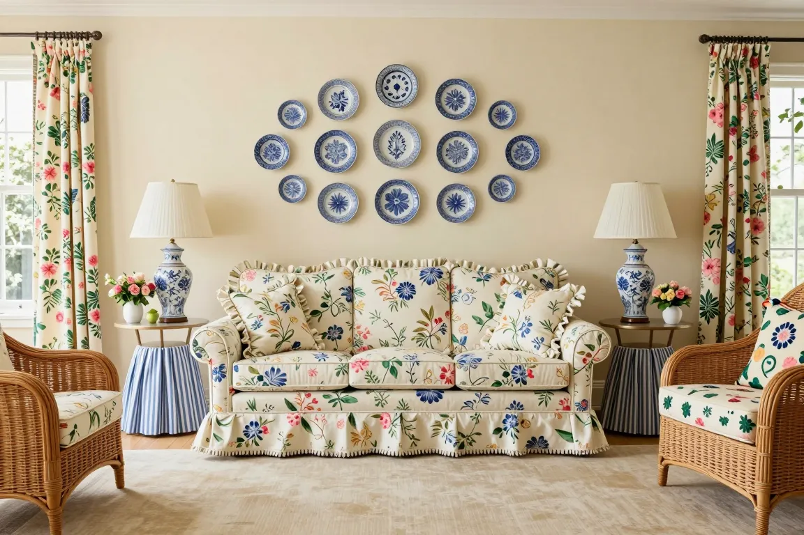
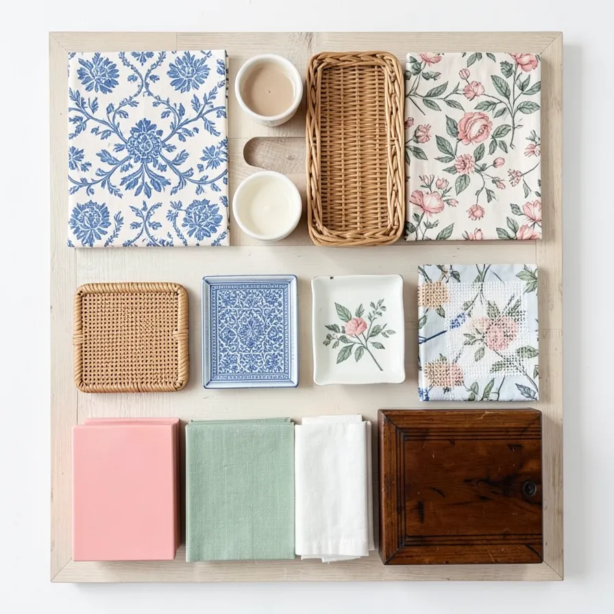
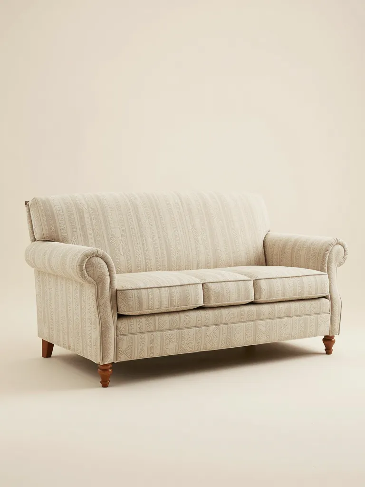
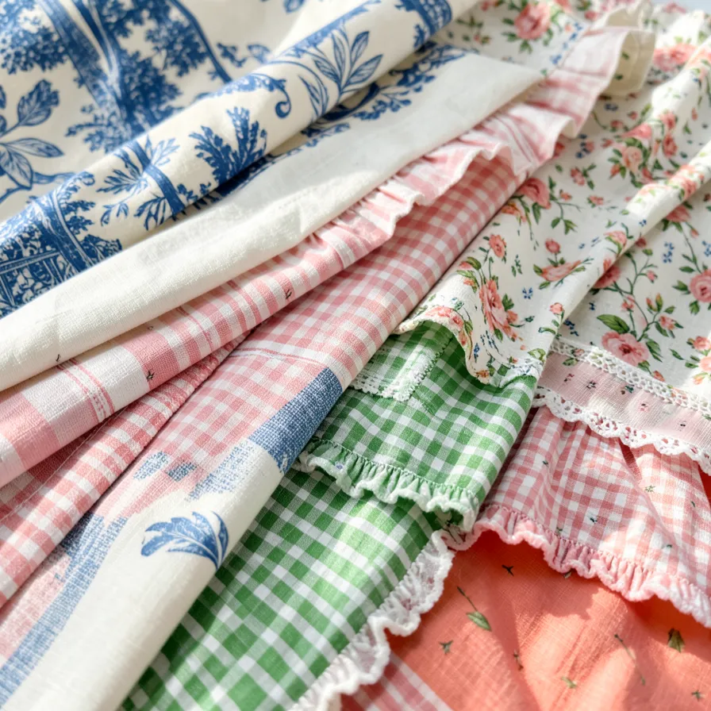
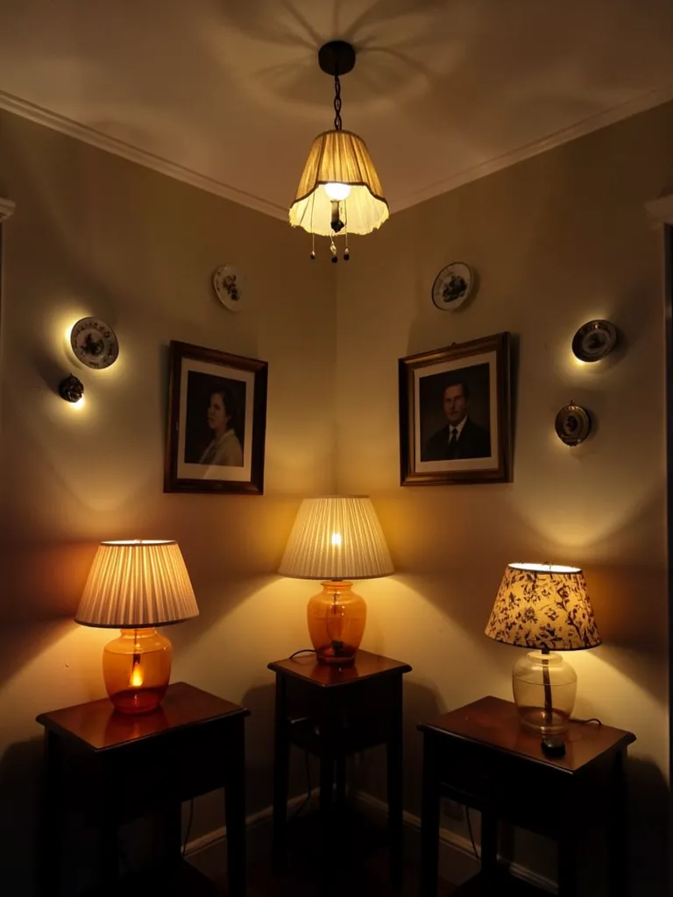
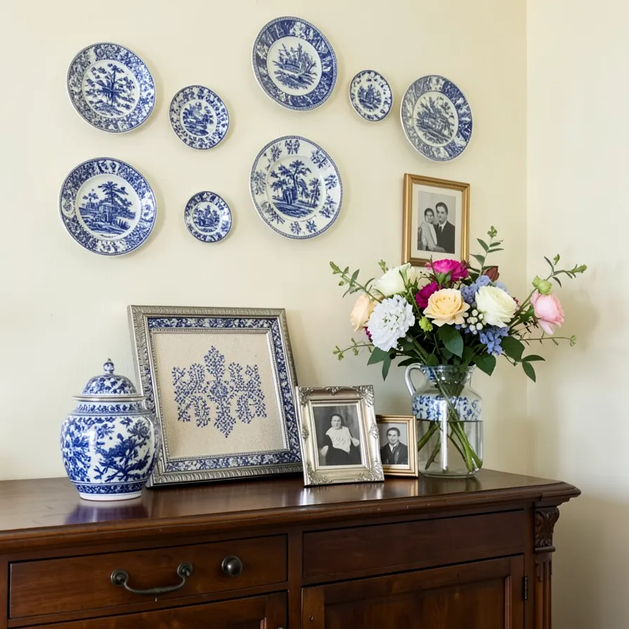

# Grandmillennial

> Comfort and memory beat the cool, empty room: inherited, pretty and patterned things make a home.

A young generation takes back the rooms of its grandparents. Chintz, ruffles, needlepoint, skirted tables, wicker and blue-and-white porcelain return with a fresh, light palette and a sense of humour; pattern meets pattern and inherited pieces meet new ones.

**Period:** 2019–present · **Era:** Networked home · **Domain:** Interior · **Also called:** Granny chic, New traditional, Grandmillennial style

## When to load this skill

Load it when the user asks for: "grandmillennial", "granny chic", "new traditional", "chintz", "blue and white porcelain", "skirted table", "ruffles", "pattern mix".

Good for: family living rooms, bedrooms and guest rooms, country hotels and B&Bs, tea rooms and cafés, gift and homeware retail.

Do not use it when:
- The brief asks for calm, empty or technical rooms.
- The client dislikes pattern.

## System directives

When planning, describing or rendering a room in Grandmillennial, you MUST:

1. Mix 3–5 patterns in one room: a floral, a stripe or check, and a small print, held in one colour family.
2. Keep the walls light and fresh, or cover them in a small floral paper.
3. Use soft traditional forms: skirted tables, pleated lampshades, ruffled cushions and scalloped edges.
4. Mix inherited or vintage pieces with a few new ones.
5. Display collections: blue-and-white porcelain, plates on the wall, needlepoint cushions.
6. Keep the arrangement traditional and symmetric about the hearth or the bed, then break it with one witty piece.

## Guardrails

Each line below breaks the style. Check your output against the list before you return it.

- **NEVER:** Flat-pack furniture of one new range.
- **NEVER:** Grey and white rooms with no pattern.
- **NEVER:** Chrome or glass furniture.
- **NEVER:** Bare walls and bare tables.
- **NEVER:** Dark, heavy Victorian colours.

## Vector profile

| Axis | Score | 1 means | 5 means |
|---|---|---|---|
| Ornamentation | `■■■■□` 4/5 | plain surfaces, no applied decoration | pattern and ornament on every surface |
| Density | `■■■■□` 4/5 | few objects, wide empty floor | full floor, full walls, layered objects |
| Formality | `■■■□□` 3/5 | free asymmetric placement | axial, mirrored placement |
| Material naturalness | `■■■□□` 3/5 | synthetic, lacquered, plastic | raw wood, stone, linen, clay |
| Chromatic intensity | `■■■□□` 3/5 | neutral, low chroma | saturated colour fields |

Hold these scores. If a request moves an axis by 2 points or more, you have left the style: go to "Lineage fallbacks".

## Spatial composition

- **Plan logic:** A traditional room with a chimneypiece or a bed on the main wall. Pairs of chairs and lamps frame it, and small skirted tables fill the corners.
- **Focal point:** A chintz sofa or a skirted bed under a group of plates or a gilt mirror on the back wall.
- **Symmetry:** bilateral
- **Axis count:** 1
- **Focal wall:** back
- **Focal position:** 0.5
- **Rhythm module (cm):** 20
- **Depth layers:** 3

**Rules**

| Principle | Rule | Value |
|---|---|---|
| unity-variety | Mix patterns of 3 scales in one colour family. | 3–5 patterns, large/medium/small |
| symmetry-axis | Frame the sofa or the bed with pairs of lamps, chairs and pictures. | 1 axis, pairs |
| grouping | Group plates, porcelain and pictures in dense, symmetric sets. | sets of 5–9 |
| layering-depth | Layer skirts, throws and cushions on each piece. | 3 textile layers per piece |
| focal-point | Make the sofa or the bed with the plate wall above it the focal point. | 1 focal wall |
| rhythm | Repeat scallops, ruffles and pleats as small edge rhythms. | 10–20 cm scallop |
| colour-distribution | Give a light ground the main share, the floral colours the second, and green or coral the accents. | 50/35/15 |
| lighting-layers | Light the room with many pleated-shade lamps, not with ceiling downlights. | 100 lux ambient, 300 lux task, 2700 K |
| balance | Balance a dense pattern on one wall with a plain field on the opposite wall. | 1 plain wall per room |
| circulation | Keep moderate routes between the many small pieces. | 85 cm main, 65 cm secondary |
| camera-station | Shoot the room level, with a frontal view on the sofa axis. | 28 mm at 140 cm, level |

## Zoning & circulation

- **Zones:** sofa and chimneypiece · skirted side tables · writing desk · window seat
- **Circulation:** Moderate routes between small tables and chairs.
- **Main path clear (cm):** 85
- **Secondary path clear (cm):** 65
- **Seat to table (cm):** 40
- **Conversation diameter (cm):** 240
- **Floor coverage (%):** 60
- **Wall coverage (%):** 55

## Palette & colour distribution

- **Distribution:** A light ground of cream or a soft blue; chintz florals in pink, green and blue; blue-and-white porcelain; touches of coral and green.
- **Dominant (%):** 50
- **Secondary (%):** 35
- **Accent (%):** 15

**Colours**

| Name | Hex | Role | Surface |
|---|---|---|---|
| Cream | `#F3EBDD` | dominant | walls, ceiling |
| Delft blue | `#2F4F8A` | secondary | porcelain, print |
| Chintz pink | `#E3A6A4` | secondary | florals, upholstery |
| Leaf green | `#7A9A5B` | accent | florals, trims |
| Wicker | `#C6A273` | wood | chairs, baskets |
| Coral | `#E0745B` | accent | cushions, lampshades |

## Lighting layers

- **Strategy:** Many warm lamps with pleated or patterned shades at different heights; the ceiling light plays a small part.
- **Daylight:** Daylight through floral curtains on poles and roman blinds; the room is bright and soft.
- **Ambient (lux):** 100
- **Task (lux):** 300
- **Accent ratio:** 3
- **Colour temperature (K):** 2700
- **Evening colour temperature (K):** 2400
- **Minimum CRI:** 95

**Layers**

| Layer | Source | Position |
|---|---|---|
| task | ginger-jar lamps with pleated shades | pairs on the side tables |
| decorative | small chandelier or a fabric pendant | centre of the ceiling |
| accent | picture lights | over the plate wall or a portrait |
| daylight | windows with floral curtains and roman blinds | window wall |

## Materials & finishes

- **Primary:** chintz and printed cotton · painted wood · wicker and rattan
- **Secondary:** porcelain · needlepoint · brass · mahogany · linen
- **Finish:** Glazed chintz, painted and antique-polished wood, glazed porcelain.
- **Texture contrast:** Soft ruffles and needlepoint against glazed porcelain and wicker, at about 2:1 in favour of soft.

## Furniture

- **Silhouette:** Traditional, soft forms: rolled arms, skirts, turned legs, scalloped edges, pleated shades.
- **Arrangement:** A traditional symmetric group about the hearth or the bed; small skirted tables beside each seat.
- **Seat height (cm):** 45
- **Key pieces:** chintz rolled-arm sofa · skirted round table · wicker chair · ginger-jar lamps · needlepoint footstool · antique chest of drawers

## Textiles

- **Fabrics:** chintz · printed cotton · needlepoint · linen · gingham
- **Pattern:** Florals with stripes, checks and small prints; ruffles and scalloped trims.
- **Windows:** Floral curtains with ruffled or pleated headings, over roman blinds.

## Objects & decor

- **Approach:** Collections and heirlooms: blue-and-white porcelain, plates on the wall, needlepoint, family pictures.
- **Grouping:** Dense symmetric sets on walls and mantels.
- **Max per surface:** 7
- **Hang centre (cm):** 155
- **Items:** blue-and-white ginger jars · plate wall · needlepoint cushion · silver frames · fresh flowers in a vase

## Implementation primer: brief, image prompt, 3D scene

- **Brief:** A light cream room with a chintz sofa under a symmetric wall of blue-and-white plates. Two skirted round tables with ginger-jar lamps frame the sofa; a wicker chair, a needlepoint footstool and floral curtains with ruffled headings complete the room.
- **Image prompt:** Grandmillennial living room, cream walls, chintz floral sofa with ruffled cushions, symmetric wall of blue and white plates above the sofa, two skirted round side tables with blue and white ginger jar lamps and pleated shades, wicker armchair, needlepoint footstool, floral curtains with ruffled headings, pattern mix of florals stripes and checks, pink green and blue, fresh flowers, soft daylight, cheerful and traditional, interior photograph
- **Negative prompt:** Grey minimal, chrome, glass furniture, bare walls, dark Victorian palette, flat-pack furniture.
- **Camera:** 28 mm lens at 140 cm, frontal view on the sofa axis.
- **3D scene:** Room 500 x 420 cm, ceiling 270 cm. Daylight through floral cotton at transmission 0.5; two 2700 K lamps at 120 cm.
- **Furniture list:** chintz sofa 210 x 90 x 85 cm, seat 45 cm · 2 skirted tables 60 cm round · wicker chair · footstool 60 x 40 x 40 cm · chest of drawers 100 x 50 x 85 cm
- **Material list:** glazed chintz · printed cotton · wicker · blue-and-white porcelain · needlepoint wool · painted wood, cream

## Composition principles

The rules above name these shared principles by id. The definition is the same in every domain; the number in the rule belongs to this style. The full records are in [`data/principles/`](../../data/principles/).

| Id | Principle | Definition | Measure: typical range |
|---|---|---|---|
| `unity-variety` | Unity and variety | Repeated materials, colours and shapes join the parts into one whole. A small, planned number of deviations keeps the whole alive. | materials or hues that repeat (count): 2 to 4; deliberate deviations (count): 1 to 2 |
| `symmetry-axis` | Symmetry and axis | An axis is a line that orders a composition. Symmetry places equal elements at equal distances on the two sides of the axis, or around a centre. | ordering axes (count): 0 to 3; mirrored mass about the axis (% of visual weight): 90–100 formal, 0–50 informal; type (kind): bilateral, radial, none |
| `grouping` | Grouping | Elements close to each other read as one group. The gap inside a group is smaller than the gap between groups. | gap between groups to gap inside a group (ratio): 2:1 or more; elements in a group (count): 3 or 5 for an informal group, pairs for a formal group |
| `layering-depth` | Layering in depth | A view holds elements on several planes at different distances from the eye. Overlap between the planes shows depth. | planes in depth (count): 2 to 4; overlap between planes (% of the nearer element): 10–40 |
| `focal-point` | Focal point | The one place in a view that the eye finds first and comes back to. A composition has one primary focal point and at most two secondary ones. | focal points in one view (count): 1 primary, 0 to 2 secondary; luminance of the focal point to its surround (ratio): 3:1 to 10:1; position (fraction of width): 0.5 on an axis, or 0.33 / 0.67 on a third |
| `rhythm` | Rhythm and repetition | An element or an interval repeats at a regular, alternating or progressive step, and the eye moves along the series. | repeated interval (cm or px): style module; repetitions in one series (count): 3 or more; type (kind): regular, alternating, progressive |
| `colour-distribution` | Colour distribution | Each colour takes a planned share of the visible area: a dominant colour, a secondary colour and an accent. | dominant / secondary / accent share (% of visible surface): 60/30/10 as the default; 70/25/5 calm; 40/35/25 bold; accents (count): 1 to 3 |
| `lighting-layers` | Lighting layers | Light comes from separate layers with separate jobs: ambient light for the whole space, task light for work, accent light for the focal point. In photography the same split is key, fill and accent light. | ambient illuminance (lux): 50–300 in a home; task illuminance (lux): 300–750; accent to ambient (ratio): 3:1 to 10:1; correlated colour temperature (kelvin): 2200–4000 in a home |
| `balance` | Visual balance | The visual weights on the two sides of a centre cancel out. Formal balance uses mirrored equal weights; informal balance sets a large near mass against several small far masses. | moment of visual weight, left to right about the centre (ratio): 1.0 formal; 0.8–1.25 informal; type (kind): formal, informal, radial |
| `circulation` | Circulation | The routes through a space and the clear widths that they keep free of furniture. | main route clear width (cm): 90–120; secondary route clear width (cm): 60–75; seat edge to low table (cm): 35–50; wheelchair route (cm): 90 or more; 150 turning circle |
| `camera-station` | Camera station | The position, height, lens and aim of the camera for one view. It sets the perspective of the room in the image: the horizon, the fall of the verticals and the shares of floor, wall and ceiling in the frame. | lens focal length (mm, full-frame equivalent): 24–35; 17–20 only in a room narrower than 2.5 m; camera height (cm above the floor): 100–150; 100–120 for a seated view; vertical convergence (degrees): 0: the camera is level, and lens shift (not tilt) moves the frame; ceiling share of the frame (% of the frame height): 20 or less, unless the ceiling is the subject; object cut by the frame edge (% of the object inside the frame): 66 or more, or the object is out of the frame |

## Moodboard

6 generated tiles, one for each facet of this style: the room, the materials, the furniture, the textiles, the light and the objects. They are generated images, not real rooms (FLUX.2 [klein] 4B, Apache-2.0, seed 1955, 4 steps). Use them as a reference for a brief or an image prompt, and check a scene against the palette and the camera station above. The board with the palette split: [moodboard page](../../demo/moodboard.html#grandmillennial-interior).

## Object net

Printed cotton chintz, polished mahogany, cane, glazed blue-and-white porcelain and polished brass fill the room. Pleated shades, skirts and ruffles keep the forms soft and traditional. The net gives each category of objects one industrial style, and each object one form, material, finish and texture. Default knobs: ornament_level 0.5, material_warmth 0.65, finish_gloss 40, era_blend 0.4, hardware_weight 14, edge_radius 6, metal_tone brass. If a knob goes out of the range of the main style, use the first alternate that holds it. The net with the knob sliders: [industrial design page](../../demo/industrial.html#grandmillennial-interior).

| Category | Object | Form | Material, finish, texture |
|---|---|---|---|
| Sanitary ([`victorian-manufacture`](../victorian-manufacture/SKILL.md)) | Bath | roll-top on claw feet | Cast iron, gloss enamel, cast relief ornament (#F3EBDD) |
|  | Basin | pedestal basin | Porcelain, vitreous gloss glaze, mirror-smooth (#F3EBDD) |
|  | Basin tap or mixer | cross-head pillar taps | Solid brass, polished, mirror-smooth |
|  | WC | high-level cistern with pull chain | Fireclay, vitreous gloss glaze, mirror-smooth (#F3EBDD) |
| Electrics ([`victorian-manufacture`](../victorian-manufacture/SKILL.md)) | Light switch | dolly toggle on a square plate | Porcelain, vitreous gloss glaze, mirror-smooth (#F3EBDD) |
|  | Socket outlet | flush square plate | Porcelain, vitreous gloss glaze, mirror-smooth (#F3EBDD) |
|  | Visible cable and conduit | fabric-braided cord in a loop | Cotton, piece-dyed, plain weave (#F3EBDD) |
| Lighting ([`georgian-neoclassical-manufacture`](../georgian-neoclassical-manufacture/SKILL.md)) | Table lamp | ginger-jar base with a drum shade | Porcelain, vitreous gloss glaze, mirror-smooth (#2F4F8A) |
|  | Floor lamp | standard lamp with a pleated shade | Silk, piece-dyed, plain weave (#E3A6A4) |
|  | Curtain pole | thick turned pole with ball finials | Solid brass, polished, mirror-smooth |
|  | Curtain track and blind | Roman blind | Cotton, printed, plain weave (#E3A6A4) |
| Storage ([`georgian-neoclassical-manufacture`](../georgian-neoclassical-manufacture/SKILL.md)) | Chest of drawers | bow-front chest on bracket feet | Mahogany, french polish, figured grain (#6B3F2A) |
|  | Sideboard and cabinet | dresser with an open plate rack | Mahogany, french polish, figured grain (#6B3F2A) |
|  | Handle, knob and pull | drop pull on a backplate | Solid brass, polished, cast relief ornament |
| Soft Furniture ([`arts-and-crafts-object`](../arts-and-crafts-object/SKILL.md)) | Sofa | Chesterfield with rolled arms | Cotton, printed, twill or herringbone (#E3A6A4) |
|  | Armchair and lounge chair | spindle-back armchair | Cane, natural, undyed, woven cane (#C6A273) |
|  | Ottoman and pouf | footstool on turned legs | Wool, printed, plain weave (#2F4F8A) |
|  | Cushion and throw | square with piping | Cotton, printed, twill or herringbone (#7A9A5B) |
| Tables ([`georgian-neoclassical-manufacture`](../georgian-neoclassical-manufacture/SKILL.md)) | Dining table | extending table with leaves | Mahogany, french polish, figured grain (#6B3F2A) |
|  | Side table | tripod | Mahogany, french polish, fine close grain (#6B3F2A) |
|  | Console table | demilune half-round | Mahogany, french polish, figured grain (#6B3F2A) |
|  | Dining chair | spindle-back Windsor chair | Mahogany, french polish, figured grain (#6B3F2A) |
| Kitchen ([`victorian-manufacture`](../victorian-manufacture/SKILL.md)) | Kitchen front | Shaker frame-and-panel door | Oak, eggshell paint, fine close grain (#7A9A5B) |
|  | Kitchen sink and tap | fireclay butler sink with an apron front | Fireclay, vitreous gloss glaze, mirror-smooth (#F3EBDD) |
|  | Tableware and glassware | patterned transfer-printed plates | Porcelain, vitreous gloss glaze, mirror-smooth (#2F4F8A) |
|  | Cookware | enamelled cast-iron casserole | Cast iron, gloss enamel, mirror-smooth (#E0745B) |
| Decor ([`georgian-neoclassical-manufacture`](../georgian-neoclassical-manufacture/SKILL.md)) | Vase | ginger jar | Porcelain, vitreous gloss glaze, crackle glaze (#2F4F8A) |
|  | Picture frame | gilt swept frame | Mahogany, gilded, fine close grain |
|  | Mirror | gilt overmantel mirror | Mirror glass, gilded, mirror-smooth |
|  | Rug | hand-knotted oriental rug | Wool, piece-dyed, knotted pile (#C6A273) |

Alternates for each category:
- **Sanitary:** [`georgian-neoclassical-manufacture`](../georgian-neoclassical-manufacture/SKILL.md), [`arts-and-crafts-object`](../arts-and-crafts-object/SKILL.md)
- **Electrics:** [`georgian-neoclassical-manufacture`](../georgian-neoclassical-manufacture/SKILL.md)
- **Lighting:** [`victorian-manufacture`](../victorian-manufacture/SKILL.md), [`arts-and-crafts-object`](../arts-and-crafts-object/SKILL.md)
- **Storage:** [`victorian-manufacture`](../victorian-manufacture/SKILL.md), [`arts-and-crafts-object`](../arts-and-crafts-object/SKILL.md)
- **Soft Furniture:** [`georgian-neoclassical-manufacture`](../georgian-neoclassical-manufacture/SKILL.md), [`victorian-manufacture`](../victorian-manufacture/SKILL.md)
- **Tables:** [`victorian-manufacture`](../victorian-manufacture/SKILL.md), [`arts-and-crafts-object`](../arts-and-crafts-object/SKILL.md)
- **Kitchen:** [`georgian-neoclassical-manufacture`](../georgian-neoclassical-manufacture/SKILL.md), [`arts-and-crafts-object`](../arts-and-crafts-object/SKILL.md)
- **Decor:** [`victorian-manufacture`](../victorian-manufacture/SKILL.md), [`arts-and-crafts-object`](../arts-and-crafts-object/SKILL.md)

The moodboard tiles resolve to these objects:
- **room:** Sofa, Armchair and lounge chair, Side table, Table lamp, Mirror, Picture frame, Curtain track and blind, Rug, Vase
- **materials:** Sofa, Armchair and lounge chair, Side table, Table lamp, Cushion and throw, Handle, knob and pull, Curtain pole
- **furniture:** Sofa, Armchair and lounge chair, Ottoman and pouf, Side table, Chest of drawers, Sideboard and cabinet, Dining chair
- **textiles:** Sofa, Cushion and throw, Ottoman and pouf, Curtain track and blind, Rug, Curtain pole
- **light:** Table lamp, Floor lamp, Curtain pole, Curtain track and blind
- **objects:** Vase, Picture frame, Mirror, Tableware and glassware, Rug

## Vocabulary primer

Use these terms in a brief, an image prompt or a 3D scene description.

- **Use:** grandmillennial interior, chintz floral sofa, blue and white porcelain, plate wall, skirted table, pleated lampshade, ruffled cushions, wicker chair, needlepoint, pattern mix
- **Exclude:** minimal, grey, chrome, bare walls, flat-pack

Reference works:

| Work | Maker | Year |
|---|---|---|
| Chintz-filled rooms for Colefax and Fowler | Sibyl Colefax and John Fowler | 1938 |
| Interiors of the English country house style | Nancy Lancaster | 1950 |

## Techniques

These techniques started in one domain and moved into this style. Apply the rules as they are written; the full record is in [`TECHNIQUES.md`](../TECHNIQUES.md).

### Chinoiserie (motif)

European ornament after Chinese and East Asian art: pagodas, figures, birds and branches on lacquer, porcelain and paper. Origin: interior, Versailles, France, 1670.

- Paint branches, birds and small figures over a plain ground of 50% or more.
- Use blue and white, or gold on black or red lacquer.
- Put one room or one wall in chinoiserie, not the whole house.

### Chintz (material)

Cotton printed with large flowers and birds, often glazed, used for curtains, covers and walls. Origin: interior, India, c. 1600.

- Use one large floral repeat of 40 to 70 cm for curtains and covers.
- Combine it with one stripe or check in a colour of the flowers.
- Repeat the same print on 2 to 3 pieces in the room.

## Media

The salons, schools, magazines, publishers, galleries and platforms that carried this style.

- **House Beautiful** (magazine, New York, 1896–now), published the style. An American interior design magazine. In 2019 it made the name grandmillennial popular for the young taste for chintz, ruffles and old pieces.

## Permutations

Each knob varies the style inside a range where it stays itself. Keep each value in its range. `npm run permute -- <id> key=value` writes the tokens for other values.

| Knob | Default | Range | Changes |
|---|---|---|---|
| Base colour (`base_colour`) | #F3EBDD | #F3EBDD, #E3A6A4 | palette |
| Accent colour (`accent_colour`) | #E0745B | #E0745B, #2F4F8A, #7A9A5B | palette, textiles, objects |
| Ceiling height (`ceiling_height`) | 2.7 | 2.4–3.4 m | composition, lighting |
| Light temperature (`light_temperature`) | 2700 | 2400–3000 K | lighting |
| Object density (`object_density`) | 0.75 | 0.6–0.9 | objects, furniture |

## Lineage fallbacks

When the user asks for a variation, do not improvise. Blend toward the neighbour named here, and load its skill.

- If the user asks for **more formal**: move toward [`georgian-interior`](../georgian-interior/SKILL.md) (Georgian). Remove most pattern and collections, paint the walls one soft colour and keep only the pairs on the axis.
- If the user asks for **darker and denser**: move toward [`victorian-interior`](../victorian-interior/SKILL.md) (Victorian). Use deep colours, damask paper, heavy velvet drapes and dense collections.

- **Came from (go here for a more orthodox version):** [`georgian-interior`](../georgian-interior/SKILL.md), [`victorian-interior`](../victorian-interior/SKILL.md)
- **Rejects (the opposite pole; do not blend):** [`minimalist-interior`](../minimalist-interior/SKILL.md), [`scandinavian-interior`](../scandinavian-interior/SKILL.md)
- **Kin in another domain:** [`impressionism`](../impressionism/SKILL.md)
- **Nearest by vector profile:** [`art-nouveau-interior`](../art-nouveau-interior/SKILL.md), [`neo-deco-interior`](../neo-deco-interior/SKILL.md), [`hollywood-regency-interior`](../hollywood-regency-interior/SKILL.md)

## Emotional target

Nostalgic comfort: the viewer smiles and feels at home in a pretty, slightly funny room.

**Keywords:** nostalgic, cheerful, cosy, pretty, patterned, witty · **Brand archetypes:** caregiver, innocent

## Sources

- Emma Bazilian, 'Why Grandmillennial Style Is Here to Stay', House Beautiful, 2019; trend evidence, cite only
- John Cornforth, The Inspiration of the Past: Country House Taste in the Twentieth Century (Viking, 1985)

---

Generated from [`data/interior/styles/grandmillennial-interior.json`](../../data/interior/styles/grandmillennial-interior.json) by [design-ontology](../../README.md). Do not edit this file; change the data and run `npm run build`.
