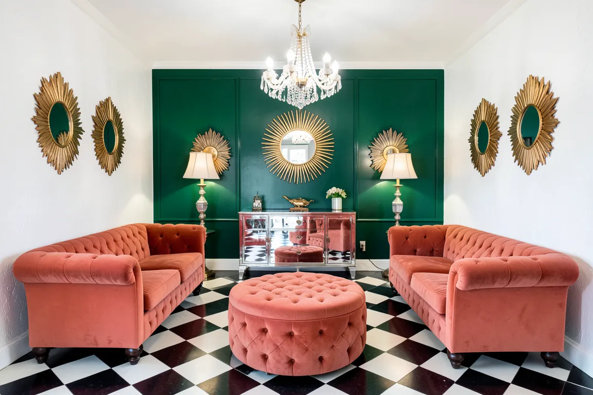
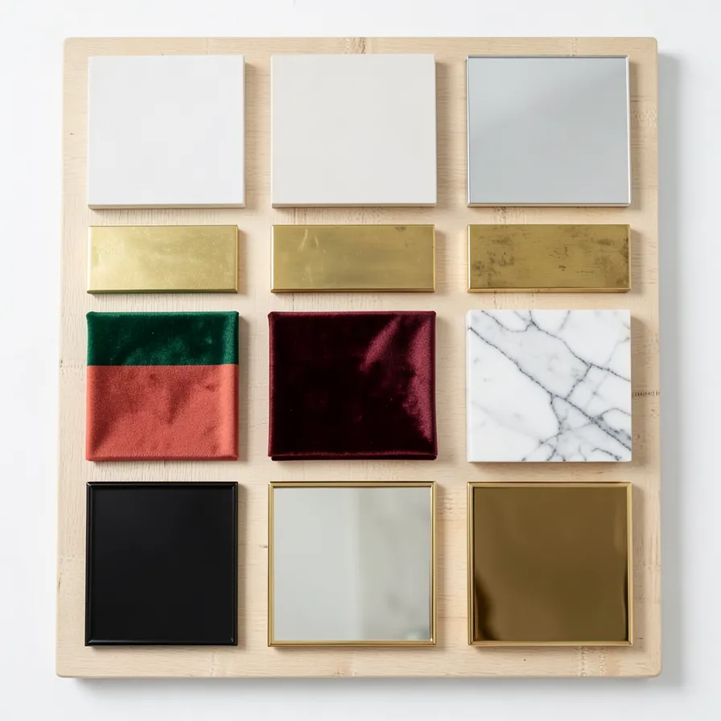
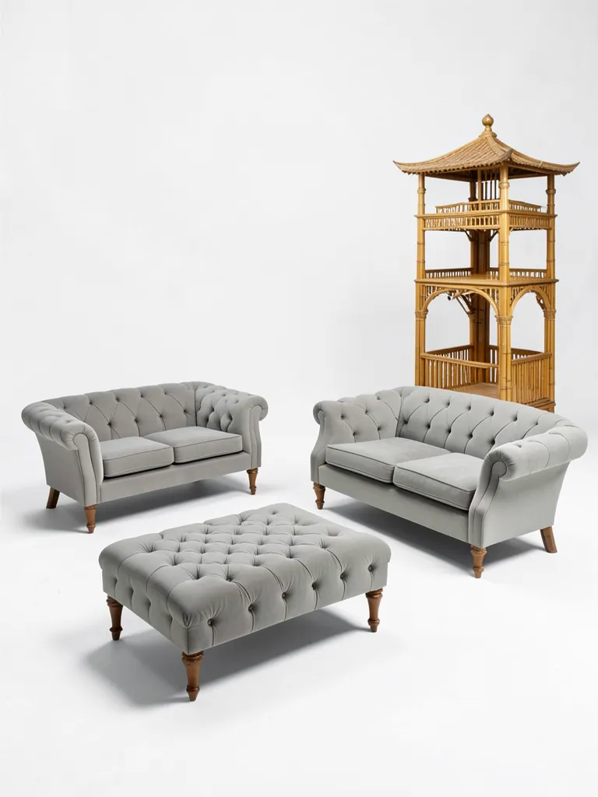
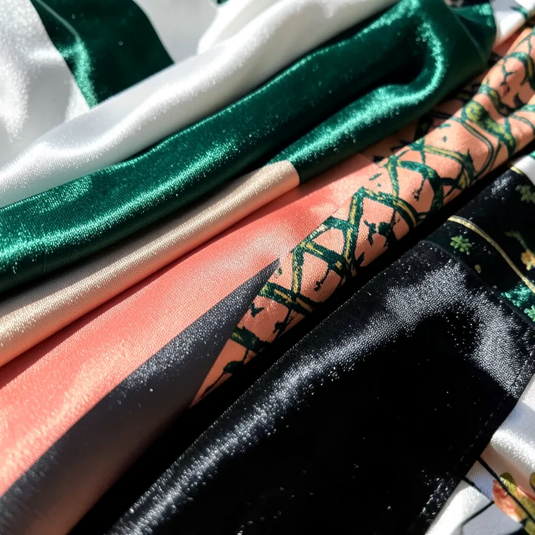
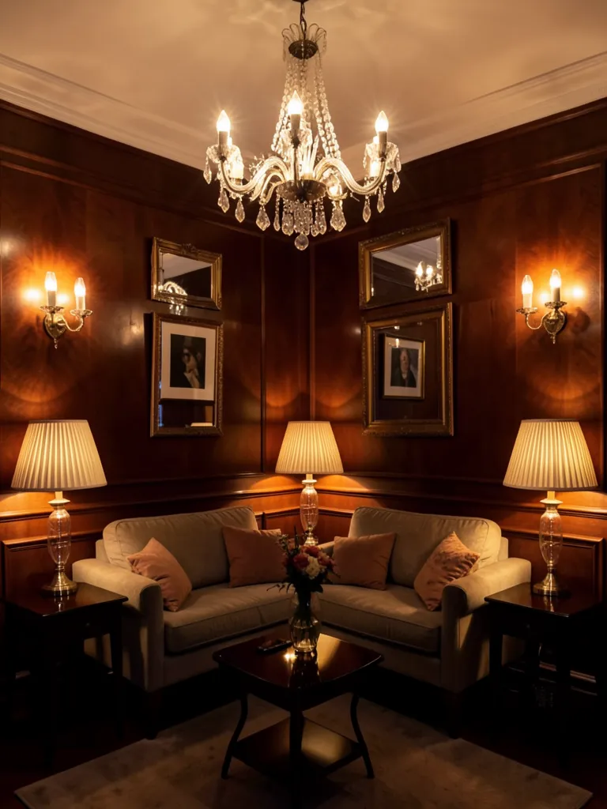
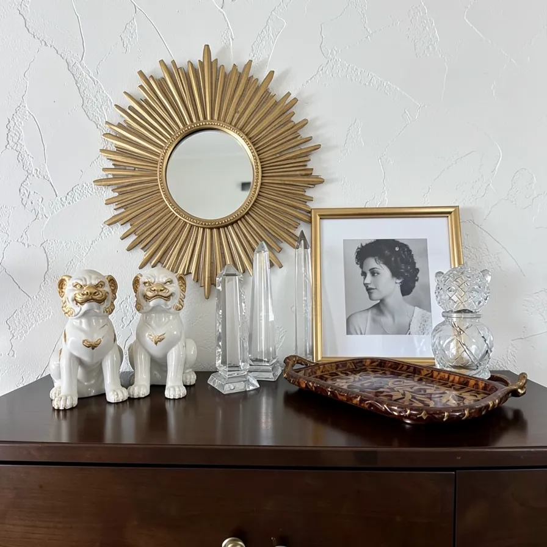

# Hollywood Regency

> A room is a stage set: bold colour, gloss and symmetry make the people in it look their best.

The decorator's room of the film stars. Regency and neoclassical forms meet lacquer colour, bold stripes and mirror; a symmetric plan around a centre piece, white plaster and gilt make each room ready for a camera.

**Period:** 1935–1965; revival from 2005 · **Era:** Post-war modern · **Domain:** Interior · **Also called:** Hollywood Regency, Regency moderne, Hollywood glamour

## When to load this skill

Load it when the user asks for: "hollywood regency", "regency moderne", "dorothy draper", "old hollywood", "glam interior", "lacquered walls", "checkerboard floor".

Good for: hotel lobbies and bars, dressing rooms, beauty and fashion retail, restaurants, event spaces.

Do not use it when:
- The brief asks for calm or natural materials.
- The room has no centre, such as a narrow corridor.

## System directives

When planning, describing or rendering a room in Hollywood Regency, you MUST:

1. Plan the room around one centre piece, such as a round table or an ottoman, with seats in pairs about it.
2. Use one saturated colour boldly, often lacquered, against white or black.
3. Add mirror and gilt for sparkle: mirrored furniture, gilt frames and brass fittings.
4. Use bold graphic pattern on one surface: wide stripes, trellis or a black and white floor.
5. Mix Regency and neoclassical forms, such as klismos chairs and pagodas, with modern comfort.
6. Make the room photogenic: warm light that flatters faces and a clear view of each pair.

## Guardrails

Each line below breaks the style. Check your output against the list before you return it.

- **NEVER:** Matt, rustic or raw surfaces.
- **NEVER:** Muted earth palettes with no contrast.
- **NEVER:** Asymmetric informal groups.
- **NEVER:** Bare, cold light.
- **NEVER:** Many small patterns at once.

## Vector profile

| Axis | Score | 1 means | 5 means |
|---|---|---|---|
| Ornamentation | `■■■■□` 4/5 | plain surfaces, no applied decoration | pattern and ornament on every surface |
| Density | `■■■□□` 3/5 | few objects, wide empty floor | full floor, full walls, layered objects |
| Formality | `■■■■□` 4/5 | free asymmetric placement | axial, mirrored placement |
| Material naturalness | `■■□□□` 2/5 | synthetic, lacquered, plastic | raw wood, stone, linen, clay |
| Chromatic intensity | `■■■■□` 4/5 | neutral, low chroma | saturated colour fields |

Hold these scores. If a request moves an axis by 2 points or more, you have left the style: go to "Lineage fallbacks".

## Spatial composition

- **Plan logic:** A symmetric plan around a centre piece. Pairs of sofas, chairs and lamps face each other across it; a lacquer or mirror wall closes the axis.
- **Focal point:** A round centre table or tufted ottoman under a chandelier in the middle of the room.
- **Symmetry:** radial
- **Axis count:** 2
- **Focal wall:** centre
- **Focal position:** 0.5
- **Rhythm module (cm):** 40
- **Depth layers:** 3

**Rules**

| Principle | Rule | Value |
|---|---|---|
| symmetry-axis | Arrange pairs of seats and lamps on two axes that cross at the centre piece. | 2 axes, mirror pairs |
| focal-point | Put the focal point in the centre of the floor under the chandelier. | 1 centre piece |
| contrast | Set one lacquered saturated colour against white plaster and black accents. | LRV difference 50–70 |
| rhythm | Repeat one bold stripe or trellis on one surface only. | stripes 10–20 cm |
| balance | Balance each piece with its twin across the centre. | moment ratio 1.0 |
| hierarchy | Make the centre piece and the chandelier the richest; the walls stay plain. | 3 levels |
| colour-distribution | Give white and the lacquer colour the main shares and gilt and black the accents. | 50/35/15 |
| lighting-layers | Light the faces with warm lamps in pairs and a crystal chandelier; avoid downlight. | 150 lux ambient, 300 lux task, 2700 K |
| sightlines | Keep the view from the door to the centre piece open. | furniture on the axis below 80 cm |
| circulation | Keep a ring route around the centre group. | 100 cm main, 75 cm secondary |
| camera-station | Shoot the room level, with a frontal view on the cross axis through the centre piece. | 24 mm at 140 cm, level |

## Zoning & circulation

- **Zones:** centre conversation group · bar cart · vanity or writing desk · window banquette
- **Circulation:** A ring route around the centre group and two straight routes on the axes.
- **Main path clear (cm):** 100
- **Secondary path clear (cm):** 75
- **Seat to table (cm):** 40
- **Conversation diameter (cm):** 280
- **Floor coverage (%):** 50
- **Wall coverage (%):** 40

## Palette & colour distribution

- **Distribution:** White plaster and one lacquered colour (emerald, coral or peacock blue) on walls or furniture; black on a floor or trim; gilt and mirror for the accents.
- **Dominant (%):** 50
- **Secondary (%):** 35
- **Accent (%):** 15

**Colours**

| Name | Hex | Role | Surface |
|---|---|---|---|
| Plaster white | `#F4F1EA` | dominant | walls, ceiling |
| Emerald lacquer | `#0F6B4F` | secondary | walls or cabinets |
| Coral | `#E2735E` | secondary | upholstery, lamps |
| Gloss black | `#111111` | accent | floor tiles, trims, frames |
| Gilt | `#C9A246` | metal | mirrors, frames, hardware |
| Mirror | `#D7DCDF` | metal | mirrored furniture and panels |

## Lighting layers

- **Strategy:** Warm light that flatters faces. Pairs of lamps at face height and a crystal chandelier give sparkle; mirrors double each source.
- **Daylight:** Tall windows with full curtains on gilt poles; daylight reflects from mirror and lacquer.
- **Ambient (lux):** 150
- **Task (lux):** 300
- **Accent ratio:** 3
- **Colour temperature (K):** 2700
- **Evening colour temperature (K):** 2400
- **Minimum CRI:** 95

**Layers**

| Layer | Source | Position |
|---|---|---|
| decorative | crystal chandelier | over the centre piece |
| task | pairs of tall lamps with pleated shades | on side tables at each end of the sofas |
| accent | picture lights and mirrored sconces | on the lacquer wall |
| daylight | tall windows with full curtains | window wall |

## Materials & finishes

- **Primary:** lacquer · plaster · mirror glass
- **Secondary:** gilt wood · brass · velvet · silk · marble · faux bamboo
- **Finish:** High-gloss lacquer, mirror and polished brass.
- **Texture contrast:** Gloss and mirror against tufted velvet, at about 2:1 in favour of gloss.

## Furniture

- **Silhouette:** Neoclassical and Regency forms in clean, smooth lines: klismos chairs, tufted sofas, pagoda and faux-bamboo pieces.
- **Arrangement:** Matched pairs face each other across a round centre table or ottoman.
- **Seat height (cm):** 44
- **Key pieces:** tufted ottoman · pair of tufted sofas · klismos chairs · mirrored chest · lacquer étagère · crystal chandelier · pair of pagoda lamps

## Textiles

- **Fabrics:** velvet · silk · satin · chinoiserie print
- **Pattern:** One bold graphic pattern: wide stripe, trellis or chinoiserie.
- **Windows:** Full silk or satin curtains with a shaped pelmet, on gilt poles.

## Objects & decor

- **Approach:** Glamorous pieces in pairs: porcelain, gilt, crystal and framed portraits.
- **Grouping:** Pairs and symmetric sets.
- **Max per surface:** 4
- **Hang centre (cm):** 160
- **Items:** pair of porcelain foo dogs · gilt sunburst mirror · crystal obelisks · framed portrait · lacquer tray

## Implementation primer: brief, image prompt, 3D scene

- **Brief:** A white plaster room with an emerald lacquered back wall and a black and white floor. Two tufted coral sofas face each other across a round tufted ottoman under a crystal chandelier; pagoda lamps, a mirrored chest and gilt mirrors stand in pairs.
- **Image prompt:** Hollywood Regency living room, symmetrical, white plaster walls and an emerald green lacquered wall, black and white checkerboard floor, two coral velvet tufted sofas facing each other, round tufted ottoman in the centre, crystal chandelier, pair of pagoda lamps, mirrored chest, gilt sunburst mirrors, glossy and glamorous, 1950s Los Angeles, interior photograph
- **Negative prompt:** Rustic, matt earth tones, asymmetric, cold light, clutter, raw wood.
- **Camera:** 24 mm lens at 140 cm, frontal view on the cross axis through the centre piece.
- **3D scene:** Room 650 x 550 cm, ceiling 300 cm. One 2700 K crystal chandelier at 220 cm; four 2700 K lamps at 130 cm; lacquer roughness 0.05.
- **Furniture list:** 2 sofas 210 x 90 x 80 cm, seat 44 cm · round ottoman 110 cm · mirrored chest 90 x 45 x 80 cm · 2 klismos chairs · chandelier 80 cm
- **Material list:** emerald lacquer · white plaster · black and white marble tiles · coral velvet · gilt wood · mirror glass

**References**

| Title | Credit | Licence | Url |
|---|---|---|---|
| Regency source: gilded-wood bench designed by Thomas Hope (before 1807) | The Metropolitan Museum of Art, Purchase, The James Parker Charitable Foundation Gift, 2014 | CC0 | https://www.metmuseum.org/art/collection/search/631133 |
| Regency source: Thomas Hope, Household Furniture and Interior Decoration (1807) | The Metropolitan Museum of Art, Harris Brisbane Dick Fund, 1930 | CC0 | https://www.metmuseum.org/art/collection/search/351777 |

## Composition principles

The rules above name these shared principles by id. The definition is the same in every domain; the number in the rule belongs to this style. The full records are in [`data/principles/`](../../data/principles/).

| Id | Principle | Definition | Measure: typical range |
|---|---|---|---|
| `symmetry-axis` | Symmetry and axis | An axis is a line that orders a composition. Symmetry places equal elements at equal distances on the two sides of the axis, or around a centre. | ordering axes (count): 0 to 3; mirrored mass about the axis (% of visual weight): 90–100 formal, 0–50 informal; type (kind): bilateral, radial, none |
| `focal-point` | Focal point | The one place in a view that the eye finds first and comes back to. A composition has one primary focal point and at most two secondary ones. | focal points in one view (count): 1 primary, 0 to 2 secondary; luminance of the focal point to its surround (ratio): 3:1 to 10:1; position (fraction of width): 0.5 on an axis, or 0.33 / 0.67 on a third |
| `contrast` | Contrast | Two adjacent elements differ in value, hue, texture, size or shape. Contrast marks edges and makes the focal point. | light reflectance value difference between adjacent planes (LRV points): 30 or more for a visible edge |
| `rhythm` | Rhythm and repetition | An element or an interval repeats at a regular, alternating or progressive step, and the eye moves along the series. | repeated interval (cm or px): style module; repetitions in one series (count): 3 or more; type (kind): regular, alternating, progressive |
| `balance` | Visual balance | The visual weights on the two sides of a centre cancel out. Formal balance uses mirrored equal weights; informal balance sets a large near mass against several small far masses. | moment of visual weight, left to right about the centre (ratio): 1.0 formal; 0.8–1.25 informal; type (kind): formal, informal, radial |
| `hierarchy` | Hierarchy | The elements of a composition rank by importance through size, position, contrast or isolation. The viewer reads them in that order. | levels of rank (count): 2 to 3; size ratio between adjacent levels (ratio): 1.5:1 or more |
| `colour-distribution` | Colour distribution | Each colour takes a planned share of the visible area: a dominant colour, a secondary colour and an accent. | dominant / secondary / accent share (% of visible surface): 60/30/10 as the default; 70/25/5 calm; 40/35/25 bold; accents (count): 1 to 3 |
| `lighting-layers` | Lighting layers | Light comes from separate layers with separate jobs: ambient light for the whole space, task light for work, accent light for the focal point. In photography the same split is key, fill and accent light. | ambient illuminance (lux): 50–300 in a home; task illuminance (lux): 300–750; accent to ambient (ratio): 3:1 to 10:1; correlated colour temperature (kelvin): 2200–4000 in a home |
| `sightlines` | Sightlines | The line from an eye position, such as an entrance or a seat, to a target. A clear sightline joins the viewer to the focal point. | standing eye height (cm): 150–165; seated eye height (cm): 110–120; obstruction on the main sightline (cm of height): 0, or below 75 for low furniture |
| `circulation` | Circulation | The routes through a space and the clear widths that they keep free of furniture. | main route clear width (cm): 90–120; secondary route clear width (cm): 60–75; seat edge to low table (cm): 35–50; wheelchair route (cm): 90 or more; 150 turning circle |
| `camera-station` | Camera station | The position, height, lens and aim of the camera for one view. It sets the perspective of the room in the image: the horizon, the fall of the verticals and the shares of floor, wall and ceiling in the frame. | lens focal length (mm, full-frame equivalent): 24–35; 17–20 only in a room narrower than 2.5 m; camera height (cm above the floor): 100–150; 100–120 for a seated view; vertical convergence (degrees): 0: the camera is level, and lens shift (not tilt) moves the frame; ceiling share of the frame (% of the frame height): 20 or less, unless the ceiling is the subject; object cut by the frame edge (% of the object inside the frame): 66 or more, or the object is out of the frame |

## Moodboard

6 generated tiles, one for each facet of this style: the room, the materials, the furniture, the textiles, the light and the objects. They are generated images, not real rooms (FLUX.2 [klein] 4B, Apache-2.0, seed 1955, 4 steps). Use them as a reference for a brief or an image prompt, and check a scene against the palette and the camera station above. The board with the palette split: [moodboard page](../../demo/moodboard.html#hollywood-regency-interior).

## Object net

Gloss lacquer, mirror glass, gilt brass and tufted velvet in pairs: every object shines, and every light source doubles in a mirror. The net gives each category of objects one industrial style, and each object one form, material, finish and texture. Default knobs: ornament_level 0.5, material_warmth 0.45, finish_gloss 88, era_blend 0.3, hardware_weight 18, edge_radius 4, metal_tone brass. If a knob goes out of the range of the main style, use the first alternate that holds it. The net with the knob sliders: [industrial design page](../../demo/industrial.html#hollywood-regency-interior).

| Category | Object | Form | Material, finish, texture |
|---|---|---|---|
| Sanitary ([`art-deco-product`](../art-deco-product/SKILL.md)) | Basin | console basin on legs | Marble, polished, veined (#F4F1EA) |
|  | Basin tap or mixer | swan-neck spout | Solid brass, polished, mirror-smooth (#C9A246) |
|  | Towel rail | pedestal rail on feet | Solid brass, polished, mirror-smooth (#C9A246) |
|  | Bath accessories | shelf-top vessels | Frosted glass, acid-etched or sandblasted, etched or frosted (#D7DCDF) |
| Electrics ([`art-deco-product`](../art-deco-product/SKILL.md)) | Light switch | dolly toggle on a square plate | Solid brass, polished, mirror-smooth (#C9A246) |
|  | Socket outlet | flush square plate | Bakelite, moulded gloss, mirror-smooth (#111111) |
|  | Dimmer and control | large knurled rotary knob | Solid brass, polished, knurled (#C9A246) |
| Lighting ([`art-deco-product`](../art-deco-product/SKILL.md)) | Pendant lamp | tiered chandelier | Pressed glass, clear gloss, pressed pattern (#D7DCDF) |
|  | Table lamp | ginger-jar base with a drum shade | Porcelain, vitreous gloss glaze, mirror-smooth (#E2735E) |
|  | Wall sconce | candle arm with a pleated shade | Solid brass, gilded, cast relief ornament (#C9A246) |
|  | Floor lamp | standard lamp with a pleated shade | Solid brass, polished, mirror-smooth (#C9A246) |
|  | Curtain pole | pole with spear or acanthus finials | Solid brass, gilded, cast relief ornament (#C9A246) |
| Storage ([`art-deco-product`](../art-deco-product/SKILL.md)) | Sideboard and cabinet | breakfront with a raised centre | Macassar ebony, french polish, figured grain (#111111) |
|  | Shelving | open bookcase | Walnut, high-gloss lacquer, fine close grain (#0F6B4F) |
|  | Wardrobe and tall cabinet | flush built-in wall | Mirror glass, silvered, mirror-smooth (#D7DCDF) |
|  | Handle, knob and pull | drop pull on a backplate | Solid brass, polished, cast relief ornament (#C9A246) |
| Soft Furniture ([`art-deco-product`](../art-deco-product/SKILL.md)) | Sofa | tuxedo sofa with flush arms | Velvet, piece-dyed, button-tufted (#E2735E) |
|  | Armchair and lounge chair | barrel chair | Velvet, lustre pile, button-tufted (#0F6B4F) |
|  | Ottoman and pouf | button-tufted ottoman | Velvet, piece-dyed, button-tufted (#E2735E) |
|  | Cushion and throw | bolster | Mohair, piece-dyed, cut pile (#0F6B4F) |
| Tables ([`georgian-neoclassical-manufacture`](../georgian-neoclassical-manufacture/SKILL.md)) | Dining chair | upholstered parsons chair | Mahogany, french polish, fine close grain (#111111) |
|  | Low table | glass top on a sculptural base | Mirror glass, silvered, mirror-smooth (#D7DCDF) |
|  | Console table | demilune half-round | Marble, polished, veined (#F4F1EA) |
|  | Side table | C-table | Solid brass, gilded, mirror-smooth (#C9A246) |
| Kitchen ([`art-deco-product`](../art-deco-product/SKILL.md)) | Kitchen front | flat slab door | Walnut, high-gloss lacquer, fine close grain (#0F6B4F) |
|  | Worktop and splashback | thick mitred stone slab | Marble, polished, veined (#F4F1EA) |
|  | Kettle and small appliances | stovetop whistling kettle | Chrome-plated brass, polished, mirror-smooth (#D7DCDF) |
|  | Tableware and glassware | rimmed white plates | Porcelain, gilded, cast relief ornament (#C9A246) |
|  | Cutlery | fiddle pattern | Silver plate, polished, mirror-smooth |
| Decor ([`georgian-neoclassical-manufacture`](../georgian-neoclassical-manufacture/SKILL.md)) | Mirror | sunburst mirror | Solid brass, gilded, cast relief ornament (#C9A246) |
|  | Vase | ginger jar | Porcelain, vitreous gloss glaze, mirror-smooth (#F4F1EA) |
|  | Bowl, tray and box | lacquer box | Walnut, high-gloss lacquer, fine close grain (#0F6B4F) |
|  | Picture frame | gilt swept frame | Mahogany, gilded, fine close grain (#C9A246) |
|  | Candle holder and lantern | candlestick pair | Silver plate, polished, mirror-smooth |
|  | Rug | plain wool rug with a border | Wool, piece-dyed, cut pile (#F4F1EA) |

Alternates for each category:
- **Sanitary:** [`georgian-neoclassical-manufacture`](../georgian-neoclassical-manufacture/SKILL.md), [`streamline-moderne-product`](../streamline-moderne-product/SKILL.md), [`super-normal-product`](../super-normal-product/SKILL.md)
- **Electrics:** [`georgian-neoclassical-manufacture`](../georgian-neoclassical-manufacture/SKILL.md), [`streamline-moderne-product`](../streamline-moderne-product/SKILL.md)
- **Lighting:** [`georgian-neoclassical-manufacture`](../georgian-neoclassical-manufacture/SKILL.md), [`streamline-moderne-product`](../streamline-moderne-product/SKILL.md), [`super-normal-product`](../super-normal-product/SKILL.md)
- **Storage:** [`georgian-neoclassical-manufacture`](../georgian-neoclassical-manufacture/SKILL.md), [`streamline-moderne-product`](../streamline-moderne-product/SKILL.md)
- **Soft Furniture:** [`georgian-neoclassical-manufacture`](../georgian-neoclassical-manufacture/SKILL.md), [`streamline-moderne-product`](../streamline-moderne-product/SKILL.md), [`mid-century-modern-product`](../mid-century-modern-product/SKILL.md)
- **Tables:** [`art-deco-product`](../art-deco-product/SKILL.md), [`contemporary-craft-product`](../contemporary-craft-product/SKILL.md), [`streamline-moderne-product`](../streamline-moderne-product/SKILL.md)
- **Kitchen:** [`georgian-neoclassical-manufacture`](../georgian-neoclassical-manufacture/SKILL.md), [`streamline-moderne-product`](../streamline-moderne-product/SKILL.md), [`super-normal-product`](../super-normal-product/SKILL.md)
- **Decor:** [`art-deco-product`](../art-deco-product/SKILL.md), [`contemporary-craft-product`](../contemporary-craft-product/SKILL.md), [`streamline-moderne-product`](../streamline-moderne-product/SKILL.md)

The moodboard tiles resolve to these objects:
- **room:** Sofa, Ottoman and pouf, Pendant lamp, Table lamp, Wardrobe and tall cabinet, Mirror, Low table, Rug
- **materials:** Low table, Worktop and splashback, Basin tap or mixer, Sofa, Shelving, Tableware and glassware, Mirror
- **furniture:** Sofa, Ottoman and pouf, Dining chair, Wardrobe and tall cabinet, Shelving, Console table
- **textiles:** Sofa, Cushion and throw, Armchair and lounge chair, Ottoman and pouf, Curtain pole
- **light:** Pendant lamp, Table lamp, Wall sconce, Curtain pole, Floor lamp
- **objects:** Mirror, Vase, Bowl, tray and box, Picture frame, Candle holder and lantern

## Vocabulary primer

Use these terms in a brief, an image prompt or a 3D scene description.

- **Use:** Hollywood Regency interior, lacquered walls, checkerboard floor, tufted ottoman, crystal chandelier, pagoda lamps, mirrored furniture, gilt sunburst mirror, emerald and coral, symmetry
- **Exclude:** rustic, earth tones, asymmetric, cold light, raw wood

Reference works:

| Work | Maker | Year |
|---|---|---|
| Greenbrier Hotel interiors | Dorothy Draper | 1948 |
| Interiors for film stars in Los Angeles | William Haines | 1935 |
| Carlyle Hotel interiors | Dorothy Draper | 1930 |

## Techniques

These techniques started in one domain and moved into this style. Apply the rules as they are written; the full record is in [`TECHNIQUES.md`](../TECHNIQUES.md).

### Checkerboard (motif)

A grid of squares in two alternate colours, on a floor, in a picture or on a surface. Origin: architecture, Italy, c. 1300.

- Use squares of one size: 300 to 600mm on a floor, or 1/8 to 1/16 of the width of a picture.
- Lay the grid at 45° to make a small room look wider, or at 0° to show the vanishing point.

### Sunburst (motif)

Rays from a disc or a half disc: a sign of light and of the new, on a facade, a gate, a mirror or a clock. Origin: architecture, Paris, 1925.

- Draw 12 to 36 rays from one centre; alternate long and short rays, or two finishes.
- Keep the centre disc at 15% to 30% of the full diameter.
- In a room, use one sunburst as the focal point of one wall.

## Organisations

The groups, studios, companies, schools, channels and backers that carried this style.

- **Architectural Digest** (magazine, Los Angeles, 1920–now), published the style. A magazine of interiors and houses. It published the homes of Hollywood stars and later the soft, curved rooms of new glamour.

## Permutations

Each knob varies the style inside a range where it stays itself. Keep each value in its range. `npm run permute -- <id> key=value` writes the tokens for other values.

| Knob | Default | Range | Changes |
|---|---|---|---|
| Base colour (`base_colour`) | #F4F1EA | #F4F1EA, #0F6B4F | palette |
| Accent colour (`accent_colour`) | #E2735E | #E2735E, #C9A246, #111111 | palette, textiles, objects |
| Ceiling height (`ceiling_height`) | 3 | 2.7–4 m | composition, lighting |
| Light temperature (`light_temperature`) | 2700 | 2400–3000 K | lighting |
| Object density (`object_density`) | 0.5 | 0.4–0.65 | objects, furniture |

## Lineage fallbacks

When the user asks for a variation, do not improvise. Blend toward the neighbour named here, and load its skill.

- If the user asks for **darker and more geometric**: move toward [`art-deco-interior`](../art-deco-interior/SKILL.md) (Art Deco). Replace the lacquer colour with black lacquer and veneer, add stepped and fan forms and cove light.
- If the user asks for **softer and today**: move toward [`neo-deco-interior`](../neo-deco-interior/SKILL.md) (Neo-deco). Replace the gloss with fluted wood and bouclé, round all corners and warm the palette.

- **Came from (go here for a more orthodox version):** [`art-deco-interior`](../art-deco-interior/SKILL.md), [`georgian-interior`](../georgian-interior/SKILL.md)
- **Kin in another domain:** [`art-deco-web`](../art-deco-web/SKILL.md), [`barbiecore`](../barbiecore/SKILL.md), [`formal-script`](../formal-script/SKILL.md)
- **Nearest by vector profile:** [`neo-deco-interior`](../neo-deco-interior/SKILL.md), [`art-deco-interior`](../art-deco-interior/SKILL.md), [`grandmillennial-interior`](../grandmillennial-interior/SKILL.md)

## Emotional target

Delight: the viewer feels glamorous and on show, as on a film set.

**Keywords:** glamorous, bold, theatrical, glossy, symmetric, witty · **Brand archetypes:** lover, ruler

## Sources

- Dorothy Draper, Decorating Is Fun! (Doubleday, 1939)
- Peter Schifando and Jean H. Mathison, Class Act: William Haines, Legendary Hollywood Decorator (Pointed Leaf Press, 2005)
- [Wikidata Q25312912: Hollywood Regency](https://www.wikidata.org/wiki/Q25312912)
- [Getty AAT 300374864](https://vocab.getty.edu/page/aat/300374864)

---

Generated from [`data/interior/styles/hollywood-regency-interior.json`](../../data/interior/styles/hollywood-regency-interior.json) by [design-ontology](../../README.md). Do not edit this file; change the data and run `npm run build`.
