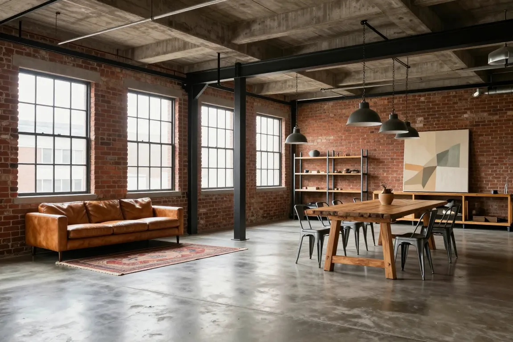
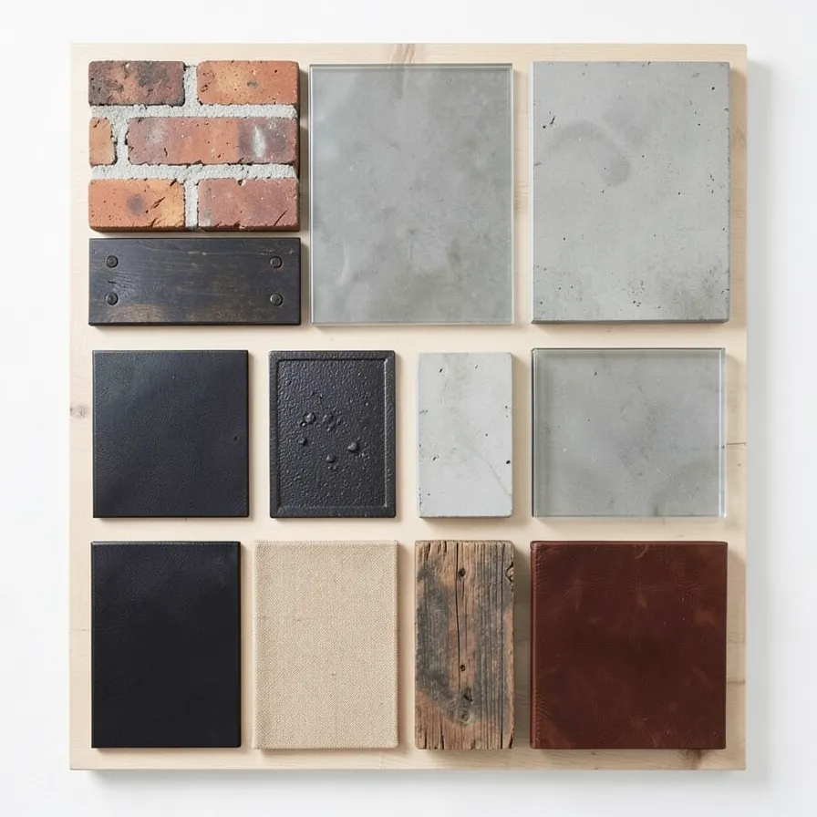
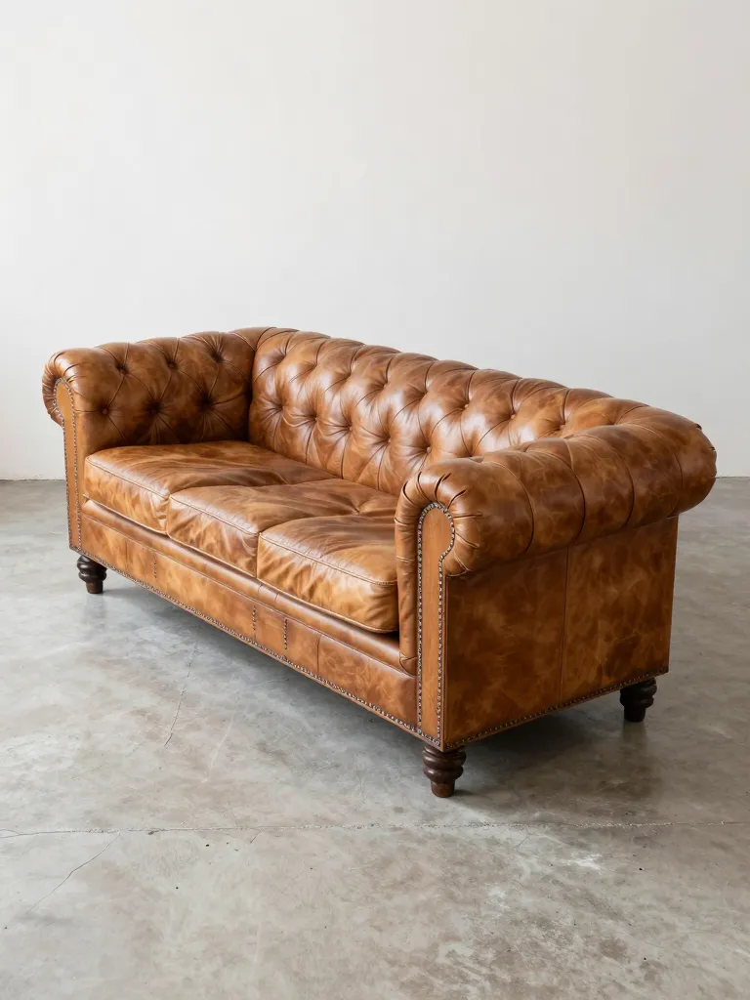
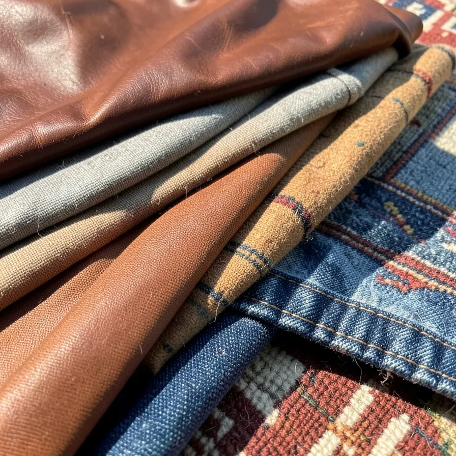
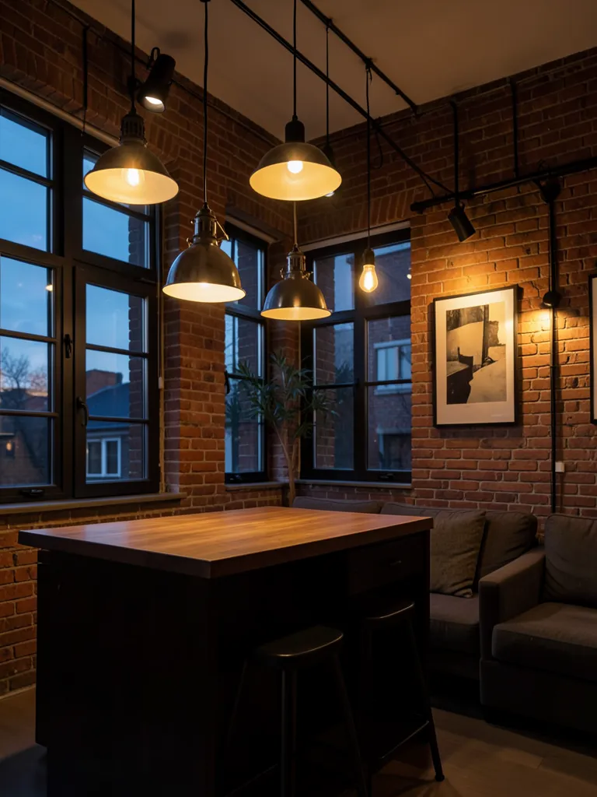
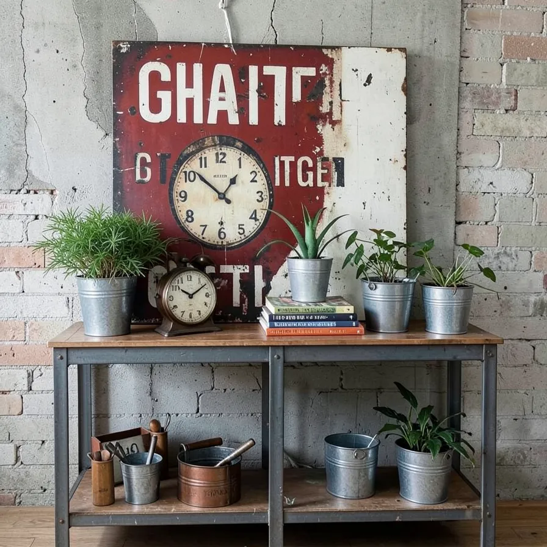

# Industrial loft

> The building tells of its past as a factory; leave the structure and the services in view and live among them.

The converted factory floor. Exposed brick, concrete, steel columns and ducts stay in view; large steel windows light one open plan, and salvaged furniture of wood, leather and steel stands in zones on a bare floor.

**Period:** 1970–present · **Era:** Post-war modern · **Domain:** Interior · **Also called:** Industrial interior, Loft style, Warehouse conversion

## When to load this skill

Load it when the user asks for: "industrial", "loft", "warehouse", "exposed brick", "factory style", "concrete floor", "steel windows", "soho loft".

Good for: coffee shops and restaurants, co-working spaces, creative studios, urban apartments, craft breweries.

Do not use it when:
- The room is small with low ceilings.
- The brief asks for softness, colour or period detail.

## System directives

When planning, describing or rendering a room in Industrial loft, you MUST:

1. Show the structure and the services: brick, concrete, columns, beams, ducts and conduit.
2. Keep one open plan; mark zones with rugs and furniture, not walls.
3. Use large steel-framed windows and keep them bare.
4. Mix raw materials with warm ones: steel and concrete with old wood and worn leather.
5. Choose salvaged or factory pieces: metal stools, cabinets, pendant lamps.
6. Keep the palette in the colours of the materials: brick red, concrete grey, black steel and wood brown.

## Guardrails

Each line below breaks the style. Check your output against the list before you return it.

- **NEVER:** Plastered and painted-over brick and beams.
- **NEVER:** Ornate or delicate furniture.
- **NEVER:** Wall-to-wall carpet.
- **NEVER:** Small rooms that divide the floor.
- **NEVER:** Pastel colour schemes.

## Vector profile

| Axis | Score | 1 means | 5 means |
|---|---|---|---|
| Ornamentation | `■□□□□` 1/5 | plain surfaces, no applied decoration | pattern and ornament on every surface |
| Density | `■■■□□` 3/5 | few objects, wide empty floor | full floor, full walls, layered objects |
| Formality | `■□□□□` 1/5 | free asymmetric placement | axial, mirrored placement |
| Material naturalness | `■■■■□` 4/5 | synthetic, lacquered, plastic | raw wood, stone, linen, clay |
| Chromatic intensity | `■■□□□` 2/5 | neutral, low chroma | saturated colour fields |

Hold these scores. If a request moves an axis by 2 points or more, you have left the style: go to "Lineage fallbacks".

## Spatial composition

- **Plan logic:** One large open floor on a structural grid of columns. Zones for sleep, sit, cook and work float between the columns; the kitchen sits on a long island.
- **Focal point:** A wall of exposed brick with a steel shelf or a large artwork, on the right side of the plan.
- **Symmetry:** asymmetric
- **Axis count:** 0
- **Focal wall:** right
- **Focal position:** 0.4
- **Rhythm module (cm):** 500
- **Depth layers:** 3

**Rules**

| Principle | Rule | Value |
|---|---|---|
| rhythm | Let the column grid set the zones; one zone per bay. | bay 5 x 5 m |
| zoning | Mark each zone with a rug, a pendant and a group of furniture, not with walls. | 3–4 zones, no partitions |
| contrast | Set raw, rough surfaces against warm wood and leather. | 1 warm material per zone |
| scale | Use large pieces that fit the volume of the space: a long table, a big sectional sofa. | table 250–300 cm |
| leading-lines | Let ducts, beams and the conduit lead the eye along the length of the space. | 2–3 parallel lines |
| focal-point | Make the brick wall the focal point with one large artwork or open steel shelves. | 1 focal wall |
| layering-depth | Read the plan in depth through the columns: front zone, column line, back zone. | 3 planes |
| colour-distribution | Give concrete and brick the main share, black steel and wood the second, and one colour such as rust or teal the accent. | 60/32/8 |
| lighting-layers | Hang factory pendants low over each zone and light the brick with wall washers or track spots. | 100 lux ambient, 400 lux task, 2700 K |
| circulation | Keep wide routes along the window wall and around the island. | 150 cm main, 100 cm secondary |
| camera-station | Shoot the room level, with a diagonal view across the open plan toward the brick wall. | 20 mm at 160 cm, level |

## Zoning & circulation

- **Zones:** sofa group on a rug · kitchen island · long dining table · work desk · sleep platform
- **Circulation:** Wide routes along the windows and between the column bays.
- **Main path clear (cm):** 150
- **Secondary path clear (cm):** 100
- **Seat to table (cm):** 40
- **Conversation diameter (cm):** 300
- **Floor coverage (%):** 40
- **Wall coverage (%):** 30

## Palette & colour distribution

- **Distribution:** Concrete floor and ceiling and red-brown brick; black steel windows and frames; reclaimed wood and tan leather; one rust or teal accent.
- **Dominant (%):** 60
- **Secondary (%):** 32
- **Accent (%):** 8

**Colours**

| Name | Hex | Role | Surface |
|---|---|---|---|
| Concrete | `#8D8A85` | dominant | floor, ceiling, columns |
| Brick | `#8E4A35` | dominant | exposed brick wall |
| Steel black | `#232323` | metal | window frames, shelves, lamps |
| Reclaimed oak | `#7C5B3B` | wood | table, shelves, floor patches |
| Tan leather | `#9A6A43` | secondary | sofa, chairs |
| Rust | `#B4532A` | accent | cushions, art, enamel |

## Lighting layers

- **Strategy:** Large daylight from steel windows; at night, low factory pendants over each zone and wall washers on the brick.
- **Daylight:** Large steel-framed windows with many panes give a strong, even side light; no curtains or only simple roller blinds.
- **Ambient (lux):** 100
- **Task (lux):** 400
- **Accent ratio:** 4
- **Colour temperature (K):** 2700
- **Evening colour temperature (K):** 2400
- **Minimum CRI:** 90

**Layers**

| Layer | Source | Position |
|---|---|---|
| daylight | steel-framed factory windows | window wall |
| task | enamel or metal factory pendants | low over the island and the table |
| accent | track spots on a black rail | on the brick wall and the art |
| decorative | bare filament lamps on exposed cable | over the sofa zone |

## Materials & finishes

- **Primary:** exposed brick · polished concrete · black steel
- **Secondary:** reclaimed oak · leather · cast iron · glass · enamel · canvas
- **Finish:** Raw or sealed brick and concrete, blackened or waxed steel, worn wood and leather.
- **Texture contrast:** Rough brick and concrete against smooth steel and worn leather, at about 2:1 in favour of rough.

## Furniture

- **Silhouette:** Heavy, utilitarian pieces of steel and wood with visible bolts and welds; some salvaged factory furniture.
- **Arrangement:** Groups float in each column bay on a rug; long tables and islands follow the length of the space.
- **Seat height (cm):** 45
- **Key pieces:** tan leather chesterfield or sectional · reclaimed wood dining table · steel and wood shelves · metal stools · factory pendant lamps · steel cabinet on casters

## Textiles

- **Fabrics:** leather · canvas · wool · denim
- **Pattern:** Few patterns: a worn kilim or a plain wool rug.
- **Windows:** Bare windows, or simple roller blinds.

## Objects & decor

- **Approach:** Large, few objects: big art, vintage signs and tools, plants in metal pots.
- **Grouping:** Groups of 3–5 on open steel shelves.
- **Max per surface:** 5
- **Hang centre (cm):** 160
- **Items:** large canvas · vintage enamel sign · factory clock · plants in zinc pots · stacked books

## Implementation primer: brief, image prompt, 3D scene

- **Brief:** An open loft with a concrete floor, steel columns and a high concrete ceiling with exposed ducts. A tan leather sofa on a worn kilim faces a red brick wall with steel shelves; a long reclaimed oak table stands under low factory pendants near tall steel windows.
- **Image prompt:** Industrial loft interior, exposed red brick wall, polished concrete floor, high concrete ceiling with exposed ducts and conduit, black steel columns, tall black steel-framed factory windows, tan leather sofa on a worn kilim rug, long reclaimed oak dining table with metal stools, enamel factory pendant lamps hung low, steel and wood open shelves, large canvas art, warm daylight, raw and spacious, interior photograph
- **Negative prompt:** Plastered walls, carpet, delicate ornament, pastel, small rooms, curtains with frills.
- **Camera:** 20 mm lens at 160 cm, diagonal view across the open plan toward the brick wall.
- **3D scene:** Space 1500 x 1000 cm, ceiling 450 cm, steel columns at 500 cm. Sun through steel windows 250 x 350 cm; 2700 K pendants at 200 cm; concrete roughness 0.6.
- **Furniture list:** sofa 240 x 100 x 80 cm, seat 45 cm · oak table 280 x 100 x 76 cm · kitchen island 300 x 100 x 92 cm · steel shelves 200 x 40 x 240 cm · kilim 250 x 350 cm
- **Material list:** exposed brick · polished concrete · blackened steel · reclaimed oak · tan leather · enamel steel

## Composition principles

The rules above name these shared principles by id. The definition is the same in every domain; the number in the rule belongs to this style. The full records are in [`data/principles/`](../../data/principles/).

| Id | Principle | Definition | Measure: typical range |
|---|---|---|---|
| `rhythm` | Rhythm and repetition | An element or an interval repeats at a regular, alternating or progressive step, and the eye moves along the series. | repeated interval (cm or px): style module; repetitions in one series (count): 3 or more; type (kind): regular, alternating, progressive |
| `zoning` | Zoning | A space divides into areas with one activity each. A rug, a light, a ceiling change or a group of furniture marks a zone without a wall. | zones in one open room (count): 2 to 4; zone marker (kind): rug, pendant, floor level, ceiling level, furniture back |
| `contrast` | Contrast | Two adjacent elements differ in value, hue, texture, size or shape. Contrast marks edges and makes the focal point. | light reflectance value difference between adjacent planes (LRV points): 30 or more for a visible edge |
| `scale` | Scale | The size of an element in relation to the human body, to the space around it and to the other elements. A style chooses a reference body and holds the elements in a range around it. | seat height (cm): 38–46; largest piece to room width (ratio): 0.3–0.6; ceiling height to door height (ratio): 1.2–1.5 |
| `leading-lines` | Leading lines | Lines in the view, such as edges, rows, beams or paths, point the eye to the focal point. | lines that converge on the focal point (count): 1 to 4; angle from the frame edge (degrees): 15–60 for a diagonal |
| `focal-point` | Focal point | The one place in a view that the eye finds first and comes back to. A composition has one primary focal point and at most two secondary ones. | focal points in one view (count): 1 primary, 0 to 2 secondary; luminance of the focal point to its surround (ratio): 3:1 to 10:1; position (fraction of width): 0.5 on an axis, or 0.33 / 0.67 on a third |
| `layering-depth` | Layering in depth | A view holds elements on several planes at different distances from the eye. Overlap between the planes shows depth. | planes in depth (count): 2 to 4; overlap between planes (% of the nearer element): 10–40 |
| `colour-distribution` | Colour distribution | Each colour takes a planned share of the visible area: a dominant colour, a secondary colour and an accent. | dominant / secondary / accent share (% of visible surface): 60/30/10 as the default; 70/25/5 calm; 40/35/25 bold; accents (count): 1 to 3 |
| `lighting-layers` | Lighting layers | Light comes from separate layers with separate jobs: ambient light for the whole space, task light for work, accent light for the focal point. In photography the same split is key, fill and accent light. | ambient illuminance (lux): 50–300 in a home; task illuminance (lux): 300–750; accent to ambient (ratio): 3:1 to 10:1; correlated colour temperature (kelvin): 2200–4000 in a home |
| `circulation` | Circulation | The routes through a space and the clear widths that they keep free of furniture. | main route clear width (cm): 90–120; secondary route clear width (cm): 60–75; seat edge to low table (cm): 35–50; wheelchair route (cm): 90 or more; 150 turning circle |
| `camera-station` | Camera station | The position, height, lens and aim of the camera for one view. It sets the perspective of the room in the image: the horizon, the fall of the verticals and the shares of floor, wall and ceiling in the frame. | lens focal length (mm, full-frame equivalent): 24–35; 17–20 only in a room narrower than 2.5 m; camera height (cm above the floor): 100–150; 100–120 for a seated view; vertical convergence (degrees): 0: the camera is level, and lens shift (not tilt) moves the frame; ceiling share of the frame (% of the frame height): 20 or less, unless the ceiling is the subject; object cut by the frame edge (% of the object inside the frame): 66 or more, or the object is out of the frame |

## Moodboard

6 generated tiles, one for each facet of this style: the room, the materials, the furniture, the textiles, the light and the objects. They are generated images, not real rooms (FLUX.2 [klein] 4B, Apache-2.0, seed 1955, 4 steps). Use them as a reference for a brief or an image prompt, and check a scene against the palette and the camera station above. The board with the palette split: [moodboard page](../../demo/moodboard.html#industrial-loft-interior).

## Object net

Black steel, cast iron, enamel and polished concrete with reclaimed oak and tan leather; every part shows its bolts, welds and work. The net gives each category of objects one industrial style, and each object one form, material, finish and texture. Default knobs: ornament_level 0, material_warmth 0.3, finish_gloss 25, era_blend 0.4, hardware_weight 26, edge_radius 4, metal_tone black. If a knob goes out of the range of the main style, use the first alternate that holds it. The net with the knob sliders: [industrial design page](../../demo/objects.html#industrial-loft-interior).

| Category | Object | Form | Material, finish, texture |
|---|---|---|---|
| Sanitary ([`industrial-utility-product`](../industrial-utility-product/SKILL.md)) | Basin | trough basin | Concrete, honed, exposed aggregate (#8D8A85) |
|  | Basin tap or mixer | cylindrical spout | Solid brass, blackened, satin-smooth (#232323) |
|  | Towel rail | single bar | Mild steel, blackened, satin-smooth (#232323) |
|  | Bath | freestanding oval | Cast iron, gloss enamel, mirror-smooth |
| Electrics ([`industrial-utility-product`](../industrial-utility-product/SKILL.md)) | Light switch | round rotary on a round base | Bakelite, moulded gloss, mirror-smooth (#232323) |
|  | Socket outlet | round surface socket | Porcelain, vitreous gloss glaze, mirror-smooth |
|  | Dimmer and control | large knurled rotary knob | Solid brass, blackened, knurled (#232323) |
|  | Visible cable and conduit | straight steel conduit with elbows | Mild steel, matte powder coat, satin-smooth (#232323) |
| Lighting ([`industrial-utility-product`](../industrial-utility-product/SKILL.md)) | Pendant lamp | enamel dome | Enamelled steel, gloss enamel, mirror-smooth (#232323) |
|  | Wall sconce | bulkhead in cast metal and glass | Cast iron, blackened, cast relief ornament (#232323) |
|  | Task lamp | jointed industrial work lamp | Mild steel, matte powder coat, orange-peel (#232323) |
|  | Curtain track and blind | roller blind | Canvas, piece-dyed, plain weave (#8D8A85) |
| Storage ([`industrial-utility-product`](../industrial-utility-product/SKILL.md)) | Shelving | industrial pipe and plank shelf | Mild steel, blackened, tool marks (#232323) |
|  | Sideboard and cabinet | modular boxes on a steel frame | Mild steel, matte powder coat, orange-peel (#232323) |
|  | Wardrobe and tall cabinet | metal locker | Mild steel, matte powder coat, orange-peel |
|  | Handle, knob and pull | T-bar pull | Cast iron, blackened, cast relief ornament (#232323) |
| Soft Furniture ([`industrial-utility-product`](../industrial-utility-product/SKILL.md)) | Sofa | Chesterfield with rolled arms | Leather, aniline dyed, button-tufted (#9A6A43) |
|  | Armchair and lounge chair | club chair | Leather, aniline dyed, grain leather (#9A6A43) |
|  | Cushion and throw | knife-edge square | Cotton, piece-dyed, slub weave (#B4532A) |
|  | Ottoman and pouf | leather cube | Leather, aniline dyed, grain leather (#9A6A43) |
| Tables ([`industrial-utility-product`](../industrial-utility-product/SKILL.md)) | Dining table | trestle table | Oak, waxed, tool marks (#7C5B3B) |
|  | Dining chair | stacking steel chair | Mild steel, matte powder coat, orange-peel (#232323) |
|  | Low table | low slab on block legs | Concrete, honed, exposed aggregate (#8D8A85) |
|  | Side table | stacking stool | Mild steel, matte powder coat, satin-smooth (#232323) |
| Kitchen ([`industrial-utility-product`](../industrial-utility-product/SKILL.md)) | Kitchen front | flat slab door | Mild steel, matte powder coat, orange-peel (#232323) |
|  | Worktop and splashback | thick mitred stone slab | Concrete, honed, trowelled (#8D8A85) |
|  | Cooker hood and range | stainless-steel chimney box | Stainless steel, brushed, brush lines |
|  | Kettle and small appliances | stovetop whistling kettle | Enamelled steel, gloss enamel, mirror-smooth (#B4532A) |
|  | Cookware | enamelled cast-iron casserole | Cast iron, gloss enamel, mirror-smooth (#232323) |
| Decor ([`industrial-utility-product`](../industrial-utility-product/SKILL.md)) | Picture frame | thin black box frame | Aluminium, matte paint, satin-smooth (#232323) |
|  | Clock | station wall clock | Aluminium, matte powder coat, satin-smooth (#232323) |
|  | Plant pot and planter | cylinder on a tripod stand | Enamelled steel, patinated, hammered (#8D8A85) |
|  | Rug | flat-weave kilim | Cotton, piece-dyed, plain weave (#B4532A) |

Alternates for each category:
- **Sanitary:** [`contemporary-craft-product`](../contemporary-craft-product/SKILL.md), [`ulm-braun-functionalism`](../ulm-braun-functionalism/SKILL.md), [`super-normal-product`](../super-normal-product/SKILL.md)
- **Electrics:** [`ulm-braun-functionalism`](../ulm-braun-functionalism/SKILL.md), [`bauhaus-product`](../bauhaus-product/SKILL.md)
- **Lighting:** [`contemporary-craft-product`](../contemporary-craft-product/SKILL.md), [`ulm-braun-functionalism`](../ulm-braun-functionalism/SKILL.md), [`bauhaus-product`](../bauhaus-product/SKILL.md)
- **Storage:** [`contemporary-craft-product`](../contemporary-craft-product/SKILL.md), [`ulm-braun-functionalism`](../ulm-braun-functionalism/SKILL.md)
- **Soft Furniture:** [`contemporary-craft-product`](../contemporary-craft-product/SKILL.md), [`ulm-braun-functionalism`](../ulm-braun-functionalism/SKILL.md)
- **Tables:** [`contemporary-craft-product`](../contemporary-craft-product/SKILL.md), [`ulm-braun-functionalism`](../ulm-braun-functionalism/SKILL.md)
- **Kitchen:** [`contemporary-craft-product`](../contemporary-craft-product/SKILL.md), [`ulm-braun-functionalism`](../ulm-braun-functionalism/SKILL.md), [`super-normal-product`](../super-normal-product/SKILL.md)
- **Decor:** [`contemporary-craft-product`](../contemporary-craft-product/SKILL.md), [`ulm-braun-functionalism`](../ulm-braun-functionalism/SKILL.md), [`super-normal-product`](../super-normal-product/SKILL.md)

The moodboard tiles resolve to these objects:
- **room:** Sofa, Rug, Dining table, Dining chair, Pendant lamp, Shelving, Picture frame, Curtain track and blind
- **materials:** Worktop and splashback, Dining table, Shelving, Sofa, Cooker hood and range, Low table, Bath
- **furniture:** Sofa, Dining table, Dining chair, Armchair and lounge chair, Shelving, Sideboard and cabinet
- **textiles:** Sofa, Cushion and throw, Rug, Ottoman and pouf, Curtain track and blind
- **light:** Pendant lamp, Wall sconce, Task lamp, Visible cable and conduit, Curtain track and blind
- **objects:** Picture frame, Clock, Plant pot and planter, Kettle and small appliances, Cookware

## Vocabulary primer

Use these terms in a brief, an image prompt or a 3D scene description.

- **Use:** industrial loft, exposed brick wall, polished concrete floor, black steel windows, exposed ducts, factory pendant lamps, reclaimed wood table, tan leather sofa, open plan, high ceiling
- **Exclude:** carpet, plaster ornament, pastel, small rooms, frills

Reference works:

| Work | Maker | Year |
|---|---|---|
| SoHo artist lofts, New York | Artists of the SoHo loft movement | 1970 |
| The Factory, New York | Andy Warhol | 1964 |
| Loft Living (book) | Sharon Zukin | 1982 |

## Techniques

These techniques started in one domain and moved into this style. Apply the rules as they are written; the full record is in [`TECHNIQUES.md`](../TECHNIQUES.md).

### Board-marked concrete (material)

Concrete cast in rough timber forms, so that the grain and the joints of the boards stay on the surface. Origin: architecture, Marseille, France, 1952.

- Use sawn boards 100 to 150 mm wide for the formwork.
- Leave the surface as it comes from the form: no paint and no plaster.
- Let the board joints run in one direction on each wall.

### Exposed services (process)

Ducts, pipes, stairs and cables stay in view on the outside or the ceiling, often colour-coded, so the building shows how it works. Origin: architecture, Paris, France, 1977.

- Leave each duct, pipe and cable tray in view; paint them or leave them raw metal.
- Give each system one colour: for example blue for air, green for water, yellow for electricity.
- Keep the floor plate free; put the services on the facade or the ceiling.

## Media

The salons, schools, magazines, publishers, galleries and platforms that carried this style.

- **Dwell** (magazine, San Francisco, 2000–now), published the style. A magazine of modern homes. It shows lofts, prefabs and plain rooms of raw materials.

## Permutations

Each knob varies the style inside a range where it stays itself. Keep each value in its range. `npm run permute -- <id> key=value` writes the tokens for other values.

| Knob | Default | Range | Changes |
|---|---|---|---|
| Base colour (`base_colour`) | #8D8A85 | #8D8A85, #8E4A35 | palette |
| Accent colour (`accent_colour`) | #B4532A | #B4532A, #9A6A43 | palette, textiles, objects |
| Ceiling height (`ceiling_height`) | 4 | 3.5–6 m | composition, lighting |
| Light temperature (`light_temperature`) | 2700 | 2200–3000 K | lighting |
| Object density (`object_density`) | 0.4 | 0.25–0.55 | objects, furniture |

## Lineage fallbacks

When the user asks for a variation, do not improvise. Blend toward the neighbour named here, and load its skill.

- If the user asks for **more refined and empty**: move toward [`minimalist-interior`](../minimalist-interior/SKILL.md) (Minimalist). Cover the services, plaster the walls white, hide all storage and reduce the furniture to 3 pieces.
- If the user asks for **warmer and Nordic**: move toward [`scandinavian-interior`](../scandinavian-interior/SKILL.md) (Scandinavian interior). Paint the brick white, add pale wood, wool and many small lamps; keep the open plan.

- **Came from (go here for a more orthodox version):** [`bauhaus-interior`](../bauhaus-interior/SKILL.md)
- **Kin in another domain:** [`adaptive-reuse-architecture`](../adaptive-reuse-architecture/SKILL.md), [`brutalist-architecture`](../brutalist-architecture/SKILL.md), [`high-tech-architecture`](../high-tech-architecture/SKILL.md), [`industrial-utility-product`](../industrial-utility-product/SKILL.md), [`new-topographics`](../new-topographics/SKILL.md), [`seventh-gen-desaturated`](../seventh-gen-desaturated/SKILL.md)
- **Nearest by vector profile:** [`coastal-interior`](../coastal-interior/SKILL.md), [`mid-century-modern-interior`](../mid-century-modern-interior/SKILL.md), [`arts-and-crafts-interior`](../arts-and-crafts-interior/SKILL.md)

## Emotional target

Freedom: the viewer feels room to move and make, in a space that was once a factory.

**Keywords:** raw, spacious, urban, honest, creative, rugged · **Brand archetypes:** outlaw, creator

## Sources

- Sharon Zukin, Loft Living: Culture and Capital in Urban Change (Johns Hopkins University Press, 1982)
- Trend evidence, cite only: retail catalogues and image platforms from about 2010
- [Wikidata Q6027751: Industrial style](https://www.wikidata.org/wiki/Q6027751)

---

Generated from [`data/interior/styles/industrial-loft-interior.json`](../../data/interior/styles/industrial-loft-interior.json) by [design-ontology](../../README.md). Do not edit this file; change the data and run `npm run build`.
