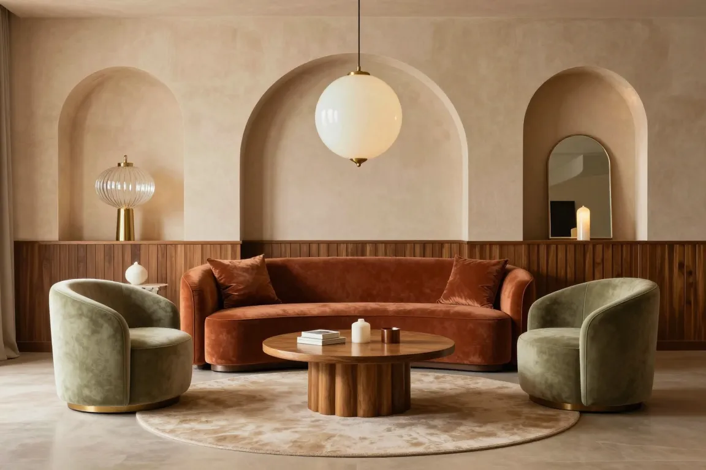
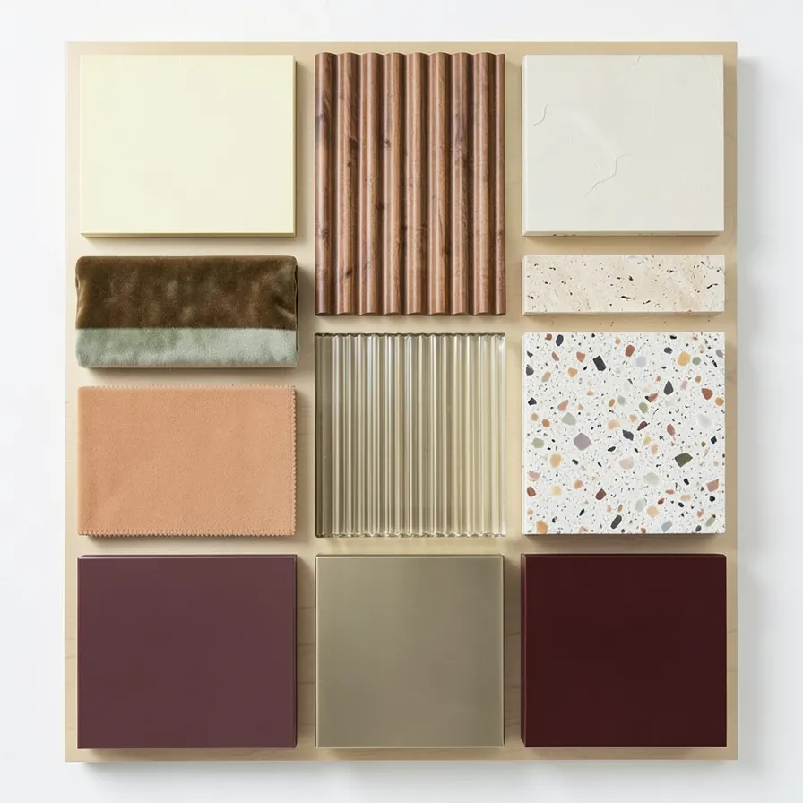
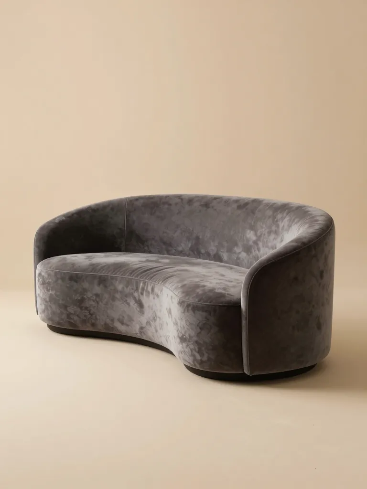
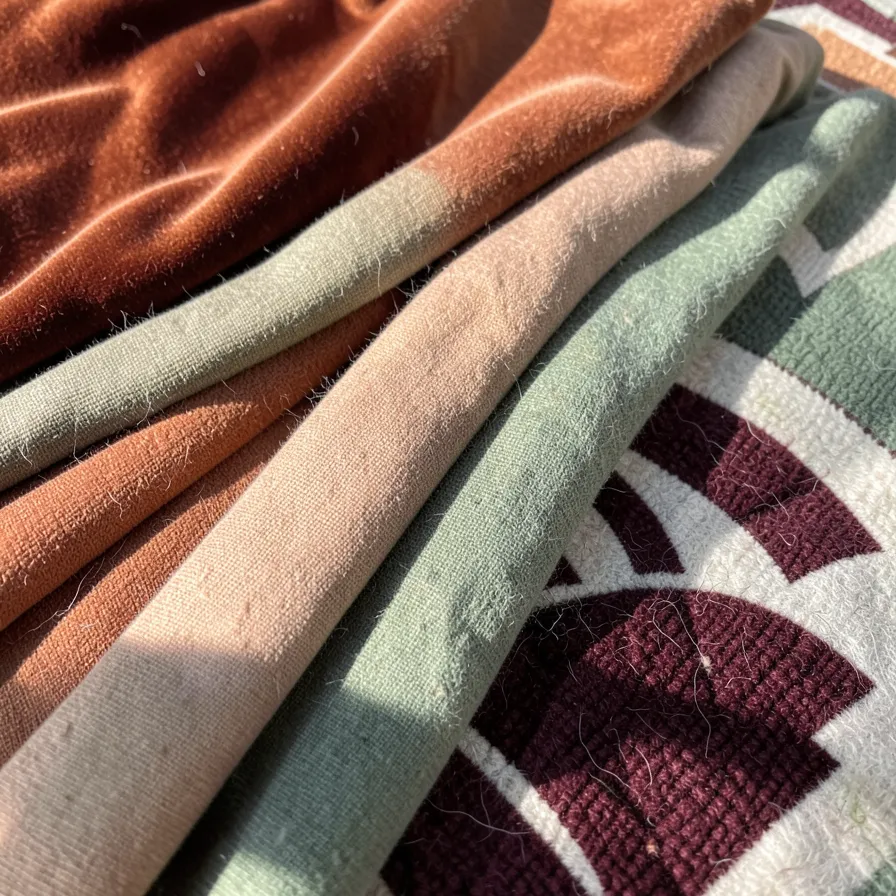
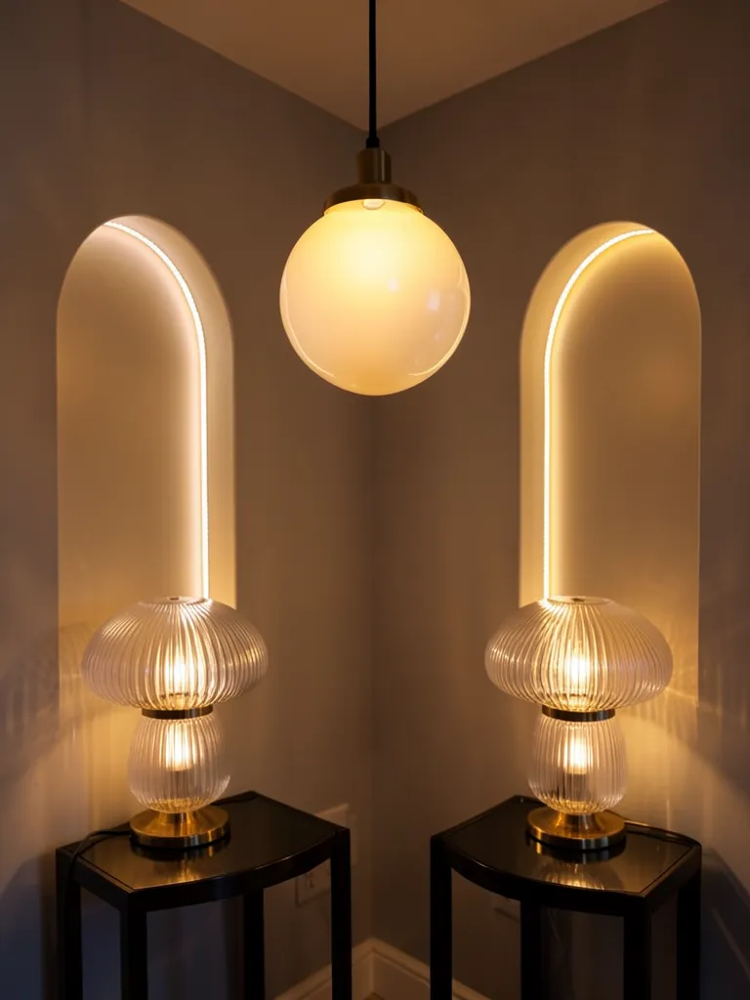
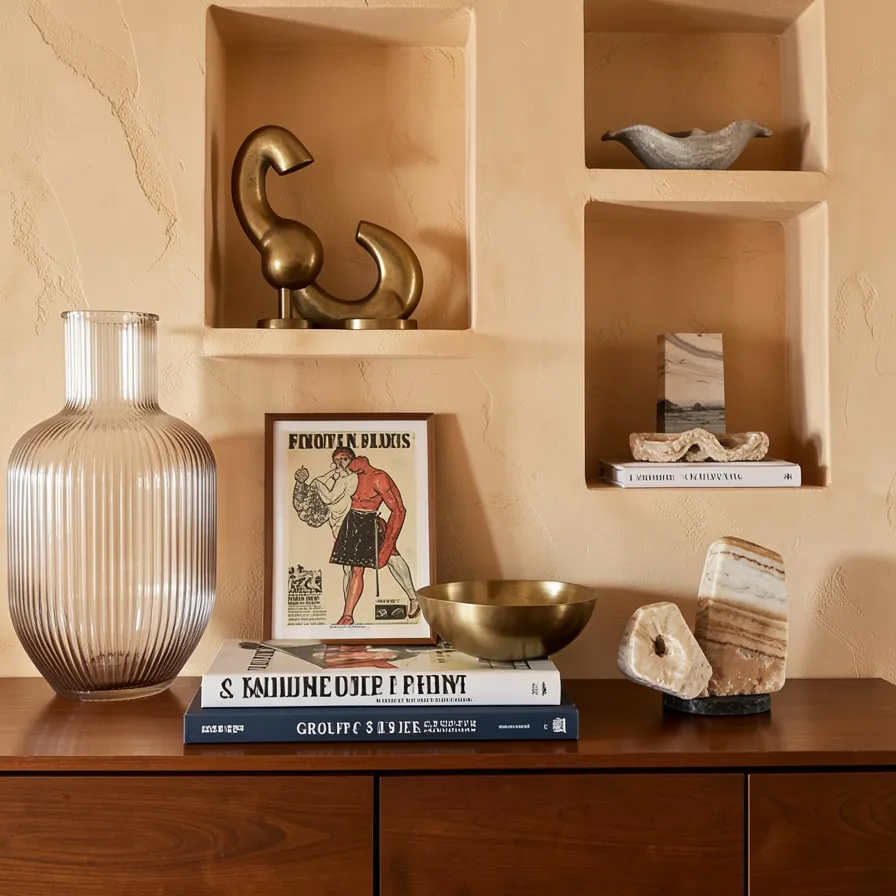

# Neo-deco

> Deco glamour without the hard edges: curves, ribs and warm metal make luxury feel soft and personal.

Art Deco after a century, made soft. Curved bouclé and velvet seats, fluted wood, arches, ribbed glass and brushed brass keep the geometry and the glamour of the 1920s, but in warm, muted colours and rounded forms.

**Period:** 2020–present · **Era:** Networked home · **Domain:** Interior · **Also called:** Art Deco revival, New Deco, Modern Deco

## When to load this skill

Load it when the user asks for: "neo deco", "new deco", "modern art deco", "curved sofa", "fluted wood", "arched niche", "boucle", "deco revival".

Good for: restaurants and bars, boutique hotels, beauty salons, living rooms, fashion retail.

Do not use it when:
- The brief asks for a rustic or technical room.
- The budget does not allow curved custom upholstery.

## System directives

When planning, describing or rendering a room in Neo-deco, you MUST:

1. Round every form: curved sofas, arched mirrors and doorways, pill-shaped tables.
2. Use ribs and flutes as the main ornament: fluted wood, reeded glass, ribbed plaster.
3. Keep the palette warm and muted: terracotta, sage, ochre, burgundy and cream with brushed brass.
4. Place one curved seat group in the centre of the room, not against the walls.
5. Use one or two glamorous materials, such as velvet and brass, with matt plaster.
6. Light with globe and mushroom lamps and with arched niches lit from inside.

## Guardrails

Each line below breaks the style. Check your output against the list before you return it.

- **NEVER:** Sharp-cornered, rectilinear furniture.
- **NEVER:** High-gloss black lacquer on large walls.
- **NEVER:** Cold blue light.
- **NEVER:** Rustic, raw finishes.
- **NEVER:** Saturated primary colours.

## Vector profile

| Axis | Score | 1 means | 5 means |
|---|---|---|---|
| Ornamentation | `■■■■□` 4/5 | plain surfaces, no applied decoration | pattern and ornament on every surface |
| Density | `■■■□□` 3/5 | few objects, wide empty floor | full floor, full walls, layered objects |
| Formality | `■■■■□` 4/5 | free asymmetric placement | axial, mirrored placement |
| Material naturalness | `■■□□□` 2/5 | synthetic, lacquered, plastic | raw wood, stone, linen, clay |
| Chromatic intensity | `■■■□□` 3/5 | neutral, low chroma | saturated colour fields |

Hold these scores. If a request moves an axis by 2 points or more, you have left the style: go to "Lineage fallbacks".

## Spatial composition

- **Plan logic:** An open room with a curved seat group that floats in the centre on a round rug. Arched niches and a fluted wall frame it; the rest stays calm.
- **Focal point:** A curved velvet sofa and a round fluted table on a round rug in the centre of the room.
- **Symmetry:** radial
- **Axis count:** 1
- **Focal wall:** centre
- **Focal position:** 0.5
- **Rhythm module (cm):** 4
- **Depth layers:** 2

**Rules**

| Principle | Rule | Value |
|---|---|---|
| focal-point | Float a curved seat group in the centre of the room on a round rug. | 1 centre group |
| rhythm | Repeat flutes and ribs on wood, glass and plaster at a fine pitch. | 4 cm flute pitch |
| unity-variety | Repeat the arch and the circle at 3 scales: doorway, mirror and table. | 1 motif, 3 scales |
| symmetry-axis | Centre the arched niches or the mirror on the seat group, but let the loose pieces stay free. | 1 axis |
| contrast | Keep contrast medium: warm muted tones with brass highlights. | LRV difference 30–40 |
| framing | Frame doors, mirrors and shelves with arches. | semicircular head, radius = 1/2 width |
| colour-distribution | Give a warm plaster tone the walls, one muted colour the upholstery and brass and dark wood the accents. | 60/30/10 |
| lighting-layers | Use globe and mushroom lamps and light the niches from inside; keep the ceiling quiet. | 120 lux ambient, 300 lux task, 2700 K |
| circulation | Keep a ring route around the centre group. | 100 cm main, 75 cm secondary |
| camera-station | Shoot the room level, with a three-quarter view on the centre group with an arch behind it. | 28 mm at 120 cm, level |

## Zoning & circulation

- **Zones:** curved centre seat group · arched niche with bar or shelves · dining table · reading chair
- **Circulation:** A ring route around the round rug.
- **Main path clear (cm):** 100
- **Secondary path clear (cm):** 75
- **Seat to table (cm):** 40
- **Conversation diameter (cm):** 260
- **Floor coverage (%):** 45
- **Wall coverage (%):** 30

## Palette & colour distribution

- **Distribution:** Warm plaster walls; terracotta, sage or burgundy velvet and bouclé; fluted walnut; brushed brass in lamps and trims.
- **Dominant (%):** 60
- **Secondary (%):** 30
- **Accent (%):** 10

**Colours**

| Name | Hex | Role | Surface |
|---|---|---|---|
| Warm plaster | `#E8D8C4` | dominant | walls and arches |
| Terracotta | `#B5654A` | secondary | sofa, chairs |
| Sage | `#9AA585` | secondary | bouclé chairs, niches |
| Fluted walnut | `#5E3F2A` | wood | table, wall panels |
| Brushed brass | `#B39253` | metal | lamps, trims, legs |
| Burgundy | `#6F2B33` | accent | cushions, glass |

## Lighting layers

- **Strategy:** Soft globe light and lit niches; brass and ribbed glass make warm, diffuse sparkle.
- **Daylight:** Daylight through linen sheers on a curved track; reeded glass screens soften it further.
- **Ambient (lux):** 120
- **Task (lux):** 300
- **Accent ratio:** 3
- **Colour temperature (K):** 2700
- **Evening colour temperature (K):** 2400
- **Minimum CRI:** 95

**Layers**

| Layer | Source | Position |
|---|---|---|
| decorative | opal glass globe pendant with brass | over the centre group |
| task | mushroom table lamp in ribbed glass | on side tables |
| accent | LED strip inside the arched niches | niches on the back wall |
| daylight | linen sheers on a curved track | window wall |

## Materials & finishes

- **Primary:** lime or Venetian plaster · fluted walnut · velvet and bouclé
- **Secondary:** brushed brass · reeded glass · travertine · terrazzo
- **Finish:** Matt plaster, satin wood, brushed metal; no high gloss on large surfaces.
- **Texture contrast:** Soft bouclé and velvet against ribbed wood and smooth plaster, at about 1:1.

## Furniture

- **Silhouette:** Curved and rounded pieces: crescent sofas, barrel chairs, pill and drum tables, all low and soft.
- **Arrangement:** One curved group floats in the centre on a round rug; arched shelves line one wall.
- **Seat height (cm):** 42
- **Key pieces:** curved velvet sofa · bouclé barrel chairs · round fluted coffee table · arched mirror · globe pendant · travertine side table

## Textiles

- **Fabrics:** velvet · bouclé · mohair · linen
- **Pattern:** Few patterns: a fan or arch motif on a rug, or a quiet geometric in one tone.
- **Windows:** Linen sheers on a curved track, floor to ceiling.

## Objects & decor

- **Approach:** A few sculptural pieces: ribbed glass, brass, travertine and one deco-style print.
- **Grouping:** Groups of 3 on niche shelves, curved and straight forms mixed.
- **Max per surface:** 3
- **Hang centre (cm):** 150
- **Items:** ribbed glass vase · brass bowl · travertine sculpture · deco poster print · coffee-table books

## Implementation primer: brief, image prompt, 3D scene

- **Brief:** A warm plaster room with arched niches and a fluted walnut wall. A curved terracotta velvet sofa, two sage bouclé barrel chairs and a round fluted table float on a round rug under an opal globe pendant.
- **Image prompt:** Neo-deco living room, warm plaster walls, arched lit niches, fluted walnut wall panel, curved terracotta velvet sofa, two sage boucle barrel chairs, round fluted wood coffee table on a round rug, opal glass globe pendant with brushed brass, ribbed glass mushroom lamp, arched mirror, travertine side table, warm muted palette, soft glamorous light, contemporary Art Deco revival, interior photograph
- **Negative prompt:** Sharp corners, black lacquer walls, cold light, rustic, primary colours, clutter.
- **Camera:** 28 mm lens at 120 cm, three-quarter view on the centre group with an arch behind it.
- **3D scene:** Room 600 x 500 cm, ceiling 280 cm. 2700 K globe pendant at 210 cm; 2400 K strips in 3 niches; velvet and bouclé with sheen 0.3.
- **Furniture list:** curved sofa 260 x 100 x 75 cm, seat 42 cm · 2 barrel chairs 75 x 75 x 70 cm · fluted table 100 cm round x 38 cm · round rug 300 cm · arched mirror 90 x 180 cm
- **Material list:** lime plaster, warm · walnut, fluted · terracotta velvet · sage bouclé · brushed brass · reeded glass · travertine

## Composition principles

The rules above name these shared principles by id. The definition is the same in every domain; the number in the rule belongs to this style. The full records are in [`data/principles/`](../../data/principles/).

| Id | Principle | Definition | Measure: typical range |
|---|---|---|---|
| `focal-point` | Focal point | The one place in a view that the eye finds first and comes back to. A composition has one primary focal point and at most two secondary ones. | focal points in one view (count): 1 primary, 0 to 2 secondary; luminance of the focal point to its surround (ratio): 3:1 to 10:1; position (fraction of width): 0.5 on an axis, or 0.33 / 0.67 on a third |
| `rhythm` | Rhythm and repetition | An element or an interval repeats at a regular, alternating or progressive step, and the eye moves along the series. | repeated interval (cm or px): style module; repetitions in one series (count): 3 or more; type (kind): regular, alternating, progressive |
| `unity-variety` | Unity and variety | Repeated materials, colours and shapes join the parts into one whole. A small, planned number of deviations keeps the whole alive. | materials or hues that repeat (count): 2 to 4; deliberate deviations (count): 1 to 2 |
| `symmetry-axis` | Symmetry and axis | An axis is a line that orders a composition. Symmetry places equal elements at equal distances on the two sides of the axis, or around a centre. | ordering axes (count): 0 to 3; mirrored mass about the axis (% of visual weight): 90–100 formal, 0–50 informal; type (kind): bilateral, radial, none |
| `contrast` | Contrast | Two adjacent elements differ in value, hue, texture, size or shape. Contrast marks edges and makes the focal point. | light reflectance value difference between adjacent planes (LRV points): 30 or more for a visible edge |
| `framing` | Framing | A nearer element, such as a doorway, an arch, a window or a branch, surrounds the subject and isolates it. | frame area (% of the view): 10–35; frame planes (count): 1 to 2 |
| `colour-distribution` | Colour distribution | Each colour takes a planned share of the visible area: a dominant colour, a secondary colour and an accent. | dominant / secondary / accent share (% of visible surface): 60/30/10 as the default; 70/25/5 calm; 40/35/25 bold; accents (count): 1 to 3 |
| `lighting-layers` | Lighting layers | Light comes from separate layers with separate jobs: ambient light for the whole space, task light for work, accent light for the focal point. In photography the same split is key, fill and accent light. | ambient illuminance (lux): 50–300 in a home; task illuminance (lux): 300–750; accent to ambient (ratio): 3:1 to 10:1; correlated colour temperature (kelvin): 2200–4000 in a home |
| `circulation` | Circulation | The routes through a space and the clear widths that they keep free of furniture. | main route clear width (cm): 90–120; secondary route clear width (cm): 60–75; seat edge to low table (cm): 35–50; wheelchair route (cm): 90 or more; 150 turning circle |
| `camera-station` | Camera station | The position, height, lens and aim of the camera for one view. It sets the perspective of the room in the image: the horizon, the fall of the verticals and the shares of floor, wall and ceiling in the frame. | lens focal length (mm, full-frame equivalent): 24–35; 17–20 only in a room narrower than 2.5 m; camera height (cm above the floor): 100–150; 100–120 for a seated view; vertical convergence (degrees): 0: the camera is level, and lens shift (not tilt) moves the frame; ceiling share of the frame (% of the frame height): 20 or less, unless the ceiling is the subject; object cut by the frame edge (% of the object inside the frame): 66 or more, or the object is out of the frame |

## Moodboard

6 generated tiles, one for each facet of this style: the room, the materials, the furniture, the textiles, the light and the objects. They are generated images, not real rooms (Z-Image-Turbo, Apache-2.0, seed 1955, 9 steps). Use them as a reference for a brief or an image prompt, and check a scene against the palette and the camera station above. The board with the palette split: [moodboard page](../../demo/moodboard.html#neo-deco-interior).

## Object net

Brushed brass, velvet, fluted walnut, ribbed glass and honed travertine give the 1920s geometry a soft, round form. Terracotta, sage and burgundy stay warm and muted. The net gives each category of objects one industrial style, and each object one form, material, finish and texture. Default knobs: ornament_level 0.5, material_warmth 0.5, finish_gloss 45, era_blend 0.6, hardware_weight 14, edge_radius 22, metal_tone brass. If a knob goes out of the range of the main style, use the first alternate that holds it. The net with the knob sliders: [industrial design page](../../demo/objects.html#neo-deco-interior).

| Category | Object | Form | Material, finish, texture |
|---|---|---|---|
| Sanitary ([`art-deco-product`](../art-deco-product/SKILL.md)) | Basin | console basin on legs | Marble, honed, veined (#E8D8C4) |
|  | Basin tap or mixer | cylindrical spout | Solid brass, brushed, fluted or reeded (#B39253) |
|  | Towel rail | ring | Solid brass, brushed, brush lines (#B39253) |
| Electrics ([`art-deco-product`](../art-deco-product/SKILL.md)) | Light switch | round rotary on a round base | Solid brass, brushed, knurled (#B39253) |
|  | Socket outlet | screwless flat plate | Solid brass, brushed, brush lines (#B39253) |
|  | Dimmer and control | large knurled rotary knob | Solid brass, brushed, knurled (#B39253) |
| Lighting ([`art-deco-product`](../art-deco-product/SKILL.md)) | Pendant lamp | opal globe | Opal glass, clear gloss, mirror-smooth (#E8D8C4) |
|  | Table lamp | mushroom lamp | Opal glass, acid-etched or sandblasted, etched or frosted (#E8D8C4) |
|  | Wall sconce | fan or shell in frosted glass | Frosted glass, acid-etched or sandblasted, etched or frosted (#E8D8C4) |
|  | Curtain track and blind | ceiling-recessed track | Wool, washed, soft, twill or herringbone (#E8D8C4) |
| Storage ([`art-deco-product`](../art-deco-product/SKILL.md)) | Sideboard and cabinet | low long credenza on tapered legs | Walnut, oiled, fluted or reeded (#5E3F2A) |
|  | Shelving | open bookcase | Walnut, oiled, fine close grain (#5E3F2A) |
|  | Handle, knob and pull | round mushroom knob | Solid brass, brushed, fluted or reeded (#B39253) |
| Soft Furniture ([`art-deco-product`](../art-deco-product/SKILL.md)) | Sofa | curved crescent sofa | Velvet, lustre pile, cut pile (#6F2B33) |
|  | Armchair and lounge chair | barrel chair | Mohair, piece-dyed, bouclé loops (#E8D8C4) |
|  | Ottoman and pouf | round pouf | Velvet, lustre pile, cut pile (#9AA585) |
|  | Cushion and throw | bolster | Velvet, lustre pile, cut pile (#B5654A) |
| Tables ([`contemporary-craft-product`](../contemporary-craft-product/SKILL.md)) | Low table | round drum with fluted sides | Walnut, oiled, fine close grain (#5E3F2A) |
|  | Side table | pedestal side table | Travertine, honed, porous or pitted (#E8D8C4) |
|  | Console table | demilune half-round | Travertine, honed, veined (#E8D8C4) |
|  | Dining chair | upholstered parsons chair | Leather, aniline dyed, grain leather (#B5654A) |
| Kitchen ([`contemporary-craft-product`](../contemporary-craft-product/SKILL.md)) | Kitchen front | fluted slab | Walnut, oiled, fluted or reeded (#5E3F2A) |
|  | Worktop and splashback | slim 12 mm stone slab | Limestone, honed, veined (#E8D8C4) |
|  | Cooker hood and range | plastered chimney hood | Plaster, matte paint, trowelled (#E8D8C4) |
|  | Tableware and glassware | hand-thrown bowls | Stoneware, matte glaze, throwing rings (#B5654A) |
| Decor ([`art-deco-product`](../art-deco-product/SKILL.md)) | Mirror | arched mirror | Mirror glass, silvered, mirror-smooth (#B39253) |
|  | Vase | faceted vase | Pressed glass, clear gloss, ribbed (#9AA585) |
|  | Bowl, tray and box | fruit bowl in wire or steel | Solid brass, brushed, satin-smooth (#B39253) |
|  | Picture frame | chevron or stepped moulding | Walnut, oiled, fluted or reeded (#5E3F2A) |
|  | Rug | geometric hand-tufted rug | Wool, piece-dyed, knotted pile (#B5654A) |

Alternates for each category:
- **Sanitary:** [`contemporary-craft-product`](../contemporary-craft-product/SKILL.md), [`mid-century-modern-product`](../mid-century-modern-product/SKILL.md)
- **Electrics:** [`contemporary-craft-product`](../contemporary-craft-product/SKILL.md)
- **Lighting:** [`contemporary-craft-product`](../contemporary-craft-product/SKILL.md), [`mid-century-modern-product`](../mid-century-modern-product/SKILL.md)
- **Storage:** [`contemporary-craft-product`](../contemporary-craft-product/SKILL.md), [`mid-century-modern-product`](../mid-century-modern-product/SKILL.md)
- **Soft Furniture:** [`contemporary-craft-product`](../contemporary-craft-product/SKILL.md), [`mid-century-modern-product`](../mid-century-modern-product/SKILL.md)
- **Tables:** [`art-deco-product`](../art-deco-product/SKILL.md), [`mid-century-modern-product`](../mid-century-modern-product/SKILL.md)
- **Kitchen:** [`art-deco-product`](../art-deco-product/SKILL.md), [`mid-century-modern-product`](../mid-century-modern-product/SKILL.md)
- **Decor:** [`contemporary-craft-product`](../contemporary-craft-product/SKILL.md), [`mid-century-modern-product`](../mid-century-modern-product/SKILL.md)

The moodboard tiles resolve to these objects:
- **room:** Sofa, Armchair and lounge chair, Low table, Rug, Mirror, Pendant lamp, Sideboard and cabinet
- **materials:** Sideboard and cabinet, Side table, Sofa, Basin tap or mixer, Wall sconce, Vase, Cooker hood and range
- **furniture:** Sofa, Armchair and lounge chair, Low table, Side table, Console table, Sideboard and cabinet
- **textiles:** Sofa, Armchair and lounge chair, Ottoman and pouf, Cushion and throw, Curtain track and blind, Rug
- **light:** Pendant lamp, Table lamp, Wall sconce
- **objects:** Vase, Bowl, tray and box, Picture frame, Mirror, Tableware and glassware

## Vocabulary primer

Use these terms in a brief, an image prompt or a 3D scene description.

- **Use:** neo-deco interior, curved velvet sofa, fluted walnut, arched niches, boucle barrel chairs, opal globe pendant, brushed brass, ribbed glass, terracotta and sage, round rug
- **Exclude:** sharp corners, black lacquer, cold light, rustic, primary colours

Reference works:

| Work | Maker | Year |
|---|---|---|
| Pierre Yovanovitch furniture | Pierre Yovanovitch | 2017 |
| India Mahdavi interiors | India Mahdavi | 2014 |

## Techniques

These techniques started in one domain and moved into this style. Apply the rules as they are written; the full record is in [`TECHNIQUES.md`](../TECHNIQUES.md).

### Checkerboard (motif)

A grid of squares in two alternate colours, on a floor, in a picture or on a surface. Origin: architecture, Italy, c. 1300.

- Use squares of one size: 300 to 600mm on a floor, or 1/8 to 1/16 of the width of a picture.
- Lay the grid at 45° to make a small room look wider, or at 0° to show the vanishing point.

### Fluting and reeding (motif)

Parallel grooves (flutes) or ridges (reeds) on a column, a panel, a leg or a sheet of glass. Origin: architecture, Greece, c. 600 BCE.

- Cut 16 to 24 flutes round a column, or set the grooves at 15 to 40mm centres on a flat panel.
- Run the flutes vertical to make a surface look taller.
- Use one fluted surface in each room as an accent.

### Sunburst (motif)

Rays from a disc or a half disc: a sign of light and of the new, on a facade, a gate, a mirror or a clock. Origin: architecture, Paris, 1925.

- Draw 12 to 36 rays from one centre; alternate long and short rays, or two finishes.
- Keep the centre disc at 15% to 30% of the full diameter.
- In a room, use one sunburst as the focal point of one wall.

## Organisations

The groups, studios, companies, schools, channels and backers that carried this style.

- **Architectural Digest** (magazine, Los Angeles, 1920–now), published the style. A magazine of interiors and houses. It published the homes of Hollywood stars and later the soft, curved rooms of new glamour.

## Permutations

Each knob varies the style inside a range where it stays itself. Keep each value in its range. `npm run permute -- <id> key=value` writes the tokens for other values.

| Knob | Default | Range | Changes |
|---|---|---|---|
| Base colour (`base_colour`) | #E8D8C4 | #E8D8C4, #9AA585 | palette |
| Accent colour (`accent_colour`) | #B5654A | #B5654A, #6F2B33, #B39253 | palette, textiles, objects |
| Ceiling height (`ceiling_height`) | 2.8 | 2.5–3.4 m | composition, lighting |
| Light temperature (`light_temperature`) | 2700 | 2400–3000 K | lighting |
| Object density (`object_density`) | 0.35 | 0.25–0.5 | objects, furniture |

## Lineage fallbacks

When the user asks for a variation, do not improvise. Blend toward the neighbour named here, and load its skill.

- If the user asks for **bolder and original**: move toward [`art-deco-interior`](../art-deco-interior/SKILL.md) (Art Deco). Add black lacquer, macassar ebony, chrome and a strict symmetric plan; sharpen the contrast.
- If the user asks for **quieter**: move toward [`quiet-luxury-interior`](../quiet-luxury-interior/SKILL.md) (Quiet luxury). Remove the colour, keep the curves in greige bouclé and travertine, and reduce the brass.

- **Came from (go here for a more orthodox version):** [`art-deco-interior`](../art-deco-interior/SKILL.md)
- **Rejects (the opposite pole; do not blend):** [`minimalist-interior`](../minimalist-interior/SKILL.md)
- **Mixes well with:** [`quiet-luxury-interior`](../quiet-luxury-interior/SKILL.md)
- **Kin in another domain:** [`art-deco-architecture`](../art-deco-architecture/SKILL.md), [`art-deco-product`](../art-deco-product/SKILL.md), [`art-deco-web`](../art-deco-web/SKILL.md)
- **Nearest by vector profile:** [`art-deco-interior`](../art-deco-interior/SKILL.md), [`hollywood-regency-interior`](../hollywood-regency-interior/SKILL.md), [`grandmillennial-interior`](../grandmillennial-interior/SKILL.md)

## Emotional target

Soft glamour: the viewer feels pampered and a little elegant, in a warm and rounded room.

**Keywords:** curved, warm, glamorous, soft, elegant, nostalgic · **Brand archetypes:** lover, creator

## Sources

- Trend evidence, cite only: design press and image platforms describe a deco revival from about 2020, a century after 1920
- [Wikidata Q125739188: Art Deco Revival](https://www.wikidata.org/wiki/Q125739188)

---

Generated from [`data/interior/styles/neo-deco-interior.json`](../../data/interior/styles/neo-deco-interior.json) by [design-ontology](../../README.md). Do not edit this file; change the data and run `npm run build`.
